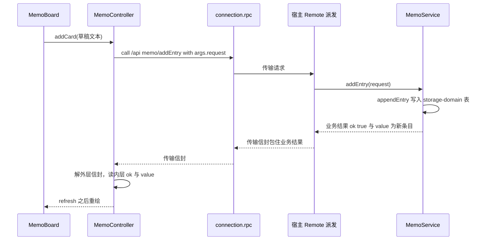
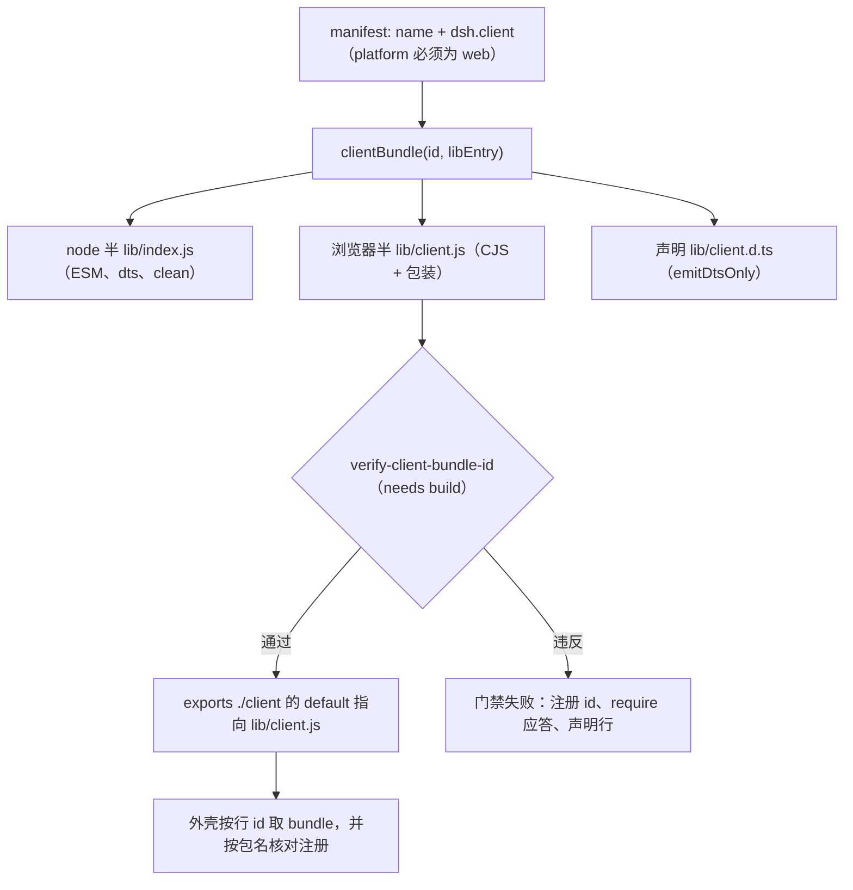
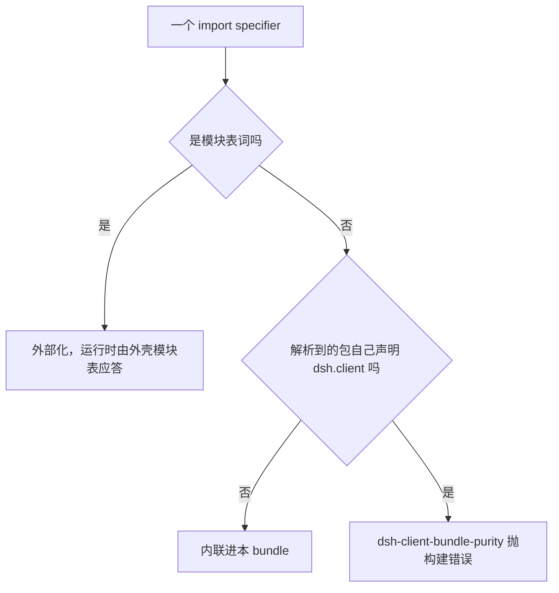

# 宿主 ⇄ 浏览器 Remote 契约

本仓库的每个「面板 + 服务」插件都由两个物理上分离、却必须严格对齐的产物组成：宿主侧一个 `TypertRemoteService` 子类（`MemoService`、`GithubIssueService`、`OpenWikiVisualizeService`），浏览器侧一个通过 `dsh.client` 声明被发现、经共享 preset 打包成 `lib/client.js` 的 CJS bundle。两侧没有共享的运行时对象、没有生成的 descriptor、也没有 import map——它们只共享一套**命名与包装约定**。这一页记录的就是这套约定：谁是方法名、谁是服务名、参数怎么绑、返回怎么套、bundle 怎么注册，以及哪些门禁会在契约被破坏时把构建打红。

四类失败恰好是这个线上契约的全部内容：Remote 方法缺少 `request` 形参、声明了两个以上形参、bundle 注册 id 与包名不一致、bundle 里出现既不是平台模块也没有被声明的 `require`。它们都不会在类型检查里报错，都只在真实宿主 + 真实浏览器里以「什么都没发生」的形式出现。

## 契约两端各发布什么

宿主半边负责**行为**，并且只通过两个可寻址的字面量对外发布：服务名与方法名。

| 宿主侧发布物 | 来源 | 浏览器侧对应的动作 |
|---|---|---|
| 服务名（Remote 命名空间） | 构造函数 `super(ctx, 'memo')` / `super(ctx, 'githubIssue')` / `super(ctx, SERVICE_KEY)` | 拼进 endpoint 的 `${service}/` 前缀 |
| 方法名 | `@Remote('addEntry')` 装饰的公开实例方法 | 拼进 endpoint 的 `${method}` 后缀 |
| 业务结果类型 | 方法返回 `{ ok: true, value } \| { ok: false, error }` | 读完传输信封后读内层 `ok` / `value` / `error` |
| —— | 没有 descriptor、没有 schema 文件、没有 codegen | 类型只靠各包 `./client` 的类型投影，运行时没有共享的类型对象可依 |

`@Remote` 只是把一个公开实例方法标注成「可按名寻址的端点」；方法体自己负责业务语义并返回业务结果，服务名由 `TypertRemoteService` 的构造函数绑定（它同时是 cordis 服务键与默认的 wire 命名空间）。同一个类里的私有方法天然没有传输面：`appendEntry` 是私有的，`readExternalPath` 干脆不注册 `@Remote`，因此它们没有任何请求能寻址的名字。

服务名本身没有任何共享对象作保：`'memo'` 在宿主 `super(ctx, 'memo')` 与浏览器 `callMemo` 里各写一份，`'openwikiVisualize'` 同样在宿主 `super(ctx, SERVICE_KEY)` 与浏览器控制器里各写一份（后者导出成 `SERVICE_KEY`）。两侧对齐靠约定与测试——openwiki 的 `tests/controller.spec.ts` 断言发出去的 endpoint 是 `` `${SERVICE_KEY}/status` ``——而不靠 import：浏览器包不能依赖宿主包，否则就把宿主运行时拖进 bundle。

浏览器半边负责**视图**：`@zhangj1164/dsh-client-ui-memo` 的 node 半边是一个空的 `apply()`，只为让插件出现在宿主的 cordis 组合里；真正的面板通过 `exports["./client"]` 交付，由 package.json 的 `dsh.client` 声明发现，并在 `apply(ctx)` 里从 `connection` 服务取到 `rpc` 后才有了调用能力。

### 声明一个浏览器半边需要哪几件事

1. **一个组合入口行。** 组合行 id（`ui-memo`、`ui-memo-settings`、`openwiki-visualize`）由某个 bundle 的 `cordis.patch.yml` 插入，`name` 指向包名。`dsh.client` 本身**不插入任何行**：`@zhangj1164/dsh-client-ui-memo` 没有 `dsh.bundle`，它的 `ui-memo` 行是由 `@zhangj1164/dsh-memo` 的 patch 插的；`@zhangj1164/dsh-client-ui-memo-settings` 与 `@zhangj1164/dsh-openwiki-visualize` 各自带 patch。
2. **`dsh.client` 声明。** 三个字段加一条身份规则，共同决定入口行在浏览器侧怎么落地：

```json
"dsh": {
  "client": {
    "inject": ["@deepseek-ai/dsh-client-connection", "..."],
    "platform": "web"
  }
}
```

- `platform`：只有 `web` 会被外壳组合；其它值连 `verify-client-bundle-id` 都直接跳过。
- `inject`：必须先于本行实例化的包行（装配顺序）；这些词同时进入该 bundle 的可应答集合。
- `external`：额外允许从模块表应答的精确 specifier。本仓库至今没有任何包声明它——跨包引用另一个插件浏览器半边的全是类型导入。
- **bundle 的注册 id 是包名**，而组合行 id 是另一个命名空间里的短名（`ui-memo` 这类）。两者都要对：外壳按行 id 抓取 bundle，而 bundle 里的 `window.__ModuleLoader__.load({ id })` 必须以**包名**注册，否则外壳只报 `bundle <url> loaded without registering "<id>"`——一条既不指出是哪个包、也不指出怎么修的报错。

### 两种 `inject` 不是一回事

同一个词在同一份清单/源码里承担两种互不相关的角色，混起来会得到「声明了依赖却仍然拿不到服务」或「服务有、require 答不上」的错觉：

| | `dsh.client.inject`（package.json） | `export const inject`（浏览器 `src/client/index.ts`） |
|---|---|---|
| 列的是什么 | **包行**：boot 顺序 + 模块表可应答词 | **cordis 服务键**：`apply()` 运行时能 `ctx.get` 到什么 |
| 本仓库取值 | memo 5 行、openwiki 4 行、memo-settings 2 行 | `['slots', 'layout', 'locale', 'theme', 'connection']` / `['slots', 'locale', 'configForms']` |
| 不写会怎样 | 装配顺序无保证，`require` 可能无法应答 | 服务缺失，`apply()` 里 `ctx.get('connection')` 得到 `undefined` 后直接返回 |

一个容易反推错的细节：声明了包行并不等于产物里一定有 `require`。`ui-memo-settings` 的 `dsh.client.inject` 声明了 `@deepseek-ai/dsh-client-ui-settings`，但对它的引用是类型导入，实到的 `lib/client.js` 只 `require("react")` 与 `require("react/jsx-runtime")`；openwiki 的 `inject` 写了四个行，产物同样只有这两个 `require`。`inject` 管装配顺序与可应答性，`require` 是打包结果，两者不必相等。

## 易混点：`exports['./client']` 是类型投影，`dsh.client` 才是浏览器半边

同一个导出键 `./client` 在本仓库承担两种完全不同的角色，决定权不在导出键上，而在 `dsh.client` 在不在：

| | `@zhangj1164/dsh-memo` | `@zhangj1164/dsh-client-ui-memo` |
|---|---|---|
| `exports['./client']` | `lib/client.js` + `lib/client.d.ts` | `lib/client.js` + `lib/client.d.ts` |
| `dsh.client` | **没有** | `platform: "web"` + 5 个 `inject` 行 |
| 那份 `src/client.ts` 是什么 | `export type * from './types.ts'`，纯类型投影 | 真正的面板入口，被打包成 wrap 过的 CJS |
| 在构建里的角色 | 不是 boot 行、不进模块表；preset 判其「无 client 半边」直接内联 | boot 行；`lib/client.js` 由外壳抓取并注册 |

`@zhangj1164/dsh-memo`（以及 `@zhangj1164/dsh-github-issue`）导出 `./client` 的唯一目的，是让浏览器代码从 `@zhangj1164/dsh-memo/client` 拿到 `MemoWeek`、`MemoEntry`、`MemoAddEntryRequest` 这类宿主类型而不复制一份。这个区别有两个直接后果：

- **测试必须绕开投影。** 根 `vitest.config.ts` 把 `@zhangj1164/dsh-memo`、`.../client`、`.../types`（以及 github-issue、telemetry 的同名面）统统 alias 到 TypeScript 源文件：运行时解析已发布的投影只会得到一个空模块，客户端测试会以一个毫不相干的错误失败。
- **`import type` 永远安全，值导入才是装配关系。** `@zhangj1164/dsh-client-ui-memo-settings` 在 `dsh.client.inject` 里声明了 `@deepseek-ai/dsh-client-ui-settings`（装配顺序），但对该包的引用是类型导入，所以产物里没有对应 `require`，也就不需要 `external` 行。

## 线上形状：按名绑定 + 单一 `request`

一次调用只有一个合法写法：

```ts
await rpc.call('/api', `${service}/${method}`, { args: { request } })
```

服务名来自 `super(ctx, 'memo')`，方法名来自 `@Remote('addEntry')`，参数**按名字**绑定——框架把 `args.request` 送到那个名叫 `request` 的形参上。于是浏览器侧只有一条规则、且必须是硬规则：**每个 Remote 方法声明且只声明一个名为 `request` 的参数**，即使它不接收任何输入。`{ args: { request } }` 之所以是唯一能工作的载荷形状，就是这个绑定方式的结果：换一个键名，宿主侧那个形参拿不到值；发一个位置数组，命名绑定无从下手。

不接收输入的方法也必须保留这个形参，`listArchivedQuarters`、`listArchivedSessions` 与 `listModels` 都是这么写的：

```ts
@Remote('listArchivedQuarters')
listArchivedQuarters(request: MemoListArchivedQuartersRequest): MemoListArchivedQuartersResult {
  void request
  ...
}
```

这条规则的代价已经用一次真实故障付过：`listArchivedQuarters` 曾完全不带参数，调用在方法体执行之前就被拒绝，宿主那边 13 个季度归档成功、客户端读回来永远为空，「归档」看起来像没做任何事。客户端测试用 fake RPC 应答、宿主测试直接 `ctx.memo.listArchivedQuarters()` 调方法（进程内省掉形参完全合法），裂缝正好落在两者之间，没有任何测试发现。现在 `tests/remote-signatures.spec.ts` 从源码里抽取每个 `@Remote('...')` 与其后的签名，断言 `request` 存在、且签名里没有第二个参数（第二个参数需要一个客户端根本不会发送的线上名字），并且先断言「扫到的方法数 > 10 且包含 `listArchivedQuarters`」，避免整份用例在重构后静默变成永远通过的空壳。

**这条不变式目前的执行范围只有 `dsh-memo`。** 扫描读的是写死的 `../src/index.ts`：同在仓库里的 `@zhangj1164/dsh-github-issue` 七个方法都遵守了规则但没有任何扫描盖住它，而 `@zhangj1164/dsh-openwiki-visualize` 有五个完全不带参数的 `@Remote` 方法——`environment()`、`status()`、`stop()`、`checkUpdate()`、`update()`——浏览器半边却照样按统一形状发 `{ args: { request: {} } }`，并由 `tests/controller.spec.ts` 把这份载荷原样断言下来。这两件事不可能同时对：要么宿主对「多出来的命名参数」是宽容的（那么 memo 那次故障的机制另有解释），要么这五个方法在线上根本到不了方法体。仓库里没有任何测试盖住这条缝（openwiki 的宿主测试 `service.environment()` 直接调方法，客户端测试用 fake RPC），两边都只证明了自己那一半；多个宿主方法用 `request?.field` 防御式读取，也无法用来判定框架实际传了什么。要信任这条规则，得把源码扫描从「一个包的 `src/index.ts`」扩到一个可枚举的宿主半边清单。

## 双层信封：传输层与业务层各有一个 `ok`

`rpc.call` 返回的不是方法的返回值，而是**传输信封**；方法自己返回的又是**业务结果**。两层都带 `ok`，所以线上形状是 `{ ok, value: { ok, value } }`：

| 层 | 形状 | 由谁产生 | 何时失败 |
|---|---|---|---|
| 传输层 | `{ ok, value?, error? }` | Connection 的 `/api` 通道 | 端点不存在、通道断掉、框架侧拒绝（包括参数绑定失败） |
| 业务层 | `{ ok: true, value } \| { ok: false, error: { code, message } }` | `@Remote` 方法体 | 输入非法、季度已归档、服务未挂载、模型调用失败等 |

`callRemote` 只解第一层：`envelope.ok && envelope.value !== undefined` 时把内层业务结果原样返回，否则用 `envelope.error` 合成失败（缺 code 时兜底 `transport-failure`），抛异常则返回 `rpc-failure`。调用方（controller 的各个动作）再读业务层——两层都不能省：只解一层会让加载器把一个数组当成 `{ ok }` 读，而把业务失败当成传输失败会让「quarter-archived」这类可操作的原因退化成一句通道错误。

## 一次看板点击走完整条链路



图里的每一步在源码里都能对上：`MemoBoard` 把草稿交给 `controller.addCard`；`addCard` 只有拿到 `targetWeek` 后才发 `callMemo(this.rpc, 'addEntry', { weekId, type: 'text', content })`；`callMemo` 只是把服务名固定成 `'memo'` 的 `callRemote`；`callRemote` 组装 `{ args: { request } }` 并解外层信封。宿主 `addEntry` 转发给私有的 `appendEntry`（`@Remote` 只在公开入口上，`originSessionId` 由 `summarizeSession` 单独设置，外部请求无法伪造来源），写库成功后返回 `{ ok: true, value: entry }`。注意这条链路里**没有** provider/model：路由由宿主按自己的 `Config` 或部署的 `agentDefaultModel` 解析，浏览器不猜。

失败时浏览器看到什么，取决于断在哪一层，而落点是同一个 `error` 字符串槽：

| 断点 | 浏览器读到的 `code` | 面板显示 |
|---|---|---|
| 季度已归档、`weekId` 非法等业务拒绝 | 宿主给的码，如 `quarter-archived`、`invalid-week-id` | 宿主写的那句话，卡片没被加上 |
| 通道断掉、端点不存在、框架拒绝参数绑定 | `envelope.error.code`，缺失时 `transport-failure` | `unknown transport error` 或通道原始信息，看起来像网络问题 |
| `rpc.call` 抛异常 | `rpc-failure` | 异常文本 |

第三行与第一行最容易被混为一谈：`addCard` 对两者做的是同一件事——`if (!result.ok) this.set({ error: result.error.message })`——所以「归档了所以不能写」和「通道坏了」在界面上只差一句文案，`code` 才是唯一可靠的区分。`listArchivedQuarters` 那次故障更隐蔽：`readArchivedQuarters` 把任何失败折叠成空集合加 `ok: false`，`refresh()` 再用一句固定警告 `the archived quarters could not be read; cards are shown as editable` 把「读不到」与「没归档」区分开——因为归档状态读不到时，卡片会被当成可编辑的。

## 控制器：浏览器侧只有「形状」被共享

两侧没有共享客户端 SDK：唯一被复用的形状是一个**结构类型**，每个包各自再写一份自己的包装函数。

- `RpcCaller` 是 `{ call(channel, endpoint, payload, signal?) }` 这个最小接口，memo 与 openwiki 各自声明一次，`connection` 服务注入进来的对象按形状满足它——没有跨包的 client 运行时依赖。
- 每个包各有自己的 `callRemote`：memo 的版本接受 `(rpc, service, method, request)`，用 `callMemo` / `callGithubIssue` 两个薄包装把服务名固定；openwiki 的版本把 `SERVICE_KEY` 闭包进去，只暴露 `(rpc, method, request)`。同一个面板因此可以在同一条通道上够到第二个宿主服务——备忘看板既发 `memo/*` 也发 `githubIssue/optimizeIssue`、`prefilledIssueUrl`、`createIssue`——而它对那一边的依赖只是 `@zhangj1164/dsh-github-issue/client` 的类型投影。
- 控制器本身是「不可变视图状态 + 动作」：`MemoController` 与 `OpenWikiClient` 都自己维护一份 view state，动作（`addCard`、`updateCard`、`archiveQuarter`、`start`、`update`）走 `callRemote`，成功后 `refresh()` 重新拉取，失败后只往 `error` 槽里写一句话。
- 生命周期挂在 cordis 上：controller 由 `ctx.effect(() => () => controller.dispose(), '...')` 释放，`connection/reset` 事件触发 `controller.refresh()`，插件被重载时不会留下第二份订阅。

备忘看板的控制器刻意不做的两件事同样是契约的一部分：**不选模型路由**（请求里没有 `provider`/`model`，只有宿主知道这次部署注册了哪些适配器），**不算日历**（`listPeriods` 返回每个 period 的 `weekIds`，归档态由宿主解析出的 week id 集合决定，浏览器只做 `Set` 成员测试）。任何一半在客户端被「补全」，就会得到两份可以互相漂移的真相。

客户端测试把线上形状固定下来而不是绕过它：`fake-rpc.ts` 只从 `payload.args.request` 取请求体——和真实绑定一样，别的键名不会被当成参数——并且回包显式构造 `{ ok: true, value: handle(...) }`，注释里写明「直接返回业务结果会塌掉一层」；openwiki 的 `controller.spec.ts` 更进一步把载荷整体断言成 `{ args: { request: {} } }`，所以一旦某个包改了载荷形状，客户端测试就会红。

## 浏览器产物的构建契约

`scripts/tsdown.client.ts` 的 `clientBundle(id, libEntry, options?)` 是这一半的唯一事实来源，它一次产出三份 tsdown 配置，顺序有意义：



- **node 半**（`name: id`）先跑、带 `clean: true`，`deps.neverBundle` / `alwaysBundle` 两侧都显式给出（生产依赖——`dependencies`、`peerDependencies`、`optionalDependencies`——留在磁盘上不打包，其余内联），从而不依赖 tsdown 的 `getProductionDeps` 兜底。
- **浏览器半**（`name: id/client`）以 `format: ['cjs']`、`platform: 'browser'`、`target: 'es2024'` 输出，入口被钉死为 `src/client/index.ts`、文件名钉死为 `client.js`，`clean: false`（目录已被 node 半清过），开 `sourcemap`，并注入三组 `define` 把 `process.env.NODE_ENV` / `import.meta.env.MODE` 折成常量——CJS 产物装不下空的 `import.meta`。产物本身是一个闭包工厂：`banner` 写 `window.__ModuleLoader__.load({ id, factory: (require) => {`，`intro` 造出 `module` / `exports`，`footer` 收尾 `return module.exports; } });`。注册 id 就来自这里，而且是从预设参数（即包名）拼进去的——不是某处手写的字面量。
- **声明半**（`name: id/client-types`）只跑 `dts: { emitDtsOnly: true }`，因为 rolldown 不会为被包装的 CJS 面产出声明 chunk，而 `exports["./client"]` 的 `types` 需要一个 `.d.ts`。

入口路径与产物名都是预设的常量，`exports["./client"]` 却是人写的：预设从不改 manifest，只保证产物叫 `lib/client.js`；门禁再从 manifest 解出 `./client` 的 `default` 去核产物。所以「入口在 `src/client/index.ts`」「产物叫 `lib/client.js`」「`exports["./client"]` 指向它」这三件事要一起改。

### require 必须可应答

浏览器半边的 `neverBundle` / `alwaysBundle` 由 `moduleTableWords(declaration)` 一个集合决定：平台基线 `PLATFORM_MODULES`，加上 `dsh.client.inject` 与 `dsh.client.external` 的每一行。行的两种拼写都算数——`<pkg>` 与 `<pkg>/client` 互为同义（浏览器在查表前会把 `/client` 归一化掉），所以同一个集合既能应答 `@deepseek-ai/dsh-client-ui-theme`，也能应答 `@deepseek-ai/dsh-client-ui-theme/client`。集合之外的 specifier 一律内联：模块表答不上来的 `require` 在工厂实例化那一刻就是确定的运行时抛错。



`PLATFORM_MODULES` 只有 11 个词，镜像 DSH 外壳的种子表（源码位置是 harness 的 `packages/client/web/src/platform.ts`，版本对齐这些包声明的 peer 范围 `0.2.1-rc.2`）：`react`、`react/jsx-runtime`、`react-dom`、`react-dom/client`、`@deepseek-ai/cordis`、`zod`、`@tanstack/react-virtual` 与四个 `dsh-client-*` UI/store 包（`store`、`ui-slots`、`ui-primitives`、`ui-dockkit`）。它**不等于**外壳的全部包：三个 web 半边实际 inject 的 `@deepseek-ai/dsh-client-connection`、`-locale`、`-ui-layout`、`-ui-renderer`、`-ui-theme`、`-ui-settings` 都不在基线里，必须自己写进 `inject` 才算数。外壳升级若增删一个种子词，必须同步改这里：外壳不再种的词会变成无法应答的 `require`，而外壳新增的词若漏在这里，就会被内联进每个 bundle。

### 另一个插件的浏览器半边不许被内联

`dsh-client-bundle-purity` 插件把这件事变成**构建错误**：解析 `@deepseek-ai/*` 或 `@zhangj1164/*` 的 specifier 时，如果它是本包的模块表词，外部化照旧；如果不在表里、却解析到一个**自己声明了 `dsh.client` 的包**，直接抛错并提示「声明到 `dsh.client.external`，或改走 cordis service 协作」。理由很硬：内联会把对方的 service、单例与 Remote 协议各造一份。类型导入在这里天然安全——它们被擦除，永远到不了这个 gate，这也正是本仓库目前**没有任何** `dsh.client.external` 行的原因。

### 样式没有 CSS 流水线

preset 刻意丢弃了 harness 版本的 `lightningcss` 虚拟模块与 `staticLinked` 静态装配通道：本仓库每个包只发布一个浏览器半边，样式以 TypeScript 字符串常量交付。`ui-memo` 的 `styles.ts` 导出一个 `CSS_TEXT`，`apply()` 里创建一个 `<style data-dsh-plugin="memo">` 挂到 `document.head`，并由 `ctx.effect` 的 disposer 负责移除。好处是样式和 token 一起走类型检查、随包发布、不需要额外 loader；代价是主题只能靠 `--dsw-alias-*` 变量跟随，不能预处理。

## 契约在哪里被拦下

两个执行点：一个读产物、把不可启动的 bundle 变成红色门禁，一个在构建期让 `@Remote` 语法能被 Node 解析。

**`verify-client-bundle-id`（唯一读产物的检查）** 在 `gates:check-all` 里带 `needs: ['build']`。它扫描 `packages/*/*/package.json`，只看 `dsh.client.platform === 'web'` 的行（当前三行：两个 memo 面板与 openwiki 预览），然后从 `exports["./client"]` 解出 bundle 路径（缺失则报「run the build」），对 `lib/client.js` 的源码做四类断言：

1. **注册 id 必须等于包名。** 用正则从 `window.__ModuleLoader__.load({ id: ... })` 抽出 id；抽不到算违规（「registers no id」），抽到但与包名不同也算违规，并把两边的字符串一起写进诊断。
2. **每个字面量 `require` 必须是模块表词。** 不在平台基线、也不在 `inject`/`external` 里的 specifier 逐个报出。
3. **不允许非字面量 `require`。** 用「`require(` 出现次数 > 字面量次数」判断；动态 specifier 是模块表结构上无法应答的。
4. **声明的行必须真的可服务。** `inject`/`external` 里的每一项必须是裸包 specifier、必须解析到已安装的清单、且该包必须自己声明 `dsh.client`——否则外壳拿不出这一行。唯一豁免是平台基线词：`react` 之类写在 `inject` 里会被当作外壳已种、不再要求本包声明 `dsh.client`。

**`@Remote` 的装饰器降级** 是构建侧的前置条件，不是可选优化：标准 TypeScript 装饰器语法 rolldown 不会降级，产物里留下的裸 `@` 语法 Node 无法解析。走 `clientBundle` 的包把 `ts.transpileModule` 插件（`lowerDecorators`）通过 `options.lib.plugins` 注入到 node 半构建里——`dsh-openwiki-visualize` 就是这么做的；自己写 `defineConfig` 的 `dsh-memo` 把同一段插件写在自己的 `tsdown.config.ts` 里。测试侧由根 `vitest.config.ts` 全局应用 `standardDecorators()`，对没有装饰器语法的文件是 no-op，所以不需要逐包配置。

第 1 条针对的是本仓库真的发出过的缺陷：包改名后 banner 里的字面量 id 停在旧名上，浏览器只报一句「loaded without registering」，而现在 `scripts/tests/client-bundle-id.spec.ts` 把这个回归、缺 handoff、越界 `require`、声明行三类错误都钉成了用例；`scripts/tests/tsdown-client.spec.ts` 则在另一端钉住 preset 的解析规则（不存在的 id 直接抛错、`client.js` 被钉死、browser 配置 `clean: false`、平台词外部化、`/client` 双拼写、malformed 声明抛错）。

## 失败模式与拦截点

| 破坏方式 | 症状 | 被谁拦住 |
|---|---|---|
| 方法没有 `request` 形参 | 调用在方法体之前被拒，宿主改成功、客户端读到空 | `tests/remote-signatures.spec.ts`（仅 `dsh-memo`） |
| 方法声明了第二个形参 | 第二个形参永远拿不到值（客户端不发送它的线上名字） | `tests/remote-signatures.spec.ts` |
| 服务名两处字面量写错一处 | endpoint 指向不存在的命名空间，宿主回端点失败，`error.code` 缺失时兜底成 `transport-failure` | 各包客户端测试断言的 endpoint 字符串（无跨包校验） |
| bundle 注册 id ≠ 包名 | 浏览器拒绝注册，面板不挂载 | preset 按名定位包（不存在的 id 直接抛）+ `verify-client-bundle-id` |
| `require` 既非平台模块、也未声明 | 工厂实例化时抛错，面板白屏 | preset 的 `alwaysBundle` 内联兜底 + `verify-client-bundle-id` |
| 内联了另一个插件的浏览器半边 | 服务/单例/Remote 协议出现两份 | `dsh-client-bundle-purity` 构建期抛错 |
| 只解一层信封 | 加载器把数组或业务对象当 `{ ok }` 读 | `tests/fake-rpc.ts` 复刻 `{ ok, value: { ok, value } }`，openwiki `controller.spec.ts` 断言载荷 |
| 无参 `@Remote`（openwiki 那五个） | 未知：要么被框架拒绝，要么多余参数被忽略 | 目前没有任何测试 |

最后一行是这份契约目前唯一的已知空白：无参方法在 `dsh-memo` 里被写死为错误，在 `dsh-openwiki-visualize` 里却照常发布，而两者的测试都只覆盖自己那一半。

## 改动这份契约时要同步的地方

- **加一个 Remote 方法**：方法体上 `@Remote('name')`，签名只有一个 `request`（哪怕不接收输入也要留着，`void request`），返回业务结果类型；同时更新包的 README 方法表（中英 + `README.i18n.yaml`）。
- **加一个浏览器侧依赖**：先判断它是不是模块表词。平台基线内的（`react`、`zod` 等）不用声明；外壳里有 client 半边但不在基线的包（`dsh-client-connection`、`-ui-theme` 一类）写进 `dsh.client.inject`；另一个插件自己的浏览器半边要同时进 `inject`（装配顺序）与 `external`（可应答请求）；纯类型引用什么都不用做。
- **包改名**：只改 `package.json` 的 `name`，preset 调用点的 `id` 必须跟着改，否则 preset 按名找不到包而中止；改名之后跑一次门禁确认产物里的注册 id 已经跟上。
- **新增/移动浏览器入口**：入口必须在 `src/client/index.ts`（预设常量），产物必须落在 `lib/client.js`，`exports["./client"].default` 必须指向它——三处一起动。
- **外壳升级**：核对 `PLATFORM_MODULES` 与 DSH 的种子表，增删词条；漏改的两侧都会静默失败（一个内联、一个无法应答）。
- **新增带 `@Remote` 的包**：它的 node 半构建需要 decorator lowering（`ts.transpileModule`），走 `clientBundle` 的包用 `options.lib.plugins` 注入（`dsh-openwiki-visualize` 就是这么做的）；根 `vitest.config.ts` 的 `standardDecorators()` 插件覆盖测试侧。
- **改线上形状**：`{ args: { request } }` 与双层信封是宿主侧与浏览器侧唯一的交界面，任何一侧单独改动都会让另一侧读到 `undefined`。要动就两侧一起动，并把 `fake-rpc.ts` 那层「显式复刻双层信封」的注释一并更新。

需要同意的能力不属于这份契约：面板发起的 Remote 调用发生在 turn 之间，`ctx.approval.request()` 没有 open turn 可落，所以敏感操作只能留在宿主内部（不注册 `@Remote`，`readExternalPath` 就是这一形态）或包装成 turn 内的 tool。见[能力与审批边界](../concepts/capability-and-approval-boundaries.md)。

## 相关页面

- [架构总览](overview.md)——两半产物的整体位置，以及本契约在其中的落点。
- [插件组合与 bundle](plugin-composition-and-bundles.md)——组合行 id、bundle patch 与 `dsh.client` 声明在装配上的分工。
- [能力与审批边界](../concepts/capability-and-approval-boundaries.md)——为什么「UI 点击 → 宿主敏感操作」拿不到人工确认。
- [构建、测试与门禁](../operations/build-test-and-gates.md)——`gates:check-all` 的完整图与依赖关系。
- [备忘看板 UI](../systems/memo-board-ui.md)——这条契约最大的消费者。
- [OpenWiki 预览](../systems/openwiki-visualize.md)——同样走 `clientBundle` 且需要 decorator lowering 的宿主+浏览器双侧插件。
- [测试策略](../testing/testing-strategy.md)——fake RPC、产物门禁与源码扫描式用例在测试金字塔中的位置。
