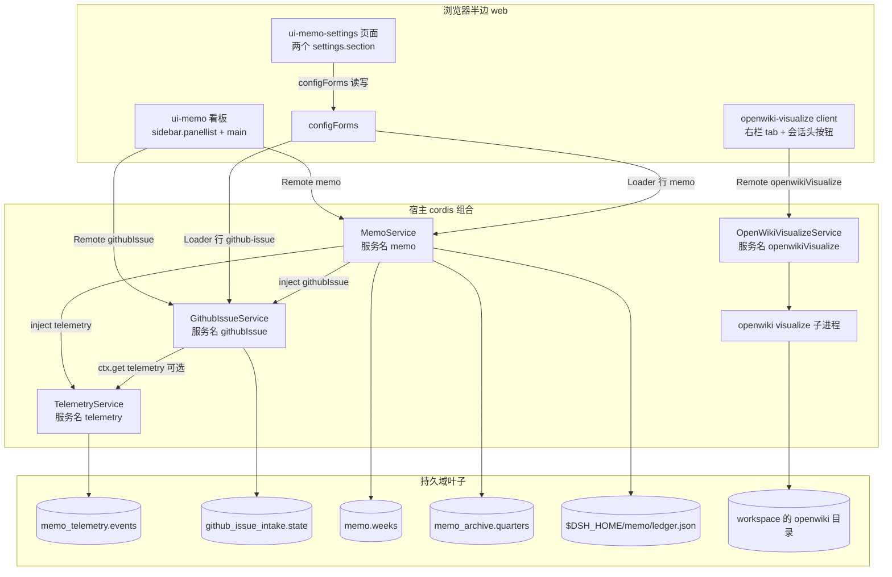

# 系统总览：六个插件与宿主/浏览器两侧

本仓库是 `zhangj1164/dsh-mega-plugins`——一个 pnpm monorepo，按 DSH 的 `packages/<group>/<pkg>` 约定放置六个 Cordis 插件包：`pnpm-workspace.yaml` 的 `packages:` 只有一行 `packages/*/*`。它交付两条产品线：一条本地优先的个人备忘套件（备忘服务 + 遥测 + GitHub issue 服务，外加看板与 Settings 两个浏览器面），一条 Web 右 Sidebar 里的 OpenWiki 预览。

共享层比「一份根依赖」要窄。根 `package.json` 只声明测试与门禁用的工具（`vitest`、`tsx`、`jsdom`、`typescript` 与 markdown 解析器），`tsdown` 和 `@types/node` 仍由每个包各自声明，所以新增包必须自带这两项。根 `vitest.config.ts` 承担三件共享工作：用 `packages/*/*/tests/**/*.spec.{ts,tsx}` 加 `scripts/tests/**/*.spec.ts` 发现全部测试；注入 `standardDecorators()`，让 `@Remote` 这类标准装饰器在测试里可用；把三个宿主包的模块别名到各自的 `src/`（它们的 `./client` 是纯类型投影，运行时解析只会得到空模块）。

理解这个仓库只需抓住三件事：**每个包属于哪半边**、**每个组合入口 id 归谁**、**状态落在哪个持久域**。其余页面分别展开每一处，本页只给地图。

## 六个包

| 包 | 目录 | 半边 | 宿主侧能力 | 浏览器侧贡献 | 组合入口 id |
|---|---|---|---|---|---|
| `@zhangj1164/dsh-telemetry` | `packages/telemetry/dsh-telemetry` | 仅宿主 | Cordis `Service`，服务名 `telemetry`；`ctx.telemetry` 记录事件与错误 | 无 | `telemetry` |
| `@zhangj1164/dsh-github-issue` | `packages/github-issue/dsh-github-issue` | 仅宿主 | `TypertRemoteService`，服务名 `githubIssue`；报告生成、issue 创建、claim 与派发 | 无 | `github-issue` |
| `@zhangj1164/dsh-memo` | `packages/memo/dsh-memo` | 宿主（浏览器半边在另一个包里） | `TypertRemoteService`，服务名 `memo`；周记、分析、报告、归档、会话总结、日志分析 | 无（不含 `dsh.client`） | `memo` **和** `ui-memo` |
| `@zhangj1164/dsh-client-ui-memo` | `packages/client/ui-memo` | 仅浏览器 | 空的 `apply()`，只为让插件出现在宿主组合里 | `sidebar.panellist` 按钮 + 键为 `memo` 的 `main` 面板（看板） | 无自己的 bundle（行由 `memo` 的 patch 插入） |
| `@zhangj1164/dsh-client-ui-memo-settings` | `packages/client/ui-memo-settings` | 仅浏览器（但自带 bundle） | 空的 `apply()` | 两个 `settings.section`：`memo` 与 `github-issue` 两个 Loader 行的配置页 | `ui-memo-settings` |
| `@zhangj1164/dsh-openwiki-visualize` | `packages/openwiki/dsh-openwiki-visualize` | 宿主 + 浏览器，同一个包 | `TypertRemoteService`，服务名 `openwikiVisualize`；环境探测、wiki 探测、`openwiki visualize` 子进程监督、自更新 | 右 Sidebar tab 类型、pane 座位、会话头入口按钮 | `openwiki-visualize`（一行同时带上两半） |

两个「基础设施」包（telemetry、github-issue）暴露的是 Cordis 服务而不是模型工具或面板：单独安装 `@zhangj1164/dsh-telemetry` 只是给别的插件一个 `ctx.telemetry` 可调，终端用户看不到任何东西。可见表面只有两块——备忘看板与 OpenWiki 预览。

## 宿主 / 浏览器拆分

三种形态，各自的原因不同：

- **纯宿主**（telemetry、github-issue）：能力本身就在宿主内——读写本地存储域、拿 `llm` 与服务端的 GitHub 凭据。它们不声明 `dsh.client`，因此不产出浏览器 bundle；客户端只能通过某个宿主服务的 `@Remote` 方法间接用到它们（`memo/analyzeLogs` 就是这条路径）。
- **纯浏览器**（ui-memo、ui-memo-settings）：node 半边是一个空的 `apply()`，仅用于让插件出现在宿主 cordis 组合里；真正的代码通过 `exports["./client"]` → `lib/client.js` 交付，由 manifest 的 `dsh.client` 声明发现，并用共享 preset `clientBundle(id, entries)` 打包，`id` 必须等于包名。两个包的 `apply()` 各自的 `inject` 列表声明它需要的浏览器行：ui-memo 要 `slots`/`layout`/`locale`/`theme`/`connection`，设置页要 `slots`/`locale`/`configForms`。
- **一个包两半**（openwiki-visualize）：宿主服务是包体（`lib/index.js`），浏览器半边由同一个 manifest 的 `dsh.client` 发现并服务在 `<package>/client` → `lib/client.js`。因此它的 bundle patch 只插一行，两半一起装卸。它的浏览器半边 `inject` 是 `slots`/`locale`/`connection`；右栏服务（`sidebarRightTabs`、`sidebarRight`）刻意不在其中——tab 类型通过 `ctx.inject(['sidebarRightTabs'], …)` 等待注册表出现，`sidebarRight` 用 `ctx.get()` 可选读取，所以一个没有组合右栏的 profile 仍能加载这个插件，只是没有可打开的预览位。

一处容易混的地方：**`exports["./client"]` 不等于 `dsh.client`**。`dsh-telemetry`、`dsh-github-issue`、`dsh-memo` 三个包都导出 `./client`，但内容都是一句 `export type * from './types.ts'`——那是给客户端复用的类型投影，既不是 boot 行也不进模块表。反过来 `@zhangj1164/dsh-client-ui-memo` 声明了 `dsh.client` 却**没有** `dsh.bundle`：它的 `ui-memo` 行由 `@zhangj1164/dsh-memo` 的 patch 插入，所以装 `dsh-memo` 就激活看板，但包本身仍必须被显式命名（profile 的 `autoInstallPeers: false` 让安装只带来命令点名的包），`dsh plugin add` 把它报成普通依赖而非 profile 层是预期行为。设置页刻意相反：它自带 bundle，可以脱离 memo 套件独立增删，但页面只在部署真的服务 `memo`（以及 `github-issue`）命名空间时才注册，单装它不会留下任何可见痕迹。

组合入口 id 的所有权是这一层的硬约束：DSH 按 `dsh.profile.bundles` 顺序逐层应用 patch，**没有传递解析，后一层也无法撤回前一层的 insert**，所以两个 bundle 插入同一个 id 不是合并而是启动失败。`pnpm run verify-bundle-entries` 在发布前就拦这件事，只放行用 `not both` 标记显式记录冲突的补丁。细节见[插件组合与 bundle 层](plugin-composition-and-bundles.md)。

## 包 / 服务图

一张图读完四个宿主服务、三个浏览器面、一条 configForms 通路与六个状态叶子；箭头方向就是调用或注入的方向。

浏览器侧共有四条边：三条走 Remote（`memo`、`githubIssue`、`openwikiVisualize`），一条走 `configForms`（设置页读写的两个 Loader 行）。图中没有跨包的浏览器半边引用。

## 一次装配的先后顺序

1. **profile 应用 bundle 层。** `dsh.profile.bundles` 逐层应用每个包的 `cordis.patch.yml`，每个 `insert` 落下一条「入口 id → 包名」的行；没有传递解析，后一层也无法撤回前一层。
2. **宿主按行组合。** 行里的包名既是 manifest 的 `name`，也是宿主插件体的入口；`static inject` 满足后服务才 `[Service.init]`——memo 在这里打开 `memo` 与 `memo_archive` 两个域，telemetry 打开 `memo_telemetry`，github-issue 可选地打开 `github_issue_intake`，每个都以 `ctx.effect` 注册关闭。openwiki-visualize 在构造函数里就用 `ctx.effect` 注册子进程回收。
3. **浏览器按包名取回半边。** 声明了 `dsh.client` 的包，其 `lib/client.js` 由 shell 按包名取回，bundle 必须以同一个包名注册；`apply()` 起来后先等 `inject` 里的行就绪，再靠 `ctx.slots.inject(key, …)` 等 slot key 出现才登记贡献——这就是看板、设置页与右栏 tab 都不会在 shell 未就绪时挂上的原因。
4. **调用走一条通道。** 用户动作 → `connection.rpc.call('/api', '<service>/<method>', { args: { request } })` → 宿主方法 → 双层信封回到 UI。

这四步同时给出失败定位：第 1 步错是启动失败；第 2 步错是服务或它的域打不开；第 3 步错是浏览器报 `bundle <url> loaded without registering "<id>"`；第 4 步错是 UI 收到业务 `error` 而不是整块崩掉。

## 谁调用谁

- **ui-memo → `memo` 与 `githubIssue` 两个 Remote 服务**。浏览器的 controller 只有一个 `callRemote(rpc, service, method, request)`，再由 `callMemo`（固定 `'memo'`）和 `callGithubIssue`（固定 `'githubIssue'`）两个薄包装区分服务名。看板的周记读写、分析、报告导出、归档、会话总结走 `memo`；issue 编辑器的 `optimizeIssue` / `prefilledIssueUrl` / `createIssue` 直接走 `githubIssue`，日志分析按钮走 `memo/analyzeLogs`。浏览器不猜 provider/model：路由由宿主按自身 `Config` 或部署的 `agentDefaultModel` 解析。契约细节见[宿主 ⇄ 浏览器 Remote 契约](host-client-remote-contract.md)。
- **memo → telemetry + githubIssue**。`MemoService` 的静态 `inject` 正是 `['storageDomain', 'telemetry', 'githubIssue']`：存储域是它自己的状态后端，另外两个是套件的协作方。`analyzeLogs` 是这条依赖存在的理由——它按配置的插件 id 逐个 `telemetry.analyzeForPlugin()`，合并成一份分析，再调 `githubIssue.generateReport()` 与 `prefilledIssueUrl()`，产出一份跨插件的诊断报告和预填 issue 链接。一次只覆盖 `memo` 的报告无法提到 `github-issue` 的故障，而那个故障恰好会弄坏看板自己的 issue 编辑器。
- **github-issue → telemetry（可选）**。它用 `ctx.get('telemetry')` 读一个结构化 sink，为每个动作写成功或带 feature code 的失败事件；telemetry 缺席时它照常工作，只是不留日志。
- **memo 的可选读取**：`llm`、`agentDefaultModel`、`fs`、`workspaceRegistry`、`sessionQuery` 都通过 `ctx.get()` 取——AI 能力是可选降级项，没有模型路由时分析类方法返回业务失败而不是让插件挂掉。`readExternalPath` 因为「面板发起的调用没有 open turn，拿不到审批」而**故意不注册 `@Remote`**，留在宿主内部。
- **ui-memo-settings → 不调 Remote**。它用 `ctx.configForms.get(namespace)` 拿到对应 Loader 行的表单镜像，编辑草稿后保存，由 `cordis-plugin-loader` 就地把 volatile 配置 ref 更新掉而不重挂插件；所以宿主服务必须在用点读取 ref（`this.config.repoUrl.get()` 这类 getter），而不是在构造时拷进字段。页面刻意只编辑 volatile 字段的一个子集——memo 9 个、github-issue 8 个——部署级旋钮（写重试、`logAnalysisPlugins`、`sessionSummaryMaxCharsLimit`）留在 `cordis.yml`。

## 持久域是叶子

每个宿主服务只碰自己的状态，四个 storage-domain 域加一个 JSON 账本：

- `memo` 域 / 表 `weeks`（`@zhangj1164/dsh-memo`）：一个 ISO 周 id（`YYYY-Www`）一行，行内含 entries 与可选 analysis，schema 在持久边界校验。
- `memo_archive` 域 / 表 `quarters`（`@zhangj1164/dsh-memo`）：季度归档只存 `label` 与 `archivedAt`。它是独立域而不是 `weeks` 旁边的第二张表：两个特性分开写，归档坏掉也不会让备忘表打不开；季度里的周 id 由宿主自己的周期日历推出，不重复持久化。
- `memo_telemetry` 域 / 表 `events`（`@zhangj1164/dsh-telemetry`）：事件按 UUID 键入，`seq` 在域打开时从已存最大值续上，重启后写序不会与旧记录重合；失败事件必须带 error 记录。写入前按可配置规则做脱敏。
- `github_issue_intake` 域 / 表 `state`（`@zhangj1164/dsh-github-issue`）：单行状态，记「上一次完成扫描的本地日」与已派发的 issue→Session 记录。`storage-domain` 是可选 peer，动态 import 声明该域；没有存储时启动检查直接跳过，而不是在没有记忆的情况下跑一遍、把同一个 issue 派发两次。
- `$DSH_HOME/memo/ledger.json`（`@zhangj1164/dsh-memo`）：分析记忆账本，不经 storage-domain，直接读写 JSON 文件，带 schema 版本、容量上限与一次性的旧路径迁移（旧文件改名 `.migrated` 而非删除）。写失败只降级为「本次分析照常返回」，不在内存里丢结果。

OpenWiki 预览没有持久域：它的叶子是 workspace 里的 `openwiki/` 目录树和一个被监督的 `openwiki visualize` 子进程——子进程通过 `ctx.effect` 的 disposer 在插件卸载时被回收，所以重载不会留下一个继续占端口的服务器。域的 schema、迁移与写入重试策略集中在[存储与持久化](storage-and-persistence.md)。

## 不变量与失败模式

| 破坏方式 | 症状 | 被谁拦住 |
|---|---|---|
| 两个 bundle 插同一个入口 id | 启动失败，两层无法合并 | `pnpm run verify-bundle-entries` |
| 只装 `dsh-memo` 就以为套件齐了 | `github-issue` / `ui-memo` 行解析不到，loader 拒绝启动 | profile 的 `autoInstallPeers: false` 语义 + README 的安装清单 |
| 只装 `ui-memo-settings` | 页面永不注册，部署里看不到任何痕迹 | `configForms.whileServed` 按命名空间守门 |
| `github-issue` 没有 `storageDomain` | 启动检查静默跳过（不会重复派发） | `openIntakeState()` 的可选读取 + `intakePersistent` 判据 |
| 浏览器 bundle 注册 id ≠ 包名 | 浏览器报 `bundle <url> loaded without registering "<id>"`，面板不挂载 | `clientBundle` 按 manifest 校验 + `pnpm run verify-client-bundle-id` |
| 把 volatile 配置在构造函数里拷走 | 设置页保存成功但服务仍用旧值 | `dsh-memo` 与 `dsh-github-issue` 的 `tests/config-volatile.spec.ts` |
| 加了字段却指望设置页能改 | 字段不出现在表单里，因为它不在 `.volatile()` 节点下 | 同一个 spec 对 schema 的断言 |
| `@Remote` 方法多声明一个参数或不叫 `request` | 调用在方法体执行前就被拒，功能看起来「什么都没做」 | `dsh-memo` 的 `tests/remote-signatures.spec.ts` |

## 改动落在哪里

- **加一个宿主能力**：新包 + `package.json` 的 `dsh.bundle`（指向自己的 `cordis.patch.yml`）+ 一个别人没占用的 insert id + schemastery `Config`（部署可变的值必须是配置字段，不得内联 URL/端口/阈值/提示词；要让 Settings 能改就标 `.volatile()` 并在用点读 getter）+ 自己的 `tests/*.spec.ts`。
- **加一个浏览器面**：`dsh.client`（`platform: 'web'`，`inject` 写清需要的行）+ 用 `scripts/tsdown.client.ts` 的 `clientBundle(包名, entries)` 构建 + 一个属于它的入口 id（或像 ui-memo 那样由宿主包的行带上）+ 一个钉 wiring 的 `tests/entry.spec.tsx`。
- **加一份持久状态**：`defineDomain` 声明域与表（域名只允许 `^[a-z][a-z0-9_]*$`，所以是 `memo_archive` 而不是 `memo-archive`），在 `[Service.init]` 里 `storageDomain.open()` 并用 `ctx.effect` 注册关闭；存储要可选，就像 github-issue 那样改成动态 import。
- **加一个 Remote 方法**：`@Remote('name')` 且签名只有唯一的 `request` 参数（协议按名绑定参数），同步更新包 README 的方法表；方法表本体与失败语义在各自的 systems 页面。

## 相关页面

- [宿主 ⇄ 浏览器 Remote 契约](host-client-remote-contract.md)——`@Remote` 命名、单 `request` 参数、双层信封、`dsh.client` 发现链与产物门禁。
- [插件组合与 bundle 层](plugin-composition-and-bundles.md)——入口 id 的所有权模型、profile 安装顺序与安装清单。
- [存储与持久化](storage-and-persistence.md)——四个域的 schema、迁移、写入重试与降级。
- [配置与实时设置](../concepts/configuration-and-live-settings.md)——volatile 字段、`configForms` 与免重启生效的边界。
- [能力与审批边界](../concepts/capability-and-approval-boundaries.md)——为什么 `readExternalPath` 不注册 `@Remote`。
- [DSH 宿主服务](../integrations/dsh-host-services.md)——本仓库依赖的 `llm`、`agentDefaultModel`、`fs`、`sessionQuery` 等宿主契约。
- [备忘服务](../systems/memo-service.md)、[备忘看板 UI](../systems/memo-board-ui.md)、[备忘设置页](../systems/memo-settings-ui.md)
- [遥测服务](../systems/telemetry-service.md)、[GitHub issue 服务](../systems/github-issue-service.md)
- [OpenWiki 预览](../systems/openwiki-visualize.md)
