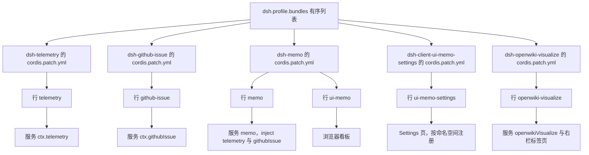
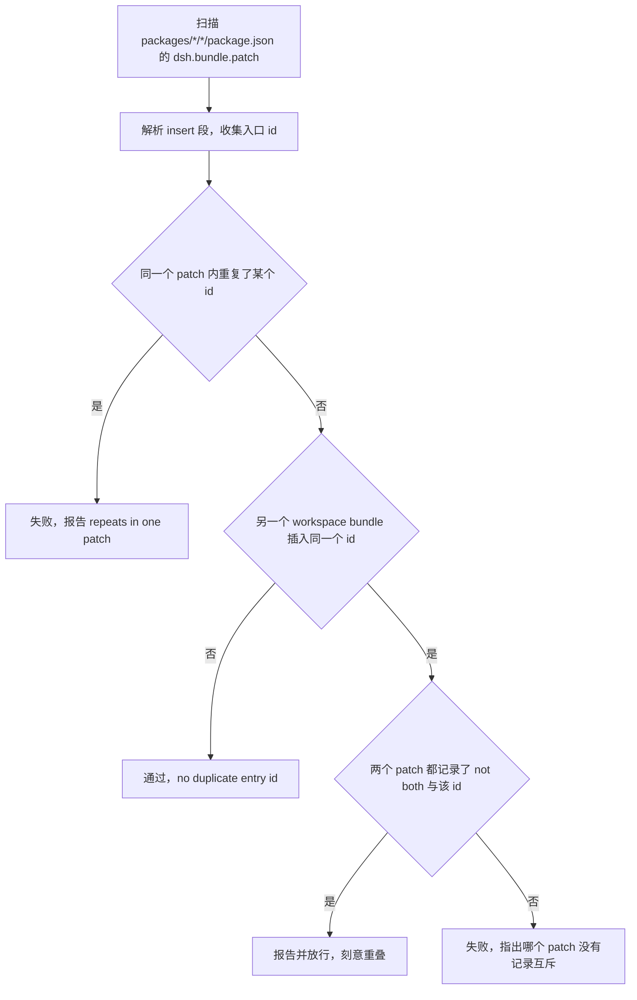

# 插件组合与 bundle 层

**每个组合入口 id 恰好有一个归属 bundle。** 这一页的其余内容都是这条不变量的推论：它为什么成立、破坏了会怎样、装的时候因此要点名哪些包、门禁怎么在发布前把它钉住。之所以要把它当成第一句话，是因为它是个**结构性**约束而不是风格建议——违反它不会让某个功能坏掉，而是让「把套件全装上」这个最自然的部署方式启动不了。

把任何一个包注入的服务、另一个包插入的行、第三个包的浏览器半边对齐起来的东西不是代码，而是组合约定：`package.json` 里的 `dsh.bundle` / `dsh.client` 声明、包内那份 `cordis.patch.yml`、以及部署 profile 里 `dsh.profile.bundles` 的有序列表。仓库只负责让自己可被组合，**组合本身发生在部署侧**。

## 组合模型：有序 patch 层，没有传递解析

DSH 按 `dsh.profile.bundles` 的顺序逐层应用每个 bundle 的 `cordis.patch.yml`。本仓库的每一层只做 `insert`：把若干「行」（行 id + 包名 + 该行的 `config`）追加进同一份入口列表。这个过程有两个不可协商的性质：

- **没有传递解析**。启用一个 bundle 不会因为别人的依赖而自动带上另一个 bundle；`dsh.profile.bundles` 里没写的层就是不存在的层。
- **没有撤回**。后一层无法删除或覆盖前一层已插入的行。加载器没有「后写覆盖」的规则，所以组合是单调的：层只增不减，冲突只能靠「没有人插同一个 id」来避免。

仓库里的 patch 只写 `insert`，从不写 `dsh.profile.bundles` 本身——**装哪些层只由部署的 profile 决定**，包不能替部署做这个决定。



五层 patch 落下六个入口 id：备忘那一层插两行（宿主服务与它的浏览器看板），其余层各插一行。

一行的 `name` 就是启动时被 import 的包：宿主半边来自它的 `lib/index.js`，浏览器半边则由同一份 manifest 的 `dsh.client` 声明发现（细节见[宿主 ⇄ 浏览器 Remote 契约](host-client-remote-contract.md)）。因此「一行带两半」是合法形态，`openwiki-visualize` 正是如此——宿主服务是包体，浏览器半边由 `dsh.client` 发现，一个 id 同时装卸两侧。反过来，「一行只带浏览器半边」也合法：`ui-memo` 就是这种形态，它的宿主能力由 `memo` 行提供。

行的 `config` 不是写死的行为，而是**部署变量的默认值**：`telemetry` 的 `maxEventsPerQuery: 500`、`github-issue` 的 `repoUrl` 与默认关闭的接单参数、`memo` 的 `repoUrl`（`provider`/`model` 刻意留空，让分析跟随部署的 `agentDefaultModel`）、`openwiki-visualize` 的版本下限、端口与注册表地址。部署在自己的 patch 或 `cordis.yml` 里只覆盖需要改的字段——这是「禁止硬编码」在组合层的落点：patch 里出现的是默认值与协议常量，可变值必须能由配置覆盖。默认值本身、`volatile` 写入与热更新的边界见[配置与热更新](../concepts/configuration-and-live-settings.md)。

## 硬约束：一个入口 id 恰好一个所属 bundle

**每个组合入口 id 恰好有一个归属 bundle。** 理由直接来自上一节的单调性：如果两个 bundle 都插入 `github-issue`，那么「把所有包都点名」这个最自然的安装方式立刻变成启动失败（`duplicate loader entry id: github-issue`），而不是一次合并——加载器没有可用的规则去协调两份插入，后一层也无法撤回前一层。这条不变量正是「任意子集都能装」的来源：装一个、装三个、装全部，层与层之间都不会撞同一行。

当前工作区的所有权分布是 6 个入口 id、5 个声明 `dsh.bundle` 的包：

| 入口 id | 所属 bundle | 行背后是什么 |
|---|---|---|
| `telemetry` | `@zhangj1164/dsh-telemetry` | 宿主服务 `ctx.telemetry`，纯基础设施 |
| `github-issue` | `@zhangj1164/dsh-github-issue` | 宿主服务 `ctx.githubIssue`，纯基础设施 |
| `memo` | `@zhangj1164/dsh-memo` | 备忘宿主服务，`static inject` 为 `['storageDomain', 'telemetry', 'githubIssue']` |
| `ui-memo` | `@zhangj1164/dsh-memo` | `@zhangj1164/dsh-client-ui-memo` 的浏览器看板行 |
| `ui-memo-settings` | `@zhangj1164/dsh-client-ui-memo-settings` | Settings 页，无自己的宿主服务，按命名空间注册 |
| `openwiki-visualize` | `@zhangj1164/dsh-openwiki-visualize` | 宿主服务 + 右栏标签页，一行两半 |

`@zhangj1164/dsh-client-ui-memo` 在这张表里只作为**行内容**出现：它声明 `dsh.client` 却**没有** `dsh.bundle`，那一行由 `@zhangj1164/dsh-memo` 插入。

这张表以 manifest 为准，不以文档清单为准：仓库 `README.md` 的安装段与 `AGENTS.md` 的 Bundle layers 段都只列了四个自带 bundle 的包，`dsh-openwiki-visualize` 是后加的一层（它只出现在 `README.md` 的工作区结构段里）。判断某行归谁，读包的 `dsh: { bundle: { patch } }` 与那份 patch 的 `insert` 段。

### 历史回归：同一入口 id 的两个归属

`@zhangj1164/dsh-memo` 曾经自己插入 `github-issue` 行，让套件能一条命令装完，代价正好是给同一个入口 id 制造了两个归属，于是「把所有包都点名」变成 `duplicate loader entry id: github-issue`。现在它的 patch 只插 `memo` 与 `ui-memo` 两行，并把理由写在文件头：

> Those two rows are deliberately NOT inserted here. A bundle layer cannot remove an insert from an earlier layer and the loader rejects a duplicate entry id outright, so a bundle that repeats a row another bundle owns makes the natural "install everything" command a boot failure. One entry id has exactly one owning bundle; that is what lets any subset of the suite be installed together.

见 [`packages/memo/dsh-memo/cordis.patch.yml`](../../packages/memo/dsh-memo/cordis.patch.yml) 的前 14 行。这段注释因此既是那次回归的墓志铭，也是这个仓库唯一一处把组合契约写成文字的地方——改用代码或门禁表达都是可以的，但读者那时就得跑一遍门禁才知道谁归谁。

推论有三条，读组合问题时按顺序用：

1. 新增一个 bundle = 新增一个别人没用过的入口 id，而不是复用现有行。
2. 「这行配置不对」要靠部署层覆盖 `config`，不能靠再插一行同 id 去顶替。
3. 确实需要刻意重叠时，必须在两个 patch 里都写下理由（见下文 `not both` 标记），否则门禁不放行。

## 安装：一条命令必须点名启动所需的每个包

profile 的 `${DSH_HOME}/profiles/*/pnpm-workspace.yaml` 设置了 `autoInstallPeers: false`，所以 `dsh plugin add` **只引入命令行上点名的包，永远不会自动带入 peer 依赖**。这条 pnpm 语义把「装插件」变成一件必须显式列举的事：凡是启动所需的行、或其注入服务所属的包，都必须出现在同一条命令里。

备忘套件的完整安装因此要点名五个包：

```sh
dsh plugin --profile web add @zhangj1164/dsh-telemetry @zhangj1164/dsh-github-issue @zhangj1164/dsh-memo @zhangj1164/dsh-client-ui-memo @zhangj1164/dsh-client-ui-memo-settings
```

其中前四个是 `@zhangj1164/dsh-memo` 自身两行得以成立的**最小集合**：服务 `inject` 的 `telemetry` 与 `githubIssue` 来自另外两个 bundle，而 patch 插入的 `ui-memo` 行指向 `@zhangj1164/dsh-client-ui-memo`。第五个 `@zhangj1164/dsh-client-ui-memo-settings` 只负责加上 Settings 页，去掉它套件照常启动。少点名的后果是可复现的：只装 `@zhangj1164/dsh-memo` 会让 `github-issue` 与 `ui-memo` 两行解析不到，加载器先报 `Cannot find package '@zhangj1164/dsh-github-issue' imported from …`，再报同样一条针对 `@zhangj1164/dsh-client-ui-memo` 的错误并让启动失败。

`dsh plugin add` 的输出只有两种报告语义，理解它比理解安装本身更重要：

| 报告 | 含义 | 本仓库的例子 |
|---|---|---|
| **profile layer** | 包自带 `dsh.bundle`，成为独立一层，可单独增删 | `dsh-telemetry`、`dsh-github-issue`、`dsh-memo`、`dsh-client-ui-memo-settings`、`dsh-openwiki-visualize` |
| **普通依赖** | `dsh.client` 插件，行由别的 bundle 插入，但仍须点名 | `dsh-client-ui-memo` |

`@zhangj1164/dsh-client-ui-memo` 被报成「普通依赖而非 profile layer」是**预期告警而非缺陷**：它没有自己的 bundle，行由备忘 bundle 带上，但它**仍然必须被点名**，否则那一行解析不到。这与官方 `dsh-client-ui-*` 包的形态一致——浏览器半边由宿主 bundle 插入，而不是自己成为一层。

两个容易误判的现象，同样是预期行为：

- **设置页装了却「什么都没有」。** `@zhangj1164/dsh-client-ui-memo-settings` 与 memo 的形态刻意相反：它自带 bundle、拥有自己的 `ui-memo-settings` 行，可以脱离备忘 bundle 独立增删；但它的页面注册包在 `ctx.configForms.whileServed(...)` 里——备忘页等 `memo` 命名空间，接单页等 `github-issue` 命名空间——部署不提供对应命名空间时既不注册也不报错。排查顺序因此是：宿主构建里有没有 `.volatile()` 的 schema 字段 → `dsh --profile web --dump-config` 里有没有 `ui-memo-settings` 行（没有就意味着这个包没成为 profile layer）→ 浏览器有没有取到该包的 `client.js`。
- **只装基础设施看不到东西。** `@zhangj1164/dsh-telemetry` 与 `@zhangj1164/dsh-github-issue` 暴露 Cordis 服务而不是面板，单独装 telemetry 只是给别的插件一个 `ctx.telemetry` 可调，终端用户看不到任何界面。可见面是备忘看板与 `@zhangj1164/dsh-openwiki-visualize` 的右栏标签页。

反过来，`@zhangj1164/dsh-openwiki-visualize` 是「一个包、一行、两半」的完整安装：`dsh plugin --profile web add @zhangj1164/dsh-openwiki-visualize` 就把宿主服务与浏览器半边一起装上，不需要再点名任何配套包。

## 三种取得方式：拿到的是产物还是源码

同一个包有三种取得方式，选哪种决定你拿到的是**构建产物**还是**源码**：

| 形态 | 命令写法 | 拿到什么 | 代价 |
|---|---|---|---|
| registry | `dsh plugin --profile web add @zhangj1164/dsh-memo` | 预构建 `lib/` + 随包发布的 patch | 无构建授权；**默认选择** |
| git | `"github:zhangj1164/dsh-mega-plugins#path:packages/memo/dsh-memo"` | 源码 checkout，安装时由 `prepare` 构建 | 需要在 profile 里写 `allowBuilds` |
| link（本地开发） | `dsh plugin --profile web add "link:<包目录绝对路径>"` | 工作区目录本身，改完重建即生效 | 先 `pnpm run build`，且必须重启宿主 |

`link:` 形态最容易被误判成「改了就生效」：宿主插件的代码在启动时 import，新写进 `dsh.profile.bundles` 的行也在启动时组装，所以重建后的 `lib/` 与刚加的那一行对运行中的进程都不可见；`patchReload: live` 只热加载配置**文档**，不加载模块。设置页在本地联调时的顺序正是 `pnpm run build` → `link:` → 重启宿主 → 重载浏览器页面。

## 从 git 安装：`path:` 属于 committish，构建需要授权

没有注册表发布时，备忘套件那五个包可以直接从本仓库装。pnpm 选中仓库内的某个包靠的是 **committish 里的 `path:` 参数**，也就是写在 `#` 之后：

```sh
dsh plugin --profile web add \
  "github:zhangj1164/dsh-mega-plugins#path:packages/telemetry/dsh-telemetry" \
  "github:zhangj1164/dsh-mega-plugins#path:packages/github-issue/dsh-github-issue" \
  "github:zhangj1164/dsh-mega-plugins#path:packages/memo/dsh-memo" \
  "github:zhangj1164/dsh-mega-plugins#path:packages/client/ui-memo" \
  "github:zhangj1164/dsh-mega-plugins#path:packages/client/ui-memo-settings"
```

这就是全部语法：pnpm 把 `#` 后面的内容解析成 `{ref, path}`，所以 `path:` 必须属于 committish。把它写成 `repository-url&path:…` 会被当成仓库名的一部分，报的是**仓库不存在**，而不是路径错误。要锁 commit 时 ref 与 `path:` 用 `&` 连接：`github:zhangj1164/dsh-mega-plugins#<sha>&path:packages/memo/dsh-memo`。

git 安装取的是**源码而不是构建产物**，所以每个包的 `prepare` 脚本（`tsdown`）会在安装过程中构建 `lib/`。pnpm ≥10 不会默默执行它：首次 `add` 以 `ERR_PNPM_GIT_DEP_PREPARE_NOT_ALLOWED` 失败，并打印一个确切的 `allowBuilds` 键。该键带解析出来的 commit，下一次推送后就匹配不上；durable 的写法是仓库级键，写进 `${DSH_HOME}/profiles/web/pnpm-workspace.yaml`：

```yaml
allowBuilds:
  '@zhangj1164/dsh-telemetry@git+https://github.com/zhangj1164/dsh-mega-plugins.git': true
  '@zhangj1164/dsh-github-issue@git+https://github.com/zhangj1164/dsh-mega-plugins.git': true
  '@zhangj1164/dsh-memo@git+https://github.com/zhangj1164/dsh-mega-plugins.git': true
  '@zhangj1164/dsh-client-ui-memo@git+https://github.com/zhangj1164/dsh-mega-plugins.git': true
  '@zhangj1164/dsh-client-ui-memo-settings@git+https://github.com/zhangj1164/dsh-mega-plugins.git': true
```

这条授权意味着一件事，值得在动手前读两遍：**你允许该包的代码在安装时于本机执行，而且不在任何 agent 沙箱之内**。只对可信来源授权；当已安装内容必须停止漂移时，用 `<sha>&path:…` 锁定。

git 安装还有两个副作用，都不影响启动：

- checkout 里的 manifest 没有任何环节去改写，因此兄弟 `peerDependencies` 会保留 `workspace:^`，pnpm 为此打印 peer 警告。启动不受影响，因为 profile 已经点名启动所需的每个包、并设置了 `autoInstallPeers: false`——那些范围没有需要解析的对象。
- 与注册表相比少一道缓冲：注册表安装拿到的是预构建 `lib/`，完全不需要构建授权。**注册表仍是更好的默认选择。**

`workspace:` 范围的发布侧约束（`pnpm publish` 与 `prepublishOnly` 互锁）属于另一条链路，见[发布与打包](../operations/release-and-publishing.md)；git 安装完全不受它影响，因为 npm 与 pnpm 都不在 install 时跑 `prepublishOnly`。

## 门禁：谁插哪个 id 由谁保证

`pnpm run verify-bundle-entries` 是这条不变量唯一的机械保障。它扫描 `packages/*/*/package.json`，收集所有声明了 `dsh.bundle.patch` 的包，解析目标 patch 插入的入口 id，然后按两条规则判定：

- **同一个 patch 内重复插入一个 id**——永远失败。
- **两个不同 bundle 插入同一个 id**——失败，除非两个 patch 都把这个冲突记录成「刻意重叠」。

解析是**定向扫描，不是 YAML 解析器**：patch 的形状固定（`- insert:` 之后跟一串 `- id:`），先按行剥注释（引号内的 `#` 视为数据），再在 insert 段内取 id 并剥掉包裹的引号。声明了 bundle 却没有可读 patch、或 patch 插不进任何 id，都会直接抛错而不是静默通过——两条都是「宁可红，也不要静默通过」的选择。



门禁的两条判定路径：同一 patch 内重复永远红，跨 bundle 共享只在双方都写下 `not both` 时被报告而非失败。

成功时它会打印一层摘要（bundle 数量、`no duplicate entry id`、以及每个包及其 id 列表），失败时逐条列出冲突并指出哪个 patch 没有记录互斥，因此**门禁输出本身就能当所有权表读**，不需要回读五份 patch。

`not both` 这条通道是个刻意留的口子：判据要求**标记 `not both`** 与**该 id 自身**同时出现，且 id 两边的字符都不能是 `[A-Za-z0-9_-]`——所以散文里紧跟标点的 `github-issue;` 成立，而 `github-issue-x` 这种近邻 id 不成立。词序也不宽容：`do not enable both` 里没有 `not both` 子串，不满足条件。今天五个 patch 互不共享 id，这条通道的价值在于**让一次刻意的重叠可以把理由写在文件里重新引入**，而不是让门禁变成可绕过的形式。

门禁的局限必须和它一起记：**它只能看到本仓库发布的 bundle**。一个部署通过自己的 profile 同时启用两个互斥的 patch 层，那在仓库之外，任何仓库门禁都观测不到——这一点只能停留在文档化的约束上。

这条门禁在 gate 图里的位置也有意义：patch 是源文件，所以 `verify-bundle-entries` **不需要构建**（`verify-publish-guard` 同理，它读的是 manifest）；而 `verify-package-exports` 与 `verify-client-bundle-id` 读的是构建产物，声明了 `needs: ['build']`。判据是「事实来自源还是产物」，不是「看起来像哪一类检查」。完整 gate 图见[构建、测试与门禁](../operations/build-test-and-gates.md)。

同层还有一次针对 `workspace:` 范围的检查：`verify-publish-guard` 要求每个带该范围的包把 `scripts/publish-guard.mjs` 接成 `prepublishOnly`，而那道守卫在打包器不是 pnpm 时拒绝发布（识别不出打包器时按 fail closed 处理）。它与本页的组合约束正交，机制与发布流程见[发布与打包](../operations/release-and-publishing.md)。

## 发布物里也必须带着 patch

组合能否成功，一半取决于 tarball 里有没有那份 patch。声明 `dsh.bundle` 的五个包都把 `cordis.patch.yml` 写进了 `files`，与 `lib/**/*.js`、`lib/**/*.d.ts` 并列；manifest 里的 `dsh.bundle.patch` 只是一个包内相对路径，缺文件时门禁先抛错，装到部署里则是本该有的那一层直接消失。没有 bundle 的 `@zhangj1164/dsh-client-ui-memo` 的 `files` 就只有 `lib`——它没有需要发布的 patch。

## 聚焦测试

`scripts/tests/bundle-entries.spec.ts` 钉住的是**解析与冲突规则**，而不是当前这份工作区的具体 id 表：任意一致缩进的 insert 序列、被注释掉的行、带 `#` 的引号 id、空 patch 抛错；`mentionsExclusion` 要求标记与裸 id 同时成立（并拒绝词序不同的写法与近邻 id）；`findCollisions` 接受文档化的共享 id，拒绝未记录的一方与单个 patch 内的重复。工作区级的「真的没有重复 id」这条断言留在门禁本身运行，不在测试里重复一份快照——否则每加一个 bundle 就要同时改测试与门禁两份事实。

设置页那一侧由 `packages/client/ui-memo-settings/tests/entry.spec.tsx` 用 stand-in client context 跑真实的浏览器半边：`waits for each namespace before registering its page` 钉住两个 `whileServed` 的命名空间顺序与取值（`memo`、`github-issue`），`registers nothing while the namespaces are not served` 钉住「命名空间没人服务时一个 section 都不注册」。这正是「单装设置页看不到痕迹」的可执行版本。

## 扩展点

- **加一个宿主 bundle**：新包 + `package.json` 的 `dsh.bundle.patch` + 一个**没人占用**的入口 id + schemastery `Config`（部署可变的值一律是配置字段，不在 patch 里硬写协议常量）+ 自己的 `tests/*.spec.ts`；再把 `cordis.patch.yml` 加进 `files`，否则发布物里没有那一层。
- **加一个浏览器面**：`dsh.client`（`platform: 'web'`、`inject` 写清需要的行）+ `clientBundle(包名, entries)` 构建。要么像设置页那样自带 bundle、拥有自己的入口 id，要么像 `ui-memo` 那样由宿主包的 patch 插入一行——后者必须接受「安装时被报成普通依赖」这个后果。
- **刻意重叠**：两个 patch 都写上 `not both` 与该 id，让门禁报告而不是失败；没有记录的一方会让门禁红。
- **本地验证一层组合**：`pnpm run build` 后用 `link:` 装进 profile 并重启宿主。UI 改动用真实 DSH Web 复核；未启动的部署永远看不到新加的行——bundle 层在启动时组装，`patchReload: live` 只热加载配置文档，不加载模块。

## 相关页面

- [系统总览](overview.md)——六个包各自的半边、服务名与占用的入口 id。
- [宿主 ⇄ 浏览器 Remote 契约](host-client-remote-contract.md)——`dsh.client` 怎样被发现、一行怎样带上两半。
- [配置与热更新](../concepts/configuration-and-live-settings.md)——行 `config` 的默认值与 `volatile` 写入语义，以及为什么代码与组合变更必须重启。
- [构建、测试与门禁](../operations/build-test-and-gates.md)——本页提到的两道门禁在完整 gate 图里的位置与运行方式。
- [发布与打包](../operations/release-and-publishing.md)——`pnpm publish` 与 `workspace:` 范围的互锁、发布后校验。
- [备忘设置页](../systems/memo-settings-ui.md)——自带 bundle、按命名空间注册页面的那一侧。
