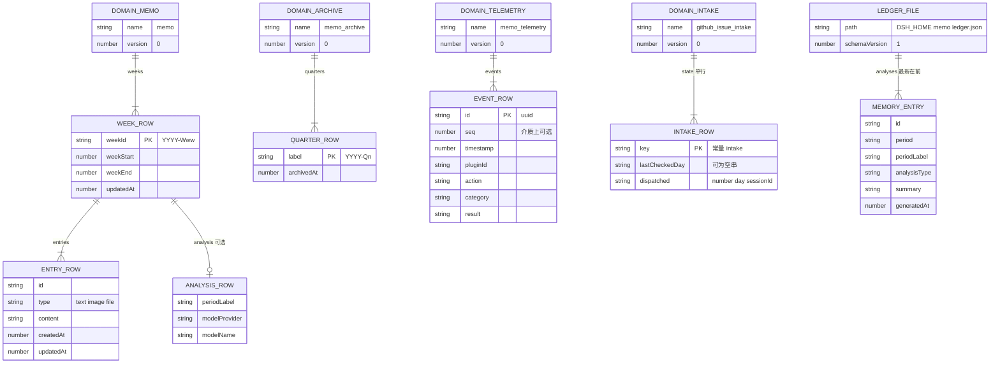
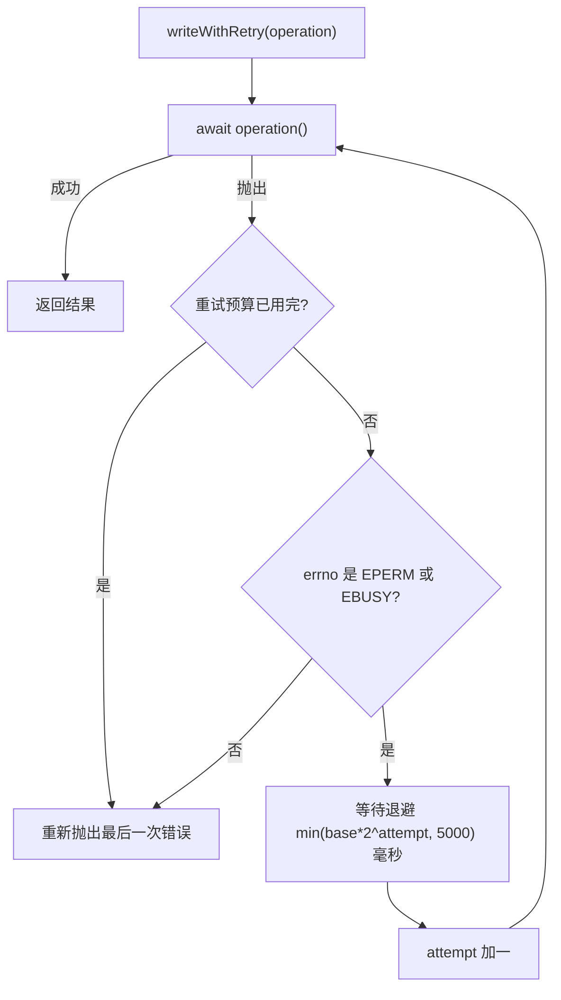

# 存储与持久化：域、schema 与写重试

本套件的持久状态只有两种落点：**四个 storage-domain 域**（KV 表，行 schema 是 zod）和**一份直接读写的 JSON 账本**（`$DSH_HOME/memo/ledger.json`）。域层负责"打开时校验、写入排队、后端原子发布"；账本绕开了这三样，自己解析 home 路径、自己决定读失败怎么办。两者的失败哲学正好相反——域层**报错**，账本报空并降级——这一点几乎解释了本页所有的细节。

本页按「域 → 表 → 键 → 行 schema → 打开/写入失败行为」组织，只讲状态与持久性契约。周记怎么算、一次接单 pass 做什么属于业务语义，见[备忘服务](../systems/memo-service.md)、[遥测服务](../systems/telemetry-service.md)与[Issue 接单服务](../systems/github-issue-service.md)；从记录推导出来的日历规则见[周期日历](../concepts/period-calendar.md)。

## 归属：谁拥有哪份状态

四张表加一份账本，全部本地、无远端，每个域只有一个写入者：

| 状态 | 介质 | 拥有者 | 其他服务怎么读它 |
|---|---|---|---|
| 备忘周行 | `memo` 域 → `weeks` 表 | `MemoService` | 无；日志分析走 `telemetry` 服务 API |
| 归档季度 | `memo_archive` 域 → `quarters` 表 | `MemoService` | 无 |
| 遥测事件 | `memo_telemetry` 域 → `events` 表 | `TelemetryService` | `memo` 调 `telemetry.analyzeForPlugin()`，不碰表 |
| 接单进度 | `github_issue_intake` 域 → `state` 表 | `GithubIssueService` | 无 |
| 分析账本 | `$DSH_HOME/memo/ledger.json` | `MemoService` | 无（明文文件，谁都能读，只有它写） |

跨服务读取一律走服务 API 而不是共享表：`analyzeLogs` 从 `ctx.get('telemetry')` 取分析、从 `ctx.get('githubIssue')` 取报告与预填链接（[`packages/memo/dsh-memo/src/index.ts`](../../packages/memo/dsh-memo/src/index.ts)）。这样"谁的域谁 open、谁 close"才成立——每个域在自己的 `[Service.init]` 里 `open`，紧接着用 `ctx.effect` 注册 `domain.close()`，域的寿命等于插件挂载的寿命。



四个域、四张表、一份账本：每个域恰好一张表，`memo` 的周行内部再嵌一个 entry 数组，账本是一个带 `schemaVersion` 的 JSON 文档。

## 域 → 表 → 键 → 行 schema

| 域名 | 表 | 表键 | 行 schema | open 者 | 关闭方式 |
|---|---|---|---|---|---|
| `memo` | `weeks` | ISO 周 id（`YYYY-Www`） | `memoWeekSchema`（内嵌 `memoEntrySchema`、`memoAnalysisSchema`） | `MemoService` | `ctx.effect` → `domain.close()` |
| `memo_archive` | `quarters` | quarter 标签（`YYYY-Qn`） | `archivedQuarterSchema` | `MemoService` | 同上，独立 effect |
| `memo_telemetry` | `events` | 事件 UUID | `telemetryEventSchema` | `TelemetryService` | 同上 |
| `github_issue_intake` | `state` | 常量 `INTAKE_STATE_KEY` = `'intake'` | `intakeStateSchema` | `GithubIssueService` | 同上 |

四个 spec 都只声明 `name`、`version: 0` 和 `tables`：没有 `global` 槽、没有介质布局选择、没有兼容版本声明，因此全部走域的默认行为——**一个域一份整介质文档**，在 JSON 后端上就是 `<root>/<域名>.json`（例如 `memo_telemetry.json`，文件里带 `{ unit: { name, version } }` 头，见[遥测旧介质用例](../../packages/telemetry/dsh-telemetry/tests/telemetry.spec.ts)）。

键的选择都不是偶然：周 id 是周记的身份，quarter 标签是归档的身份，事件 UUID 让每次写入都是"新行"而不是覆盖，而接单状态刻意只有一行——它是一份"到目前为止的进度"，不是一个可以并行增长的表。

### `memo` / `weeks`：键是 ISO 周 id，行内有两条跨字段约束

行字段为 `weekId`、`weekStart`、`weekEnd`、`entries`、`updatedAt`，外加可选的 `analysis`。schema 里有两处跨字段约束，都写成 `refine`：周行要求 `weekEnd > weekStart`，entry 要求 `updatedAt >= createdAt`（[`packages/memo/dsh-memo/src/spec.ts`](../../packages/memo/dsh-memo/src/spec.ts)）。所以"周界写反了""更新时间早于创建时间"这两类行在介质上不可能是合法的。

写入是**整行替换**：`table.put(weekId, week)` 传的是完整行，修改一条 entry 也要把整个 entry 数组重建后整体写回。这就是周行的 `updatedAt` 必须随每次修改更新的原因——它不是装饰，是这一行"最后一次被写"的唯一见证。

### `memo_archive` / `quarters`：键形状本身就是校验规则

行只有两个字段：`label` 与 `archivedAt`，其中 `label` 必须匹配 `/^\d{4}-Q[1-4]$/`。同一个正则还被服务层用作**写前守卫**：`archiveQuarter` 与 `unarchiveQuarter` 在拿到非法标签时直接返回 `invalid-quarter-label` 业务失败，不会让半条归档进入介质（[`packages/memo/dsh-memo/src/index.ts`](../../packages/memo/dsh-memo/src/index.ts)）。键形状在 schema 和调用点各守一次，是因为归档一旦落地就同时充当"这些周只读"的判据。

### `memo_telemetry` / `events`：键是 UUID，行 schema 管住了失败事件的形状

行字段为 `id`、`timestamp`、可选 `seq`、`pluginId`、`action`、`category`（`user-action`/`system`/`error`）、`result`（`success`/`failure`），可选 `sessionId`、`metadata`、`error`。除字段级约束外还有一条跨字段 `refine`：`result === 'failure'` 的行必须携带 `error` 记录（[`packages/telemetry/dsh-telemetry/src/spec.ts`](../../packages/telemetry/dsh-telemetry/src/spec.ts)）。这条 refine 的意义是"失败事件一定有错误码可分组"，日志分析的 `featureCodeRef` 分组因此不会碰到一条没有理由的失败。

键是服务分配的 `randomUUID()`，而重试重放的是**同一个闭包**，所以一次被重试的写仍然是 `put(event.id, event)`——同一个 id、同一行，不会写出第二条不同 id 的事件。

### `github_issue_intake` / `state`：一行，且"没有状态"有专门的表示

键是常量 `'intake'`；行是 `{ lastCheckedDay, dispatched }`，`dispatched` 的每一项是 `{ number, day, sessionId }`，其中 `number` 必须是正整数、`day` 与 `sessionId` 非空。`lastCheckedDay` 允许空字符串：服务用 `EMPTY_INTAKE_STATE`（`lastCheckedDay: ''`）表示"还没有跑过任何 pass"，于是"介质里没有这一行"和"这一行还没有日期"在语义上是同一件事，不需要第三种表示（[`packages/github-issue/dsh-github-issue/src/spec.ts`](../../packages/github-issue/dsh-github-issue/src/spec.ts)）。

这个域的行类型是**手写 interface**（`IntakeStateRow` / `IntakeDispatchedRow`）而不是从 zod 推导，schema 用 `as unknown as z.ZodType<IntakeStateRow>` 对齐。域本身由 `createIntakeDomain()` 在 `open` 现场构造，其中 `@deepseek-ai/dsh-storage-domain` 是动态 `import()`——这个包对它是可选 peer，缺了它只失去每日检查，不该让整个插件加载失败。

## 打开：校验发生在持久边界

域层的核心契约只有一句：**打开一个域时，用 spec 里的 zod schema 校验介质中的每一条记录**。写入侧不会替你补一遍 schema，所以一行非法记录完全可以被写出去，代价在下一次 `open` 结算。这条契约的后果非常具体：

| 域 | open 失败的代码路径 | 部署看到的后果 |
|---|---|---|
| `memo` / `memo_archive` | `[Service.init]` 里顺序 `await open(...)`，无 catch | 备忘服务不挂载；归档域打不开同样拖垮备忘服务 |
| `memo_telemetry` | `[Service.init]` 里 `await open(...)`，无 catch | 遥测服务不挂载，`ctx.get('telemetry')` 取不到它，依赖它的日志分析随之失效 |
| `github_issue_intake` | `openIntakeState()` 里 `try/catch` + `warn('intake state is unavailable: …')` | 插件照常挂载，`intakePersistent` 保持 `false`，自动接单的首启检查被主动关掉 |

域级隔离是真的，服务级隔离不是：两张表分别校验、归档功能不会污染 `weeks` 的记录集，但 `MemoService` 在同一个 `[Service.init]` 里**依次** open 备忘域与归档域、各自注册自己的关闭效应，任何一个 open 失败都让整个备忘服务初始化失败（[`packages/memo/dsh-memo/src/index.ts`](../../packages/memo/dsh-memo/src/index.ts)）。接单域相反，它把"介质坏了"降级成"这功能别开了"，因为关掉每日检查的代价远小于让整个插件起不来。

四个域都停在 `version: 0`，仓库里也没有任何域版本迁移代码——唯一的"迁移"逻辑是账本文件的一次性合并。所以"改 schema"和"升版本号"是两件事：前者只要新字段可选，旧行照样通过；后者等于换一份介质（文档头里的版本戳对不上），需要部署方手工迁移数据。

## 两条事故结论

这两条不是风格偏好，是从两次真实故障里抽出来的，改这块代码前应当先读一遍。

**一、坏行会让插件起不来。** 手工编辑、截断写、旧版本留下的非法行，效果是插件在**启动阶段**失败，而不是面板在运行时返回半个世界。备忘源码留着一条真实事故的注释：早先版本给补写的周行填了全零周界，行不满足 `weekEnd > weekStart`，那一行确实被写出去了，而它**让整个插件再也起不来**；现在补写走 `mondayOfWeekId` 现算周界（[`packages/memo/dsh-memo/src/index.ts`](../../packages/memo/dsh-memo/src/index.ts)）。用例把两半都钉住了：反例直接断言零周界行被 schema 拒绝，正例断言补写 `1999-W07` 拿到真实周界（[`packages/memo/dsh-memo/tests/memo.spec.ts`](../../packages/memo/dsh-memo/tests/memo.spec.ts)）。

**二、新增字段必须可选。** schema 变严格等于给既有介质设了一道门。遥测序列号 `seq` 的注释写得最直白：把它设为必填，第一次打开旧版本的存储时会把整个 unit 连同整份日志一起拒掉。因此 `seq` 在介质上可选、在交给调用方的 `TelemetryEvent` 上必需，读写两侧的类型故意不同（[`packages/telemetry/dsh-telemetry/src/spec.ts`](../../packages/telemetry/dsh-telemetry/src/spec.ts)）。这条规则对嵌套对象同样成立：周行的 `analysis` 整体可选，但它的子 schema 里 `modelProvider`、`modelName` 是必填，所以给嵌套结构加字段时要额外确认旧介质里不存在缺该字段的记录。

## 派生与落盘：哪些值刻意不存

`memo_archive` 整行只有 `label` 和 `archivedAt`。**quarter 覆盖哪些周 id 从不落盘**，而是在读取时由宿主的周期日历推出：`listArchivedQuarters` 与 `archiveQuarter` 的返回都带 `weekIds: weekIdsInPeriod('quarter', label)`，写保护也用同一族规则 `weekIdBelongsToPeriod(weekId, 'quarter', label)` 判断某个周是否已归档。理由写在归档域的声明处：周 id 可由标签推导，存一份副本等于存一份"日历被修正的那天就会错"的副本；把只读判断与归档列表都挂在同一个派生函数上，两者也就不可能互相漂移。

反过来，凡是**无法从介质重算**的值都必须落盘，而且只在写入时刻得到一次：

| 值 | 落盘 | 理由 |
|---|---|---|
| quarter 的周 id 列表 | 否 | 由 `label` 经周期日历派生，见[周期日历](../concepts/period-calendar.md) |
| `archivedAt` | 是 | 归档时刻没有任何其他见证者 |
| 周行 `weekStart` / `weekEnd` | 是 | 可由周 id 重算，但作为行的持久事实写出；补写的周行同样必须现算，不能填零 |
| `MEMORY_ENTRY.generatedAt` / `id` | 是 | 分析结果本身就是账本内容，无法重算 |
| 事件 `seq` | 是 | 写入顺序无法从 `timestamp` 恢复（毫秒会撞），详见下节 |
| `lastCheckedDay` | 是 | "今天已经检查过"必须跨重启成立，正是持久化的目的 |
| 周行可选 `analysis` | 可选，只读兼容 | 当前写入路径不再写它，读取时若存在则原样返回 |

`seq` 是"必须存"的最好例子：`Date.now()` 只有毫秒精度，一次重试可能和它跟随的失败落在同一毫秒，于是"失败之后还有几次尝试"会被算成 0——一个正在发生的缺陷读起来像旧缺陷。所以服务给每个事件发一个单调写序列号，并在 open 时**全表扫一遍取最大值**接着往下发；旧行没有 `seq`，读出时补 `0`，排序回落到 `timestamp`（[`packages/telemetry/dsh-telemetry/src/index.ts`](../../packages/telemetry/dsh-telemetry/src/index.ts)）。

## 分析账本：`$DSH_HOME/memo/ledger.json`

备忘的 AI 分析结果不住在域里，而是追加进一份 JSON 文件——本套件唯一直接读写文件系统的持久产物。

```json
{
  "schemaVersion": 1,
  "analyses": [
    {
      "id": "uuid",
      "period": "week",
      "periodLabel": "2026-W01",
      "analysisType": "总结",
      "summary": "…",
      "generatedAt": 1767225600000
    }
  ]
}
```

路径解析刻意镜像 DSH 自己的 home 契约，而不是 `env.DSH_HOME ?? homedir()` 这种朴素写法：`$DSH_HOME` 非空白时用它，否则 `~/.dsh`；空白覆盖值算未设（否则会解析出一个相对进程 CWD 的路径），`~`/`~/`/`~\` 前缀按平台 home 展开，最后 `resolve()` 成绝对路径。文件位置是 `<home>/memo/ledger.json`。这一整套行为有专门的测试钉住（[`packages/memo/dsh-memo/tests/ledger-home.spec.ts`](../../packages/memo/dsh-memo/tests/ledger-home.spec.ts)）。

**读写都不做逐条校验**，这是它与域层最大的结构性差异：`parseLedger` 只确认能 `JSON.parse`、`schemaVersion === 1`、`analyses` 是数组，里面每个条目的形状原样信任。于是"账本内容合法"由写入方保证，而"账本可读"由解析器兜底——两者不是同一件事。

**容量的写法决定了"历史会怎么丢"**：`appendToLedger` 把新条目插到最前、`slice(0, 500)` 截断，留住的是最新 500 条；每次追加都是"读整份 → 改 → 整份重写"，没有追加式 I/O。`listMemory` 默认只返回前 50 条（可按 `period` 过滤、可用 `limit` 放大）。

**失败语义是"降级而不抛"**，与域层正好相反：

- 文件不存在、不可读、不是 JSON、`schemaVersion` 不认识、写入被截断——一律回答"不是我能理解的账本"，调用方拿一份空账本。
- 写入失败（磁盘满、只读 home）只让 `writeLedgerAt` 返回 `false`，而 `writeLedger` 连这个布尔值都不再往上交；`analyze` 依然把本次分析结果返回给调用方，下一次成功写入会把整个列表重新序列化一遍。
- `listMemory` 是唯一还留着一层 `try/catch` 的地方：真出了意料之外的异常，它返回 `code: 'ledger-error'` 的业务失败，而不是抛给调用方。

这份容错不是多余的谨慎：账本用的是直接的 `writeFileSync`，**没有**域层那套临时文件加 `rename` 的原子发布，所以"读到半份文档"在这条路径上是正常故障形态，必须被当成空账本而不是异常。

### 一次性迁移：把平台 home 的旧账本折进来

home 解析曾经和 DSH 的契约不一致，于是未设 `DSH_HOME` 的部署把账本写在了**平台 home 顶层**的 `memo/ledger.json`。那份分析在别处不存在，所以初始化读取时做一次合并（[`packages/memo/dsh-memo/src/index.ts`](../../packages/memo/dsh-memo/src/index.ts)）：

1. 若旧路径与当前路径解析结果相同（部署把 `DSH_HOME` 设成了平台 home），直接跳过——否则会把刚读的文件改名。
2. 读旧文件；读出来是空列表（不存在 / 不可读 / 不是账本）就什么都不动。**别人写的文档必须原地留着**。
3. 按 `id` 求并集、按 `generatedAt` 降序、截到 500 条——按 `id` 去重正是迁移可以重复执行的原因：已经合并过的条目不会被写第二遍。
4. 只有当合并结果**落盘成功**之后，才把旧文件重命名为 `<legacy>.migrated`（若已存在则用 `.migrated.2`、`.migrated.3`…，绝不覆盖更早的回执）。
5. 落盘失败也照样把合并结果返回给调用方：只读 home 不该让"看历史分析"变成错误，回执没写成就意味着下次读还会再试一次。

迁移挂在每一次读取上（`readLedger` = 读 + 迁移），而 `appendToLedger` 也走 `readLedger`，所以一次 `analyze` 同样会触发迁移检查。被截断挤掉的那些旧条目不会消失——它们留在 `.migrated` 回执里，这正是"改名而不是删除"的意义。

## 瞬时写重试：只救一种错误，救不动就把错报出来

备忘与遥测各有一份逐字相同的 `writeWithRetry`：把**已经构造好的那次写操作**原样重放。重放同一个闭包（而不是重建记录）是安全性所在——事件 id 与序列号在进循环前就分配好了，重建记录会写出第二条不同 id 的事件。



规则可以精确到四句话：

1. **只有 `EPERM` 与 `EBUSY` 会被重试。** 两者都是 Windows 上 `rename(tmp, target)` 撞上杀毒扫描、索引器或另一个读句柄的时序竞争——JSON 后端发布 unit 的方式就是临时文件加重命名，所以同一操作等一会儿再试是对的。`EACCES` 被**刻意排除**：它是真权限问题的签名，等下去不会变好，只会推迟报错。
2. **退避是指数的，且有硬上限。** 第 `attempt` 次失败后等待 `min(storageWriteRetryDelayMs * 2^attempt, 5000)` 毫秒。上限 5000 ms 与可配置基数的上界（同样 5000）保证一次误配置不会把保存卡上几分钟；正常路径一次都不睡。
3. **预算是"额外尝试次数"。** `storageWriteRetries` 默认 `4`（取值 `0`–`10`），所以默认最多 5 次尝试、4 次等待（默认基数 50 ms 时依次约 50/100/200/400 ms）；`0` 表示只尝试一次——部署可以用它换掉那份额外延迟。
4. **预算耗尽后错误照样抛出**，不会被吞成一个"成功"。

两个服务在这条共同策略上的差别，才是运维真正需要知道的部分：

| | 备忘 `MemoService` | 遥测 `TelemetryService` |
|---|---|---|
| 被包裹的写 | 周行 `put`、归档 `put` 与 `delete` | 事件 `put` |
| 耗尽后的去向 | **向外传播**：Remote 调用 reject，客户端看到 `EPERM` | **丢弃**：写是 fire-and-forget，事件就此不存在 |
| 谁能观察到失败 | 直接调用方 | 只有 `flush()`：它用 `Promise.all` 等所有挂起的写，任何一次写拒绝都会让它 reject |
| 配置读法 | `Volatile`，每次调用重读，改设置下一次调用生效 | 构造时拷进私有字段，改设置要重挂载才生效 |

配置可见性的差异不是口味问题：`Volatile` 字段由 Loader 原地更新，只有"用到时再读"的服务才能兑现"改设置立刻生效"，细节见[配置与实时设置](../concepts/configuration-and-live-settings.md)。

**重试覆盖不到的地方同样重要**：`writeWithRetry` 只包裹域表的写。账本的 `writeLedgerAt` 不重试（它自己 catch 成 `false`），接单状态提交也不重试（catch 后只 warn）。所以"为什么这次保存没重试"的答案永远是"它走的不是域写"。

## 四条写路径的失败后果

| 写路径 | 介质 | 失败时会发生什么 |
|---|---|---|
| 备忘周 / 归档 | `memo`、`memo_archive` 域 | 重试 `EPERM`/`EBUSY`；耗尽后把最后一次错误抛给 Remote 调用方 |
| 遥测事件 | `memo_telemetry` 域 | 同样重试；耗尽后事件被静默丢弃，`flush()` 才会把拒绝暴露出来 |
| 备忘分析账本 | `$DSH_HOME/memo/ledger.json` | 不重试；写失败但本次分析仍然返回；下次成功写重新序列化整份列表 |
| 接单状态 | `github_issue_intake` 域 | 不重试；内存状态**先**更新，失败只 warn，代价是下一个 pass 可能重复派发同一 issue |

接单那条值得单独看，因为它的持久化承担的不是"记住数据"而是"防重复动作"：`lastCheckedDay` 存在，才使"当天首次启动检查"跨重启成立；`dispatched` 列表存在，才使同一个 issue 不会被开第二个 Session。所以提交顺序是"内存先行、磁盘随后"——这是全仓库唯一一处刻意偏离"先落盘再改内存"的地方，因为一个已经建好的 Session 无法因为写盘失败而撤销；`table.put` 失败时日志会明说后果（"a later pass may dispatch the same issue again"）。相对应地，**没有持久状态时自动接单的启动检查直接关掉**——宁可不跑，也不能在没有记忆的情况下跑两遍；同理，一次连 GitHub 都列不出 issue 的 pass 不会把当天记成"已检查"（[设计说明](../../docs/plans/2026-11-02-github-issue-intake-autopilot-design.md)）。

## 测试与可操作性

**注入 Windows 重命名竞争**：真实故障无法按需复现，所以备忘与遥测各有一份测试专用后端 `tests/flaky-storage.ts`。它包住已经挂载的 `json` 后端，注册成 `json-flaky`，并通过 `ctx.provide('storage.backend.json-flaky', …)` 让域层按名字路由到它——因此被测路径下面仍然是**真实的域与真实的 JSON unit**（harness 用 `{ backend: FLAKY_BACKEND }` 挂 `StorageDomain`）。注入点在 `putRecord` 与 `deleteRecord`（文件头注释说只装饰 `putRecord`，代码实际两者都注入，这也是为什么 `unarchiveQuarter` 的删除路径同样能被测到）；`loadAll`、`setGlobal`、`backupRecord` 直通。探针暴露 `attempts` 与 `arm(failures, code?)`，后者让用例可以在若干次成功写之后瞄准"下一次写"（[`packages/memo/dsh-memo/tests/flaky-storage.ts`](../../packages/memo/dsh-memo/tests/flaky-storage.ts)）。

**重试的四条边界**都被钉住：两次 `EPERM` 后第三次成功（备忘与遥测各有用例）、`EACCES` 一次都不重试、预算耗尽时备忘 reject（5 次尝试）而遥测丢事件、`storageWriteRetries: 0` 时只尝试一次；备忘还额外验证归档的 `put` 与 `delete` 各自都被重试（合计 4 次尝试）。注入失败的用例统一把 `storageWriteRetryDelayMs` 调成 1，避免测试真等退避。

**账本路径与迁移**：`ledger-home.spec.ts` 把平台 home 与 `DSH_HOME` 都搬进临时目录（默认 `ledgerHome: 'isolated'`，否则一次测试运行会污染开发者的 `~/.dsh/memo`，甚至把 `~/memo` 迁走），然后逐个钉住未设/显式/空白/带 `~` 的 `DSH_HOME`、读写对称，以及迁移的各个分支：合并后留回执、只合并一次、按 id 去重、容量挤压时旧条目留在回执里、不可解析文件原地不动、新路径不可写时仍显示旧条目、`DSH_HOME` 指向平台 home 时不迁移。

**旧介质可读性**：遥测的两个用例是这类测试的范式——一个跨冷启动验证 `seq` 从存储的最大值续上，另一个直接手写一份"早于 `seq`"的 unit 文件（含 `unit` 头与 `tables.events`），再打开断言旧行读出 `seq: 0`、排序回落到时间戳、且新写入仍排在所有旧行之后。

**接单状态**的用例跑在一个**内存 mock** 的 `storageDomain` 上（`MockStorageDomain` 只实现 `get`/`put`），断言一次成功 pass 后存储行里是本地日的 `lastCheckedDay` 与 `dispatched`、列不出 issue 的 pass 不写行、以及 `withoutStorage` 时启动检查一次 fetch 都不发。也就是说：接单这一路的持久性行为有覆盖，但**没有**经过真实域、zod 校验或 `json-flaky` 注入——想验证"接单域介质坏了会怎样"，得自己搭那套链路。

## 改动这块代码前的检查清单

- **新增一个域**：名字先过 `/^[a-z][a-z0-9_]*$/`（`memo_archive` 不是 `memo-archive` 就是这个原因），`version` 从 `0` 起，schema 用 zod、跨字段约束写成 `refine`，并在服务 `[Service.init]` 里 open + 用 `ctx.effect` 关闭；同时想清楚 open 失败该让插件起不来还是只关掉这个功能。
- **给已有行加字段**：一律可选，嵌套对象里的新字段同样要可选，否则旧介质第一次打开会把整个 unit 拒掉。要真正改变语义就先设计手工迁移，再谈升 `version`。
- **新增一条写**：先决定它属于哪一类——域表的写（用 `writeWithRetry`，把"什么算瞬时"钉在 `EPERM`/`EBUSY`）、还是文件写（自己决定失败是降级还是抛出）。别忘了写下"失败之后调用方看到什么"。
- **需要从记录推导的值**：能推出就不要存（quarter 的周 id 是模板），存下来就要接受"日历被修正时它会错"。
- **要验证持久化**：域写用 `flaky-storage` 注入 errno，别 mock 域层；账本类的改动则必须同时跑"不可解析文件"和"目标路径不可写"两个分支。
