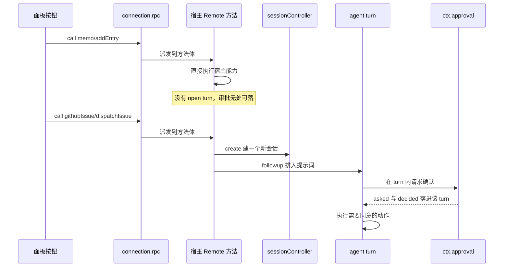
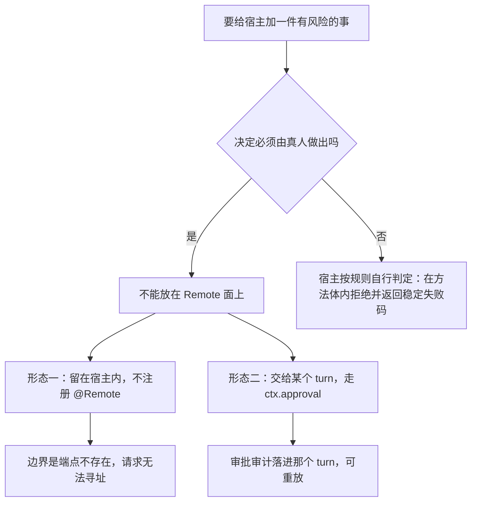

# 敏感能力与审批边界

这条规则约束的是「宿主替用户做一件有风险的事」这类能力：读宿主外部文件、改写 profile 依赖、启动子进程、以部署的身份对外建单。在这个仓库里它是一条**结构性**规则而不是一条策略配置——因为审批点只存在于一个开着的 agent turn 内，而面板的每一次点击都发生在 turn 之间。于是结论是硬的：敏感能力只有两种合规形态，其余做法都不是「更弱的审批」，而是没有审批。

规则本身写在仓库的设计原则里（[AGENTS.md](../../AGENTS.md) 的「UI 发起的敏感宿主操作没有确认点」，核验过程留在 Issue #103），并由两个包的 README 转述：[`@zhangj1164/dsh-memo`](../../packages/memo/dsh-memo/README.md) 的「No approval outside a turn」与 [`@zhangj1164/dsh-client-ui-memo`](../../packages/client/ui-memo/README.md) 的已知限制「面板发起不了审批」。这一页解释的是它为何成立、两种形态各自在源码里长什么样、以及仓库里哪些地方还没有收口。

## 机制：一次点击为什么拿不到审批

`ctx.approval.request()` 有两个硬前提：一个 **open turn**，以及那个 turn 的 `agent`。缺一个就抛错，而不是退化成「直接执行」或「静默允许」。

更关键的是它为什么必须这样：一次审批产生 `approval/asked` + `approval/decided` 这对事件，而这对事件正是 turn 的**提交/重放单位**——turn 的历史被重放时，必须能重新得到同一个答案。一次面板点击不属于任何一次可重放的历史，它没有 turn 可以落，因此「用户点了 → 宿主执行 → 记一笔确认」这条路在结构上不存在：即便调用方能拿到 `agent`，`request()` 仍会因为此刻没有 open turn 而失败。审批的本质不是「宿主能不能问一句」，而是「这个决定能不能落进某次 turn 的日志里」。

一次点击的两条去路：上半段是宿主自己动手（无审批可落），下半段是宿主把工作交给一个新 turn（审批在 turn 内）。

图的上半段是宿主自己动手的形态，下半段是把工作交给 turn 的形态；两者的分叉点不在方法签名，而在「敏感动作由谁的 turn 承担」。

## 两种合规形态

| | 形态一：留在宿主内部 | 形态二：交给 turn |
|---|---|---|
| 暴露面 | 有方法，没有 `@Remote`，因此没有线上名字 | Remote 只负责**发起**，不负责执行 |
| 审批来自 | 不需要（能力不可寻址） | 该 turn 内的 `ctx.approval` |
| 仓库实例 | `readExternalPath` | `dispatchIssue` / `runIntake` 经 Session 控制器 |
| 失效方式 | 有人补一行 `@Remote`（或一份 strict 定义）就把边界整个取掉 | 拿不到 `sessionController` / `agents` 时明确失败 |

### 形态一：留在宿主内，不注册 `@Remote`

`MemoService.readExternalPath` 是这一形态的标本。它真的会读宿主外部路径的文本，方法本身完好地留在服务上，只是没有 `@Remote` 注册——源码的 JSDoc 把理由写得直白：能力是想要的，缺的是确认点，`ctx.approval` 关在一个 open turn 上，而面板点击发生在 turn 之间，所以在确认点出现之前，任何东西都不该通过线上到达它（[`src/index.ts`](../../packages/memo/dsh-memo/src/index.ts) 的 JSDoc 与实现）。

这里的边界是**不可寻址**，不是「寻址后受限」。区别很实际：受限意味着请求能到达一处检查并被拒绝，于是那处检查本身成了新的攻击面与新的维护负担；不可寻址意味着线上根本没有这个名字，发给它的请求没有任何东西可供解析。测试把这一点当作契约来测：用 `remoteMethods(memo)` 取出命名空间下的端点列表，断言其中**有** `addEntry`、**没有** `readExternalPath`，正向断言则防止整份用例在重构后静默变成空壳（[`tests/external-path.spec.ts`](../../packages/memo/dsh-memo/tests/external-path.spec.ts)）。

用例注释还记下了完整条件：本包不发布 strict Remote 定义，因此网关从这些 `@Remote` 标记解析端点；**一份 strict 定义如果存在，会优先于标记被解析**。所以「这个方法不可达」的准确说法是「既没有标记，也没有 strict 定义」——将来无论用哪一种方式给它补上描述，都是把边界取掉，而不是只改一处声明。

这个形态有两个必须一起保住的推论：

- **方法体里没有任何审批或权限检查。** 安全性 100% 来自暴露面，因此把 `readExternalPath` 提升成 Remote 端点（或给它加一份 strict 定义）是「删除边界」这一动作，而不是「放宽一项检查」——改动量只有一行，代价全部落在别处。文件也确实仍可被宿主在进程内直接调用，测试正是这样调它的，所以它同时是「以后有了 turn 内传输可以直接接上去的宿主侧实现」。
- **它对备忘数据只读。** 用例断言成功后整份 `listWeeks` 与读取前完全一致：不写入任何周（遥测事件照旧记录这次读取），也没有可确认的动作。

一个必须点名的命名陷阱：`readExternalPath` 的失败码里仍有 `approval-denied`，但它指的是 `fs` 后端的**权限或沙箱拒绝**（`FS_PERMISSION_DENIED`、`FS_SANDBOX_DENIED`、`EACCES`、`EPERM`），不是一次审批决定。读取失败按原因分派成 `path-not-found` / `path-not-text` / `path-too-large` / `approval-denied` / `fs-error` / `fs-unavailable`，返回给调用方与记进遥测的是同一个码（见 [`src/types.ts`](../../packages/memo/dsh-memo/src/types.ts) 的失败联合与 `src/index.ts` 的 `readFailureCode`）。在同一条 `fs` 读取里，「宿主拒绝了你」和「用户拒绝了你」是两件不同的事实，而这个码只表达前者——这也是它没有借用审批语义的原因：既然这一层根本没有审批，就没有审批可以被拒。

### 形态二：把工作交给 turn（intake dispatch 经 Session 控制器）

`@zhangj1164/dsh-github-issue` 提供了另一种写法：Remote 方法存在，但它**不自己执行**敏感工作，而是把工作交给一个新会话。`dispatchIssue` 与 `runIntake` 都是 `@Remote`，实际动作在私有的 `dispatch` 里完成——经 `ctx.get('sessionController').create()` 建一个会话，再用 `ctx.get('agents').get(sessionId).agent.followup()` 把提示词排进队列。于是真正会动代码、跑工具、开 PR 的是那个会话的 agent turn，审批在那里有 open turn 可用。

这条路径的选择理由在设计文档里写得很清楚：走 Session 控制器而不是直接 `ctx.agents.create()`，是因为控制器负责 preset 解析、工作区归属与发布流程，经它建出来的会话与用户在 Web 里点「新建会话」得到的会话一致，才能在侧边栏里被看见、被继续、被归档（[intake autopilot 设计](../../docs/plans/2026-11-02-github-issue-intake-autopilot-design.md)）。同一个决定也让交接面变小：派发只做「建会话 + 排队一句提示词」，其余全部发生在 turn 内。

失败语义照旧是稳定失败码而不是静默降级：部署没挂 `sessionController` 或 `agents` 时返回 `session-unavailable`；建会话失败、或会话建好却没有发布出活着的 Agent、或提示词被拒绝，都返回 `dispatch-failed`，不伪造成功。

需要说清的现状是：**这个仓库目前没有任何插件直接调用 `ctx.approval.request()`，也没有任何 turn 内 tool 的注册点（没有一处 `ctx.tools` 调用）。** 形态二在这里的实现方式是「把能力搬进 turn」，而不是「在 Remote 里问一句」——后者做不到，前者是可用的。若要新增一个确实需要同意的 turn 内 tool，它应当落在 `ctx.approval` 上，而不是落在一个只有自己能认的令牌上。

## 被禁止的替代品：自建令牌与客户端对话框

仓库的规则点名了两个常见的「补一个同意」方案，并明确它们不是审批：

- **一次性令牌。** 令牌由宿主自建、自己校验，因此与被保护的方法处在同一个可寻址面上：谁能调到方法，谁就能先调到发令牌的那一步（或直接模拟它）。
- **客户端对话框。** 浏览器弹一个确认框，点「确定」后再发同一次 Remote 调用。

两者都绕开部署已经配置的 `ask` / `never` 策略——那份策略是部署方对「什么需要问人」的唯一声明——也都不产生任何审批审计。一句话概括：**只有被保护代码自己认得的确认，什么都确认不了。** 因此正确的修法永远是收口暴露面（不注册端点，或把工作搬进 turn），而不是在客户端重建一层同意。

这段规则在仓库里是有前史的，两个方向都被留下过痕迹：

- 「客户端调用前弹同意对话框」曾是 `readExternalPath` 的一条需求，2026-10-21 的设计文档明确**撤销**了它：该边界在代码里从未存在，且当时没有任何调用方能在其之上实现（[设计文档](../../docs/plans/2026-10-21-memo-read-external-path-accuracy-design.md)）。
- 一次性确认令牌曾被当成合理设计，但因为当时没有调用方、做出来无法验收而停在 `needs-triage`；现在的规则直接把它排除在合规形态之外。

同时要留出一条区分，否则这条规则会被误读成「UI 里不许有确认框」：面板对**用户自己的数据**做意图确认是可以的，例如 `ui-memo` 删除卡片前的 `ConfirmDialog`（[`MemoBoard.tsx`](../../packages/client/ui-memo/src/client/MemoBoard.tsx)）。它确认的是「我要删这条」，而它并不为一次宿主敏感操作背书，也不声称自己是审批。另一处相邻但不同的东西是宿主**自己就能判定**的策略：归档季度只读由 `addEntry` / `updateEntry` / `deleteEntry` 在方法体内以 `quarter-archived` 拒绝，理由是同一批 Remote 方法对任何客户端可达、且归档可能在对话框打开期间落地——那不需要 turn，因为答案不需要问人。审批要的是「决定属于人，并且必须落进某次 turn 的历史」。

## 尚未收口的案例：turn 之间的宿主副作用

两个包的 Remote 面上各留着一处「一次点击就替用户做成了一件有外部后果的事」，其共同点是：动作由宿主执行、发生在 turn 之间、没有确认，也没有可落的审批审计。

### `update`：改写 profile 依赖

`@zhangj1164/dsh-openwiki-visualize` 的 `@Remote('update')` 会以子进程执行 `dsh plugin --profile <profile> add <package>@latest`，也就是**改写 profile 的依赖**，然后回报需要重新加载。它的设计文档写的是「只在 UI 显式确认之后才执行」（[设计文档](../../docs/plans/2026-10-16-openwiki-visualize-design.md)）；但当前的浏览器半边是按钮直接 `onClick` 调 `client.update()`，控制器紧接着 `callRemote(..., 'update', {})`，中间没有确认步骤，更没有审批点——一次 turn 之间的点击就足以改写部署的依赖（[`src/index.ts`](../../packages/openwiki/dsh-openwiki-visualize/src/index.ts) 的 `update`、[`Pane.tsx`](../../packages/openwiki/dsh-openwiki-visualize/src/client/Pane.tsx) 的版本控件、[`controller.ts`](../../packages/openwiki/dsh-openwiki-visualize/src/client/controller.ts) 的 `update`）。

README 为它给出的收口手段是把不可逆步骤与自动路径分开：检查可以随插件启动自动跑，但检查永不安装，安装只在你要求时发生，并回报它执行过的确切命令（[README](../../packages/openwiki/dsh-openwiki-visualize/README.md) 的 Self-update 一节）。这是有意义的收窄——自动路径拿不到安装能力——但它不是同意语义：一次点击既没有征询部署的 `ask` / `never`，也没有留下审批审计。同一插件里 `start` / `stop` 启停本地子进程，也属于 turn 之外可达的宿主副作用，只是后果范围比改写依赖窄。

### `createIssue`：以部署的凭据对外建单

`@zhangj1164/dsh-github-issue` 的 `@Remote('createIssue')` 是同一类问题的另一个实例，而且范围更宽：它直接用部署解析出来的 GitHub 凭据调用 REST API 建一个真实 issue，并把 `{ number, url }` 返回给面板。请求里的 `repoUrl` 会覆盖配置的仓库，宿主的校验只到「URL 形状」这一层——能调到这个方法，就能在凭据可写的任意仓库里建单（host 由部署的 `apiBaseUrl` 决定，不含在请求面里）。

面板侧同样没有中间步骤：`ui-memo` 的「直接提交到 GitHub」按钮回调里直接 `controller.createIssue()`，控制器接着 `callRemote(..., 'createIssue', { report })`（[`MemoBoard.tsx`](../../packages/client/ui-memo/src/client/MemoBoard.tsx)、[`controller.ts`](../../packages/client/ui-memo/src/client/controller.ts)）。这一步在设计上正是为了替掉「预填 URL 还要用户按下提交」，所以它主动删掉了唯一那个人工节点；留下的 telemetry 事件记录的是结果，不是一次同意。

按本页的规则，这类能力只有两条出路：搬进 turn（做成一个 agent 在 turn 内可调用、因而能走 `ctx.approval` 的动作），或留在宿主内部不暴露。补一个对话框不是其中一条。

## 改动时的判断顺序

加一件新的敏感能力前，先问「这个决定属于人还是属于规则」，再决定它落在哪一侧。

- **需要人同意的能力**：不进 Remote 面。要么不注册 `@Remote`（不变量：方法体内不写权限检查，边界全在暴露面），要么把工作交给 turn（不变量：Remote 只发起，不执行）。
- **宿主能按规则回答的**：写在方法体内，返回稳定失败码，并且同样要在宿主侧拒绝，因为同一批 Remote 方法对任何客户端可达。
- **不要**用客户端确认框、自建令牌或一个隐藏参数来补审批——它们只增加一处看起来像边界的地方。
- **把一个已有内部方法提升为 `@Remote`（或为它补一份 strict 定义），等同于删除那条边界**：这需要一次显式论证（为什么它不再需要同意），而不是一次签名修改。`readExternalPath` 的端点缺失断言就是这条规则唯一的自动化守卫，把它改成断言「存在」等于同时改掉契约和文档。

## 相关页面

- [Host ⇄ 浏览器 Remote 契约](../architecture/host-client-remote-contract.md)——被这套边界约束的调用通道与线上形状。
- [GitHub issue 服务](../systems/github-issue-service.md)——形态二的实例（接单与派发），以及 `createIssue` 这处未收口的建单能力。
- [备忘服务](../systems/memo-service.md)——形态一的实例：`readExternalPath` 与宿主的写保护。
- [OpenWiki 预览](../systems/openwiki-visualize.md)——`update` 那次点击所在的面板。
- [Issue 接单自动驾驶](../workflows/issue-intake-autopilot.md)——形态二在完整工作流里的位置。
