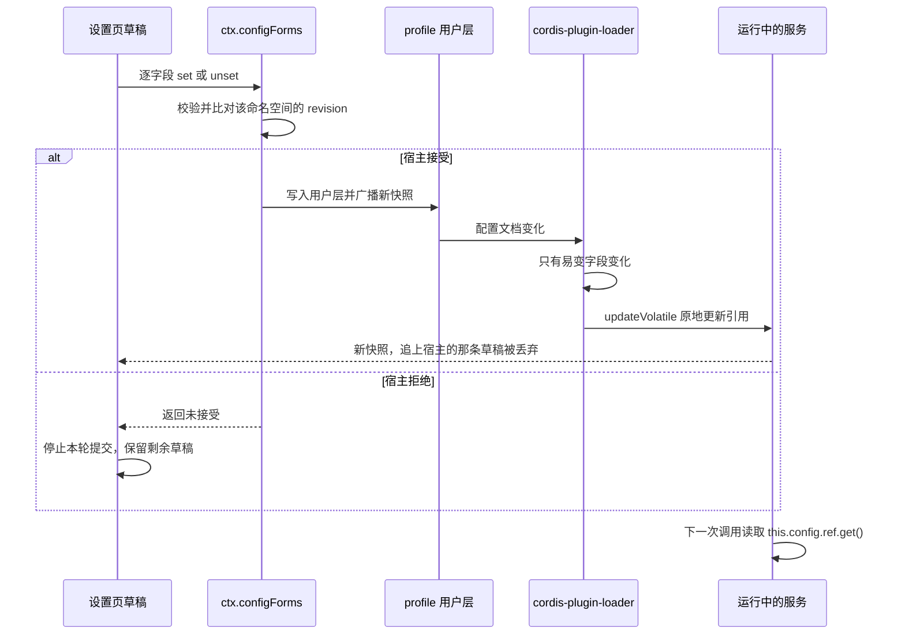
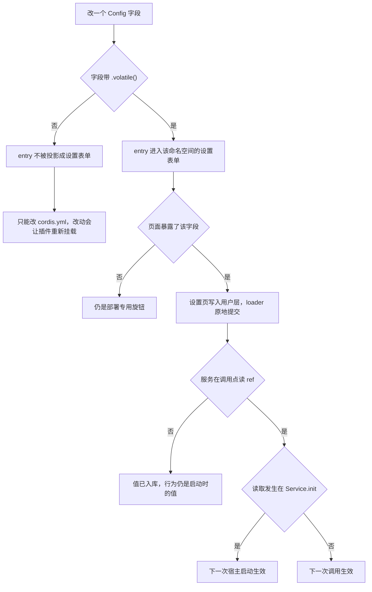

# 配置与热生效

在这个仓库里，「在 DSH Web 里改一个设置」不是一次普通的表单提交，而是一条同时落在宿主 schema（随 `lib/` 构建产出）、Loader 与浏览器三个位置的链路。任何一层断开，表现都不是报错，而是**页面消失**或**值写进去了但行为不变**——所以这三层的契约必须一起读：

1. **声明层**：部署可变的值是 schemastery 校验过的 `Config` 字段，带 schema 默认值，由部署在自己的 `cordis.patch.yml` 里覆盖。
2. **投影层**：`@deepseek-ai/dsh-settings` 只把 `.volatile()` 字段投影成设置表单；一个没有任何易变字段的 entry 根本不会出现在设置面板里。
3. **读取层**：Loader 对「只改了易变字段」的配置走原地提交、**不重新挂载插件**，所以服务必须在用到的位置读 `this.config.<field>.get()`；构造时拷贝成实例字段的写法会永远服务插件启动时的值。

这条链路的两端各有一个典型标本：`@zhangj1164/dsh-memo` 把 13 个字段全标易变、全部经 getter 读取（[`src/index.ts`](../../packages/memo/dsh-memo/src/index.ts)），`@zhangj1164/dsh-openwiki-visualize` 则一个易变字段都没有、在构造函数里 `Object.freeze({ ...config })` 冻结整份配置（[`src/index.ts`](../../packages/openwiki/dsh-openwiki-visualize/src/index.ts)），因此后者根本没有设置页。

## 写入路径

设置页不持有值。它只在宿主表单之上暂存草稿，再逐字段提交；草稿状态机的唯一真值是宿主已接受的快照。

图：一次设置页保存从浏览器到运行中服务的完整路径，以及被拒绝时的收场方式。

`SettingsDraft.save()` 只提交「脏」字段，按渲染顺序逐个 `set`/`unset`，每次写入都带快照里的命名空间 revision；一次被拒绝就中止整轮，剩下的草稿留在页面上让用户改（[`draft.ts`](../../packages/client/ui-memo-settings/src/client/draft.ts)）。宿主快照追上来时，与之相等的草稿自动消失，所以「保存成功」不需要页面自己记账。

**「已覆盖」只能看用户层的键存在性**，不能比较值：`snapshot.user` 里有这个字段就说明部署在用户层覆盖过它，行内才出现「恢复默认」，而「恢复默认」暂存的是一次 unset。值相同但未被覆盖的字段，不显示徽标——这是同一份文件里两个不同的真值来源，混用会把「和默认值恰好相等」误报成「改过」。

## 谁能上设置页

可投影的字段范围由 schema 决定，而不是由页面决定：**只有 `.volatile()` 标记的字段会进入表单**。一个 entry 的 schema 里若一个易变字段都没有，`volatileForm()` 返回 `undefined`，`describe()` 整条跳过这个 entry——于是它的命名空间从不被服务，页面按门控不注册，既不报错也不留空页。

| 包 | `Config` 字段 | 易变字段 | 设置页暴露 | 改动生效 |
|---|---|---|---|---|
| `@zhangj1164/dsh-memo` | 13 | 13 | 9 | 下一次服务调用 |
| `@zhangj1164/dsh-github-issue` | 18 | 8 | 8 | 下一次服务调用（`autopilotEnabled` 除外） |
| `@zhangj1164/dsh-telemetry` | 6 | 0 | 0 | 插件重新挂载 |
| `@zhangj1164/dsh-openwiki-visualize` | 15 | 0 | 0 | 插件重新挂载 |

两个宿主的选择方向不同，理由也不同：

- **memo 全标易变，只暴露 9 个。** 全标是为了让读法统一成 `.get()`，避免同一份 `Config` 一半是 ref、一半是普通值；暴露哪些是客户端页面的决定，与 schema 无关。留在 `cordis.yml` 的四个——`logAnalysisPlugins`、`storageWriteRetries`、`storageWriteRetryDelayMs`、`sessionSummaryMaxCharsLimit`——是部署级耐久性/覆盖范围参数，最后一项尤其特殊：它约束的是**另一个界面**长度选择器的上界，改动它会改变备忘面板的可选范围，不适合当普通设置项。
- **github-issue 只标那 8 个。** 剩下 10 个（`provider`、`model`、`token`、`tokenEnv`、`tokenCommand`、`tokenCommandTimeoutMs`、`apiBaseUrl`、`requestTimeoutMs`、`maxPrefillUrlLength`、`prefillTruncationNote`）在构造函数里就被拷贝或编译成实例字段，本来就不是按调用读的；它们只属于部署层。

同一个字段名在不同命名空间里是**两份独立的值**，只是作用范围不对称：memo 的 `repoUrl` 只在它自己发起的那次预填里生效——它作为请求覆盖传给 `githubIssue.prefilledIssueUrl()`，所以那一次调用用的是 memo 的值，而不是 github-issue 配置里的值；github-issue 的 `repoUrl` 则是它自己的 `runIntake`/`listClaimableIssues`/`createIssue` 与直接预填的默认仓库。两个默认值恰好相同，所以只有部署覆盖了其中一个之后这份差异才会显形，改一边不会同步另一边。

页面能做的第二层裁剪是「本地边界」。浏览器读不到 schema，所以数字上下界（`1..20`、`1000..200000`、`100..4000`）与 `sessionSummaryLanguage` 的三个枚举值是在页面里复述的一份；它只用于在往返之前拦住错误输入，宿主校验仍是唯一权威，schema 改了两边都要改（[`form.ts`](../../packages/client/ui-memo-settings/src/client/form.ts)、[`intake-form.ts`](../../packages/client/ui-memo-settings/src/client/intake-form.ts)）。写入按顶层字段名寻址，当前暴露的 17 个字段里没有数组或对象字段；列表值的字段（如 `logAnalysisPlugins`）留在部署层，本来也只适合整份替换。

## 命名空间就是 Loader 行 id

设置表单按 entry id 寻址，所以「命名空间」不是新概念，就是 bundle patch 里 `insert` 的那个 id：

- `memo` 是 [`packages/memo/dsh-memo/cordis.patch.yml`](../../packages/memo/dsh-memo/cordis.patch.yml) 插入的行 id，`github-issue` 是 [`packages/github-issue/dsh-github-issue/cordis.patch.yml`](../../packages/github-issue/dsh-github-issue/cordis.patch.yml) 插入的行 id。
- 该 id 成为 Loader entry 的 `options.id`，`dsh-settings` 用它作为表单命名空间；浏览器侧就是 `ctx.configForms.get('memo')` / `get('github-issue')`。
- 客户端把这两个字符串写成常量，而不去 import 宿主包：浏览器包不能依赖宿主包，而这些 id 是 bundle 已发布的 Loader 行名，不是私有模块路径（[`client/index.ts`](../../packages/client/ui-memo-settings/src/client/index.ts)）。
- `dsh --profile web --dump-config` 里看到的 `include:memo` 只是 Config Inspect 的展示前缀，不是命名空间。

页面注册以「该命名空间正在被服务」为前提（`configForms.whileServed`，多命名空间是 `some` 语义），两个页面互相独立：没装备忘就没有备忘页，没装接单就没有接单页，接单页也不要求先装备忘。同一条门控同时解释了为什么单独安装 `@zhangj1164/dsh-client-ui-memo-settings` 是安全的——它只插入自己的 `ui-memo-settings` 行，没有对应宿主时不显示任何痕迹（见[插件组合与 bundle 层](../architecture/plugin-composition-and-bundles.md)与[备忘设置页 UI](../systems/memo-settings-ui.md)）。

## 留空即复位

保存时，空文本被写成 **unset**，而不是空字符串：用户层的键被删掉，配置重新按分层文档解析，于是 schema 默认值（或「未设置」）回来。这条语义在每个字段上的含义都不同，因为它回到的是该字段的默认：

- `provider` / `model` 清空 → 未设置 → 请求不带路由，落到部署的 `agentDefaultModel` 选择。
- `claimLabel` 清空 → 回到 `ready-for-agent`，而不是「列出所有 open issue」。
- `sessionSummarySourceTemplate`、`sessionSummaryPrompt`、`autopilotPrompt` 清空 → 回到各自内置默认文案。
- `autopilotCwd` / `autopilotPreset` / `autopilotTimeZone` 的默认本身就是空串，空串在那里表示「跟随宿主默认」。

「写 unset 而不是空串」不是洁癖：memo 的路由解析用 `??` 串起「请求 → 本服务 `Config` → `agentDefaultModel`」，一个字面上的空串会被当成一个路由值而不是「未设置」（[`src/index.ts`](../../packages/memo/dsh-memo/src/index.ts)）；github-issue 侧虽然有 `firstNonBlank` 兜住空白，但两边的正确形状仍是 unset。清空即复位的另一个后果是页面不需要「必填」校验：一个必填字段清空后不是校验失败，而是恢复默认。

## 哪些改动仍需重启

热生效只覆盖一种改动：**只动了易变字段、且服务在调用点读 ref**。其余情况各有各的生效点。

图：一个配置字段要走到「不重启就生效」，要连续通过的四道关。

- **单字段易变写入 → 下一次服务调用。** 不重新挂载，模块级状态（已打开的存储域、子进程、缓存）原样保留；这正是设置页要的语义，也意味着 `Service.init` 里的工作不会因为一次设置写入而重跑。
- **`autopilotEnabled` → 下一次宿主启动。** 它能存、能写、能热提交，但「每天第一次启动检查」这件事是 `Service.init` 里读一次 ref 之后 `void this.startupIntake()` 发出去的，`init` 不会因为易变写入重跑，所以拨动开关从下一次宿主启动才改变行为；值本身已即时写进 profile 的用户层并跨重启存活（[`src/index.ts`](../../packages/github-issue/dsh-github-issue/src/index.ts)）。这是「存储语义」与「生效时机」分离的唯一一处，页面文案必须写明。
  - 开关的作用范围也只是这条启动检查：`runIntake`、`dispatchIssue` 这些 Remote 调用根本不读它，所以关掉自动派发之后手动接单照旧可用。
  - 启动检查另有一道前置条件——接单状态必须可持久化。部署没有挂 `storageDomain`（或打开失败）时 `init` 只告警并跳过检查，宁可不跑也不在没有「已派发过哪些 issue」的记忆下重复开 Session。
- **非易变字段或无易变字段的 entry → 插件重新挂载。** `@zhangj1164/dsh-telemetry` 与 `@zhangj1164/dsh-openwiki-visualize` 的每个字段都在构造时被拷贝（visualize 还整体 `Object.freeze`），改 profile 文档无法原地提交，loader 只能重新挂载插件；两者也就没有设置页。重新挂载会重建模块级状态，例如 visualize 会在 reload 时 reap 掉自己启的子进程，telemetry 会在 `init` 里重新扫描表来续上写入序号。
- **代码与组合变更 → 必须重启宿主。** 宿主插件的 `lib/` 在启动时 import，新写进 `dsh.profile.bundles` 的行在启动时组装，两者对运行中的进程都不可见；`patchReload: live` 只热加载配置**文档**，不加载模块（[备忘设置页 README](../../packages/client/ui-memo-settings/README.md)）。
- **`autopilotTimeZone` 是「校验位置」而非「生效位置」的特殊情况。** schema 接受任意字符串，非法值不会在写入时被拒；服务在量取「今天」时校验，失败则告警一次（按值去重）并回落到宿主时区，而不是让 `localDayKey` 抛错打断启动检查或派发。

## 为什么不把凭据和传输设置放上页面

`token`、`tokenEnv`、`tokenCommand`、`apiBaseUrl`、`requestTimeoutMs`、`maxPrefillUrlLength` 明确不进设置页。三个理由叠加，缺一都不够：

1. **写入面是浏览器。** 凭据一旦成为可投影字段，读写路径就多了一条浏览器 → 用户层的通路；凭据与部署级传输设置不该出现在浏览器界面里。
2. **写入落在 profile 的明文用户层。** 设置页的「保存」是往 profile 的 `cordis.patch.yml` 写值，不是往密钥环写值；token 存在那里就换了存放位置，而不是被保护起来。
3. **读法本身也不是热的。** `resolveToken()` 每进程只解析一次并缓存（`tokenResolved` / `resolvedToken`），即便把 `token` 标成易变、页面能改，运行中的服务也仍用第一次解析出的值——一个「看起来能改、实际不生效」的字段比不放上去更糟。

同理，`maxPrefillUrlLength` 这类值描述的是「这个部署的 GitHub 有多长容忍度」，改它属于部署决策，不属于看板用户的日常操作。

## 不硬编码规则

规则本身写在 [AGENTS.md](../../AGENTS.md)：部署可变的值必须是校验过的 `Config` 字段、可从 `cordis.yml` 配置；协议常量、外部规范和安全不变量保持固定。判断一个新值该不该成为 `Config`，问的不是「部署会不会想改」，而是「它是本部署的策略，还是与外部世界、与安全约束的约定」。这条规则有三处容易读错，本仓库的用法可以作为注解：

- **`DEFAULT_*` 常量不是可配置性，而是默认值的命名方式。** `DEFAULT_LOG_ANALYSIS_PLUGINS`、`DEFAULT_SESSION_SUMMARY_PROMPT`、`DEFAULT_DISPATCH_PROMPT` 都只作为 `.default(...)` 出现，字段本身仍可被部署覆盖。把默认值内联进调用点才是违规。
- **提示词片段也算可变值。** memo 的总结提示词是 `Config` 默认值而不是内联字符串，因为它面向模型、部署可能想改语言、行文风格或团队词汇；`sessionSummarySourceTemplate` 同理，占位符（`{sessionId}`、`{sessionTitle}`，以及提示词里的 `{language}`、`{maxChars}`）在服务端渲染时替换，部署自带的模板省略某个占位符就是主动放弃那一维控制。
- **反面是协议常量。** OpenWiki 预览把「它怎样与外部 CLI 说话」写成具名常量而不是 `Config`：脚手架文件名（`INSTRUCTIONS.md`、`log.md`）与 wiki 标记文件、端口上下界（`MINIMUM_PORT`/`MAXIMUM_PORT`）、拼出 `visualize <dir> --port <n> --no-open` 的参数向量都在 [`environment.ts`](../../packages/openwiki/dsh-openwiki-visualize/src/environment.ts)，探测路由 `GRAPH_PATH`（`/api/graph`）与回环地址 `LOOPBACK_HOST`（`127.0.0.1`）在 [`src/index.ts`](../../packages/openwiki/dsh-openwiki-visualize/src/index.ts)。改其中任何一个都不再是同一个协议，因此不该由部署配置。而「先试哪个端口、试几次、用哪个可执行文件、问哪个 registry」这些部署可能真想改的，全部是 `Config`（见 [OpenWiki 预览](../systems/openwiki-visualize.md)）。
- **安全不变量同样不是开关。** 集中体现是「UI 发起的敏感宿主操作没有确认点」：面板发起的 Remote 调用发生在 turn 之间，`ctx.approval.request()` 必然因缺少 open turn 而抛错，因此这类能力只能留在宿主内部，或包装成 turn 内的 tool 走审批。没有任何 `Config` 字段能把它变成「可绕过审批」——加一个就是漏洞，而不是配置项（见[能力与审批边界](capability-and-approval-boundaries.md)）。

## 契约的两半，各有测试钉住

易变标记只买到一半。`cordis-plugin-loader` 对「只有易变字段变化」的提交方式是**更新已有 ref 而不是重新挂载**，所以第二半是服务自己：每个值都要在用的地方读。两个宿主的 `tests/config-volatile.spec.ts` 各钉一半，写法是把 loader 的提交方式在测试里复现一遍——`updateVolatile(ref, createVolatile(value))`：

- **memo**：断言 13 个顶层字段全部带 `meta.volatile`（以后新增字段忘了标记，失败点在这里而不是在面板里）；再在进程内改掉 `provider`/`model` 之后调用 `analyze`，用未注册的路由证明这一次调用读取的是新提交的 ref（`NO_ADAPTER` + 新的 provider/model），而不是构造时的值。用例注释点名了它防的 bug：构造函数里拷贝一份字段的写法能通过这套测试之外的所有用例，却永远服务启动值。
- **github-issue**：断言易变字段**恰好**是设置页那 8 个（多标一个也会失败，因为它是等值断言）；再一次 `runIntake` 证明新的 `claimLabel`、`maxIssuesPerRun`、`autopilotCwd`、`autopilotPrompt` 在下一次派发里生效；第三个用例证明非法时区回落宿主时区而不抛错。

客户端侧的用例钉住另外几条：暂存不写、只保存改过的字段、空白写成 unset、被拒绝时保留草稿、只读与不可用状态不写、渲染顺序上遇错即停、以及宿主追上后草稿被丢弃；[`tests/entry.spec.tsx`](../../packages/client/ui-memo-settings/tests/entry.spec.tsx) 则用真实的浏览器半边钉住「两个页面各自注册、各自 gate、命名空间没人服务时一个 section 都不注册」。

## 失效模式与排查

- **页面静默消失 = 宿主产物陈旧。** 如果宿主 `lib/` 是另一个分支的产物，里面没有 `.volatile()`，`volatileForm()` 返回 `undefined`，`describe()` 跳过该 entry，浏览器门控不注册——表现是「没有页面、也没有错误」。排查顺序（先查宿主产物里的 `.volatile()`，再查 `--dump-config` 里的 `ui-memo-settings` 行，最后查浏览器是否取到 `client.js`）写在备忘设置页 README 里，第一处命中即原因。相关背景见[备忘服务](../systems/memo-service.md)与[GitHub 接单服务](../systems/github-issue-service.md)。
- **「页面出现」与「写入生效」是两个问题。** 页面出现只要求命名空间被服务；写入生效还要求字段真的易变（否则 loader 没有可原地提交的东西）。
- **边界是复述的。** 浏览器复述 schema 的数字与枚举，schema 改动必须同步页面，否则用户会被本地校验拦住一个宿主本来就接受的值（反向的漏网之鱼由宿主拒绝）。
- **只读与不可用。** 部署把文档设为不可写、或命名空间状态不是 `ready` 时，保存按钮不写，草稿仍留着，而不是静默丢弃用户输入。
