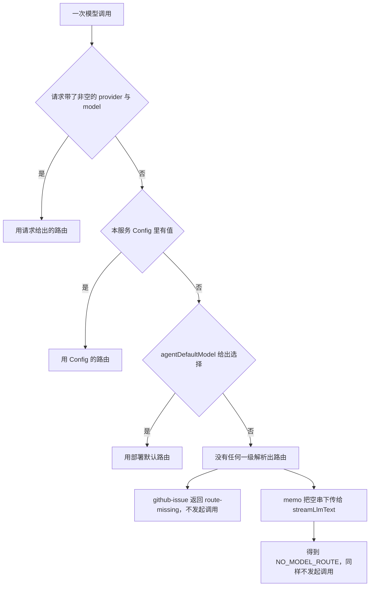
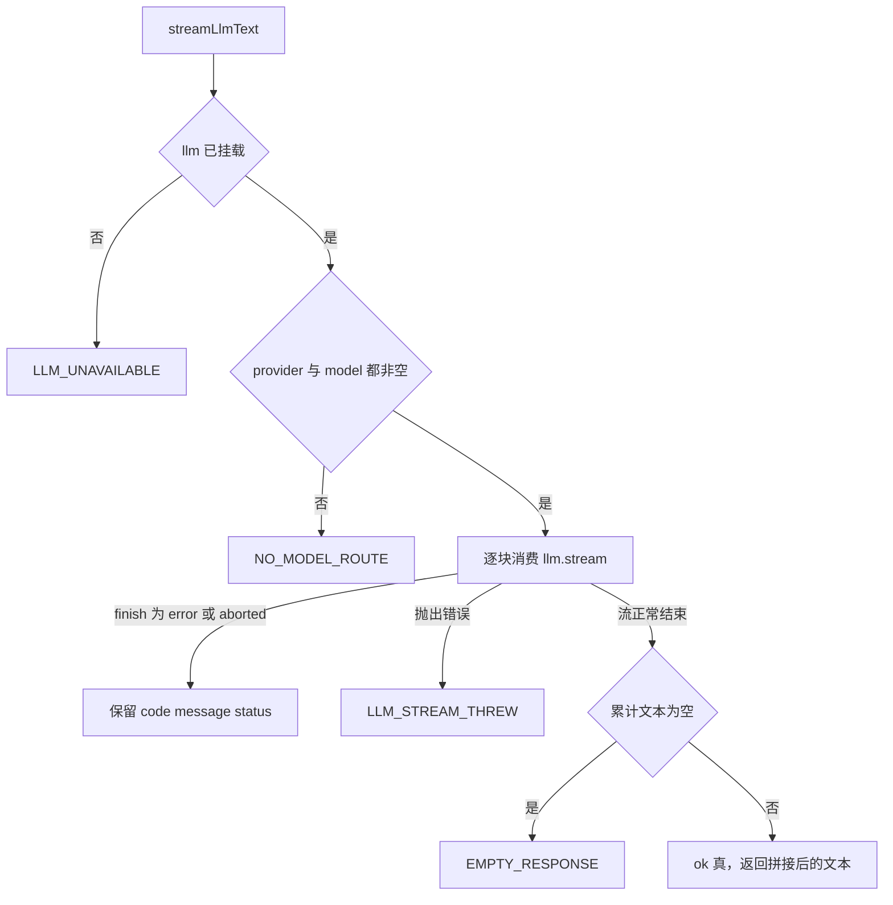
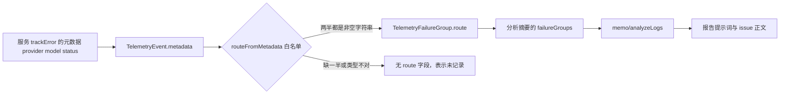
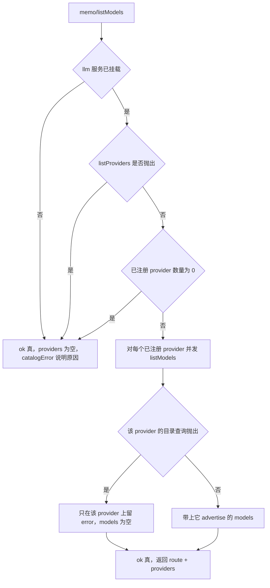

# 模型路由与失败事实保全

本仓库有两个会真正发起模型调用的宿主包：`@zhangj1164/dsh-memo` 与 `@zhangj1164/dsh-github-issue`。它们各自都要回答同一个问题的两半：

1. **这次调用发给谁？** —— 从请求、服务 `Config`、部署的 `agentDefaultModel` 三级里解析出一个 `{ provider, model }`。
2. **没拿到文本时，到底是谁的问题？** —— 把 DSH 归一化后的终态失败原样保留下来，而不是折成一句「模型没有产出」。

这两半之所以必须一起读，是因为它们曾被同一个缺陷连起来：浏览器硬编码了一个没人注册的 provider `custom`，于是每次调用都以 `NO_ADAPTER` 失败，而服务把整个失败压成一个空响，上报成「模型没有产出」。结果是路由缺陷被记成了模型问题，用户去查模型，查不到任何东西——这个失败当时连一条遥测都没留下。

## 路由解析：三级，且没有一级是硬编码

两个服务的 `resolveRoute` 是同一套顺序的两个实现：

1. **调用请求里带的 `provider` / `model`**（一次调用的覆盖，备忘面板的模型切换器就靠它）。
2. **本服务 `Config` 的 `provider` / `model`**（给这个服务单独钉一条路由，而不动另一个服务；这一级的生效方式两包不同，见下段）。
3. **部署的 `agentDefaultModel` 选择**（`ctx.get('agentDefaultModel')?.currentSelection()`，全仓唯一的「这个部署用哪个模型」真值来源）。

任何一级都没有字面量路由，所以一个部署只改配置就能整体改指向；`agentDefaultModel` 未挂载时该级直接跳过。

**「`Config` 里的这一级」在两个包里活法不同，而顺序相同。** `dsh-github-issue` 的 `Config.provider` / `model` 不是 `Volatile`：构造函数把它们复制进实例字段（`this.provider = config.provider`），所以这一级在挂载时就固定了，要改它就得改 `cordis.yml` 并重新挂载。`dsh-memo` 则把它们声明成 `Volatile`，`resolveRoute` 每次调用都经 getter 读 `this.config.provider.get()`，因此设置面板写入后下一次调用即生效、无需重挂（`config-volatile.spec.ts` 用同进程内改写 ref 的方式钉住了「绝不复制进字段」这条契约）。共用一套顺序不等于共用一套生效语义：排查「改了路由为什么还是旧的」时，问题往往不在顺序，而在这一级有没有被重新读到——详见[配置与热生效](configuration-and-live-settings.md)。另有一处小错位值得记住：memo 不 trim 解析结果，带前后空白的值会原样进入路由并以 `NO_ADAPTER` 现身；github-issue 的 `firstNonBlank` 会 trim。

图：三级路由解析，以及解析失败时两个包各自的收场方式。

**逐半解析，而不是逐级选中。** 两个包都没有「选中某一级、整条路由都从它来」这回事：`provider` 与 `model` 各自沿同一顺序找第一个合格值。所以一条能用的路由可以由不同来源拼成——比如 `Config` 只钉了 `provider`、`model` 来自部署默认——而一条路由不可用只有一个判据：两个半区里有一个是空的。读配置时值得记住这一点，否则很容易以为「只设 provider 不设 model」会整体回落到部署默认。

**「空白算未提供」在两个包里落点不同，但不是两种语义。** `dsh-github-issue` 的 `firstNonBlank` 在解析层就把空白（含纯空格，返回时还会 `trim`）当作缺失丢掉，所以一个 `provider: ''` 的请求不会遮蔽下一级（`Config` 或 `agentDefaultModel` 仍然回答），三级全空才返回 `undefined`。`dsh-memo` 的 `resolveRoute` 用 `??` 串联，字面上的空串会被当成一个路由值保留下来——所以真正拦住它的是 `streamLlmText` 的前置判断：`provider`/`model` 任一为空即返回 `NO_MODEL_ROUTE`，**在任何 `llm.stream` 之前**返回。两边都不会用空路由去发一次注定失败的调用，区别只在报哪个码。

解析失败后两个包给出的业务码也不一样，且这个不一样是刻意的：

- **`dsh-github-issue` → `route-missing`**。「没有任何东西给出路由」被当成与 `llm-failure` 不同种的缺陷：它的责任方是调用方或部署，不是模型。同时它会以 DSH 的 `NO_MODEL_ROUTE` 码记一条 `trackError`，附带 `featureCodeRef: github-issue:<action>`，让日志分析能把两个包按同一个码归组。这条事件传入的元数据是空对象 `{}`，即**不带** `provider`/`model`——没有路由可记，缺键在这里就是字面意思。另外 `optimizeIssue` 会先拒空描述再解析路由，所以一个空白输入拿到的是 `empty-input` 而不是 `route-missing`：输入校验与路由是两个独立判定，先说先失败的那个。
- **`dsh-memo` → `llm-failure` 且 `failureCode: 'NO_MODEL_ROUTE'`**。它保留 DSH 码的形状，所以「没解析出路由」与「模型报错」在同一条业务码下用 `failureCode` 区分。

## 失败事实：`streamLlmText` 的契约

两个包各有一份 `streamLlmText`，行为逐行相同。它只做一件事：把一次流式调用收敛成「文本」或「保留原因的失败」，绝不把后者变成 `undefined`。

| 结局 | 何时产生 | 诊断含义 |
|---|---|---|
| `LLM_UNAVAILABLE` | 宿主没挂 `llm` 服务 | 部署缺服务，既不是模型也不是路由问题 |
| `NO_MODEL_ROUTE` | 解析出的 `provider` 或 `model` 为空 | 三级都没给出路由，属配置缺陷 |
| DSH 原码（`NO_ADAPTER`、`MISSING_CREDENTIAL`、`AUTH`、`RATE_LIMIT` …） | `finish` 块的 `reason.kind` 为 `error` 或 `aborted` | 保留 `code` + `message` + 可选 `status` |
| `LLM_STREAM_THREW` | 异常逃出了 DSH 的归一化 | 传输层断裂，`message` 是原始异常文本 |
| `EMPTY_RESPONSE` | 流正常结束但累计文本长度为 0 | 路由是通的，模型应答了、没有内容 |

表外的四条细节值得记住：

- **`EMPTY_RESPONSE` 不是本地发明的码**，它来自 `@deepseek-ai/dsh-llm` 导出的 `EMPTY_RESPONSE_CODE`，是 DSH 自己为该情形保留的码。正因为有它，「模型应答为空」才不必和「路由不通」共用一个说法。
- **`finish` 的失败对象是必填的**，`error` 与 `aborted` 两种 reason 都带 `LlmFailure`。测试夹具里刻意保留了它，因为一个省略 `failure` 的 mock 会让服务悄悄丢掉 routing code 而没有任何测试察觉。
- **终块（`finish`）的判定规则。** 循环只做两件事：把 `text-delta` 累加进缓冲区，检查 `finish` 的 `reason.kind`。`error` / `aborted` 立刻返回失败——此刻缓冲区里可能已有半截文本，但原因优先，半截文本被丢弃，因为一份被截断的报告比一条可归因的失败更能误导人。`reason.kind === 'stop'` 不是失败，循环照常结束，「是否失败」完全交给之后唯一那条判据：累计文本长度为 0。所以 `EMPTY_RESPONSE` 的语义很窄——**流正常结束、一个字符都没有**；适配器失败、未注册路由、逃逸的异常都在到达这一步之前就以各自的码返回，不会被这条文本判据重新解释成「空响应」。
- **`status` 缺席就真的没有这个键**：失败对象以展开语法并入 `status`（`failure.status === undefined ? {} : { status }`），而下游 `routeFromMetadata` 对缺失 `status` 宽容、对缺失 `provider`/`model` 不宽容，两边正是靠这个写法才对得上。

图：一次模型调用被分成五种失败与一种成功，且没有任何一条路径会丢掉原因。

**表里第一行的可达性取决于挂载方式。** `dsh-github-issue` 声明了 `static inject = ['llm']`，没有 `llm` 它根本不会激活，所以那一行对它只是防御；`dsh-memo` 的 `inject` 里没有 `llm`（它按 `ctx.get('llm')` 可选读取），因此「未挂 `llm`」是 memo 真实可达的部署状态——而且这种部署仍然必须能打开备忘看板，这是下一节目录降级的由来。

## 保留下来的四个事实

失败向上走时，被保留下来的永远是同一组事实：**`failureCode`**（DSH 的 provider-neutral 机器路由码）、**`provider`**、**`model`**、**`status`**（provider 返回的 HTTP 状态，DSH 给了才有），加上一条以路由为前缀的 **`message`**。

两个包把同样的事实摆在不同的位置上，因为它们面向的读者不同：

- **`dsh-github-issue`** 返回 `code: 'llm-failure'` 的业务失败，`message` 形如 `model call to provider "
" model "<m>" failed: <code>: <message>`，状态码进遥测 metadata。调用方（备忘面板的 issue 编辑器）只需要展示 `message`，它自己就把路由与码说全了。
- **`dsh-memo`** 除同样的 `message` 前缀外，还把 `failureCode`、`provider`、`model`、`status` 提到失败对象**顶层**（`MemoMemoFailure` 的 `llm-failure` 变体），所以控制器与后续分析不必解析字符串就能分支。`summarizeSession` 更是把每次模型失败塞进它自己的 `outcomes` 条目，一次限流不会丢掉其他会话的摘要；而这类 `llm-failure` 结局**不再二次记账**（`summaryFailure` 见到 `llm-failure` 就跳过 `trackError`），因为 `llmFailure` 已经带着路由记过一次，重复记录会让日志分析的失败计数虚高。

**成功事件也带路由。** 两个包都在 `track` 的成功分支里并入 `provider` / `model`（`routeFacts`）。理由是可判读性：只在失败时记路由的遥测能说出「哪条路由坏了」，却永远说不清「改动路由有没有修好它」。同样的道理让备忘面板的 `listModels` 也把解析出的路由同时记进成功与失败事件。

由此得到一个有用的判读分层：

- `NO_ADAPTER` / `NO_MODEL_ROUTE` / `route-missing` → 路由或配置写错了，换模型无用。
- `MISSING_CREDENTIAL` / `AUTH` → 凭据问题，`status` 通常给出 401/403。
- `RATE_LIMIT`（常带 429）→ provider 侧限流，可重试，不是代码缺陷。
- `EMPTY_RESPONSE` → 路由、凭据、限流都可能是好的，问题在「模型对这个请求没给出文本」。
- `LLM_STREAM_THREW` → 传输层，`message` 是唯一线索。

## 路由事实的闭环：元数据键名本身就是契约

失败事件里的那三个键不是随手写的自由字段，而是跨包的约定。`dsh-telemetry` 在做日志分析时用 `routeFromMetadata` 按白名单只抄 `provider`、`model`、`status` 三样，并额外要求前两者都是**非空字符串**、`status` 是有限数——任缺一半就当作「这条事件没记录路由」，`TelemetryFailureGroup.route` 直接不出现。整条链是：

图：路由事实从服务的遥测元数据一路走到 issue 报告，中间只有一道白名单。

三个后果值得记住：

1. **改名即断链。** 把元数据里的 `provider` 换成别的键不会编译失败、也不会让服务测试失败，只会在 issue 报告里静默丢掉「这个失败发生在哪条路由上」。这正是「保留事实」这类改动最容易漏的一环。
2. **「未记录」与「没有路由」被严格区分。** `TelemetryFailureGroup.route` 的类型注释写明：缺席只意味着这些事件没记，绝不是「没有路由」；老事件早于这个写入，所以它们的失败组天然没有 route。`github-issue` 的 `route-missing` 事件就是这一类的正例——没有路由可记。反过来，memo 在解析出空路由时会把 `provider: ''`、`model: ''` 显式写进元数据（而不是省略键），因为「什么都不存在」与「这个事件早于记录功能」必须能分开；这两种写法最终都不产生 `route`，但它们的含义不同。
3. **报告能说「在哪条路由上」，全靠这一步。** `memo/analyzeLogs` 把每个失败组的 `route` 原样塞进给 `githubIssue.generateReport` 的 `failureGroups`，报告提示词与预填 issue 正文因此可以写出「provider X 的 model Y 返回了 status Z」。没有这条链，报告只能写「失败了 N 次」。

## 路由目录：`listModels` 如何在宿主侧生成

模型切换器要列出「这个部署能切到哪些模型」，而这件事只有宿主知道。DSH 把 `listProviders()` 与 `listModels(provider)` 只暴露给宿主，浏览器拿不到注册表，所以目录由 `memo/listModels` 这个 Remote 方法生成：

图：目录聚合的三条降级路径，全部落在一次「成功」的结果里。

四条规则决定了这个目录的形状：

1. **只列已注册的 provider。** DSH 另有 `listConfigurableProviders()`，它会包含 dormant 项（声明了但未配置）。dormant 路由承载不了调用，列出来就是列一个必然失败的选择，因此不在目录里。
2. **单个 provider 的目录错误留在该 provider 自己身上**（`MemoModelProvider.error`）。一个 adapter 抛错不能让其余 provider 的模型一起消失，也不能把整次查询变成失败。各 provider 是并发查询的，所以一个不可达的 provider 只让看板多等一次慢查询，而不是排一串队。
3. **`catalogError` 表示「注册表读不出来」**，与「某个 provider 什么都没 advertise」是两件事：前者是部署问题，后者只是目录为空。三条路径会写它——未挂 `llm`、`listProviders()` 抛出、零注册 provider——并分别以 `llm-unavailable` / `providers-threw` / `no-provider` 记进遥测的 `reason`。
4. **`listModels` 没有失败变体**（`MemoListModelsResult` 只有 `ok: true` 一支）。一个没有模型路由的部署仍然必须能打开备忘看板，能力缺失要可见，但不能让 UI 不可用。

注意第 3 条与遥测口径的一处刻意错位：这三条路径的业务结果都是**成功**，但记录的遥测事件是 `result: 'failure'`。理由是这个事件的读者在问「注册表为什么读不出来」，而不是「用户这一下失败了吗」；代价是日志分析里 `memo:listModels` 会出现失败组，而看板其实照常可用。读这类失败组时要按 `reason` 而不是按 `result` 下结论。

浏览器侧因此有一条明确的不变式：**路由不在这里产生。** 控制器从 `memo/listModels` 读回 `provider`/`model`/`providers`/`catalogError`，`selectModel` 只接受出现在已上报注册表里的 provider（且两半都非空），并把选择存进浏览器本地存储；`analyze`/`exportReport`/`optimizeIssue` 只在存在选择时才把 `provider`/`model` 一起放进请求。读失败与读成空被严格区分：`catalogError` 存在时注册表是**未知**而非空，用户记住的选择必须保留；`catalogError` 不存在而 provider 不在列表里时，说明该 provider 已被移除，选择即被丢弃并清除持久化。目录成员资格只是建议，从不被当作请求白名单——DSH 明确规定目录是 advisory、不参与校验，所以「不在目录里」不是拒绝的理由，界面上一个被钉住但目录里没有的模型仍然照旧提供。

## 维护缝：两份 `streamLlmText`

`streamLlmText` 在两个宿主包里各有一份**结构相同、互不依赖**的实现，而不是一个共享依赖：

- `dsh-memo` 依赖 `dsh-github-issue`（`peerDependencies` 里的 `workspace:^`），不是反过来；下层包替上层包背一个文本助手会形成反向耦合，所以两份并存。
- 代价是：**任何「保全失败事实」的改动都必须同时落到两处**（`packages/memo/dsh-memo/src/llm-text.ts` 与 `packages/github-issue/dsh-github-issue/src/llm-text.ts`）。只改一处不会编译失败、不会测试失败，只会让一个服务的失败报告悄悄退化回「什么都没有」——这正是这类改动最容易漏的地方。
- 源码里写明了退出条件：**第三个消费者出现时，才是把这一对抽成共享包的时机**。

相关的耦合还有一条：`memo/analyzeLogs` 把 memo 解析出的路由作为请求覆盖传给 `githubIssue.generateReport`。由于请求级优先，非空的那一半会胜过 github-issue 自己的 `Config`；而空的那一半在 `firstNonBlank` 里按「未提供」丢掉，于是回落到 github-issue 的 `Config` 与部署默认。所以「报告生成跟随 memo 的路由」在 memo 解析成功时成立，memo 缺的那一半仍可能由 github-issue 自己补上——这条链不会因为 memo 没路由就直接变成 `route-missing`。报告生成一旦失败，会被折成 `github-issue-failure` 的业务失败，消息来自下层而路由事实留在了 github-issue 的事件里。

## 测试落点

这些不变式都有直接对应的测试，改动时先看它们：

- **路由优先级与空白**：`github-issue.spec.ts` 覆盖「请求 → Config → 部署默认」三级、空白串不遮蔽下一级、以及解析失败返回 `route-missing` 且 `llm.requests` 为空；`memo.spec.ts` 覆盖 Config 解析、`NO_ADAPTER`、`MISSING_CREDENTIAL` + `status`、`EMPTY_RESPONSE`、显式请求覆盖配置。memo 的 `listModels` 测试还钉住了「Config 不钉路由时跟随 `agentDefaultModel`」。`config-volatile.spec.ts` 单独钉住「路由 ref 就地改写后下一次调用即生效」。
- **目录**：`memo.spec.ts` 的 model catalog 组覆盖多 provider 顺序、单 provider 抛错不影响其余、`catalogError` 与「空目录 / 单个 provider 空目录」的区分、未挂 `llm` 的降级。
- **浏览器侧规则**：`controller.spec.ts` 覆盖「注册表读不出时仍可用并说明原因」「空注册表与坏注册表不同」「拒绝钉住未上报的 provider」「注册表未知时保留已记住的选择」「清除选择后两个半区都不再发送」。
- **遥测**：两个包都断言成功事件带路由、失败事件带保留码 + 路由 + `status`，`route-missing` 事件带 `NO_MODEL_ROUTE` 与 feature 锚点；`memo.spec.ts` 还断言「解析出的空路由写成空串而不是省略键」「无可用 provider 的降级事件也带路由」，以及没有遥测挂载时 github-issue 照常工作。`telemetry.spec.ts` 从另一端钉住白名单：元数据里混进 `apiKey` 之类字段时 `group.route` 的键仍只有 `provider`/`model`/`status`，而只写了 `provider` 的事件不产生 `route`。

两个写得最薄的地方值得先补：`streamLlmText` 的 `LLM_UNAVAILABLE` 与 `NO_MODEL_ROUTE` 两支目前没有直接断言（github-issue 侧因为 `inject` 本就不可达，memo 侧只有 `listModels` 的 `llm-unavailable` 降级被覆盖），而「元数据键名是契约」这条链只在 `dsh-telemetry` 自己那边被测到。

## 相关页面

- [宿主服务与集成边界](../integrations/dsh-host-services.md)
- [GitHub Issue 服务](../systems/github-issue-service.md)
- [备忘看板 UI](../systems/memo-board-ui.md)
- [分析与导出工作流](../workflows/analyze-and-export.md)
- [日志分析到 Issue 的工作流](../workflows/log-analysis-to-issue.md)
- [配置与热生效](configuration-and-live-settings.md)
