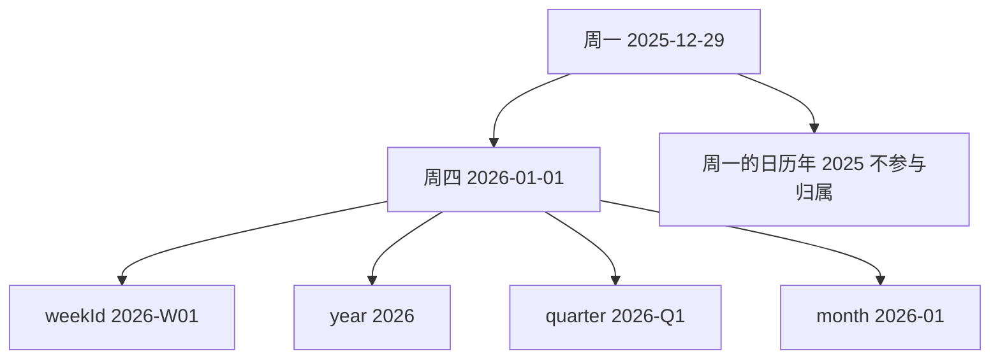
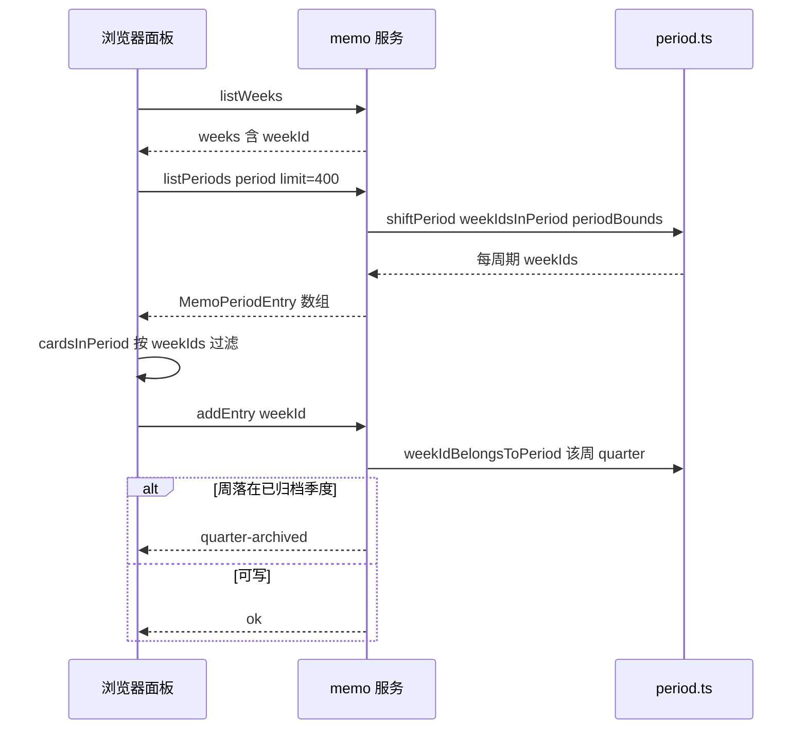

# 四维周期日历（period calendar）

备忘面板可以按周、月、季、年四个维度翻看同一批卡片，而卡片在磁盘上只有一个键：ISO 周 id。于是"某张卡属于哪个周期"必须只有一个答案，否则同一张卡会在时间线里出现、在分析里消失，或者在归档后被悄悄改写。这份契约落在纯模块 `packages/memo/dsh-memo/src/period.ts`（`@zhangj1164/dsh-memo/period`）里：不碰 storage、不碰 Context、不碰模型，只做日历数学，并由宿主 `src/index.ts` 原样再导出，两侧引用同一份实现。

这一页讲的是"标签长什么样、哪一周归哪个周期、谁负责算出这份归属"。周记录的 schema 与落盘位置见[存储域、schema 与持久性](../architecture/storage-and-persistence.md)，面板如何消费它见[备忘面板 UI](../systems/memo-board-ui.md)，服务端方法全貌见[备忘服务](../systems/memo-service.md)，归档只读的完整流程见[季度归档与只读](../workflows/quarter-archive-and-read-only.md)。

## 为什么只允许一份日历

客户端完全可以自己写一遍周计算，代价是两个实现慢慢分叉：宿主用一套边界判定做分析、导出与只读守卫，浏览器用另一套决定列表显示什么，某天早上两者就在跨年那一周上给出不同答案，而现象只是"某些卡片看不见"。

契约因此分成两半，各自由一方负责：

- **形状**（标签长什么样）两侧都知道，因为浏览器要判断 `localStorage` 里记住的标签还能不能用。
- **归属**（哪个周 id 落在哪个周期）只有宿主算。浏览器拿到的是已经解析好的 `weekIds` 数组，它只做 `Set` 成员判断。

这就是宿主 `listPeriods` 返回 `MemoPeriodEntry` 时坚持把 `weekIds` 一起带回来的原因：面板与时间线共用一份日历，而不是两份可能漂移的日历。

这条分工不只靠纪律维持，它写在依赖图里：`@zhangj1164/dsh-client-ui-memo` 只从 `@zhangj1164/dsh-memo/client` 导入**类型**（`MemoAnalysisPeriod`、`MemoPeriodEntry`、`MemoWeek` 等），从不导入 `@zhangj1164/dsh-memo/period`，所以浏览器包里根本没有那套日历数学可调；它唯一复制的是标签正则（见[浏览器侧](#浏览器侧只消费不重算)）。`controller.spec.ts` 的 `asks the host for the timeline instead of computing periods locally` 把这条边界也钉住了：刷新必须发出一次 `memo/listPeriods`，而不是本地凑出一个周期列表。

## 四个维度与固定标签

标签格式是**钉死的**，因为它是已存数据的读法：`MemoAnalysis.periodLabel`、账本 `ledger.json` 里的 `MemoMemoryEntry`、归档表的 `label` 主键都存着它。改了格式，历史数据就再也对不上。

| 维度 | 标签形状 | 示例 | 标签年份的来源 |
|---|---|---|---|
| `week` | `YYYY-Www` | `2026-W01` | 该周**星期四**的日历年（ISO 周年） |
| `month` | `YYYY-MM` | `2026-09` | 日期自身的日历年 |
| `quarter` | `YYYY-Qn` | `2026-Q3` | 日期自身的日历年 |
| `year` | `YYYY` | `2026` | 日期自身的日历年 |

注意第 5 列：`week` 是唯一不取自日期本身日历年的维度。`periodLabelFor('week', 2025-12-29)` 是 `2026-W01`，而 `periodLabelFor('year', 2025-12-29)` 是 `2025`——同一天在两个维度上分属两年，这是规则，不是 bug。

形状校验与生成都是每维一张表：

```ts
const LABEL_PATTERN: Record<MemoAnalysisPeriod, RegExp> = {
  week: /^\d{4}-W\d{2}$/u,
  month: /^\d{4}-(0[1-9]|1[0-2])$/u,
  quarter: /^\d{4}-Q[1-4]$/u,
  year: /^\d{4}$/u,
}
```

`isPeriodLabel(period, label)` 只回答"这个字符串像不像该维度的标签"，不做语义校验（`2026-W99` 形状合格、语义不存在）。语义层面的失败在下一层显式暴露，见[失败与边界语义](#失败与边界语义)。

**存储层对四个标签并不一视同仁。** 归档表 `archivedQuarterSchema` 把 `label` 钉成 `/^\d{4}-Q[1-4]$/u`，所以一行非季度标签的归档记录既写不进去也打不开；而周表 `memoWeekSchema.weekId` 只要求非空字符串，`memoAnalysisSchema.periodLabel` 同样只要求非空字符串。也就是说季度标签有 schema 兜底，周 id 与 `periodLabel` 的格式只由写入方（`periodLabelFor`、`mondayOfWeekId`）保证。这条差别决定了改格式的代价：季度标签会当场在写入或开库时报错，周与分析的标签则会被存储静静接受，直到某次归属计算再也找不到对应周才暴露——那时代码通常已经上线很久。所以改标签格式必须当成数据迁移，而不是改一串正则。

## 周的计算：周一起始 + 星期四规则

两条规则合起来定义了 ISO-8601 周，缺一不可。

**周一起始。** `startOfIsoWeek(date)` 把任意时刻折到所在周的周一 00:00 本地时间：星期日 `getDay() === 0` 视为上一周的末尾，偏移 `-6` 天；其余取 `1 - day`。面板上的"本周"、卡片的新增目标周、周记录的 `weekStart`/`weekEnd` 都建立在它之上（宿主侧 `computeWeekBounds()` 从它出发，见[写入路径](#写入路径行边界也由周-id-决定)）。

**星期四决定周年。** `isoWeekParts(date)` 先取周一，再取该周星期四，`weekYear` 就是星期四的日历年；周号则用"包含 1 月 4 日的那一周是第 1 周"来定位：把 `weekYear` 年 1 月 4 日折到其周一，再数两个周一相差几周。

于是 `2025-12-29`（周一）落进 `2026-W01`，而 `2027-01-01`（周五）属于 `2026-W53`——两端都由同一个星期四判定得到。反方向由 `mondayOfWeekId(weekId)` 提供：解析 `YYYY-Www`，从该年 1 月 4 日所在周的周一加 `(week - 1) * 7` 天，得到周一，或对畸形 id 返回 `undefined`。

### 边界周实例：2025-12-29 → 2026-W01

这一周横跨年、月、季三个边界，正好把规则讲清楚。它的周一是 2025-12-29，星期四是 2026-01-01。



上图：一周的归属只看它星期四落在哪个区间；周一的日历年只影响它落在哪一天，不影响它是哪一周。

| 问题 | 答案 | 依据 |
|---|---|---|
| 这一周的 id | `2026-W01` | 星期四在 2026 年，且它是 1 月 4 日所在周的周一 |
| `periodLabelFor('year', 2025-12-29)` | `2025` | `year` 维度取日期自身的日历年 |
| 它属于哪个 month / quarter / year 周期 | `2026-01` / `2026-Q1` / `2026` | 星期四 2026-01-01 落在这些区间内 |
| 它属于 `2025-12` / `2025-Q4` / `2025` 吗 | 否 | 星期四不在这些区间内 |
| 它在 2025 年的时间线里出现吗 | 不出现 | 2025 的周列表不含 `2026-W01` |

最后两行是这套规则的实际收益：一张 12 月 29 日记下的卡片，会出现在"2026 年 1 月""2026 年 Q1""2026 年"里，而不会同时被算进 2025 年 Q4 的分析。

### 写入路径：行边界也由周 id 决定

日历不只用于展示，它同时决定一条周记录落盘的 `weekStart` / `weekEnd`。宿主有两条路径，都以周 id 为输入：

- **当前周**：`computeWeekBounds()` 用 `isoWeekParts` 得到 `weekId`，再由 `weekBoundsFromMonday` 把周一定到本地 00:00、把周日定到 23:59:59.999，因此这条记录的边界与 `periodBounds` 给出的闭区间完全同坐标。
- **回填历史周**：`appendEntry` 在周记录还不存在时用 `mondayOfWeekId(request.weekId)` 现算边界，而不是相信请求里带来的时间戳；`mondayOfWeekId` 返回 `undefined` 时以 `invalid-week-id` 拒绝，所以一个不是 `YYYY-Www` 的周 id 无法创建行。

两条路径都受同一约束：`memoWeekSchema` 要求 `weekEnd > weekStart`。这条 refinement 不是形式主义——早期版本给回填周写零边界，产出的行会被 schema 拒绝，而存储域在打开时要校验每一条记录，于是那一行让整个插件启动不了（回归测试 `the week schema rejects the zero-bounds row an earlier revision wrote`）。所以"边界必须由周 id 派生"既是日历规则，也是启动可用性规则；schema 与落盘细节见[存储域、schema 与持久性](../architecture/storage-and-persistence.md)。

## 归属与枚举是一对

契约里有两个函数，看起来一个查一个列，实际上必须是同一个判断的两种写法：

```ts
export function weekIdsInPeriod(period: MemoAnalysisPeriod, label: string): string[]
export function weekIdBelongsToPeriod(weekId: string, period: MemoAnalysisPeriod, label: string): boolean
```

两者共用私有函数 `periodRange(period, label)`：它先用 `isPeriodLabel` 做形状校验，再把标签翻成**半开区间** `[start, endExclusive)`——周是周一到下周一、月是 1 日到下月 1 日、季是季首月到下季首月、年是 1 月 1 日到次年 1 月 1 日。

- `weekIdBelongsToPeriod`：解析出周 id 的周一，加 3 天得到星期四，判断它是否落在区间内。
- `weekIdsInPeriod`：从区间起点所在周的**前一个**周一开始，每周加 7 天，只要星期四 `< endExclusive` 就继续，落在 `[start, endExclusive)` 内就记入结果。起点故意提前一周，正是为了收进"周一在上个周期、星期四在本周期"的那一周——也就是上一节那个边界周。

因此 `weekIdsInPeriod` 就是 `weekIdBelongsToPeriod` 的枚举：一个周期列出的周 id 集合，恒等于该周期判定返回 `true` 的周 id 集合。这不是靠约定维持的，而是被测试直接钉住的：`period.spec.ts` 取 2026 年全部周 id，对四个维度各取一个标签，逐个断言 `listed.has(weekId) === weekIdBelongsToPeriod(...)`。

一个可推导出的强性质是**铺满且不重叠**：每个周恰有一个星期四，所以每周恰属于一个周期。2026 年的 12 个月摊开、4 个季度摊开，都与该年的 53 个周 id 完全一致且无重复。这条性质是可测的（`partitions a year into twelve months and four quarters with no gap or overlap`），而基于字符串前缀的实现根本表达不出它。

> 因为"被列出"与"被判定"是同一个判断，一张卡不可能在一个周期里显示、却在另一个周期里被守卫或分析——这正是归档只读与分析取数敢直接复用这个函数的前提。

其余对外函数同样建立在 `periodRange` 上，失败方向统一为"拒绝"：

| 函数 | 作用 | 输入不合法时 |
|---|---|---|
| `startOfIsoWeek(date)` | 所在 ISO 周的周一 00:00 本地时间 | 不适用（总有答案） |
| `isoWeekParts(date)` | `{ weekYear, week }` | 不适用 |
| `periodLabelFor(period, date)` | 维度 + 日期 → 规范标签 | 不适用 |
| `isPeriodLabel(period, label)` | 标签形状是否属于该维度 | `false` |
| `mondayOfWeekId(weekId)` | 周 id → 周一 `Date` | `undefined` |
| `weekIdsInPeriod(period, label)` | 周期 → 升序周 id 列表 | `[]` |
| `weekIdBelongsToPeriod(weekId, period, label)` | 成员判定 | `false` |
| `periodBounds(period, label)` | 闭区间毫秒 `{ start, end }` | `undefined` |
| `shiftPeriod(period, label, delta)` | 在同维度平移若干周期 | `undefined` |

`periodBounds` 是"给存储/查询用的闭区间"版本：起点是周期首日本地 00:00，终点取 `endExclusive` 前 1 毫秒，所以 `2026-W37` 的 `end` 是星期日 23:59:59.999。`shiftPeriod` 是时间线分页的唯一来源：它按维度做日历算术（周加 7 天、月加一个月、季加 3 个月、年加 1 年）再重新格式化，因此 `2026-W53 + 1 = 2027-W01` 这类跨年平移不会跳格或重复。

## 宿主侧：时间线与归档都由宿主解析

`listPeriods` 是四维导航的唯一事实来源。它从 `periodLabelFor(request.period, now)` 出发，用 `shiftPeriod(..., -offset)` 逐段回退，为每个周期填出 `id`、`label`、`start`、`end`、`current`、`weekCount` 与 `weekIds`。四个细节值得记住：

- `limit` 默认 26，被夹到 `[1, 400]`；`shiftPeriod` 返回 `undefined` 时循环直接结束。
- **只向过去枚举**。`offset` 从 0 起、标签一律取 `shiftPeriod(..., -offset)`，所以时间线里永不出现未来周期：今天之后的时间段没有可点的入口。这只是导航契约，不是写入约束——`appendEntry` 只校验周 id 的形状（加归档守卫），一个未来的 `2027-W05` 照样能被写进表里，只是面板不会主动提供这条路。
- **空周期也返回**。没有存过任何周的月份仍然是一条可导航的条目，否则时间线会跳过用户日历上看得见的月份，也失去了"在空周期里写第一张卡"的入口。
- `weekCount` 是"这个周期里有几条周记录"，**不是"有几条备忘"**。`getOrCreateCurrentWeek` 会为零条目的当前周建一条空行，删除一张周里最后一张卡也只是把该行写成 `entries: []` 而不删行，所以 `weekCount > 0` 只说明周记录存在。浏览器因此改用卡片自身的 `weekId` 判断某个周期是否为空（`periodHasCards`）。

归档方向复用同一批函数，而不是另写一套季度映射：

- `archiveQuarter` / `unarchiveQuarter` 只接受匹配 `/^\d{4}-Q[1-4]$/u` 的标签，其它输入一律 `invalid-quarter-label` 且不写任何行。
- 归档条目返回的 `weekIds` 每次都用 `weekIdsInPeriod('quarter', label)` 现算，**从不落盘**。归档表只存 `{ label, archivedAt }`：周 id 是标签的确定性派生，存一份副本只会在日历被修正的那天变成错误的归档范围。
- 写入守卫 `archivedWeekFailure(weekId)` 对每条归档标签调用 `weekIdBelongsToPeriod(weekId, 'quarter', label)`。这就是"归档在四个维度都成立"的机制：无论在周视图还是年视图点下编辑，被拒与否都取决于该周的星期四落在哪个季度。
- 分析（`analyze`）与导出（`exportReport`）取数走 `collectEntries` → `weekMatchesPeriod` → `weekIdBelongsToPeriod`，维度非法时返回 `false`。所以"面板上看到这张卡"和"这次分析读到这张卡"用的是同一个判定。



上图：浏览器只拿宿主解析好的 `weekIds` 做过滤；写入是否放行，由宿主用同一个成员判定回答。

## 浏览器侧：只消费，不重算

面板控制器明确不实现日历：它不知道某个月包含哪几周，也不尝试推导。`refresh(period?)` 先 `listWeeks`，再 `listPeriods({ period, limit: PERIOD_HISTORY_LIMIT })`，`PERIOD_HISTORY_LIMIT` 就是宿主的上限 400（约 7.7 年，覆盖个人备忘的整个历史）。取满而不是取一屏，是因为标签规则与年份切换器都从这一条时间线算出来，短窗口会静默隐藏切换器本该提供的年份。

拿到 `weekIds` 之后，浏览器侧的每一步都只是集合运算或字符串前缀：

- `cardsInPeriod(cards, weekIds)`：把 `weekIds` 建成 `Set`，过滤卡片。切换维度、切换标签、切换年份都复用它。
- `targetWeekId(selection, weekIds, currentWeekId)`：新卡片优先落在选中周期内的某一周（当前周在内就用当前周，否则用列表最后一支），选中周期为空时退回当前周——因为宿主不会为一个空周期发明一个未来/过去周。（签名里的 `selection` 目前未被读取：判定只依赖 `weekIds` 与 `currentWeekId`。）
- `archivedWeekIds`：把宿主在 `listArchivedQuarters` 里返回的每个季度的 `weekIds` 合并成一个 `Set`，`isArchived(card)` 只做 `has` 查询。归档读失败时宁可显示为可编辑并给出提示，也不隐藏卡片。
- `yearOf(label)`：取标签前四位。四个维度的标签都以年份开头，这正是选择器可以纯客户端实现的原因。
- `visiblePeriods` / `selectableYears`：前者保留"当前周期 + 至少一条卡片的周期"，按年份过滤后截到 10 条；后者只提供至少有一个标签的年份，并始终包含当前年。两者都不需要判断某周属于哪个周期。

有一个边界值得说清：面板交给 `targetWeekId` 的"当前周"不是再向宿主问一次，而是 `listWeeks` 的首条（`weeks[0]?.weekId`，该列表按 `weekStart` 从新到旧）。这仍然是"消费宿主的数据"，但它的语义是"最新一条周记录"，而不是"今天所在的周"。当它为空、且所选周期在 `periods` 里对不上（`weekIds` 为空）时，`targetWeekId` 返回 `undefined`，`addCard` 就以 `no target week for the selected period` 拒绝，而不是自己推一个周 id。需要真正的"今天所在周"时应当扩展宿主的返回值——`listArchivedSessions` 已经在返回 `currentWeekId`——绝不要在面板里算一个。

浏览器唯一复制的是**形状**：`logic.ts` 里维护一份 `LABEL_PATTERNS`，用于 `readSelection` 校验 `localStorage` 里恢复出来的标签。它刻意不与宿主逐字节一致——例如月形状写成 `^\d{4}-\d{2}$`，会接受宿主拒绝的 `2026-13`。代价可控：这类标签在 `refresh` 时找不到对应 tag，选择会退回同年的最新标签，而不是让面板停在一个看不见的周期上。

## 季度永远按标签命名

归档动作的入参是**季度标签**，不是"当前正在看的周期"：

- 宿主侧 `archiveQuarter({ label })` 先做标签校验，再写入归档行。传入 `2026-W37`、`2026-09`、`2026`、`not-a-quarter`、空串都会得到 `invalid-quarter-label`，且归档表保持为空。
- 浏览器侧 `archiveCurrentQuarter()` 在维度不是 `quarter` 时直接 no-op（返回 `false`，不发生任何 RPC），把入口收在标签唯一的地方。

原因是"当前周期所属的季度"没有唯一答案：一个年包含四个季度；而一周的周一可能落在上一个季度，它本身却属于持有其星期四的那个季度。若从周期起点的时间戳反推季度，年视图会归错档，跨季的周也一样。回归测试 `archives exactly the quarter named, never a neighbour` 就是钉这件事：归档目标季度后，相邻季度必须仍然可写，重复归档同一季度也只留一行。

## 失败与边界语义

日历函数不抛异常，全部 fail-closed，调用方无需 try/catch：

- 畸形标签：`isPeriodLabel` → `false`；`weekIdsInPeriod` → `[]`；`weekIdBelongsToPeriod` → `false`；`mondayOfWeekId`、`periodBounds`、`shiftPeriod` → `undefined`。`listPeriods` 因此对畸形输入退化为空列表而不是崩溃。
- 畸形周 id：形状不符或周号不在 `1..53` 都返回 `undefined`，于是成员判定为 `false`。
- `mondayOfWeekId` 只校验"周号在 1..53"这个形状，不校验"该年真的有第 53 周"。不存在的 `2025-W53` 会被映射到 2025-12-29，而它规范化后的 id 是 `2026-W01`——归属只会落到 2026，永远不会被算进被错误命名的年份。方向是安全的：伪造的 id 拿不到额外的写权限。
- 全部运算在**本地时间**里做：`setHours(0,0,0,0)` 定日起点，用 `setDate` 做日位移而不是固定毫秒数，周号差用 `Math.round(差值 / 7 天)` 吸收夏令时造成的一小时偏移。因此同一个部署里不同时区的浏览器会落到各自的本地周，而 `periodBounds` 的闭区间与宿主的 `weekStart`/`weekEnd` 保持同一坐标。
- 维度值被当作字符串传入的地方（`weekMatchesPeriod`）先验证它属于四个已知维度之一，否则返回 `false`——未知维度不会意外匹配到所有周。
- 对上层可见的后果：`analyze` / `exportReport` 不另行校验 `periodLabel`，畸形或跨维度标签（`2026-13`、`2026-Q9`、`2026-09` 配 `quarter`）不会得到"标签非法"这种错误码，而是因为成员判定为空集，最终以 `no-entries` 失败。这条路径上唯一的标签错误码来自归档（`invalid-quarter-label`），因为归档写入必须先校验自己的主键。

## 两个历史缺陷与今天的回归测试

这套规则不是凭空设计的，它是两个真实缺陷的收敛结果，都来自"用字符串前缀代替日历数学"：

1. **季度用了与月份共享的 `YYYY-` 前缀**。前缀判定下，`2026-Q1`、`2026-Q2`、`2026-Q3`、`2026-Q4` 与同年的 `2026-01`…`2026-12` 无法区分，结果每个季度都被报成 `Q1`。现在由 `gives each quarter only its own weeks` 覆盖：Q1 从 `2026-W01` 到 `2026-W13`，Q2 从 `2026-W14`，Q3 从 `2026-W27`，Q4 到 `2026-W53`，且 Q3 的每个周对另外三个季度都判定为 `false`。
2. **周标签取了周一的日历年**。年边界的那一周因此差一年，卡片会在错误的一年里出现或消失。现在由 `labels a year-boundary week with the year owning its Thursday` 覆盖：`2025-12-29 → 2026-W01`，`2027-01-01 → 2026-W53`。

代码里仍留有两处过时注释：`collectEntries` 的 docstring 还写着"month/quarter/year 按 weekId 前缀匹配"，`weekMatchesPeriod` 的 `@returns` 还写着"whether the week's Monday falls inside the period"；两处实现都早已改成星期四规则。读代码时以实现为准；这也是"注释描述旧算法"值得顺手修掉的一个例子。

## 扩展与维护

改动这份契约时，有四条边界值得守住：

- **加维度不是加一个枚举值。** 需要同步：`MemoAnalysisPeriod` 联合类型、`LABEL_PATTERN`、`periodLabelFor`、`periodRange`、`shiftPeriod`，浏览器侧的 `PERIODS` 与 `LABEL_PATTERNS`（显示顺序也在 `PERIODS`）。更重要的是重新确立"铺满且不重叠"这条性质——新维度是否能与既有时段一一对齐，必须由测试回答，而不是由格式字符串回答。
- **浏览器永不重算归属。** 需要新的时间段视图时，扩展 `listPeriods` 返回的 `weekIds`，不要在面板里引入第二套周历。
- **派生值不落盘。** 季度的 `weekIds`、`periodBounds` 的毫秒边界都是标签的确定性函数；一旦存下来，日历被修正的那天它就变成了错误状态。
- **归档只按标签。** 任何"从当前视图推断季度"的便捷入口都会重新引入第一个缺陷的同构问题。

## 测试地图

| 测试文件 | 覆盖点 |
|---|---|
| `packages/memo/dsh-memo/tests/period.spec.ts` | 年边界周年、1 月 4 日起周号、星期日的归属；四维标签格式与拒绝交叉维度；周 id 往返；月/季/年归属、铺满不重叠、53 周、季度独立性；枚举与判定的一致性；`shiftPeriod` 跨年可逆；`periodBounds` 闭区间与畸形返回 |
| `packages/memo/dsh-memo/tests/memo.spec.ts` | `listPeriods` 四维都含当前周且 `weekCount ≥ 1`；最新在前、标签不重复、空周期可用；归档解析出的 `weekIds` 等于时间线；只归档被命名的季度；归档后 add/update/delete 全部 `quarter-archived` 且在逐周检查中覆盖整个季度；回填周的边界必须由周 id 派生（零边界行被 schema 拒绝） |
| `packages/client/ui-memo/tests/logic.spec.ts` | `yearOf` 读四维标签；`periodHasCards` 区分"有周记录"与"有备忘"；标签规则与年份切换器 |
| `packages/client/ui-memo/tests/controller.spec.ts` | 刷新时只向宿主索取时间线（`asks the host for the timeline instead of computing periods locally`）；只显示 `weekId` 属于所选周期的卡片；在选中的历史周期里新增会写进该周期的某一周；找不到时间线时退回同年的最新标签 |
