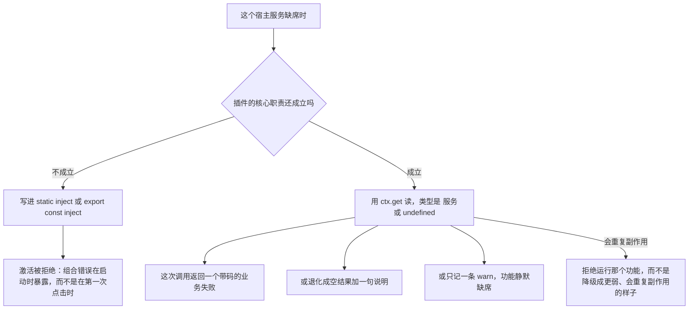
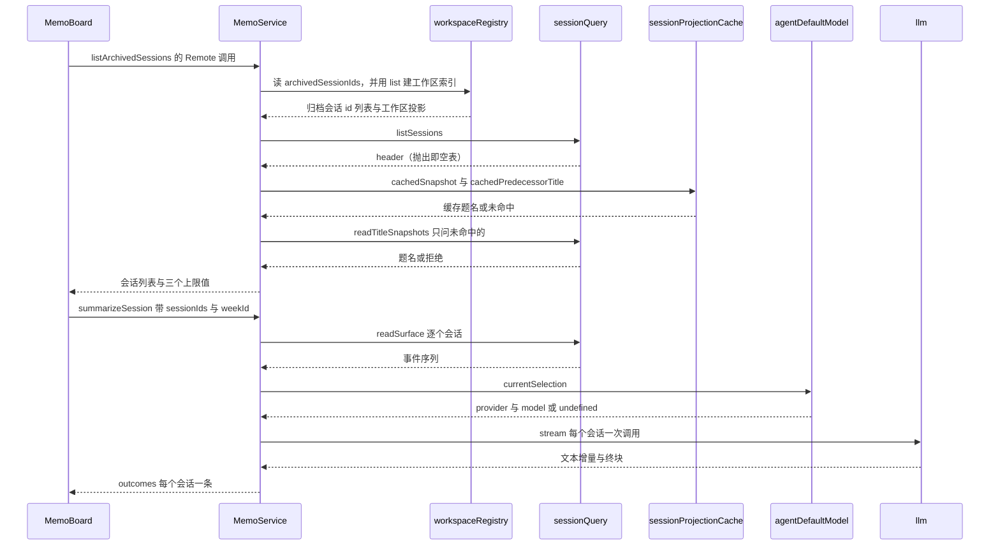

# DSH 宿主服务契约：结构化读取与可选降级

这一页是本仓库**不经过任何库链接、只经过服务键**消费 DSH 的全部契约所在处。每个包要么在 cordis 服务键上取运行中的宿主能力，要么在浏览器外壳的服务表里取；这里逐个记下读了哪个键、用了它哪几个成员、谁是必需、谁是可选的、缺席时发生什么。

先把结论摊开，后面的章节是它的证据：

- **没有一处宿主服务是靠 `import` 服务类拿到的。** 消费方只声明它读到的成员（`interface LlmTextSource { stream(...) }` 这一类），因此包里没有 `@deepseek-ai/dsh-workspace`、`@deepseek-ai/dsh-fs` 这类运行时依赖，一个部署也就可以只组合这些能力的一个子集。
- **「必需」与「可选」是两种声明，不是两种语气。** `static inject` / `export const inject` 决定插件能不能激活；`ctx.get('key')` 决定一次调用能不能干活。同一个服务可能在一个包里是前者、在另一个包里是后者（`llm`、`telemetry`、`storageDomain` 都是），这个差别是排查「为什么插件根本没挂上」与「为什么这个按钮报错」的分界线。
- **可选读不许把「没有这个能力」伪装成「有一次空结果」。** 每个可选读取点都必须留下一个机器可读的原因（失败码、`catalogError`、`service` 字段或一条 `console.error`/`warn`）。
- **缺席有两种形态，处理方式不同**：「服务根本没挂」给带原因的失败；「服务在，但某个可选成员没有」给退化的可用结果。会消灭用户数据的那个服务（存储）必须让依赖它的功能**拒绝运行**，而不是降级成更弱的版本。
- **契约针对的 DSH 版本是钉住的，不是浮动的。** 见下节。

## 契约针对的 DSH 版本与钉法

本页描述的每个服务键、每个可选成员都来自同一批 DSH rc 发布：`package.json` 的 `peerDependencies` 写 `^0.2.1-rc.2`（客户端包）与 `^0.2.0-rc.2`（`dsh-invariants`），而工作区通过 [`pnpm-workspace.yaml`](../../pnpm-workspace.yaml) 的 `minimumReleaseAgeExclude` 把安装解析钉到具体版本，列表覆盖本仓库实际用到的十一个 DSH 包：

| DSH 包 | 钉住的版本 | 本仓库经它消费的面 |
|---|---|---|
| `@deepseek-ai/dsh-llm` | `0.2.1-rc.3` | `llm` 服务的结构面，以及 `createUserMessage` / `EMPTY_RESPONSE_CODE` 两个值导入 |
| `@deepseek-ai/dsh-storage-domain` | `0.2.1-rc.3` | `storageDomain` 服务；`defineDomain` / `domainTable` / `KvTable` / `DomainSpec` |
| `@deepseek-ai/dsh-storage`、`@deepseek-ai/dsh-storage-json` | `0.2.1-rc.3` | 只作为 memo/telemetry 的后端 peer，代码里不出现 |
| `@deepseek-ai/dsh-typert-protocol` | `0.2.1-rc.3` | `TypertRemoteService` 与 `@Remote`（三个宿主包值导入） |
| `@deepseek-ai/dsh-invariants` | `0.2.0-rc.2` | 五个 `src/invariant.ts` 伴生插件 |
| `@deepseek-ai/dsh-client-connection` | `0.2.1-rc.3` | 浏览器侧 `connection` 服务 |
| `@deepseek-ai/dsh-client-locale` | `0.2.1-rc.3` | 浏览器侧 `locale` 服务 |
| `@deepseek-ai/dsh-client-ui-slots` | `0.2.1-rc.3` | 浏览器侧 `slots` 服务（平台种子） |
| `@deepseek-ai/dsh-client-ui-layout` | `0.2.1-rc.3` | 浏览器侧 `layout` 服务（`MainPanelId`） |
| `@deepseek-ai/dsh-client-ui-theme` | `0.2.1-rc.3` | 浏览器侧 `theme`（只做类型导入与 alias 令牌） |

为什么要钉：pnpm 的 `minimumReleaseAge` 会拒绝「刚发布不到阈值」的版本，而本仓库正对着 rc 系列开发，于是文件头的注释把结论写明——「一个比 `minimumReleaseAge` 门槛更年轻的 rc 会让 `pnpm install` 卡在构建依赖上，所以把解析到的确切版本写在 `minimumReleaseAgeExclude` 里」。这条机制同时是本页的**版本证据**：它说明服务面是对着 `rc.3` 校验的，而不是对着某个范围。外壳侧还有一处配套的硬编码：`scripts/tsdown.client.ts` 的 `PLATFORM_MODULES` 注释声明它「镜像 DSH 0.2.1-rc.2 的 `packages/client/web/src/platform.ts`，也就是本仓库包声明 peer 的那个发布」。

**升级外壳不是改一条版本号。** 清单里这十一个包加上 `PLATFORM_MODULES` 这十一个种子词，共同定义了两侧能读到什么；`sidebarRightTabs`、`sidebarRight`、`sessionProjectionCache`、`schedule`、`sessionController` 这几个服务在 `peerDependencies` 里根本没有对应的包（见下文模块表一节），它们的存在性只由运行中的组合决定，因此升级时必须实测、不能靠清单推断。

还有一处细小但容易被误读的不对称：清单里钉的是 `0.2.1-rc.3`，而 `PLATFORM_MODULES` 的注释与各包的 peer 范围写的是 `rc.2` 系。前者是这一次安装解析到的确切发布，后者是对外声明「我能跟哪个范围协作」；两者不是同一种声明，所以出现差一档并不表示哪一处写错了。

## 为什么是结构类型，而不是依赖宿主包

消费方只声明它读到的成员，这是这些包共同的选择，源码把理由写在每一处类型定义旁边。三种动机，各有一个可核对的落点：

1. **不把宿主运行时拖进包里，也不锁死宿主的实现。** `LlmTextSource` 只要一个方法：`stream(options)` 返回 `AsyncIterable<StreamChunk>`（[`llm-text.ts`](../../packages/memo/dsh-memo/src/llm-text.ts)）。具体的服务类、适配器注册表、凭据解析全都不在类型里出现，所以 DSH 内部换了实现类、这个包也不必跟着改。
2. **结构类型是「只用这部分」的机械保证。** `SessionArchiveSource` 的主角只有一个字段 `archivedSessionIds: readonly string[]`，工作区投影 `list()` 是**可选的**成员（[`src/index.ts`](../../packages/memo/dsh-memo/src/index.ts)）；`FsTextSource` 只有 `resolve(path)` 与 `readText(target)` 两个方法，而目标值刻意留成 `unknown`——本服务从不解释它，只原样交回给产出它的那个服务。把面收窄到这个程度，读代码的人不必去查宿主文档也能知道这里依赖了什么。
3. **它让「部署只组合一部分」成为可表达的事实。** 没有硬依赖，就没有「装了备忘就必须装工作区服务」这种连带要求——缺哪个宿主服务只让对应能力不可用。这条取舍在设计文档里被明确写下来：`workspaceRegistry` 与 `sessionQuery` 通过 `ctx.get()` 读取、不进 `static inject`，因此没有工作区/会话查询的 headless 部署仍能启动备忘服务（[会话总结设计](../../docs/plans/2026-10-28-memo-session-summary-design.md)）。备忘对**本仓库自己的** `telemetry` 与 `githubIssue` 仍然硬依赖，但那是它自身套件的成员，与宿主能力无关，见下表。

代价也要说清楚：结构类型不校验宿主那一侧，成员改名或语义变化不会在本仓库编译失败。这份契约的执行点因此全在测试上——每个结构性面都有一份手写的 mock 在测试里扮演宿主（见[测试落点](#测试落点)）。

**被 `import` 的宿主包是另一份清单，而且很短**——结构类型挡掉的是「服务句柄」，不是所有类型。`@deepseek-ai/dsh-typert-protocol` 提供 `TypertRemoteService` 与 `@Remote`（值导入，三个宿主包都用）；`@deepseek-ai/dsh-llm` 提供 `createUserMessage`、`EMPTY_RESPONSE_CODE` 以及消息与流式块的类型（两个宿主包的值导入，并在 `peerDependencies` 里声明）；`@deepseek-ai/dsh-storage-domain` 提供 `defineDomain`、`domainTable` 与 `KvTable`、`DomainSpec` 类型；`@deepseek-ai/dsh-invariants` 只提供 `InvariantInstaller` 类型。反过来，文件系统、工作区、会话、Agent、投影缓存、Schedule 这几个宿主包在六个 `package.json` 里一个都不出现——它们是纯结构化的那一类，也正是「部署可以不装」的那一类。

| 结构类型 | 声明位置 | 消费方 | 只声明了哪些成员 |
|---|---|---|---|
| `LlmTextSource` | [`memo/src/llm-text.ts`](../../packages/memo/dsh-memo/src/llm-text.ts)、[`github-issue/src/llm-text.ts`](../../packages/github-issue/dsh-github-issue/src/llm-text.ts) | 两个宿主服务 | `stream(options)`，流式块 |
| `LlmModelCatalog` | [`memo/src/index.ts`](../../packages/memo/dsh-memo/src/index.ts) | `memo/listModels` | `listProviders()`、`listModels(provider)` |
| `FsTextSource` | 同上 | `memo/readExternalPath` | `resolve(path)`、`readText(target)` |
| `SessionArchiveSource` / `SessionArchiveWorkspace` | 同上 | `memo` 的归档读取 | `archivedSessionIds`、`list?()` |
| `SessionQuerySource` | 同上 | `memo` 的归档读取 | `listSessions()`、`readTitleSnapshots?()`、`readSurface(id)` |
| `ProjectionCacheSource` | 同上 | `memo` 的标题快路径 | `cachedSnapshot?()`、`cachedPredecessorTitle?()` |
| `SessionHeaderLike` / `SessionSurfaceLike` / `SessionTitleSnapshotLike` / `SessionTitleObservationResultLike` | 同上 | 同上 | 只取 `id`/`createdAt`/`cwd`/`origin` 与事件的 `type`/`seq`/`data` |
| `TelemetrySink` | [`github-issue/src/index.ts`](../../packages/github-issue/dsh-github-issue/src/index.ts) | `github-issue` | `track()`、`trackError()` |
| `GithubStorageDomain` / `GithubIntakeTable` | 同上 | `github-issue` 的接单状态 | `open(spec)`、`table(name)`、`close()`，表的 `get`/`put` |
| `GithubSessionController` | 同上 | `github-issue` 的派发 | `create({cwd?, workspaceId?, agentPreset?})`、`prompt(request, signal)`、`rename?()` |
| `GithubScheduleService` | 同上 | 同上 | `create(sessionId, {prompt, title, after_seconds})` |
| `GithubWorkspaceRegistry` / `GithubWorkspace` | 同上 | 派发时的会话摆放 | `list()`，以及每项的 `id`/`path` |
| `SlotsFace` | [`ui-memo-settings/src/client/index.ts`](../../packages/client/ui-memo-settings/src/client/index.ts) | 设置页 | `inject(key, cb)`、`register(options, component)` |
| `SidebarRightTabsFace` / `SidebarRightFace` | [`dsh-openwiki-visualize/src/client/index.ts`](../../packages/openwiki/dsh-openwiki-visualize/src/client/index.ts) | OpenWiki 预览 | `register(definition)`；`openTab(kind, options)`、`isExpanded?()`、`toggleExpanded?()` |
| `RpcCaller` | [`ui-memo/src/client/controller.ts`](../../packages/client/ui-memo/src/client/controller.ts)、[`ui-memo-settings/src/client/index.ts`](../../packages/client/ui-memo-settings/src/client/index.ts)、[`dsh-openwiki-visualize/src/client/controller.ts`](../../packages/openwiki/dsh-openwiki-visualize/src/client/controller.ts) | 三个浏览器包 | `call(channel, endpoint, payload, signal?)`（设置页的版本是省略 `signal` 的三参形态） |

两处例外值得点名，因为它们不是「结构类型」而是「照原样用」：`storageDomain` 与 `invariants`。前者在 `dsh-memo`、`dsh-telemetry` 里是 `static inject` 中的必需项，直接读 `this.ctx.storageDomain`（域声明的 helper 从 `@deepseek-ai/dsh-storage-domain` 值导入，`KvTable` 与 `DomainSpec` 则是类型导入）；后者五个包各自带一个 `src/invariant.ts` 伴生插件，`export const inject = ['invariants']`，用 `ctx.invariants.register(packageName, install)` 为包名占位，其中 memo 的 `install` 还带一个 `inject: ['memo']`，让注册等自己的服务在座。

## 两条读取路径，以及怎么选

选哪条由一个问题决定：**缺了它，这个插件的核心职责还成立吗？**



图：必需与可选的判定，以及各自在缺席时的落点。最后一条是被持久性逼出来的一种，见下文 `storageDomain`。

两条路径在本仓库各有标准写法：

- **必需**：`MemoService` 的 `static inject = ['storageDomain', 'telemetry', 'githubIssue']`、`TelemetryService` 的 `['storageDomain']`、`GithubIssueService` 的 `['llm']`；浏览器侧是 `export const inject = [...]`（`ui-memo` 的五个、`ui-memo-settings` 的四个、`dsh-openwiki-visualize` 的三个），以及五个 `src/invariant.ts` 的 `['invariants']`。
- **可选**：`this.ctx.get('workspaceRegistry')`、`this.ctx.get('agentDefaultModel')?.currentSelection()`、`ctx.get('connection')`、`ctx.get('sidebarRight')`。`github-issue` 把这件事收成一个助手：`optionalService<T>(ctx, name)`，靠一次 `ctx.get` 的类型转换把「按字符串键取一个本包不依赖的服务」集中在一处（[`src/index.ts`](../../packages/github-issue/dsh-github-issue/src/index.ts)），四个可选服务读取全部经它。

**声明必需不等于代码里就不再检查。** 本仓库有好几处两个都做了，读的时候不要把它当成冗余：`memo/analyzeLogs` 先 `this.ctx.get('telemetry')` 再判 `undefined`，而 `telemetry` 本来就在 `static inject` 里；`github-issue` 把 `llm` 写进 `static inject`，而它复用的 `streamLlmText` 仍保留了 `LLM_UNAVAILABLE` 这一支（[`llm-text.ts`](../../packages/memo/dsh-memo/src/llm-text.ts)）。理由是这份检查跟着**能力**走而不是跟着**这个包**走：`streamLlmText` 是同一份实现被两个包共用，其中 memo 侧的 `llm` 就是可选的，所以那一支在那边真会被走到。反过来说，必需的那一侧这一支在实际运行中不可达——这正是[模型路由与失败事实保全](../concepts/llm-route-and-failure-facts.md)指出「`LLM_UNAVAILABLE` 没有直接断言」的原因。

**可选还要在清单里再声明一次。** `github-issue` 的 `peerDependenciesMeta` 把 `@deepseek-ai/dsh-storage-domain` 标成 `optional: true`（[package.json](../../packages/github-issue/dsh-github-issue/package.json)），于是「这个部署可以不装存储」这件事在安装期和运行期各有一份声明，且指的是同一件事。

## 宿主侧：服务键一览

| 服务键 | 本仓库读到什么 | 声明 | 缺席时 |
|---|---|---|---|
| `storageDomain` | `open(spec)` → `{ table(name), close() }`，表的 `get`/`put`/`entries` | `dsh-memo`、`dsh-telemetry` **必需**；`dsh-github-issue` **可选**（`optionalService`，且 `peerDependenciesMeta` 标 optional） | 必需侧：插件不激活（`[Service.init]` 里拿不到域就无法初始化）。可选侧：接单状态留空且不持久化，首启检查**拒绝运行**并 `warn`，因为它无法记住「今天已经派发过」 |
| `llm` | `stream({provider, model, messages, system})` 的异步块流；`listProviders()`、`listModels(provider)` | `dsh-github-issue` **必需**；`dsh-memo` **可选**（`ctx.get`） | 可选侧：`streamLlmText` 返回 `LLM_UNAVAILABLE`；`listModels` 仍返回 `ok: true`，`providers` 为空并带 `catalogError` |
| `agentDefaultModel` | `currentSelection()` → `{provider, model}` | 两个包都**可选**（`ctx.get(...)?.`） | 跳过路由解析的第三级：`github-issue` 可能因此返回 `route-missing`，`memo` 把空串交给 `streamLlmText` 得到 `NO_MODEL_ROUTE` |
| `fs` | `resolve(path)` → 不透明目标；`readText(target)` | `dsh-memo` **可选** | `readExternalPath` 返回 `fs-unavailable` 并记一条失败事件，不抛 |
| `workspaceRegistry`（归档） | `archivedSessionIds: readonly string[]`；`list?()` 工作区投影（`id`/`title`/`path`/`sessionIds`） | `dsh-memo` **可选** | `session-service-unavailable`，且失败体里带 `service: 'workspaceRegistry'` |
| `workspaceRegistry`（摆放） | `list()` 里各工作区的 `id`/`path` | `dsh-github-issue` **可选** | 派发照常，会话按目录创建、落在侧栏未分组里，并 `warn` 一句 |
| `sessionQuery` | `listSessions(signal?)`、`readTitleSnapshots?(ids, signal?)`、`readSurface(id, signal?)` | `dsh-memo` **可选** | `session-service-unavailable` 且 `service: 'sessionQuery'`；见下节的逐层降级 |
| `sessionProjectionCache` | `cachedSnapshot?(header, keys?)`、`cachedPredecessorTitle?(header)` | `dsh-memo` **可选** | 题名一律走日志折叠（贵但正确）；缓存行读抛出也只当未命中 |
| `sessionController` | `create({cwd?, workspaceId?, agentPreset?})`、`prompt(request, signal)`、`rename?({sessionId, title})` | `dsh-github-issue` **可选** | 整体缺席或缺 `prompt` 时 `session-unavailable`：显式失败，不伪造一个会话；`rename` 缺席时派发照常成功，仅少一个标题 |
| `schedule` | `create(sessionId, {prompt, title, after_seconds})` | `dsh-github-issue` **可选** | 退回到 `sessionController.prompt` 直接投递；注册被拒则是 `dispatch-failed` |
| `invariants` | `register(packageName, install)` | 五个 `src/invariant.ts` 伴生插件都**必需**（`ui-memo-settings` 没有这个伴生插件） | 伴生插件不激活，包名占位与不变式检查缺席 |
| `telemetry`（本仓库自己的） | `track()`、`trackError()`、`analyzeForPlugin(id)` | `dsh-memo` **必需**；`dsh-github-issue` **可选** | 可选侧：事件被丢弃，全部功能照常——诊断依赖绝不能成为拒绝激活的理由（`TelemetrySink` 的注释即如此写明；`github-issue.spec.ts` 的 “works with no telemetry mounted at all” 钉住成功与失败两条路径） |
| `githubIssue`（本仓库自己的） | `generateReport()`、`prefilledIssueUrl()` | `dsh-memo` **必需** | `analyzeLogs` 仍保留一条 `github-issue-failure` 的防御分支，消息写明服务不可用 |
| `logger` | 只有 `github-issue` 读，且是可选的 `{ warn(message) }` | 不是 cordis 服务，用 `(this.ctx as { logger?: … }).logger?.warn(...)` 取 | 缺席时它所有非致命警告（工作区未匹配、持久写失败、标题缺失）都静默丢弃，功能照常 |

`logger` 是这张表里唯一的「不是服务键、而是外壳挂在 ctx 上的成员」：它没有 `inject` 也没有键名可查，`github-issue` 的 `warn` 助手直接把 `logger` 当可选成员读，所以**在一个没有 logger 的宿主上下文里，所有「降级发生了」的痕迹都会消失**——这些警告本身就是本页多处「只 `warn`」的落点，值得单独记住。

备忘对 `telemetry` 与 `githubIssue` 的硬依赖有一条连带后果：备忘服务不能在一个没装这两者的部署里单独挂上——这正是备忘套件的安装命令要把五个包一起点名、且 `memo` 的 patch 自己插入 `ui-memo` 行的原因（见[插件组合与 bundle](../architecture/plugin-composition-and-bundles.md)）。

**有一个包完全不在这张表里**：`@zhangj1164/dsh-openwiki-visualize` 的宿主半边没有任何 `inject`、也不读任何宿主服务，它靠 `child_process` 拉起 `openwiki visualize`、靠 `node:fs` 数页面，环境探测也只读 `process` 与包的清单版本。所以「插件必须消费宿主服务」不是本仓库的规则，只是因为要跨插件协作或要读写宿主资源时才需要。

### `storageDomain`：缺席时不许退化成「每进程一次」

三个宿主包里，`storageDomain` 的两种声明各有各的道理：

- **备忘与遥测必需。** 周行、季度归档、遥测事件都是持久事实，拿不到域就没有服务可言，所以在 `[Service.init]` 里 `await this.ctx.storageDomain.open(spec)`；备忘还同时打开档案域（`weeks` 与 `quarters` 两张表），两个域各挂一个 `memo.domainClose` / `memo.archiveDomainClose` 清理效果。
- **接单状态可选，但不许降级。** `openIntakeState` 用 `optionalService` 取存储：没有域就按空状态启动，`intakePersistent` 保持 false；首启检查**直接不运行**，只记一条 `state-unavailable` 并 `warn`。理由写在源码注释里——没有「已经派发过什么」的记忆，重启就会给同一个 issue 再开一个会话，所以宁可 warn 一句也不跑（[`src/index.ts`](../../packages/github-issue/dsh-github-issue/src/index.ts)）。这不是「退化成每进程一次」，而是「宁可不做」：`intake-service.spec.ts` 的 “stays off without durable state so it cannot dispatch twice” 用一个从不被调用的 `fetch` mock 钉住它（[`intake-service.spec.ts`](../../packages/github-issue/dsh-github-issue/tests/intake-service.spec.ts)）。

同一条原则在写入侧还有一层：`commitIntakeState` 先更新内存、再 `table.put`；durable 写失败只 `warn`，而且警告消息直接说出后果（“a later pass may dispatch the same issue again”）——不假装写成功。

### `llm`：两个形状，一个服务

同一个服务在两处被读成两种互补的形状：

- **单块文本**（`LlmTextSource`）：给 `stream(options)`，收一串块，把它收敛成「文本」或「保留原因的失败」。这一层的全部规则——`text-delta` 累加、`finish` 的 `error`/`aborted` 优先、`EMPTY_RESPONSE` 与 `LLM_STREAM_THREW` 的分工、`status` 缺席就不写这个键——见[模型路由与失败事实保全](../concepts/llm-route-and-failure-facts.md)。
- **目录**（`LlmModelCatalog`）：只给 `memo/listModels` 用，因为 `listProviders()` 与 `listModels(provider)` 只有宿主能调，浏览器侧的 Remote 面根本没有 `listModels`。聚合规则（只列已注册 provider、单个 provider 抛错留在自己身上、三条降级写 `catalogError` 却仍返回成功）见同一页的路由目录一节。

结构上值得单独记住的一点：`llm` 在 `github-issue` 里是必需、在 `memo` 里是可选的**同一个服务**。所以「模型能力缺失时这个部署还能做什么」不是全局结论，而是逐包结论——没有 `llm` 的部署里备忘的存储、归档、检索全部可用，issue 生成则整个插件不在。`memo.spec.ts` 的 “degrades to an empty registry when no llm service is mounted” 用 `withoutLlm` 开关钉住可选侧：`listModels` 仍是 `ok: true`，只是 `providers` 为空且 `catalogError` 里指名 `llm`（[`memo.spec.ts`](../../packages/memo/dsh-memo/tests/memo.spec.ts)）。

### `agentDefaultModel`：只回答第三级，且两个包读法有细微差别

两边都是 `this.ctx.get('agentDefaultModel')?.currentSelection()`，只用于路由解析的最后一级：请求 → 服务 `Config` → 部署默认。两边都没有把它当成「配置的来源」去写，也没有在浏览器里缓存它——面板拿到的路由是 `memo/listModels` 报回来的那个值。

一处真实的不一致：`github-issue` 的 `resolveRoute` 用 `firstNonBlank` 把空白串当成「未提供」丢掉；`memo` 的 `resolveRoute` 用 `??` 串联，字面空串会被保留下来（再由 `streamLlmText` 的前置判断报 `NO_MODEL_ROUTE`）。读 `agentDefaultModel` 的代码改动时，这条差别决定了「部署把某个字段留空」会走哪条分支。

### `workspaceRegistry` 与 `sessionQuery`：把容错分成三层

这一对服务是「可选读」的最佳样本，因为同一个功能对两者做了三种不同的容错：

1. **服务整体缺席** → 整个 Remote 方法返回 `session-service-unavailable`，且 `service` 字段指名是哪一个。这是有意的：一个空的会话选择列表与「读不到会话服务」是两件事，前者会让用户以为没有归档会话。`listArchivedSessions` 与 `summarizeSession` 各做一次同样的双服务判定（[`src/index.ts`](../../packages/memo/dsh-memo/src/index.ts)），`session-summary.spec.ts` 断言的是「缺 registry 报这个码而不是空列表」。
2. **`sessionQuery` 能应答但个别调用失败** → 降级到本地容错。`listSessions()` 抛错时 `readSessionHeaders` 返回一张空 header 表而不是失败（归档集合仍然点名了会话，读不到元数据就少几个字段）；`readSurface()` 抛错时那一个会话拿到 `session-unreadable` 并落进 `outcomes`，其余会话的总结照常写入。
3. **结构上可选的方法缺席** → `readTitleSnapshots` 是可选成员，老一点的 session-query 后端没有它时，题名回退成短 id 形式（`sessionTitleOrFallback` 产出 `Session session-` 这种），会话本身不隐藏；批量读取本身抛出也只当没有标题。

`archivedSessionIds` 是「哪些会话可以总结」的唯一依据，`sessionQuery` 只负责标题、header 与内容；子会话（`origin === 'subagent'`）在宿主侧被过滤掉，因为它们是非用户的委派工作，各自总结出来只会是父会话的近似副本（`isSubagentSession`，[`session-transcript.ts`](../../packages/memo/dsh-memo/src/session-transcript.ts)）。

`workspaceRegistry` 的 `list()` 在这条路径上是**可选成员**，两者用途不同：缺席只是没有工作区分组，会话照常列出；`archivedWorkspaceIndex` 用它的同步投影把归档会话归回各自的项目（归档会保留会话的工作区槽位，所以不这样归就会掉进未分组）。

**第四个可选读取也插在这个功能里：`sessionProjectionCache`。** 折叠一个会话题名要重放整份日志，归档几十个大会话时选择器会慢到像坏了；宿主投影缓存里已经有侧栏列出过的同一份题名、零 I/O，所以先读缓存、只对缓存答不上的会话做折叠。它的两个成员都是可选的，读抛出也只算未命中；一个 `null` 题名是**真答案**（「这一行还没有题名」），会被记成空串走短 id 回退，而不是再花一次折叠去确认没有题名。`session-summary.spec.ts` 三条用例分别钉住「只折叠未缓存的」「全命中时一次折叠都不做」「缓存里的 null 行不再折叠」（[`session-summary.spec.ts`](../../packages/memo/dsh-memo/tests/session-summary.spec.ts)）。



图：一次「总结归档会话」触到的五个宿主服务，以及两个 Remote 方法的边界——浏览器只发请求、只读结果，不自己算可达性也不自己选路由。

### `fs`：只有两个方法，但失败原因要分得开

`resolve(path)` 拿到一个不透明目标，`readText(target)` 读出文本。之所以拆成两步而不是一个 `readText(path)`，是因为解析一步就包含了宿主对路径的策略判定（沙箱、允许清单），失败也发生在那一步。错误分派把 DSH 的 `FsErrorCode` 映射成本服务自己的码（`FS_NOT_FOUND`/`ENOENT` → `path-not-found`，`FS_NOT_TEXT`/`FS_NOT_REGULAR_FILE` → `path-not-text`，`FS_TOO_LARGE` → `path-too-large`，`FS_PERMISSION_DENIED`/`FS_SANDBOX_DENIED`/`EACCES`/`EPERM` → `approval-denied`，其余 → `fs-error`），读取本身靠 `code` 字段鸭子类型判断而不 `instanceof FsError`——`@deepseek-ai/dsh-fs` 不是本包的依赖（[`src/index.ts`](../../packages/memo/dsh-memo/src/index.ts)）。

`external-path.spec.ts` 用一个只在 `resolve`/`readText` 两步之一抛错的 `StubFs` 逐个覆盖这九个输入码，并单独断言「不带 `code` 的失败是 `fs-error` 而不是编一个原因」（[`external-path.spec.ts`](../../packages/memo/dsh-memo/tests/external-path.spec.ts)）。这条读取**没有 `@Remote` 端点**，所以浏览器根本发不出到达它的请求；这是能力边界而非审批边界，理由与替代形态见[能力与审批边界](../concepts/capability-and-approval-boundaries.md)。

### `sessionController`、`schedule` 与工作区：派发是几个可选服务拼起来的

派发一个新会话不是「调一个创建方法」那么简单，它要几个可选服务各出一段，且每一段的缺席都有确定语义：

1. **`sessionController.create({ cwd?, workspaceId?, agentPreset? })` 负责创建**，并且必须经它而不是直接建 Agent：控制器会应用部署的 preset、工作区归属与发布流程，所以这样建出来的会话与用户从 Web 点「新建会话」得到的一致，才会出现在侧栏、才能被继续与归档（[接单闭环设计](../../docs/plans/2026-11-02-github-issue-intake-autopilot-design.md)）。`workspaceId` 与 `cwd` 互斥，`workspacePlacement` 因此先查 `workspaceRegistry`：配置目录能按规范化路径匹配到一个已注册工作区就传 `workspaceId`（会话进侧栏分组），否则传 `cwd`（会话留在未分组）；registry 缺席、`list()` 抛出、没有匹配都退到 `cwd` 并 `warn`。规范化本身只做比较用途：分隔符统一成 `/`、折叠重复与尾部分隔符、只在 Windows 与 macOS 上折叠大小写。
2. **投递有两条路，优先 `schedule`**：`schedule.create(sessionId, { prompt, title, after_seconds })` 把提示词登记成一条到点投递的自动化任务，任务因此在 Web 的自动化板上可见；没有 Schedule 服务（非 Web 组合）时退回 `sessionController.prompt({ requestId, sessionId, mode: 'queue', content }, signal)`——就是 Web 提示词用的那条持久准入路径。两条路被拒都是 `dispatch-failed`，都不提交「今天已查」。
3. **`rename` 与派发任务标题是纯呈现**：`rename` 是可选成员，`void` 调用、失败只 `warn`——拿不到标题服务的部署仍得到一个可用会话。标题在 `dispatchTitle` 里按码点截到 120，因为 Session 与 Schedule 两个服务都在这个长度上截断或拒绝（Schedule 拒绝时给 `invalid_prompt`，会连带把一次本来成功的派发判失败）。

**整体缺席是显式失败，不是伪造。** `dispatch` 第一行就是 `sessionController === undefined || typeof controller.prompt !== 'function'` → 返回 `session-unavailable`，消息写明「这个部署没挂带 prompt 准入的 Session 控制器，所以没有 issue 能被派发」，一个会话都不会被建出来；`intake-service.spec.ts` 里 `failures[0].code` 正是它、`dispatched` 为空，另有一条 “refuses when the deployment mounts no Session router” 直接断言 `dispatchIssue` 的同一个码（[`intake-service.spec.ts`](../../packages/github-issue/dsh-github-issue/tests/intake-service.spec.ts)）。

**注意这里判的是 `prompt`，不是 `agents`。** 本仓库当前版的派发路径只读 `sessionController`（创建 + 投递）与可选的 `schedule`；`agents.get(sessionId).agent.followup(...)` 这条更早的投递形态在当前 `src/index.ts` 与 `tests/intake-harness.ts` 里都已不存在——harness 的 `MockSessionController` 记录的字段就是 `creates` / `prompts` / `renames`。因此本页按当前源码把投递记为 `schedule.create` 与 `sessionController.prompt` 两路；如果宿主侧的 `agents` 契约仍被别处使用，那也是本仓库目前尚未消费的面。

## 浏览器侧：服务键一览

浏览器半边的服务全部是 cordis 服务键，与宿主侧同一套机制，只是由外壳提供。这张表有一列值得细读：`inject` 里的服务**多数没有代码真的设守卫**，靠 `inject` 本身保证——源码注释写的就是「`inject` 保证服务存在」。

| 服务键 | 本仓库读到什么 | 声明与守卫 | 缺席时 |
|---|---|---|---|
| `connection` | `rpc.call(channel, endpoint, payload, signal?)`（按 `RpcCaller` 结构面），以及 `connection/reset` 事件 | 三个包都在 `inject` 里；两个面板（`ui-memo`、`dsh-openwiki-visualize`）先 `ctx.get` 再判空并**直接 return**，设置页判空后**不返回**，只把版本卡片降级掉 | 两个面板 `console.error` 后返回，一个槽位都不注册：没有通道的面板没有意义；设置页照常注册两个页面，只是没有更新卡片 |
| `slots` | `inject(key, cb)`、`register(options, component)` | 三个包**必需**；只有 `ui-memo-settings` 先 `ctx.get` 判空（`SlotsFace` 只在设置页写出来），另外两个直接 `ctx.slots` | 设置页 `console.error` 后返回（`entry.spec.tsx` 断言「不抛」）；另外两个包在 `ctx.slots.inject` 处抛错 |
| `locale` | `register(ns, {zh, en})`、`bind(ns)(key)`、`getLocale().active` | 三个包**必需**，不设守卫 | 在 `ctx.locale.register` 处抛错——`ui-memo` 还把当前语言随请求发出（决定总结输出语言），且它是惰性读的，用户在面板开着时切换语言也生效 |
| `layout` | `selectPanel(id)`，配合 `MainPanelId` 类型 | `ui-memo` **必需**，不设守卫 | 看板「关闭」是一次面板导航（回到保留的 `conversation` 面板），没有布局服务就没有这个动作 |
| `theme` | **没有任何方法调用**：只有 `type {}` 导入与样式里的 `--dsw-alias-*` 令牌 | 只有 `ui-memo` 把 `theme` 写进 `inject`，且不设守卫；`ui-memo-settings` 与预览包只在 `dsh.client.inject` 里列主题包（预览包还把它写进 `peerDependencies`） | 源码注释写明样式用 alias 令牌所以自动跟随主题；`inject` 表达的是样式层依赖外壳的主题装配，所以它在场与否不会让某个注册动作失败 |
| `configForms` | `get(namespace)`、`whileServed(namespaces, cb)`；表单本身 `getSnapshot()`、`subscribe()`、`set(field, value)`、`unset(field)` | `ui-memo-settings` **必需**，不设守卫（`ConfigForm` 只是类型，从 `@deepseek-ai/dsh-client-ui-settings/client` 导入） | 在 `ctx.configForms.get(...)` 处抛错；一个没有表单服务的设置页只能是一片空白 |
| `sidebarRightTabs` | `register({ id, kind, multiple, title })` | `dsh-openwiki-visualize` **可选**，经 `ctx.inject(['sidebarRightTabs'], scoped => …)` 作用域读 | 标签页类型不注册，预览 pane 与入口按钮仍然贡献（环境报告与工作区探测照样有用） |
| `sidebarRight` | `openTab(kind, { params })`、`isExpanded?()`、`toggleExpanded?()` | `dsh-openwiki-visualize` **可选**（`ctx.get`，故意不写进 `inject`） | 点入口按钮时 `console.warn` 并放弃打开：没有右侧栏就没有可打开的落点 |

三处细节是这张表的要害：

**`sidebarRightTabs` 用 `ctx.inject` 而不是一次 `ctx.get`。** 右侧栏插件自己的工厂可能排在预览插件之后，一次 `apply()` 时的读取会**静默地什么都不注册**；源码注释把这条竞态写在注册点旁边。`ctx.inject(['sidebarRightTabs'], scoped => ...)` 把注册推迟到服务存在那一刻，并在 `scoped.effect` 里挂 disposer；测试专门复刻了「回调到手时服务还没到，之后才提供」这个顺序（`tests/entry.spec.tsx` 的 “registers the tab type when the registry arrives after apply”）。

**`sidebarRight` 的成员是可选的，因为它只是尽力而为。** `openTab` 一定会被调用，而「展开」只在调用方能判断时才做：`isExpanded?.() === false` 才 `toggleExpanded?.()`，无条件 toggle 会把用户本来就展开的栏收起来。

**`connection` 在两个面板与设置页上的处理不同，这条差异是有意的。** 两个面板的每一件事都经 RPC，所以缺通道时 `console.error` 后整个 `apply()` 返回；设置页除版本卡片外只依赖 `configForms` 与 `slots`，卡片拿不到通道就整块不注入 `update`，页面照常可用。设置页里 `connection` 因此有三种不同身份：`inject` 里的必需键、代码里的可选读取、以及仅影响一块 UI 的降级点。

## 模块表：三套名字与能直接够到哪些服务

浏览器半边的产物是一个闭包工厂（`window.__ModuleLoader__.load({ id, factory })`），它的 `require` 由外壳的模块表应答。因此**一个包能直接 `require` 什么**是被结构限定的：外壳的平台种子（`PLATFORM_MODULES` 里那 11 个词）、`dsh.client.inject` 里声明的行、以及 `dsh.client.external` 里声明的精确 specifier（[`tsdown.client.ts`](../../scripts/tsdown.client.ts) 的 `moduleTableWords`）。其余 specifier 由打包器内联，而内联另一个插件的浏览器半边会被 `dsh-client-bundle-purity` 直接判成构建错误。产物层面的规则与门禁见[宿主 ⇄ 浏览器 Remote 契约](../architecture/host-client-remote-contract.md)。

这条约束推出一条对宿主服务的结论：**一个面板不能直接够到宿主的 `llm`、`fs`、`sessionQuery` 之类的服务，因为它连它们的包都 `require` 不到；它只能走 Remote。** 这不是风格问题——DSH 把 `listProviders()`、`listModels(provider)` 只暴露给宿主，浏览器侧根本没有对应方法，所以模型目录必须由 `memo/listModels` 代理回来。

同时要区分三件常被混起来的事，它们其实是三套彼此独立的名字：

- **服务键**（`ctx.get('key')`、`export const inject`）是 cordis 的运行时查找，与包名无关：`configForms` 这个键里既没有作用域也没有包名。
- **`dsh.client.inject` 的包行**管装配顺序与模块表可应答性。`slots` 服务被三个包 `inject` 使用，却没有任何包把 `@deepseek-ai/dsh-client-ui-slots` 写进 `dsh.client.inject`——它是平台种子，外壳已经种好了。
- **产物里的 `require`** 是打包结果，不必与上面两者相等。

于是三种组合在仓库里都能找到实例：服务键有、包行也有（`locale` / `connection` / `layout` / `theme`）；服务键有、包行靠平台种子（`slots`）；服务键有、包行与 peer 都没有（`sidebarRightTabs` / `sidebarRight`）——预览包的 `dsh.client.inject` 只有 `connection`、`locale`、`ui-renderer`、`ui-theme` 四行，`peerDependencies` 里也没有右侧栏包（[package.json](../../packages/openwiki/dsh-openwiki-visualize/package.json)）。最后一种最松散，也最依赖「缺席时自己降级」，在产物里没有任何对应的 `require`，模块表完全不参与，`ctx.inject` + `ctx.get` 是它唯一的协作通道。

还有两处第四种形态，说明包行也不总等于「有 peer」：`ui-memo-settings` 的 `dsh.client.inject` 只列 `locale` 与 `dsh-client-ui-settings`，而 `peerDependencies` 只声明前者——后者作为 `configForms` 的**类型来源**留在 `devDependencies`；`ui-memo` 与预览包的 `dsh.client.inject` 则都含 `dsh-client-ui-renderer`，但两者都没把它写进 `peerDependencies`（预览包的只要在 `devDependencies` 里）。所以「一个服务被声明为必需」在浏览器侧有两种证据来源：`export const inject`（服务键，决定激活）、`dsh.client.inject`（包行，决定装配顺序与可应答性），两者可以对不同步，读清单时不要把几栏对齐着看。

## 可选读的四条规则

把上面所有可选读取点放在一起，可以看出四条会被代码直接执行的规则。加一个新的可选服务读取时，这四条是要一起满足的：

1. **缺席必须留下机器可读的原因。** `session-service-unavailable` 带 `service` 字段，`catalogError` 带一句人话，`fs-unavailable` 带 `path`。只有一句 `console.warn` 就够用的地方是那种「用户本来也不会看到差异」的能力（会话标题、右侧栏展开、派发会话的工作区分组）。
2. **不许把「读不到」折叠成「空」。** 归档会话的列表为空与工作区服务缺席是两种结论，前者是数据，后者是部署问题；模型目录是唯一一处刻意把两者都塞进成功结果的地方（`ok: true` + `catalogError`），理由是备忘看板在没有模型路由的部署里也必须能打开。
3. **一个成员坏掉不许带走整批。** 单个 provider 的目录查询抛错只写进那个 provider 的 `error`；单个会话的 `readSurface` 抛错只落进那一个 `outcome`；`listSessions` 抛错退化成空 header 表；`workspaceRegistry.list()` 抛错只让会话留在未分组。
4. **可选读在浏览器侧不许抛。** 两处「缺了就没什么可做」的读取是 `console.error` 加 `return`（两个面板的 `connection`、设置页的 `slots`），而不是让 `apply()` 抛出去——一个面板的缺席不该让整行组合失败。反过来，`inject` 里的服务代码不做防御：那意味着组合本身坏了，在第一次使用时抛错比静默少注册一半槽位更容易查。设置页对 `connection` 的处理是第三种：它在 `inject` 里，所以缺席属于组合问题，但页面主体不依赖它，于是只降级卡片而不返回。

**外加一条只对「会重复副作用」的功能成立的规则：没有持久记忆就不许跑。** 首启接单检查在有 `storageDomain` 时才开始工作，这是唯一一处「可选服务缺席导致功能拒绝运行」而不是「降级」的地方。

## 测试落点

这份契约没有编译期执行点，所以每个结构性面都靠一份手写宿主替身钉住。改动时先看这些：

- **路由与目录**：`memo/tests/harness.ts` 的 `MockLlmService` 与 `MockAgentDefaultModel`，以及它暴露的 `followAgentDefault`、`withoutLlm` 与 `llm: { catalogThrows, extraProviders }` 几个开关；`memo.spec.ts` 断言「`Config` 不钉路由时跟随 `agentDefaultModel`」与「未挂 `llm` 时降级成带 `catalogError` 的空目录」。
- **归档读取**：`tests/session-summary.spec.ts` 自己定义 `MockWorkspaceRegistry`（`archivedSessionIds` 加 `list()`）、`MockSessionQuery`（三个方法，并按 `titles`/`surfaces` 回答）与 `MockProjectionCache`，断言「缺 registry 报 `session-service-unavailable` 而不是空列表」「子会话被过滤」「读不到的会话只坏自己那一条」「缓存命中的题名不再折叠」「缓存里的 null 行照短 id 显示」。
- **`fs`**：`tests/external-path.spec.ts` 用 `StubFs` 在两个步骤上注入带 `code` 的异常，覆盖五个业务码背后的九个输入码，并断言 `readExternalPath` 不在 `remoteMethods(memo)` 的端点表里——正反两条断言一起才成契约。
- **`sessionController` / `schedule` / `workspaceRegistry` / `storageDomain` / `telemetry` / `llm`**：`github-issue/tests/intake-harness.ts` 的选项就是这几个服务的缺席矩阵——`withoutSessionServices`、`withoutSchedule`、`workspaceListFails` / `workspaces`、`withoutStorage` / `storageOpenFails`，加上 `promptFails`、`scheduleCreateFails`；`MockLlmService` 的存在本身就在证明 `llm` 是必需的（注释写明「接单测试从不调模型，但服务没有这个注入无法激活」），`MockTelemetry` 则是那个恒在的可选侧。`intake-service.spec.ts` 用它们断言 `session-unavailable`、「无持久状态时首启检查不跑、不派发」，以及工作区匹配失败时按目录创建。
- **浏览器侧**：`ui-memo/tests/entry.spec.tsx` 断言 `inject` 的精确取值与两个槽位注册；`ui-memo-settings/tests/entry.spec.tsx` 用 `served: false` 覆盖「命名空间没被服务就一个页面都不注册」、用 `slots: false` 覆盖「缺 slots 时不抛」、用 `connection: false` 覆盖版本卡片整块降级；`dsh-openwiki-visualize/tests/entry.spec.tsx` 覆盖「服务晚到才注册」与「完全没有 registry 时仍贡献 pane 与入口」。

## 这份契约面向的 DSH 版本，以及它怎么被钉住

上面每一个服务键的面都是对着**一组具体的 DSH rc 发布**写的，而这组发布是用 pnpm 的 `minimumReleaseAge` 之外的一条豁免钉住的：工作区根目录的 [`pnpm-workspace.yaml`](../../pnpm-workspace.yaml) 里有

```yaml
minimumReleaseAgeExclude:
  - '@deepseek-ai/dsh-client-connection@0.2.1-rc.3'
  - '@deepseek-ai/dsh-client-locale@0.2.1-rc.3'
  - '@deepseek-ai/dsh-client-ui-layout@0.2.1-rc.3'
  - '@deepseek-ai/dsh-client-ui-slots@0.2.1-rc.3'
  - '@deepseek-ai/dsh-client-ui-theme@0.2.1-rc.3'
  - '@deepseek-ai/dsh-invariants@0.2.0-rc.2'
  - '@deepseek-ai/dsh-llm@0.2.1-rc.3'
  - '@deepseek-ai/dsh-storage@0.2.1-rc.3'
  - '@deepseek-ai/dsh-storage-domain@0.2.1-rc.3'
  - '@deepseek-ai/dsh-storage-json@0.2.1-rc.3'
  - '@deepseek-ai/dsh-typert-protocol@0.2.1-rc.3'
```

文件头的注释把机制和理由都写清了：`pnpm install` 有一个 `minimumReleaseAge` 的冷却窗口，刚发布的 rc 往往比窗口更年轻，安装会卡在「这个运行时还没被允许」上；把**已经解析到的确切版本**逐条列进 `minimumReleaseAgeExclude`，就等于只给这几条放行。于是这份列表同时是两件事：

1. **安装闸门**：没列进这里的 rc 会被冷却窗口挡住，所以「升级到一个新 rc」在这个仓库里必然是一次显式编辑，而不是 `pnpm update` 的副作用。
2. **契约的版本标签**：列在这里的包正是本页描述服务面的那些包——`dsh-client-ui-slots`（`slots`）、`dsh-client-connection`（`connection`）、`dsh-client-locale`（`locale`）、`dsh-client-ui-layout`（`layout`）、`dsh-client-ui-theme`（`theme`）、`dsh-llm`（`llm`）、`dsh-storage*` 与 `dsh-storage-domain`（`storageDomain` 背后的存储栈）、`dsh-invariants`（`invariants`）、`dsh-typert-protocol`（Remote 与 `@Remote`）。

值得注意的是**哪些不在这份列表里**：`sessionQuery`、`workspaceRegistry`、`sessionProjectionCache`、`sessionController`、`schedule`、`fs`、`agentDefaultModel` 背后的宿主包一个都没有出现——因为它们本来就不是本仓库的依赖，本仓库对它们的了解只有源码里那几个结构类型。这正是「结构化声明」的运营后果：**这些面的版本由部署决定，本仓库无法钉住，也不会在升级时报警**。所以它们只能靠测试替身和自己的容忍度保证（见[测试落点](#测试落点)），而那几个出现在列表里的面，一升级就会在这里留下痕迹。

反过来，那份列表里的版本号与各包 `peerDependencies` 的范围不必一致（清单写的是 `^0.2.1-rc.2` / `^0.2.0-rc.2` 这类范围，`pnpm-workspace.yaml` 写的是解析到的确切 rc）：前者是可接受的版本区间，后者是这一次安装实际拿到的具体发布。判断「本页描述的契约对着哪一版」要读后者。

## 改动这份契约时要同步的地方

- **加一个宿主服务读取**：先回答「缺了它插件还成立吗」。必需就写进 `static inject`/`inject` 并在清单里补 `peerDependencies`；可选就用 `ctx.get`（或在 `github-issue` 里用 `optionalService`）、把包标成 `peerDependenciesMeta.optional`，并想清楚缺席时返回哪个码。
- **收窄一个结构面**：把 interface 里没用到的成员删掉，比留着一个「以后可能用」的成员更接近契约的真实形状；`FsTextSource` 的目标值刻意是 `unknown`，这类「不解释宿主的值」的选择要保住。
- **换一个服务键的拼写**：`ctx.get('...')` 里的字符串、测试的 mock `super(ctx, '...')`、以及文档里的失败码 `service` 字段必须一起改；三处都不会编译失败。
- **升级 DSH 外壳**：`pnpm-workspace.yaml` 的 `minimumReleaseAgeExclude` 列表要跟着改（新 rc 会被 `minimumReleaseAge` 拦住，不列就装不上），`scripts/tsdown.client.ts` 的 `PLATFORM_MODULES` 要跟着种子表增删，并且要实测那几个「清单里没有对应包」的服务（`sidebarRightTabs`、`sidebarRight`、`sessionProjectionCache`、`schedule`、`sessionController`）。本仓库目前没有任何 `dsh.client.external` 行。
- **把一条「只 `warn`」改成「有码的失败」，或反过来**：先确认调用方是否真的能展示它。宿主侧的 `warn` 全部经 `ctx.logger?.warn`，那条通路本身可选；浏览器侧的 `console.warn`/`console.error` 在测试里被断言为「不抛」，所以改写时要保持这两个性质之一。
- **给浏览器包加一个跨插件依赖**：先判断它是平台种子、还是要声明的行；另一个插件的浏览器半边必须同时进 `inject` 与 `external`，而纯类型引用什么都不用做。这条与[宿主 ⇄ 浏览器 Remote 契约](../architecture/host-client-remote-contract.md)的构建小节是同一件事。

## 相关页面

- [宿主 ⇄ 浏览器 Remote 契约](../architecture/host-client-remote-contract.md)——两侧发布的字面量、线上形状、双层信封与产物门禁。
- [模型路由与失败事实保全](../concepts/llm-route-and-failure-facts.md)——`llm` 这一半的完整规则：三级路由、失败事实、宿主侧目录聚合。
- [能力与审批边界](../concepts/capability-and-approval-boundaries.md)——为什么 `readExternalPath` 留在宿主内、以及 turn 之间的宿主副作用清单。
- [配置与热生效](../concepts/configuration-and-live-settings.md)——`configForms` 写入的 `volatile` 语义与设置页的生效路径。
- [插件组合与 bundle](../architecture/plugin-composition-and-bundles.md)——谁插入哪一行、安装命令为何必须点名每个包。
- [存储与持久化](../architecture/storage-and-persistence.md)——`storageDomain` 这一侧的域声明、表与写入重试。
- [备忘服务](../systems/memo-service.md)——这张表里读取点最密的宿主包。
- [GitHub Issue 服务](../systems/github-issue-service.md)——`sessionController`/`schedule`/`storageDomain` 三个可选读取的实际用途。
- [Issue 接单与 Session 派发循环](../workflows/issue-intake-autopilot.md)——派发路径、去重与提交顺序的完整工作流。
- [备忘设置页](../systems/memo-settings-ui.md)——`configForms` 的唯一消费者，也是浏览器侧唯一设守卫读 `slots` 的包。
- [OpenWiki 预览](../systems/openwiki-visualize.md)——宿主半边不读宿主服务、浏览器半边读右侧栏两个服务的对照样本。
- [GitHub REST 集成](github-rest.md)——同一个包里唯一不经过宿主服务的那条外部通道。
