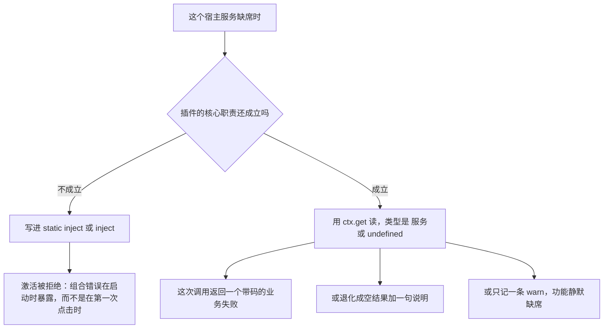
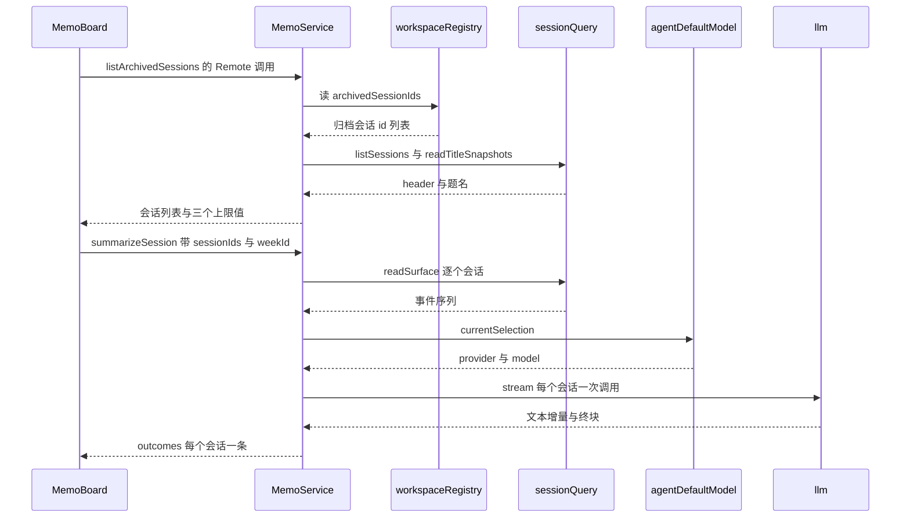

# 本仓库消费的 DSH 宿主服务契约

本仓库没有一个包把 DSH 当库来链接使用：它要么在 cordis 的服务键上取到运行中的能力（宿主侧），要么在浏览器外壳的服务表里取（浏览器侧）。这一页记录的就是那份消费清单——读了哪个键、读了它哪几个成员、谁是必需、谁是可选的、缺席时会发生什么。

先把结论摊开，后面的章节是它的证据：

- **没有一处宿主服务是靠 `import` 服务类拿到的。** 消费方只声明它读到的成员（`interface LlmTextSource { stream(...) }` 这一类），因此包里没有 `@deepseek-ai/dsh-workspace`、`@deepseek-ai/dsh-fs` 这类运行时依赖，一个部署也就可以只组合这些能力的一个子集。
- **「必需」与「可选」是两种声明，不是两种语气。** `static inject` / `export const inject` 决定插件能不能激活；`ctx.get('key')` 决定一次调用能不能干活。同一个服务可能在一个包里是前者、在另一个包里是后者（`llm` 就是），这个差别是排查「为什么插件根本没挂上」与「为什么这个按钮报错」的分界线。
- **可选读不许把「没有这个能力」伪装成「有一次空结果」。** 每个可选读取点都必须留下一个机器可读的原因（失败码、`catalogError`、`service` 字段或一条 `console.error`）。

## 为什么是结构类型，而不是依赖宿主包

消费方只声明它读到的成员，这是这些包共同的选择，源码把这句理由写在每一处类型定义旁边。三种动机，各有一个可核对的落点：

1. **不把宿主运行时拖进包里，也不锁死宿主的实现。** `LlmTextSource` 只要一个方法：`stream(options)` 返回 `AsyncIterable<StreamChunk>`（[`llm-text.ts`](../../packages/memo/dsh-memo/src/llm-text.ts)）。具体的服务类、适配器注册表、凭据解析全都不在类型里出现，所以 DSH 内部换了实现类、这个包也不必跟着改。
2. **结构类型是「只用这部分」的机械保证。** `SessionArchiveSource` 只有一个字段 `archivedSessionIds: readonly string[]`（[`src/index.ts`](../../packages/memo/dsh-memo/src/index.ts)）；`FsTextSource` 只有 `resolve(path)` 与 `readText(target)` 两个方法，而目标值刻意留成 `unknown`——本服务从不解释它，只原样交回给产出它的那个服务。把面收窄到这个程度，读代码的人不必去查宿主文档也能知道这里依赖了什么。
3. **它让「部署只组合一部分」成为可表达的事实。** 没有硬依赖，就没有「装了备忘就必须装工作区服务」这种连带要求——缺哪个宿主服务只让对应能力不可用。这条取舍在设计文档里被明确写下来：`workspaceRegistry` 与 `sessionQuery` 通过 `ctx.get()` 读取、不进 `static inject`，因此没有工作区/会话查询的 headless 部署仍能启动备忘服务（[会话总结设计](../../docs/plans/2026-10-28-memo-session-summary-design.md)）。备忘对**本仓库自己的** `telemetry` 与 `githubIssue` 仍然硬依赖，但那是它自身套件的成员，与宿主能力无关，见下表。

代价也要说清楚：结构类型不校验宿主那一侧，成员改名或语义变化不会在本仓库编译失败。这份契约的执行点因此全在测试上——每个结构性面都有一份手写的 mock 在测试里扮演宿主（见[测试落点](#测试落点)）。

**被 `import` 的宿主包是另一份清单，而且很短**——结构类型挡掉的是「服务句柄」，不是所有类型。`@deepseek-ai/dsh-typert-protocol` 提供 `TypertRemoteService` 与 `@Remote`（值导入，三个宿主包都用）；`@deepseek-ai/dsh-llm` 提供 `createUserMessage`、`EMPTY_RESPONSE_CODE` 以及消息与流式块的类型（两个宿主包的值导入，并在 `peerDependencies` 里声明）；`@deepseek-ai/dsh-storage-domain` 提供 `defineDomain`、`domainTable` 与 `KvTable`、`DomainSpec` 类型；`@deepseek-ai/dsh-invariants` 只提供 `InvariantInstaller` 类型。反过来，文件系统、工作区、会话、Agent 那几个宿主包在六个 `package.json` 里一个都不出现——它们是纯结构化的那一类，也正是「部署可以不装」的那一类。

| 结构类型 | 声明位置 | 消费方 | 只声明了哪些成员 |
|---|---|---|---|
| `LlmTextSource` | [`memo/src/llm-text.ts`](../../packages/memo/dsh-memo/src/llm-text.ts)、[`github-issue/src/llm-text.ts`](../../packages/github-issue/dsh-github-issue/src/llm-text.ts) | 两个宿主服务 | `stream(options)`，流式块 |
| `LlmModelCatalog` | [`memo/src/index.ts`](../../packages/memo/dsh-memo/src/index.ts) | `memo/listModels` | `listProviders()`、`listModels(provider)` |
| `FsTextSource` | 同上 | `memo/readExternalPath` | `resolve(path)`、`readText(target)` |
| `SessionArchiveSource` | 同上 | `memo` 的归档读取 | `archivedSessionIds` |
| `SessionQuerySource` | 同上 | `memo` 的归档读取 | `listSessions()`、`readTitleSnapshots?()`、`readSurface(id)` |
| `SessionHeaderLike` / `SessionSurfaceLike` / `SessionTitleSnapshotLike` | 同上 | 同上 | 只取 `id`/`createdAt`/`cwd`/`origin` 与事件的 `type`/`seq`/`data` |
| `TelemetrySink` | [`github-issue/src/index.ts`](../../packages/github-issue/dsh-github-issue/src/index.ts) | `github-issue` | `track()`、`trackError()` |
| `GithubStorageDomain` / `GithubIntakeTable` | 同上 | `github-issue` 的接单状态 | `open(spec)`、`table(name)`、`close()`，表的 `get`/`put` |
| `GithubSessionController` | 同上 | `github-issue` 的派发 | `create({cwd?, agentPreset?})`、`rename?()` |
| `GithubAgents` / `GithubAgentHandle` | 同上 | 同上 | `get(sessionId)`、`agent.followup(input)` |
| `SlotsFace` | [`ui-memo-settings/src/client/index.ts`](../../packages/client/ui-memo-settings/src/client/index.ts) | 设置页 | `inject(key, cb)`、`register(options, component)` |
| `SidebarRightTabsFace` / `SidebarRightFace` | [`dsh-openwiki-visualize/src/client/index.ts`](../../packages/openwiki/dsh-openwiki-visualize/src/client/index.ts) | OpenWiki 预览 | `register(definition)`；`openTab(kind, options)`、`isExpanded?()`、`toggleExpanded?()` |
| `RpcCaller` | [`ui-memo/src/client/controller.ts`](../../packages/client/ui-memo/src/client/controller.ts)、[`dsh-openwiki-visualize/src/client/controller.ts`](../../packages/openwiki/dsh-openwiki-visualize/src/client/controller.ts) | 两个面板 | `call(channel, endpoint, payload, signal?)` |

两处例外值得点名，因为它们不是「结构类型」而是「照原样用」：`storageDomain` 与 `invariants`。前者在 `dsh-memo`、`dsh-telemetry` 里是 `static inject` 中的必需项，直接读 `this.ctx.storageDomain`（域声明的 helper 从 `@deepseek-ai/dsh-storage-domain` 值导入，`KvTable` 与 `DomainSpec` 则是类型导入）；后者五个包各自带一个 `src/invariant.ts` 伴生插件，用 `ctx.invariants.register(packageName, install)` 为包名占位。

## 两条读取路径，以及怎么选

选哪条由一个问题决定：**缺了它，这个插件的核心职责还成立吗？**

图：必需与可选的判定，以及各自在缺席时的落点。

两条路径在本仓库各有标准写法：

- **必需**：`MemoService` 的 `static inject = ['storageDomain', 'telemetry', 'githubIssue']`、`TelemetryService` 的 `['storageDomain']`、`GithubIssueService` 的 `['llm']`；浏览器侧是 `export const inject = [...]`。
- **可选**：`this.ctx.get('workspaceRegistry')`、`this.ctx.get('agentDefaultModel')?.currentSelection()`、`ctx.get('connection')`。`github-issue` 把这件事收成一个助手：`optionalService<T>(ctx, name)`，靠一次 `ctx.get` 的类型转换把「按字符串键取一个本包不依赖的服务」集中在一处（[`src/index.ts`](../../packages/github-issue/dsh-github-issue/src/index.ts)）。

**声明必需不等于代码里就不再检查。** 本仓库有好几处两个都做了，读的时候不要把它当成冗余：`memo/analyzeLogs` 先 `this.ctx.get('telemetry')` 再判 `undefined`，而 `telemetry` 本来就在 `static inject` 里；`github-issue` 把 `llm` 写进 `static inject`，而它复用的 `streamLlmText` 仍保留了 `LLM_UNAVAILABLE` 这一支。理由是这份检查跟着**能力**走而不是跟着**这个包**走：`streamLlmText` 是同一份实现被两个包共用，其中 memo 侧的 `llm` 就是可选的，所以那一支在那边真会被走到。反过来说，必需的那一侧这一支在实际运行中不可达——这正是[模型路由与失败事实保全](../concepts/llm-route-and-failure-facts.md)指出「`LLM_UNAVAILABLE` 没有直接断言」的原因。

**可选还要在清单里再声明一次。** `github-issue` 的 `peerDependenciesMeta` 把 `@deepseek-ai/dsh-storage-domain` 标成 `optional: true`（[package.json](../../packages/github-issue/dsh-github-issue/package.json)），于是「这个部署可以不装存储」这件事在安装期和运行期各有一份声明，且指的是同一件事。

## 宿主侧：服务键一览

| 服务键 | 本仓库读到什么 | 声明 | 缺席时 |
|---|---|---|---|
| `storageDomain` | `open(spec)` → `{ table(name), close() }`，表的 `get`/`put`/`entries` | `dsh-memo`、`dsh-telemetry` **必需**；`dsh-github-issue` **可选**（`optionalService`） | 必需侧：插件不激活（`Service.init` 里拿不到域就无法初始化）。可选侧：接单状态留空且不持久化，首启检查**拒绝运行**并 `warn`，因为它无法记住「今天已经派发过」 |
| `llm` | `stream({provider, model, messages, system})` 的异步块流；`listProviders()`、`listModels(provider)` | `dsh-github-issue` **必需**；`dsh-memo` **可选**（`ctx.get`） | 可选侧：`streamLlmText` 返回 `LLM_UNAVAILABLE`；`listModels` 仍返回 `ok: true`，`providers` 为空并带 `catalogError` |
| `agentDefaultModel` | `currentSelection()` → `{provider, model}` | 两个包都**可选**（`ctx.get(...)?.`） | 跳过路由解析的第三级：`github-issue` 可能因此返回 `route-missing`，`memo` 把空串交给 `streamLlmText` 得到 `NO_MODEL_ROUTE` |
| `fs` | `resolve(path)` → 不透明目标；`readText(target)` | `dsh-memo` **可选** | `readExternalPath` 返回 `fs-unavailable` 并记一条失败事件，不抛 |
| `workspaceRegistry` | `archivedSessionIds: readonly string[]` | `dsh-memo` **可选** | `session-service-unavailable`，且失败体里带 `service: 'workspaceRegistry'` |
| `sessionQuery` | `listSessions(signal?)`、`readTitleSnapshots?(ids, signal?)`、`readSurface(id, signal?)` | `dsh-memo` **可选** | `session-service-unavailable` 且 `service: 'sessionQuery'`；见下节的逐层降级 |
| `sessionController` | `create({cwd?, agentPreset?})`、`rename?({sessionId, title})` | `dsh-github-issue` **可选** | 与 `agents` 一起缺席时 `session-unavailable`；只有 `rename` 缺席时派发照常成功，仅少一个标题 |
| `agents` | `get(sessionId)` → `{ agent: { followup({content, source}) } }` | `dsh-github-issue` **可选** | 同上；`get` 返回 `undefined`（会话建了但没有发布的 Agent）报 `dispatch-failed` |
| `invariants` | `register(packageName, install)` | 五个包各有 `src/invariant.ts` 且**必需**（`ui-memo-settings` 没有这个伴生插件） | 伴生插件不激活，包名占位与不变式检查缺席 |
| `telemetry`（本仓库自己的） | `track()`、`trackError()`、`analyzeForPlugin(id)` | `dsh-memo` **必需**；`dsh-github-issue` **可选** | 可选侧：事件被丢弃，全部功能照常——诊断依赖绝不能成为拒绝激活的理由（源码注释即如此写明） |
| `githubIssue`（本仓库自己的） | `generateReport()`、`prefilledIssueUrl()` | `dsh-memo` **必需** | `analyzeLogs` 仍保留一条 `github-issue-failure` 的防御分支，消息写明服务不可用 |

备忘对 `telemetry` 与 `githubIssue` 的硬依赖有一条连带后果：备忘服务不能在一个没装这两者的部署里单独挂上——这正是备忘套件的安装命令要把五个包一起点名、且 `memo` 的 patch 自己插入 `ui-memo` 行的原因（见[插件组合与 bundle](../architecture/plugin-composition-and-bundles.md)）。

**有一个包完全不在这张表里**：`@zhangj1164/dsh-openwiki-visualize` 的宿主半边没有任何 `inject`、也不读任何宿主服务，它靠 `child_process` 拉起 `openwiki visualize`、靠 `node:fs` 数页面，环境探测也只读 `process` 与包的清单版本。所以「插件必须消费宿主服务」不是本仓库的规则，只是因为要跨插件协作或要读写宿主资源时才需要。

### `llm`：两个形状，一个服务

同一个服务在两处被读成两种互补的形状：

- **单块文本**（`LlmTextSource`）：给 `stream(options)`，收一串块，把它收敛成「文本」或「保留原因的失败」。这一层的全部规则——`text-delta` 累加、`finish` 的 `error`/`aborted` 优先、`EMPTY_RESPONSE` 与 `LLM_STREAM_THREW` 的分工、`status` 缺席就不写这个键——见[模型路由与失败事实保全](../concepts/llm-route-and-failure-facts.md)。
- **目录**（`LlmModelCatalog`）：只给 `memo/listModels` 用，因为 `listProviders()` 与 `listModels(provider)` 只有宿主能调，浏览器侧的 Remote 面根本没有 `listModels`。聚合规则（只列已注册 provider、单个 provider 抛错留在自己身上、三条降级写 `catalogError` 却仍返回成功）见同一页的路由目录一节。

结构上值得单独记住的一点：`llm` 在 `github-issue` 里是必需、在 `memo` 里是可选的**同一个服务**。所以「模型能力缺失时这个部署还能做什么」不是全局结论，而是逐包结论——没有 `llm` 的部署里备忘的存储、归档、检索全部可用，issue 生成则整个插件不在。

### `agentDefaultModel`：只回答第三级，且两个包读法有细微差别

两边都是 `this.ctx.get('agentDefaultModel')?.currentSelection()`，只用于路由解析的最后一级：请求 → 服务 `Config` → 部署默认。两边都没有把它当成「配置的来源」去写，也没有在浏览器里缓存它——面板拿到的路由是 `memo/listModels` 报回来的那个值。

一处真实的不一致：`github-issue` 的 `resolveRoute` 用 `firstNonBlank` 把空白串当成「未提供」丢掉；`memo` 的 `resolveRoute` 用 `??` 串联，字面空串会被保留下来（再由 `streamLlmText` 的前置判断报 `NO_MODEL_ROUTE`）。读 `agentDefaultModel` 的代码改动时，这条差别决定了「部署把某个字段留空」会走哪条分支。

### `workspaceRegistry` 与 `sessionQuery`：把容错分成三层

这一对服务是「可选读」的最佳样本，因为同一个功能对两者做了三种不同的容错：

1. **服务整体缺席** → 整个 Remote 方法返回 `session-service-unavailable`，且 `service` 字段指名是哪一个。这是有意的：一个空的会话选择列表与「读不到会话服务」是两件事，前者会让用户以为没有归档会话。
2. **`sessionQuery` 能应答但个别调用失败** → 降级到本地容错。`listSessions()` 抛错时返回一张空 header 表而不是失败（归档集合仍然点名了会话，读不到元数据就少几个字段）；`readSurface()` 抛错时那一个会话拿到 `session-unreadable` 并落进 `outcomes`，其余会话的总结照常写入。
3. **结构上可选的方法缺席** → `readTitleSnapshots` 是可选成员，老一点的 session-query 后端没有它时，题名回退成短 id 形式（`Session session-` 这种），会话本身不隐藏。

`archivedSessionIds` 是「哪些会话可以总结」的唯一依据，`sessionQuery` 只负责标题、header 与内容；子会话（`origin: 'subagent'`）在宿主侧被过滤掉，因为它们是非用户的委派工作，各自总结出来只会是父会话的近似副本。

图：一次「总结归档会话」触到的四个宿主服务，以及两个 Remote 方法的边界——浏览器只发请求、只读结果，不自己算可达性也不自己选路由。

### `fs`：只有两个方法，但失败原因要分得开

`resolve(path)` 拿到一个不透明目标，`readText(target)` 读出文本。之所以拆成两步而不是一个 `readText(path)`，是因为解析一步就包含了宿主对路径的策略判定（沙箱、允许清单），失败也发生在那一步。错误分派把 DSH 的 `FsErrorCode` 映射成本服务自己的码（`FS_NOT_FOUND`/`ENOENT` → `path-not-found`，`FS_NOT_TEXT`/`FS_NOT_REGULAR_FILE` → `path-not-text`，`FS_TOO_LARGE` → `path-too-large`，`FS_PERMISSION_DENIED`/`FS_SANDBOX_DENIED`/`EACCES`/`EPERM` → `approval-denied`，其余 → `fs-error`），读取本身靠 `code` 字段鸭子类型判断而不 `instanceof FsError`——`@deepseek-ai/dsh-fs` 不是本包的依赖。

这条读取**没有 `@Remote` 端点**，所以浏览器根本发不出到达它的请求；这是能力边界而非审批边界，理由与替代形态见[能力与审批边界](../concepts/capability-and-approval-boundaries.md)。

### `sessionController` 与 `agents`：派发必须走两条不同的路

派发一个新会话不是「调一个创建方法」那么简单，它要两个服务各出一半：

- `sessionController.create({ cwd?, agentPreset? })` 负责**创建**，并且必须经它而不是直接建 Agent：控制器会应用部署的 preset、工作区归属与发布流程，所以这样建出来的会话与用户从 Web 点「新建会话」得到的一致，才会出现在侧栏、才能被继续与归档（[接单闭环设计](../../docs/plans/2026-11-02-github-issue-intake-autopilot-design.md)）。
- `agents.get(sessionId).agent.followup({ content, source })` 负责**投递**：把 issue 渲染成提示词排进那个 Agent 的收件箱并唤醒驱动，不需要另一个 turn 已经打开。

两步失败给不同的码：创建抛错与投递被拒都是 `dispatch-failed`，消息里区分「会话建不出来」与「会话建好了但提示词被拒」；`agents.get` 找不到活着的 Agent 也是 `dispatch-failed`，因为一个没有 Agent 的会话派发出去就是静默失败。`rename` 是可选成员：拿不到标题服务的部署仍得到可用会话，失败只 `warn`。

## 浏览器侧：服务键一览

浏览器半边的服务全部是 cordis 服务键，与宿主侧同一套机制，只是由外壳提供。这张表的最后一列值得细读：`inject` 里的服务**只有两处代码设了守卫**，其余靠 `inject` 本身保证——源码注释写的就是「`inject` 保证服务存在」。

| 服务键 | 本仓库读到什么 | 声明与守卫 | 缺席时 |
|---|---|---|---|
| `connection` | `rpc.call(channel, endpoint, payload, signal?)`（按 `RpcCaller` 结构面），以及 `connection/reset` 事件 | `ui-memo`、`dsh-openwiki-visualize` **必需**，且都先 `ctx.get` 再判空 | `console.error` 后**直接 return**，一个槽位都不注册：没有通道的面板没有意义 |
| `slots` | `inject(key, cb)`、`register(options, component)` | 三个包**必需**；只有 `ui-memo-settings` 先 `ctx.get` 判空 | 设置页 `console.error` 后返回；另外两个包直接写 `ctx.slots`，缺失时在注册处抛错 |
| `locale` | `register(ns, {zh, en})`、`bind(ns)(key)`、`getLocale().active` | 三个包**必需**，不设守卫 | 在 `ctx.locale.register` 处抛错——`ui-memo` 还把当前语言随请求发出（决定总结输出语言） |
| `layout` | `selectPanel(id)`，配合 `MainPanelId` 类型 | `ui-memo` **必需**，不设守卫 | 看板「关闭」是一次面板导航，没有布局服务就没有这个动作 |
| `theme` | **没有任何方法调用**：只有 `type {}` 导入与样式里的 `--dsw-alias-*` 令牌 | `ui-memo` **必需**（`inject`） | 源码注释写明样式用 alias 令牌所以自动跟随主题；`inject` 表达的是样式层依赖外壳的主题装配 |
| `configForms` | `get(namespace)`、`whileServed(namespaces, cb)`；表单本身 `getSnapshot()`、`subscribe()`、`set(field, value)`、`unset(field)` | `ui-memo-settings` **必需**，不设守卫 | 在 `ctx.configForms.get(...)` 处抛错；一个没有表单服务的设置页只能是一片空白 |
| `sidebarRightTabs` | `register({ id, kind, multiple, title })` | `dsh-openwiki-visualize` **可选**，经 `ctx.inject([...])` 作用域读 | 标签页类型不注册，预览 pane 与入口按钮仍然贡献（环境报告与工作区探测照样有用） |
| `sidebarRight` | `openTab(kind, { params })`、`isExpanded?()`、`toggleExpanded?()` | `dsh-openwiki-visualize` **可选**（`ctx.get`） | 点入口按钮时 `console.warn` 并放弃打开：没有右侧栏就没有可打开的落点 |

三处细节是这张表的要害：

**`sidebarRightTabs` 用 `ctx.inject` 而不是一次 `ctx.get`。** 右侧栏插件自己的工厂可能排在预览插件之后，一次 `apply()` 时的读取会**静默地什么都不注册**。`ctx.inject(['sidebarRightTabs'], scoped => ...)` 把注册推迟到服务存在那一刻，并在 `scoped.effect` 里挂 disposer；测试专门复刻了「回调到手时服务还没到，之后才提供」这个顺序（`tests/entry.spec.tsx`）。

**`sidebarRight` 的成员是可选的，因为它只是尽力而为。** `openTab` 一定会被调用，而「展开」只在调用方能判断时才做：`isExpanded?.() === false` 才 `toggleExpanded?.()`，无条件 toggle 会把用户本来就展开的栏收起来。

**这两个服务在清单里没有任何声明。** 预览包的 `dsh.client.inject` 只有 `connection`、`locale`、`ui-renderer`、`ui-theme` 四行，`peerDependencies` 里也没有右侧栏包。服务键、包行、`require` 是三套彼此独立的名字，见下节。

## 模块表：浏览器能直接够到哪些服务

浏览器半边的产物是一个闭包工厂（`window.__ModuleLoader__.load({ id, factory })`），它的 `require` 由外壳的模块表应答。因此**一个包能直接 `require` 什么**是被结构限定的，只有三类：外壳的平台种子（`PLATFORM_MODULES` 里那 11 个词）、`dsh.client.inject` 里声明的行、以及 `dsh.client.external` 里声明的精确 specifier。其余 specifier 由打包器内联，而内联另一个插件的浏览器半边会被 `dsh-client-bundle-purity` 直接判成构建错误。产物层面的规则与门禁见[宿主 ⇄ 浏览器 Remote 契约](../architecture/host-client-remote-contract.md)。

这条约束推出一条对宿主服务的结论：**一个面板不能直接够到宿主的 `llm`、`fs`、`sessionQuery` 之类的服务，因为它连它们的包都 `require` 不到；它只能走 Remote。** 这不是风格问题——DSH 把 `listProviders()`、`listModels(provider)` 只暴露给宿主，浏览器侧根本没有对应方法，所以模型目录必须由 `memo/listModels` 代理回来。

同时要区分两件常被混起来的事：

- **`ctx.get('key')` 是运行时的服务查找**，`key` 是 cordis 服务键，与包名无关。`configForms` 这个键里既没有作用域也没有包名，而清单里与它对应的那一行是 `@deepseek-ai/dsh-client-ui-settings`。
- **`dsh.client.inject` 列的是包行**，管的是装配顺序与模块表可应答性。`slots` 服务被三个包 `inject` 使用，却没有一个包把 `@deepseek-ai/dsh-client-ui-slots` 写进 `dsh.client.inject`——因为它是平台种子，外壳已经种好了。

于是三种组合在仓库里都能找到实例：服务键有、包行也有（`locale` / `connection`）；服务键有、包行靠平台种子（`slots`）；服务键有、包行与 peer 都没有（`sidebarRightTabs` / `sidebarRight`）。最后一种最松散，也最依赖「缺席时自己降级」。

## 可选读的四条规则

把上面所有可选读取点放在一起，可以看出四条会被代码直接执行的规则。加一个新的可选服务读取时，这四条是要一起满足的：

1. **缺席必须留下机器可读的原因。** `session-service-unavailable` 带 `service` 字段，`catalogError` 带一句人话，`fs-unavailable` 带 `path`。只有一句 `console.warn` 就够用的地方是那种「用户本来也不会看到差异」的能力（会话标题、右侧栏展开）。
2. **不许把「读不到」折叠成「空」。** 归档会话的列表为空与工作区服务缺席是两种结论，前者是数据，后者是部署问题；模型目录是唯一一处刻意把两者都塞进成功结果的地方（`ok: true` + `catalogError`），理由是备忘看板在没有模型路由的部署里也必须能打开。
3. **一个成员坏掉不许带走整批。** 单个 provider 的目录查询抛错只写进那个 provider 的 `error`；单个会话的 `readSurface` 抛错只落进那一个 `outcome`；`listSessions` 抛错退化成空 header 表。
4. **可选读在浏览器侧不许抛。** 两处可选读都是 `console.error` 加 `return`（两个面板的 `connection`、设置页的 `slots`），而不是让 `apply()` 抛出去——一个面板的缺席不该让整行组合失败。反过来，`inject` 里的服务代码不做防御：那意味着组合本身坏了，在第一次使用时抛错比静默少注册一半槽位更容易查。

## 测试落点

这份契约没有编译期执行点，所以每个结构性面都靠一份手写宿主替身钉住。改动时先看这些：

- **路由与目录**：`memo/tests/harness.ts` 的 `MockLlmService` 与 `MockAgentDefaultModel`，以及它暴露的 `followAgentDefault`、`withoutLlm` 与 `llm: { catalogThrows, extraProviders }` 几个开关；`memo.spec.ts` 断言「`Config` 不钉路由时跟随 `agentDefaultModel`」与「未挂 `llm` 时降级成带 `catalogError` 的空目录」。
- **归档读取**：`tests/session-summary.spec.ts` 自己定义 `MockWorkspaceRegistry`（只有 `archivedSessionIds`）与 `MockSessionQuery`（三个方法），并断言「缺 registry 报 `session-service-unavailable` 而不是空列表」「子会话被过滤」「读不到的会话只坏自己那一条」。
- **`fs`**：`tests/external-path.spec.ts` 用 `StubFs` 在两个步骤上注入带 `code` 的异常，覆盖五个映射码，并断言 `readExternalPath` 不在 `remoteMethods(memo)` 的端点表里——正反两条断言一起才成契约。
- **`sessionController` / `agents` / `storageDomain`**：`github-issue/tests/intake-harness.ts` 提供 `withoutSessionServices` 与 `withoutStorage` 两个开关，`intake-service.spec.ts` 用它们断言 `session-unavailable` 与「无持久状态时首启检查不跑、不派发」。
- **浏览器侧**：`ui-memo/tests/entry.spec.tsx` 断言 `inject` 的精确取值与「只注册两个槽位」；`ui-memo-settings/tests/entry.spec.tsx` 用 `served: false` 与 `slots: false` 覆盖两个缺席分支；`dsh-openwiki-visualize/tests/entry.spec.tsx` 覆盖「服务晚到才注册」与「完全没有 registry 时仍贡献 pane 与入口」。

## 改动这份契约时要同步的地方

- **加一个宿主服务读取**：先回答「缺了它插件还成立吗」。必需就写进 `static inject`/`inject` 并在清单里补 `peerDependencies`；可选就用 `ctx.get`（或在 `github-issue` 里用 `optionalService`）、把包标成 `peerDependenciesMeta.optional`，并想清楚缺席时返回哪个码。
- **收窄一个结构面**：把 interface 里没用到的成员删掉，比留着一个「以后可能用」的成员更接近契约的真实形状；`FsTextSource` 的目标值刻意是 `unknown`，这类「不解释宿主的值」的选择要保住。
- **换一个服务键的拼写**：`ctx.get('...')` 里的字符串、测试的 mock `super(ctx, '...')`、以及文档里的失败码 `service` 字段必须一起改；三处都不会编译失败。
- **给浏览器包加一个跨插件依赖**：先判断它是平台种子、还是要声明的行；另一个插件的浏览器半边必须同时进 `inject` 与 `external`，而纯类型引用什么都不用做。这条与[宿主 ⇄ 浏览器 Remote 契约](../architecture/host-client-remote-contract.md)的构建小节是同一件事。
- **外壳升级**：`scripts/tsdown.client.ts` 的 `PLATFORM_MODULES` 要跟着种子表增删。本仓库目前没有任何 `dsh.client.external` 行，所以「服务键有、包行与 peer 都没有」的那一类（右侧栏）在产物里没有任何对应的 `require`，模块表完全不参与，`ctx.inject` + `ctx.get` 是它唯一的协作通道。

## 相关页面

- [宿主 ⇄ 浏览器 Remote 契约](../architecture/host-client-remote-contract.md)——两侧发布的字面量、线上形状、双层信封与产物门禁。
- [模型路由与失败事实保全](../concepts/llm-route-and-failure-facts.md)——`llm` 这一半的完整规则：三级路由、失败事实、宿主侧目录聚合。
- [能力与审批边界](../concepts/capability-and-approval-boundaries.md)——为什么 `readExternalPath` 留在宿主内、以及 turn 之间的宿主副作用清单。
- [配置与热生效](../concepts/configuration-and-live-settings.md)——`configForms` 写入的 `volatile` 语义与设置页的生效路径。
- [备忘服务](../systems/memo-service.md)——这张表里读取点最密的宿主包。
- [GitHub Issue 服务](../systems/github-issue-service.md)——`sessionController`/`agents`/`storageDomain` 三个可选读取的实际用途。
- [备忘设置页](../systems/memo-settings-ui.md)——`configForms` 的唯一消费者，也是浏览器侧唯一设守卫读 `slots` 的包。
- [OpenWiki 预览](../systems/openwiki-visualize.md)——宿主半边不读宿主服务、浏览器半边读右侧栏两个服务的对照样本。
- [GitHub REST 集成](github-rest.md)——同一个包里唯一不经过宿主服务的那条外部通道。
