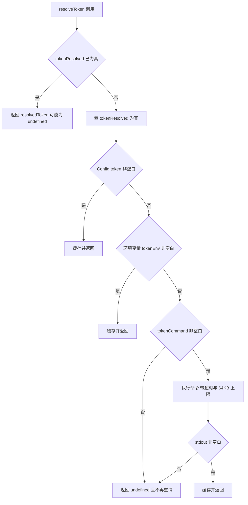
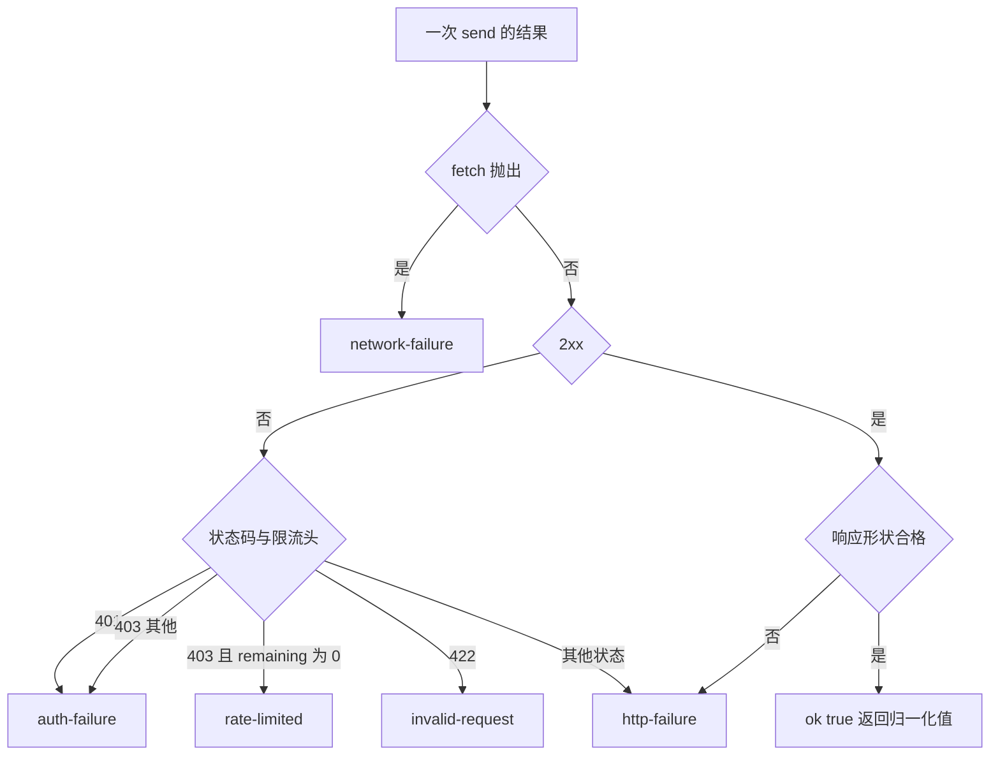

# GitHub REST 集成与凭据

`GithubIssueClient` 是 `@zhangj1164/dsh-github-issue` 里唯一直接讲 GitHub REST 的地方。它把两件事收敛成两个方法——建一个 issue、列出带 claim 标签的 open issue——并保证任何失败都以 `GithubIssueFailureCode` 里的稳定码返回，所以上层的服务永远不需要自己读一个 `fetch` 异常或一个 HTTP 状态码（[github.ts](../../packages/github-issue/dsh-github-issue/src/github.ts#L1-L10)）。

它是一个包内私有的传输层，不是对外 API：包入口只再导出 `types.ts` 的纯类型，`GithubIssueClient` 与 `parseRepository` 都没有从 `index.ts` 导出，宿主能看到的只有带 `@Remote` 的服务方法（[index.ts](../../packages/github-issue/dsh-github-issue/src/index.ts#L44-L45)）。调用方是 `GithubIssueService`：每个远程调用经 `createClient` 新建一个实例，把已解析的 token、`apiBaseUrl` 与 `requestTimeoutMs` 注入进去（[index.ts](../../packages/github-issue/dsh-github-issue/src/index.ts#L827-L834)）。客户端本身无状态、不缓存，一个实例可以服务任意仓库（[github.ts](../../packages/github-issue/dsh-github-issue/src/github.ts#L81-L106)）。

## 两个操作

| 操作 | 请求 | 发请求前的前置检查 | 成功值 |
|---|---|---|---|
| `createIssue(report)` | `POST {apiBaseUrl}/repos/{owner}/{repo}/issues`，JSON body `{ title, body, labels }` | 仓库可解析（否则 `invalid-repo`）、有 token（否则 `auth-missing`）、`title.trim()` 非空（否则 `invalid-request`） | `{ number, url }`（取自响应的 `number` 与 `html_url`），冻结 |
| `listClaimable(label, max)` | `GET {apiBaseUrl}/repos/{owner}/{repo}/issues?state=open&labels=<label>&per_page=<max>` | 仓库可解析、有 token | 冻结的 `GithubIssueTask[]` |

**建单**把 `report.title` 原样作为 issue 标题、`report.body` 作为正文、`report.labels` 作为标签发出。标题为空是本地拒绝而不是发一次注定 422 的请求。响应里若没有 `number` 或 `html_url`，客户端不认为成功，而是报 `http-failure`（「GitHub accepted the issue but the response carried no number or URL」）——因为调用方需要的就是这两个值（[github.ts](../../packages/github-issue/dsh-github-issue/src/github.ts#L108-L140)）。正文的整理（例如剥掉 optimizer 重复写在第一行的 `## 标题`）在服务层用 `issueBody` 完成，客户端只管发送收到的字符串。

**列单**的查询用 `URLSearchParams` 拼装，所以标签里的空格与中文会被正确百分号编码。返回体必须是数组，否则整体 `http-failure`；数组内的每一行则单独判定，宁可跳过也不整体失败，因为「一行意外数据不该把它后面的真实任务全挡住」：

- 不是对象、或带 `pull_request` 键的行被丢弃。GitHub 的 issues 接口会返回 PR，而 PR 永远不是该接的单（[github.ts](../../packages/github-issue/dsh-github-issue/src/github.ts#L142-L152)）。
- 缺 `number`、`title` 或 `html_url` 的行被丢弃。
- `labels` 里没有与传入 label 大小写不敏感相等的名字的行被丢弃；标签名从 `[{ name }]` 结构里读出，空名忽略。
- 缺 `body` 时正文取空字符串。

于是最终集合是「GitHub 侧 `labels=` 过滤」与「本地大小写不敏感复核」的交集，返回顺序保持响应顺序，`labels` 保持响应顺序。`max` 被直接写进 `per_page`，客户端不做 clamp——取值收敛（1..100）发生在服务层的 `clampCount`（[github.ts](../../packages/github-issue/dsh-github-issue/src/github.ts#L274-L310)、[index.ts](../../packages/github-issue/dsh-github-issue/src/index.ts#L1121-L1124)）。

## 请求构造：源、版本、UA 与超时

这四个事实决定了这份代码能不能挪到另一个部署上（[github.ts](../../packages/github-issue/dsh-github-issue/src/github.ts#L42-L65)、[github.ts](../../packages/github-issue/dsh-github-issue/src/github.ts#L180-L237)）：

- **`apiBaseUrl` 是独立的、可配置的 REST 源。** `repoUrl` 只贡献 owner/repo，它的 host 不参与请求地址，所以 `https://github.com/owner/repo` 配 `https://ghe.example.com/api/v3` 是合法组合，这就是 GitHub Enterprise 的接法。构造时尾斜杠被剥掉（`replace(/\/+$/u, '')`），路径再以 `/repos/...` 拼接，因此不会出现 `//repos`。
- **API 版本是钉死的常量，不是配置项。** 每个请求都带 `x-github-api-version: 2022-11-28`；注释给出的理由是请求形状是照着这个协议写的，换版本会静默收到另一套响应 schema。
- **`user-agent` 固定为包名 `@zhangj1164/dsh-github-issue`。** GitHub 要求每个 REST 请求带它。
- **超时是每请求的，而不是整条链路的。** 每次 `fetch` 都挂 `AbortSignal.timeout(timeoutMs)`（`requestTimeoutMs`，默认 15000ms，schema 收敛在 1000..180000）；到期在 `fetch` 处抛出，走与其他传输错误相同的分支，变成 `network-failure`。没有单独的「超时」码。

其余请求头固定为 `accept: application/vnd.github+json` 与 `content-type: application/json`；`authorization: Bearer <token>` 只在 token 存在时加。body 只在非 `undefined` 时 `JSON.stringify` 后附上。响应体先读文本：空文本解码成 `{}`，否则 `JSON.parse`，解析失败归类为 `http-failure` 而不是抛出（[github.ts](../../packages/github-issue/dsh-github-issue/src/github.ts#L175-L199)）。`fetchImpl` 可注入，这是测试用的假 transport，也是替换传输实现的唯一入口。

### 仓库 URL 的解析限制

`parseRepository` 用一条正则把 URL 拆成 owner/repo：`^https?://[^/\s]+/([^/\s]+)/([^/\s]+?)/?$`（[github.ts](../../packages/github-issue/dsh-github-issue/src/github.ts#L67-L79)）。成立条件很窄：

- 路径必须**恰好两段**，段内不能有空白，允许一个尾斜杠。
- `https://github.com/acme`、`.../acme/widgets/issues`、`not-a-url` 都返回 `undefined`，随后两个操作都以 `invalid-repo` 结束，且**不发出任何请求**。
- host 不被校验，`.git` 后缀也不会被剥掉（`widgets.git` 会被当成仓库名）。既然请求地址由 `apiBaseUrl` 决定，host 在这里只影响正则是否匹配。

## 凭据：三个来源，一次解析

凭据解析在服务里，结果是注入给客户端的 `token: string | undefined`（[index.ts](../../packages/github-issue/dsh-github-issue/src/index.ts#L836-L866)）。优先级是显式的三级回退：

1. `Config.token`——部署自己管密钥时设置；
2. `process.env[Config.tokenEnv]`，默认变量名 `GITHUB_TOKEN`，`tokenEnv` 为空串则跳过环境查找；
3. `Config.tokenCommand` 的标准输出，默认命令是 **`gh auth token`**。

第三级的默认值是一个刻意的运维决定：它读 `gh` CLI 已经存下的凭据，于是**一台已经登录 GitHub 的机器不需要任何额外 secret 就能跑通接单流程**；部署若自己管密钥，就设 `token` 并把 `tokenCommand` 置空串来关掉这次查找。命令用 `execAsync` 执行，带 `tokenCommandTimeoutMs`（默认 10000ms）、`windowsHide: true` 与 64KB 的 `maxBuffer`，stdout 经 `firstNonBlank` 取 trim 后的值；命令失败只 `warn('token command failed: ...')` 并当作「没有凭据」继续。

图：`resolveToken` 的三级回退，以及「无凭据」被当作终态结果缓存的行为。

两条缓存语义必须连着读（[index.ts](../../packages/github-issue/dsh-github-issue/src/index.ts#L406-L409)）：

- **每个进程只解析一次。** `resolvedToken` 与 `tokenResolved` 两个字段让 keyring 支撑的凭据不会被每个请求去取一遍；代价是**「没有凭据」也被缓存成结果**——先失败、之后才补上环境变量，同进程内不会自动恢复，需要宿主重启。
- **`tokenResolved` 在 `await` 之前置位**，所以 token 命令还在执行时进入的第二个调用会看到 `tokenResolved === true` 而 `resolvedToken === undefined`，直接得到 `auth-missing`。当前的调用序是串行的（一次 `runIntake` 先 list、再逐个 dispatch），这条不会显形；若将来在同一进程里并行发起 REST 调用，这里需要换成一个共享的 promise。

命令输出**永远不落日志**：它不进 `warn`、不进失败消息、不进遥测元数据。缺凭据时客户端返回的消息只说「no GitHub token is configured; set the configured token environment variable or token command」，不带任何凭据片段。

## 失败分类

分类只发生在三处：`send` 的 `catch`、`httpFailure` 对非 2xx 的判定、以及每个操作对成功响应形状的复核。所有失败都是 `{ ok: false, error: { code, message } }`，`code` 是契约，`message` 只给人读（[github.ts](../../packages/github-issue/dsh-github-issue/src/github.ts#L201-L247)）。

| code | 触发条件 | 是否已发出请求 |
|---|---|---|
| `invalid-repo` | `parseRepository` 返回 `undefined`（先于凭据检查判定） | 否 |
| `auth-missing` | 注入的 token 为 `undefined` | 否 |
| `invalid-request` | `createIssue` 的标题 trim 后为空；或 GitHub 返回 422 | 标题为空时否 |
| `auth-failure` | 401；或 403 且 `x-ratelimit-remaining` 不等于 `0` | 是 |
| `rate-limited` | 403 且 `x-ratelimit-remaining: 0` | 是 |
| `http-failure` | 其他状态码；2xx 但 body 不是 JSON；`createIssue` 成功却缺 `number`/`html_url`；`listClaimable` 返回非数组 | 是 |
| `network-failure` | `fetchImpl` 抛出，含 `AbortSignal.timeout` 到期 | 是 |

图：客户端把 fetch 异常与 HTTP 状态收敛成稳定失败码的唯一路径。

几个容易被误判的边界：

- **429 不是 `rate-limited`。** 限流只按「403 + `x-ratelimit-remaining: 0`」识别，429 会落成 `http-failure`。
- **失败消息会尽力带上 GitHub 的 `message`**（格式 `: <message>`），但分类从不读它——解析失败就留空，分类只看状态码与那一个 header。
- **客户端不重试、不退避。** 每个失败都直接作为结果上抛，重试策略属于调用方。
- **`GithubIssueFailureCode` 比客户端的范围大。** 这个 union 有 9 个码，客户端只产出其中 7 个（上表全部）；剩下的 `session-unavailable` 与 `dispatch-failed` 由服务的 dispatch 路径产生（没有 Session controller/Agent registry、Session 创建失败、prompt 被拒）（[types.ts](../../packages/github-issue/dsh-github-issue/src/types.ts#L138-L163)、[index.ts](../../packages/github-issue/dsh-github-issue/src/index.ts#L365-L372)、[index.ts](../../packages/github-issue/dsh-github-issue/src/index.ts#L690-L693)）。

**缺失凭据是正常失败，不是崩溃。** 客户端在发请求之前就返回 `auth-missing`，服务把它当作普通失败结果：`createIssue`/`listClaimableIssues` 会记一条 telemetry 失败事件再原样返回，`runIntake` 直接把它透传，启动检查只 `warn` 一行并等下一次启动（[github.ts](../../packages/github-issue/dsh-github-issue/src/github.ts#L115-L157)、[index.ts](../../packages/github-issue/dsh-github-issue/src/index.ts#L595-L640)）。一个没配密钥的部署因此表现为「接单跑不动」的可读失败，而不是插件挂载失败。

## 配置与运维

`apiBaseUrl`、`requestTimeoutMs`、`token`、`tokenEnv`、`tokenCommand`、`tokenCommandTimeoutMs` 都是部署级字段，在构造函数里被拷成实例字段，因此只在插件挂载时取一次值，不进设置页；需要热生效的是 `repoUrl`、`claimLabel`、`maxIssuesPerRun` 与五个 autopilot 字段（[index.ts](../../packages/github-issue/dsh-github-issue/src/index.ts#L56-L170)、[配置与热生效](../concepts/configuration-and-live-settings.md)）。

自带 bundle patch 只插入一行 `github-issue`，且只覆盖 `repoUrl`，其余全部取 schema 默认值（`https://api.github.com`、`GITHUB_TOKEN`、`gh auth token`、15s）（[cordis.patch.yml](../../packages/github-issue/dsh-github-issue/cordis.patch.yml#L26-L30)）。所以一个企业部署的最小改动是在自己的 `cordis.patch.yml` 里把 `apiBaseUrl` 指到 `https://host/api/v3`；接单循环默认关闭，开启它至少需要仓库 URL、dispatch 的 cwd，以及一个可用凭据。

## 变更与扩展的安全边界

- **新增一个操作**：在 `GithubIssueClient` 上加方法，复用私有的 `send()` 与 `fail()`，并在方法里做形状复核。不要在新方法里自己读状态码或抛出异常——那会把分类规则复制成第二份，服务层面对的就不再是一个稳定码集合。
- **不要把客户端或 `parseRepository` 摆到远程接口上。** 它接受任意 `repoUrl` 作为请求意图，而宿主侧的校验只到「URL 形状」这一层；远程方法 `createIssue` 的 `repoUrl` 覆盖已经带来同样的面（见 [能力与审批边界](../concepts/capability-and-approval-boundaries.md)）。
- **不要为了 Enterprise 而让代码去嗅探 `repoUrl` 的 host。** 源是 `apiBaseUrl` 的职责，两者解耦正是这里可移植的原因。
- **把 API 版本改成可配置**是破坏性变更而不是新选项：请求形状与响应解析都按 `2022-11-28` 写，改版本要同时改解析与测试。

## 专注测试与缺口

`tests/github.spec.ts` 用注入的假 `fetch` 覆盖了客户端的契约面（[github.spec.ts](../../packages/github-issue/dsh-github-issue/tests/github.spec.ts#L14-L113)）：

- `parseRepository` 拆出 owner/repo、容忍尾斜杠，并在两段路径缺失或非 URL 时返回 `undefined`。
- `createIssue` 的请求形状：URL 为 `https://api.github.com/repos/acme/widgets/issues`、方法为 `POST`、`authorization` 为 `Bearer secret`、body 是 `{ title, body, labels }`。
- 缺凭据时**一个请求都不发**（用 `called` 断言），并返回 `auth-missing`。
- 401 → `auth-failure`、403 + `x-ratelimit-remaining: 0` → `rate-limited`、422 → `invalid-request`、500 → `http-failure`。
- transport 抛错 → `network-failure`，且原错误文本保留在消息里；非仓库 URL → `invalid-repo`。
- `listClaimable` 只保留带 claim 标签的行、丢掉带 `pull_request` 的行、大小写不敏感匹配（`Ready-For-Agent` 命中 `ready-for-agent`）；200 + 非 JSON body → `http-failure`。

尚未覆盖、改这些行为时应顺手补上的部分：`apiBaseUrl` 的尾斜杠剥离与 Enterprise 拼接、`user-agent` 与 `x-github-api-version` 两个头、`AbortSignal` 超时、403 而没有限流头（应落 `auth-failure`）、`createIssue` 成功后缺 `number`/`html_url`、标题为空的本地拒绝，以及仓库 URL 的 `.git` 后缀与三段路径边界。

相关页面：[GitHub issue 服务](../systems/github-issue-service.md)、[issue 接单自动化](../workflows/issue-intake-autopilot.md)、[配置与热生效](../concepts/configuration-and-live-settings.md)。
