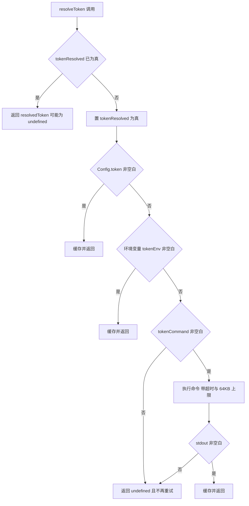
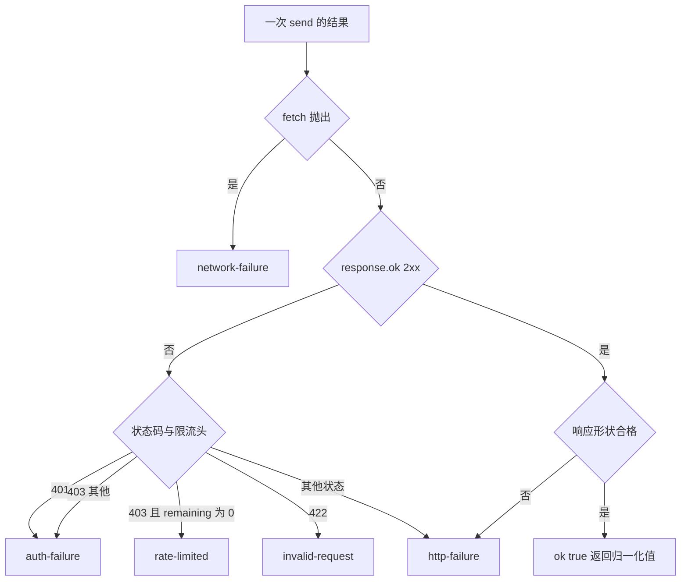

# GitHub REST 集成与凭据

`GithubIssueClient` 是 `@zhangj1164/dsh-github-issue` 里唯一直接讲 GitHub REST 的地方。它把两件事收敛成两个方法——建一个 issue、列出带 claim 标签的 open issue——并保证任何失败都以 `GithubIssueFailureCode` 里的稳定码返回，所以上层的 GitHub issue 服务永远不需要自己读一个 `fetch` 异常或一个 HTTP 状态码（[github.ts](../../packages/github-issue/dsh-github-issue/src/github.ts#L10-L17)、[github.ts](../../packages/github-issue/dsh-github-issue/src/github.ts#L111-L165)）。

它是一个包内私有的传输层，不是对外 API：包入口只 `export type * from './types.ts'`，`GithubIssueClient`、`parseRepository` 与 `GithubIssueClientOptions` 都没有出现在 `index.ts` 的导出面上，`package.json` 的 `exports` 也只有 `.`、`./types`、`./client`、`./invariant`、`./package.json` 五个入口（[index.ts](../../packages/github-issue/dsh-github-issue/src/index.ts#L44-L45)、[package.json](../../packages/github-issue/dsh-github-issue/package.json#L7-L26)）。宿主能看到的只有带 `@Remote` 的服务方法。

调用方是 `GithubIssueService`：每个远程调用经 `createClient` 新建一个实例，把 `firstNonBlank(repoUrl, 配置的 repoUrl)`、实例字段 `apiBaseUrl`、`await resolveToken()` 与实例字段 `requestTimeoutMs` 注入进去（[index.ts](../../packages/github-issue/dsh-github-issue/src/index.ts#L1018-L1027)）。客户端本身无状态、不缓存，一个实例可以服务任意仓库（[github.ts](../../packages/github-issue/dsh-github-issue/src/github.ts#L97-L106)）。

## 谁调 GitHub、谁不调

这个包对 GitHub 有两个方向，只有一个方向经过 REST：

| 路径 | 触到 GitHub 的方式 | 需要凭据 |
|---|---|---|
| `createIssue` / `listClaimableIssues` / `runIntake` / `dispatchIssue` | `GithubIssueClient` 的 REST 调用 | 是 |
| `prefilledIssueUrl` | 纯字符串拼装，产出给浏览器打开的 `https://github.com/.../issues/new?...` 链接 | 否（什么都不发） |

预填那条路径**不是** REST 集成，但它与 REST 共用一个 `repoUrl` 配置来源，而且校验规则更窄（见[预填 URL 的长度预算](#预填-url-的长度预算)）。`generateReport` 与 `optimizeIssue` 只调模型，完全不碰 GitHub。

## 两个操作

| 操作 | 请求 | 发请求前的前置检查（按判定顺序） | 成功值 |
|---|---|---|---|
| `createIssue(report)` | `POST {apiBaseUrl}/repos/{owner}/{repo}/issues`，JSON body `{ title, body, labels }` | 仓库可解析（否则 `invalid-repo`）、有 token（否则 `auth-missing`）、`title.trim()` 非空（否则 `invalid-request`） | `{ number, url }`（取自响应的 `number` 与 `html_url`），冻结 |
| `listClaimable(label, max)` | `GET {apiBaseUrl}/repos/{owner}/{repo}/issues?state=open&labels=<label>&per_page=<max>` | 仓库可解析、有 token | 冻结的 `GithubIssueTask[]` |

两个操作都在构造时就把 `repoUrl` 解析成 owner/repo 存进实例字段，所以「URL 不合法」这个判决在对象建好那一刻就定了，检查顺序是仓库 → 凭据 → 请求内容。

**建单**把 `report.title` trim 后作为 issue 标题、`report.body` 原样作为正文、`report.labels` 浅拷贝后作为标签发出。标题为空是本地拒绝，而不是发一次注定 422 的请求。响应里若没有 `number` 或 `html_url`，客户端不认为成功，而是报 `http-failure`（「GitHub accepted the issue but the response carried no number or URL」）——因为调用方需要的就是这两个值（[github.ts](../../packages/github-issue/dsh-github-issue/src/github.ts#L111-L137)）。正文的整理在服务层完成：`issueBody` 剥掉 optimizer 重复写在第一行的 `## 标题`，标签先 trim 再丢掉空项，然后才把归一化后的报告交给客户端（[index.ts](../../packages/github-issue/dsh-github-issue/src/index.ts#L652-L662)、[intake.ts](../../packages/github-issue/dsh-github-issue/src/intake.ts#L36-L52)）。客户端只管发送收到的字符串，不重复做这些整理。

**列单**的查询用 `URLSearchParams` 拼装，所以标签里的空格与中文会被正确百分号编码。返回体必须是数组，否则整体 `http-failure`；数组内的每一行则单独判定，宁可跳过也不整体失败，因为「一行意外数据不该把它后面的真实任务全挡住」（[github.ts](../../packages/github-issue/dsh-github-issue/src/github.ts#L146-L165)）：

- 不是对象、或带 `pull_request` 键的行被丢弃。GitHub 的 issues 接口会返回 PR，而 PR 永远不是该接的单。
- 缺 `number`、`title` 或 `html_url`（类型不符也算缺失）的行被丢弃。
- `labels` 里没有与传入 label 大小写不敏感相等的名字的行被丢弃；标签名从 `[{ name }]` 结构里读出，空名忽略。
- 缺 `body` 时正文取空字符串。

于是最终集合是「GitHub 侧 `labels=` 过滤」与「本地大小写不敏感复核」的交集，返回顺序保持响应顺序，`labels` 保持响应顺序。`max` 被直接写进 `per_page`，客户端不做 clamp——取值收敛（1..100，非有限数取 1）发生在服务层的 `clampCount`（[github.ts](../../packages/github-issue/dsh-github-issue/src/github.ts#L266-L316)、[index.ts](../../packages/github-issue/dsh-github-issue/src/index.ts#L1335-L1338)）。

## 请求构造：源、版本、UA 与超时

这几个事实决定了这份代码能不能挪到另一个部署上（[github.ts](../../packages/github-issue/dsh-github-issue/src/github.ts#L34-L48)、[github.ts](../../packages/github-issue/dsh-github-issue/src/github.ts#L168-L198)）：

- **`apiBaseUrl` 是独立的、可配置的 REST 源。** `repoUrl` 只贡献 owner/repo，它的 host 不参与请求地址，所以 `https://github.com/owner/repo` 配 `https://ghe.example.com/api/v3` 是合法组合，这就是 GitHub Enterprise 的接法。构造时尾斜杠被剥掉（`replace(/\/+$/u, '')`），路径再以 `/repos/...` 拼接，因此不会出现 `//repos`。
- **API 版本是钉死的常量，不是配置项。** 每个请求都带 `x-github-api-version: 2022-11-28`；注释给出的理由是请求形状是照着这个协议写的，换版本会静默收到另一套响应 schema。
- **`user-agent` 固定为包名 `@zhangj1164/dsh-github-issue`。** 两者都是模块级常量，没有对应的 `Config` 字段。
- **超时是每请求的，而不是整条链路的。** 每次 `fetch` 都挂 `AbortSignal.timeout(timeoutMs)`（来自 `requestTimeoutMs`，默认 15000ms，schema 收敛在 1000..180000）；到期在 `fetch` 处抛出，走与其他传输错误相同的分支，变成 `network-failure`。没有单独的「超时」码。

其余请求头固定为 `accept: application/vnd.github+json` 与 `content-type: application/json`；`authorization: Bearer <token>` 只在 token 存在时加。body 只在非 `undefined` 时 `JSON.stringify` 后附上。响应体成功时先读文本：空文本解码成 `{}`，否则 `JSON.parse`，解析失败归类为 `http-failure` 而不是抛出（[github.ts](../../packages/github-issue/dsh-github-issue/src/github.ts#L168-L198)、[github.ts](../../packages/github-issue/dsh-github-issue/src/github.ts#L224-L237)）。`fetchImpl` 可注入（默认 `fetch`），这是测试用的假 transport，也是替换传输实现的唯一入口。

### 仓库 URL 的解析限制

`parseRepository` 先 `trim()`，再用一条正则把 URL 拆成 owner/repo：`^https?://[^/\s]+/([^/\s]+)/([^/\s]+?)/?$`（[github.ts](../../packages/github-issue/dsh-github-issue/src/github.ts#L67-L79)）。成立条件很窄：

- 路径必须**恰好两段**，段内不能有空白，允许一个尾斜杠，两端空白被 trim 掉。
- `https://github.com/acme`、`https://github.com/acme/widgets/issues`、`not-a-url` 都返回 `undefined`，随后两个操作都以 `invalid-repo` 结束，且**不发出任何请求**；测试覆盖了「只有一段路径」与「非 URL」两种。
- host 不被校验，`.git` 后缀也不会被剥掉（`widgets.git` 会被当成仓库名）。既然请求地址由 `apiBaseUrl` 决定，host 在这里只影响正则是否匹配。

## 凭据：三个来源，一次解析

凭据解析在服务里，结果是注入给客户端的 `token: string | undefined`（[index.ts](../../packages/github-issue/dsh-github-issue/src/index.ts#L1034-L1061)）。优先级是显式的三级回退：

1. `Config.token`——部署自己管密钥时设置；
2. `process.env[Config.tokenEnv]`，默认变量名 `GITHUB_TOKEN`，`tokenEnv` 为空串则跳过环境查找；
3. `Config.tokenCommand` 的标准输出，默认命令是 **`gh auth token`**。

第三级的默认值是一个刻意的运维决定：它读 `gh` CLI 已经存下的凭据，于是**一台已经登录 GitHub 的机器不需要任何额外 secret 就能跑通接单流程**；部署若自己管密钥，就设 `token` 并把 `tokenCommand` 置空串来关掉这次查找（`tokenCommand.trim()` 为空即跳过）。命令用 `execAsync` 执行，带 `tokenCommandTimeoutMs`（默认 10000ms，schema 范围 1000..120000）、`windowsHide: true` 与 64KB 的 `maxBuffer`，stdout 经 `firstNonBlank` 取 trim 后的值；命令失败或输出为空只 `warn('token command failed: ...')` 并当作「没有凭据」继续。

图：`resolveToken` 的三级回退，以及「无凭据」被当作终态结果缓存的行为。

两条缓存语义必须连着读（[index.ts](../../packages/github-issue/dsh-github-issue/src/index.ts#L408-L412)、[index.ts](../../packages/github-issue/dsh-github-issue/src/index.ts#L1044-L1061)）：

- **每个进程只解析一次。** `resolvedToken` 与 `tokenResolved` 两个字段让 keyring 支撑的凭据不会被每个请求去取一遍；代价是**「没有凭据」也被缓存成结果**——先失败、之后才补上环境变量，同进程内不会自动恢复，需要宿主重启。
- **`tokenResolved` 在 `await` 之前置位**，所以 token 命令还在执行时进入的第二个调用会看到 `tokenResolved === true` 而 `resolvedToken === undefined`，直接得到 `auth-missing`。当前调用序是串行的——`runIntake` 先 list、再逐个 dispatch——这条不会显形；若将来在同一进程里并行发起 REST 调用，这里需要换成一个共享的 promise。
- **一个进程里只有一个 token。** 解析结果被列单、建单与 `runIntake` 里的每一个客户端共用，所以同一进程内的所有仓库（包括请求里的 `repoUrl` 覆盖）都用同一份凭据。

命令输出**永远不落日志**：它不进 `warn`、不进失败消息、不进遥测元数据。缺凭据时客户端返回的消息只说「no GitHub token is configured; set the configured token environment variable or token command」，不带任何凭据片段（[github.ts](../../packages/github-issue/dsh-github-issue/src/github.ts#L111-L116)）。

## 失败分类

分类只发生在三处：`send` 的 `catch`、`httpFailure` 对非 2xx 的判定、以及每个操作对成功响应形状的复核。所有失败都是 `{ ok: false, error: { code, message } }`，`code` 是契约，`message` 只给人读（[github.ts](../../packages/github-issue/dsh-github-issue/src/github.ts#L168-L238)）。

| code | 触发条件 | 是否已发出请求 |
|---|---|---|
| `invalid-repo` | `parseRepository` 返回 `undefined`（先于凭据检查判定） | 否 |
| `auth-missing` | 注入的 token 为 `undefined` | 否 |
| `invalid-request` | `createIssue` 的标题 trim 后为空；或 GitHub 返回 422 | 标题为空时否 |
| `auth-failure` | 401；或 403 且 `x-ratelimit-remaining` 不等于 `'0'` | 是 |
| `rate-limited` | 403 且 `x-ratelimit-remaining: 0` | 是 |
| `http-failure` | 其他状态码；2xx 但 body 不是 JSON；`createIssue` 成功却缺 `number`/`html_url`；`listClaimable` 返回非数组 | 是 |
| `network-failure` | `fetchImpl` 抛出，含 `AbortSignal.timeout` 到期 | 是（请求已尝试） |

图：客户端把 fetch 异常与 HTTP 状态收敛成稳定失败码的唯一路径。

几个容易被误判的边界：

- **429 不是 `rate-limited`。** 限流只按「403 + `x-ratelimit-remaining: 0`」识别，429 会落成 `http-failure`。
- **失败消息会尽力带上 GitHub 的 `message`**（由 `readErrorMessage` 解析失败响应体，格式 `: <message>`）；读取或解析失败就留空，分类从不读它——只看状态码与那一个 header（[github.ts](../../packages/github-issue/dsh-github-issue/src/github.ts#L306-L319)）。
- **客户端不重试、不退避。** 每个失败都直接作为结果上抛；重试发生在更外层：启动检查把「本地日」当作完成标记，所以整次 pass 失败时下一次启动会重跑（[issue 接单自动化](../workflows/issue-intake-autopilot.md)）。
- **`GithubIssueFailureCode` 比客户端的范围大。** 这个 union 有 9 个码，客户端只产出其中 7 个（上表全部）；剩下的 `session-unavailable` 与 `dispatch-failed` 由服务的 dispatch 路径产生（缺 Session controller、Session 创建失败、automation task 被拒、prompt 被拒，或一次 pass 里所有 dispatch 都失败）（[types.ts](../../packages/github-issue/dsh-github-issue/src/types.ts#L138-L163)、[index.ts](../../packages/github-issue/dsh-github-issue/src/index.ts#L418-L424)、[index.ts](../../packages/github-issue/dsh-github-issue/src/index.ts#L747-L763)）。

**缺失凭据是正常失败，不是崩溃。** 客户端在发请求之前就返回 `auth-missing`（测试断言此时 `fetch` 一次都没被调用），服务把它当作普通失败结果：`createIssue` 与 `listClaimableIssues` 会用 `trackError` 记一条 telemetry 失败事件再原样返回，`runIntake` 直接把 list 的失败透传，启动检查则 `trackError('startupIntake', ...)` 加一行 `warn` 后等下一次启动（[github.ts](../../packages/github-issue/dsh-github-issue/src/github.ts#L111-L116)、[index.ts](../../packages/github-issue/dsh-github-issue/src/index.ts#L655-L693)、[index.ts](../../packages/github-issue/dsh-github-issue/src/index.ts#L924-L940)、[github.spec.ts](../../packages/github-issue/dsh-github-issue/tests/github.spec.ts#L41-L52)）。一个没配密钥的部署因此表现为「接单跑不动」的可读失败，而不是插件挂载失败。

## 预填 URL 的长度预算

`prefilledIssueUrl` 是同一个包里另一条与 GitHub 相关的路径，但它**不经过上面的传输层**：它把 `title`、`body` 与可选的 `labels` 放进 `URLSearchParams`，拼成 `{repoUrl}/issues/new?{params}` 交给浏览器打开（[index.ts](../../packages/github-issue/dsh-github-issue/src/index.ts#L601-L619)、[index.ts](../../packages/github-issue/dsh-github-issue/src/index.ts#L1280-L1320)）。这条路径同步、不调模型、不发请求，因此也不需要凭据。

两个约束在这里汇合：

- **仓库校验比传输层更窄。** `repoUrl` 为空串时回落到 `Config.repoUrl`，然后必须匹配 `^https://github\.com/[^/]+/[^/]+$`，否则返回 `invalid-url`。`parseRepository` 接受任意 host，所以企业部署能用 `apiBaseUrl` 建单却拿不到预填链接——预填链接是给浏览器打开的 github.com 表单。
- **预算按拼装后的 URL 长度判定，而不是正文长度。** `maxPrefillUrlLength`（默认 7000）比较的是 `full.length`，即百分号编码之后的最终 URL：标题与标签花的是同一份额度，正文里的中文、空格、换行经编码后每个字符膨胀成 `%XX` 这样的三个字符。所以一条「正文不超过 N 字节」的规则仍然会产出 GitHub 拒收的 URL——判断必须发生在编码之后（[index.ts](../../packages/github-issue/dsh-github-issue/src/index.ts#L1280-L1300)）。

超预算时的收敛不是二分，而是一串有界的减法（[index.ts](../../packages/github-issue/dsh-github-issue/src/index.ts#L1262-L1320)）：

1. 先把正文截到 `keep = body.length`，末尾追加 `prefillTruncationNote`，再 `compose` 一次；
2. 每轮把 `keep` 减去「当前 URL 超出预算的字符数」（至少 1），重新 `compose`；
3. 最多 `MAX_PREFILL_TRUNCATION_PASSES = 32` 轮，`keep` 到 0 也停；
4. 最后若仍超预算（只可能因为备注本身太长），退回 `compose(note)`——发一个只有备注的正文，好过发一个 GitHub 会拒绝的 URL。

因为每轮至少减去自己测出的溢出量，收敛到预算是常态；而字符编码成多个 URL 字符时单轮会**减过头**，代价只是正文更短，不会产出超长 URL。`maxPrefillUrlLength <= 0` 直接关闭缩短，原样返回完整 URL。

测试把这条预算钉在几处关键行为上：正文被截短后仍是原正文的**前缀**（不是乱序文本）、标题与标签占同一份额度（80 字标题 + 40 字标签 + 2000 字正文仍在 400 以内）、标题本身超预算时正文缩到只剩备注、以及 `0` 表示关闭缩短（[github-issue.spec.ts](../../packages/github-issue/dsh-github-issue/tests/github-issue.spec.ts#L56-L112)）。

## 配置与运维

`apiBaseUrl`、`requestTimeoutMs`、`token`、`tokenEnv`、`tokenCommand`、`tokenCommandTimeoutMs`、`maxPrefillUrlLength`、`prefillTruncationNote` 都是部署级字段：没有 `.volatile()`，在构造函数里被 `this.x = config.x` 拷成实例字段，因此只在插件挂载时取一次值，不进设置页；需要热生效的是 `repoUrl`、`claimLabel`、`maxIssuesPerRun` 与五个 autopilot 字段（[index.ts](../../packages/github-issue/dsh-github-issue/src/index.ts#L151-L171)、[index.ts](../../packages/github-issue/dsh-github-issue/src/index.ts#L417-L430)、[配置与热生效](../concepts/configuration-and-live-settings.md)）。

自带 bundle patch 只插入一行 `github-issue`，且只覆盖 `repoUrl`，其余全部取 schema 默认值（`https://api.github.com`、`GITHUB_TOKEN`、`gh auth token`、15s、7000 字符）（[cordis.patch.yml](../../packages/github-issue/dsh-github-issue/cordis.patch.yml#L26-L30)、[index.ts](../../packages/github-issue/dsh-github-issue/src/index.ts#L162-L170)）。所以一个企业部署的最小改动是在自己的 patch 层里把 `apiBaseUrl` 指到 `https://host/api/v3`；接单循环默认关闭（`autopilotEnabled: false`），开启它至少需要仓库 URL、dispatch 的 cwd，以及一个可用凭据。

## 变更与扩展的安全边界

- **新增一个操作**：在 `GithubIssueClient` 上加方法，复用私有的 `send()` 与 `fail()`，并在方法里做形状复核。不要在新方法里自己读状态码或抛出异常——那会把分类规则复制成第二份，服务层面对的就不再是一个稳定码集合。
- **不要把客户端或 `parseRepository` 摆到远程接口上。** 它接受任意 `repoUrl` 作为请求意图，而宿主侧的校验只到「URL 形状」这一层；远程方法 `createIssue` 的 `repoUrl` 覆盖已经带来同样的面（见 [能力与审批边界](../concepts/capability-and-approval-boundaries.md)）。
- **不要为了 Enterprise 而让代码去嗅探 `repoUrl` 的 host。** 源是 `apiBaseUrl` 的职责，两者解耦正是这里可移植的原因；反过来，预填那条路径刻意只认 github.com，两处规则不同是设计而非疏漏。
- **把 API 版本改成可配置**是破坏性变更而不是新选项：请求形状与响应解析都按 `2022-11-28` 写，改版本要同时改解析与测试。
- **改预填预算时不要把判定挪回正文长度。** 预算的经济学由编码决定；把 `maxPrefillUrlLength` 的检查改成 `body.length <= max` 会重新引入「本地通过、GitHub 拒收」。

## 专注测试与缺口

`tests/github.spec.ts` 用一个可注入的假 `fetch` 覆盖了客户端的契约面，共 8 个用例（[github.spec.ts](../../packages/github-issue/dsh-github-issue/tests/github.spec.ts#L13-L112)）：

- `parseRepository` 拆出 owner/repo、容忍尾斜杠，并在只有一段路径或非 URL 时返回 `undefined`。
- `createIssue` 的请求形状：URL 为 `https://api.github.com/repos/acme/widgets/issues`、方法为 `POST`、`authorization` 为 `Bearer secret`、body 是 `{ title, body, labels }`，201 响应解出 `{ number: 7, url }`。
- 缺凭据时**一个请求都不发**（用 `called` 断言），并返回 `auth-missing`。
- 401 → `auth-failure`、403 + `x-ratelimit-remaining: 0` → `rate-limited`、422 → `invalid-request`、500 → `http-failure`。
- transport 抛错 → `network-failure`，且原错误文本保留在消息里；非仓库 URL → `invalid-repo`。
- `listClaimable` 只保留带 claim 标签的行、丢掉带 `pull_request` 的行、大小写不敏感匹配（`Ready-For-Agent` 命中 `ready-for-agent`），并要求返回的 `labels` 为 `['ready-for-agent']`；200 + 非 JSON body → `http-failure`。

预填的那一半由 `tests/github-issue.spec.ts` 覆盖（URL 形状、`invalid-url`、空 `repoUrl` 回落配置、正文缩短、标题与标签共用预算、只剩备注、关闭缩短），见 [预填 URL 的长度预算](#预填-url-的长度预算)。

尚未覆盖、改这些行为时应顺手补上的部分：`apiBaseUrl` 的尾斜杠剥离与 Enterprise 拼接、`user-agent` 与 `x-github-api-version` 两个头、`content-type`/`accept`、`AbortSignal` 超时、403 而没有限流头（应落 `auth-failure`）、`createIssue` 成功后缺 `number`/`html_url`、标题为空的本地拒绝、`listClaimable` 返回非数组，以及仓库 URL 的 `.git` 后缀与三段路径边界。

相关页面：[GitHub issue 服务](../systems/github-issue-service.md)、[issue 接单自动化](../workflows/issue-intake-autopilot.md)、[配置与热生效](../concepts/configuration-and-live-settings.md)、[日志分析到 issue](../workflows/log-analysis-to-issue.md)。
