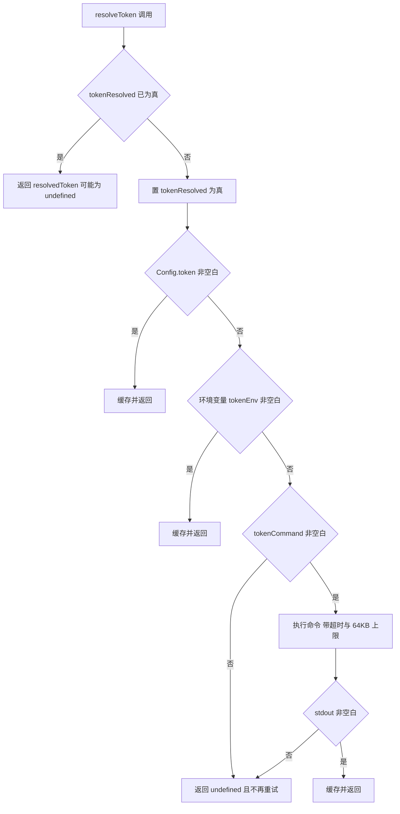
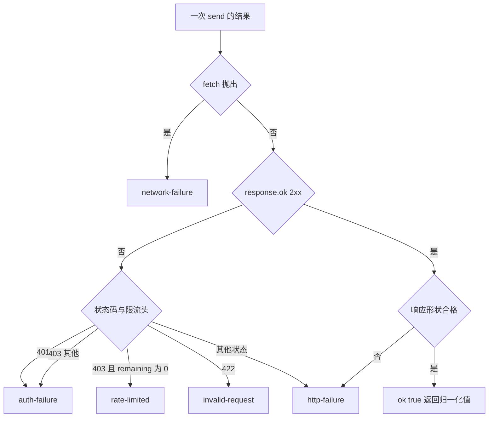

# GitHub REST 集成：URL 解析、端点、凭据与时序

`GithubIssueClient` 是 `@zhangj1164/dsh-github-issue` 里唯一直接讲 GitHub REST 的地方。它把两件事收敛成两个方法——建一个 issue、列出带 claim 标签的 open issue——并保证任何失败都以 `GithubIssueFailureCode` 里的稳定码返回，所以上层的 GitHub issue 服务永远不需要自己读一个 `fetch` 异常或一个 HTTP 状态码（[github.ts](../../packages/github-issue/dsh-github-issue/src/github.ts#L1-L10)）。

它是一个包内私有的传输层，不是对外 API：包入口只 `export type * from './types.ts'`，`GithubIssueClient`、`parseRepository` 与 `GithubIssueClientOptions` 都没有出现在 `index.ts` 的导出面上；`package.json` 的 `exports` 有 `.`、`./types`、`./client`、`./invariant`、`./package.json` 五个入口，其中 `./client` 只是把同一份类型源再导出一次给客户端代码用，仍然不含实现（[index.ts](../../packages/github-issue/dsh-github-issue/src/index.ts#L44-L45)、[client.ts](../../packages/github-issue/dsh-github-issue/src/client.ts#L1-L10)、[package.json](../../packages/github-issue/dsh-github-issue/package.json#L7-L26)）。宿主能看到的只有带 `@Remote` 的服务方法。

调用方是 `GithubIssueService`：每个远程调用经 `createClient` 新建一个实例，把 `firstNonBlank(repoUrl, 配置的 repoUrl)`、实例字段 `apiBaseUrl`、`await resolveToken()` 与实例字段 `requestTimeoutMs` 注入进去（[index.ts](../../packages/github-issue/dsh-github-issue/src/index.ts#L1010-L1027)）。客户端本身无状态、不缓存，一个实例可以服务任意仓库（[github.ts](../../packages/github-issue/dsh-github-issue/src/github.ts#L79-L106)）。

## 两个操作

| 操作 | 请求 | 发请求前的前置检查（按判定顺序） | 成功值 |
|---|---|---|---|
| `createIssue(report)` | `POST {apiBaseUrl}/repos/{owner}/{repo}/issues`，JSON body `{ title, body, labels }` | 仓库可解析（否则 `invalid-repo`）、有 token（否则 `auth-missing`）、`title.trim()` 非空（否则 `invalid-request`） | `{ number, url }`（取自响应的 `number` 与 `html_url`），冻结 |
| `listClaimable(label, max)` | `GET {apiBaseUrl}/repos/{owner}/{repo}/issues?state=open&labels=<label>&per_page=<max>` | 仓库可解析、有 token | 冻结的 `GithubIssueTask[]` |

两个操作都在构造时就把 `repoUrl` 解析成 owner/repo 存进实例字段，所以「URL 不合法」这个判决在对象建好那一刻就定了；检查顺序是仓库 → 凭据 → 请求内容（[github.ts](../../packages/github-issue/dsh-github-issue/src/github.ts#L111-L130)）。

**建单**把 `report.title` trim 后作为 issue 标题、`report.body` 原样作为正文、`report.labels` 浅拷贝后作为标签发出。标题为空是本地拒绝，而不是发一次注定 422 的请求。响应里若没有 `number` 或 `html_url`，客户端不认为成功，而是报 `http-failure`（「GitHub accepted the issue but the response carried no number or URL」）——因为调用方需要的就是这两个值；`number` 还要求是有限数字（[github.ts](../../packages/github-issue/dsh-github-issue/src/github.ts#L111-L137)、[github.ts](../../packages/github-issue/dsh-github-issue/src/github.ts#L256-L264)）。正文的整理（剥掉 optimizer 重复写在第一行的 `## 标题`、规范化行尾与尾部空白）在服务层用 `issueBody` 完成，标签也在服务层 trim 并丢弃空串，客户端只管发送收到的字符串（[intake.ts](../../packages/github-issue/dsh-github-issue/src/intake.ts#L32-L51)、[index.ts](../../packages/github-issue/dsh-github-issue/src/index.ts#L655-L666)）。

**列单**的查询用 `URLSearchParams` 拼装，所以标签里的空格与中文会被正确百分号编码。返回体必须是数组，否则整体 `http-failure`；数组内的每一行则单独判定，宁可跳过也不整体失败，因为「一行意外数据不该把它后面的真实任务全挡住」（[github.ts](../../packages/github-issue/dsh-github-issue/src/github.ts#L146-L172)）：

- 不是对象、或带 `pull_request` 键的行被丢弃。GitHub 的 issues 接口会返回 PR，而 PR 永远不是该接的单。
- 缺 `number`、`title` 或 `html_url`（类型不符也算缺失）的行被丢弃。
- `labels` 里没有与传入 label 大小写不敏感相等的名字的行被丢弃；标签名从 `[{ name }]` 结构里读出，空名忽略。
- 缺 `body` 时正文取空字符串。

于是最终集合是「GitHub 侧 `labels=` 过滤」与「本地大小写不敏感复核」的交集，返回顺序保持响应顺序，`labels` 保持响应顺序，每条任务与整个数组都被冻结。`max` 被直接写进 `per_page`，客户端不做 clamp——取值收敛（1..100，非有限数取 1）发生在服务层的 `clampCount`（[github.ts](../../packages/github-issue/dsh-github-issue/src/github.ts#L266-L316)、[index.ts](../../packages/github-issue/dsh-github-issue/src/index.ts#L1335-L1338)）。

## 请求构造：源、版本、UA 与超时

这四个事实决定了这份代码能不能挪到另一个部署上（[github.ts](../../packages/github-issue/dsh-github-issue/src/github.ts#L34-L80)、[github.ts](../../packages/github-issue/dsh-github-issue/src/github.ts#L168-L237)）：

- **`apiBaseUrl` 是独立的、可配置的 REST 源。** `repoUrl` 只贡献 owner/repo，它的 host 不参与请求地址，所以 `https://github.com/owner/repo` 配 `https://ghe.example.com/api/v3` 是合法组合，这就是 GitHub Enterprise 的接法。构造时尾斜杠被剥掉（`replace(/\/+$/u, '')`），路径再以 `/repos/...` 拼接，因此不会出现 `//repos`。
- **API 版本是钉死的常量，不是配置项。** 每个请求都带 `x-github-api-version: 2022-11-28`；注释给出的理由是请求形状是照着这个协议写的，换版本会静默收到另一套响应 schema。
- **`user-agent` 固定为包名 `@zhangj1164/dsh-github-issue`。** 两者都是模块级常量，没有对应的 `Config` 字段。
- **超时是每请求的，而不是整条链路的。** 每次 `fetch` 都挂 `AbortSignal.timeout(timeoutMs)`（来自 `requestTimeoutMs`，默认 15000ms，schema 收敛在 1000..180000）；到期在 `fetch` 处抛出，走与其他传输错误相同的分支，变成 `network-failure`。没有单独的「超时」码。

其余请求头固定为 `accept: application/vnd.github+json` 与 `content-type: application/json`；`authorization: Bearer <token>` 只在 token 存在时加——不过两个公开操作在 token 缺失时已经提前返回，所以实际发出的请求总是带它。body 只在非 `undefined` 时 `JSON.stringify` 后附上，因此列单的 GET 没有 body。响应体成功时先读文本：空文本（trim 后为空）解码成 `{}`，否则 `JSON.parse`，读取或解析失败归类为 `http-failure` 而不是抛出（[github.ts](../../packages/github-issue/dsh-github-issue/src/github.ts#L168-L198)、[github.ts](../../packages/github-issue/dsh-github-issue/src/github.ts#L224-L237)）。`fetchImpl` 可注入（默认 `fetch`），这是测试用的假 transport，也是替换传输实现的唯一入口。

### 仓库 URL 的解析限制

`parseRepository` 先 `trim()`，再用一条正则把 URL 拆成 owner/repo：`^https?://[^/\s]+/([^/\s]+)/([^/\s]+?)/?$`（[github.ts](../../packages/github-issue/dsh-github-issue/src/github.ts#L66-L79)）。成立条件很窄：

- 协议只接受 `http` 与 `https`，路径必须**恰好两段**，段内不能有空白，允许一个尾斜杠，两端空白被 trim 掉。
- `https://github.com/acme`、`https://github.com/acme/widgets/issues`、`not-a-url` 都返回 `undefined`，随后两个操作都以 `invalid-repo` 结束，且**不发出任何请求**；`tests/github.spec.ts` 覆盖了「只有一段路径」与「非 URL」两种，三段路径只是由正则推出的结论。
- host 不被校验，`.git` 后缀也不会被剥掉（`widgets.git` 会被当成仓库名）。既然请求地址由 `apiBaseUrl` 决定，host 在这里只影响正则是否匹配。

服务层还有第二套、更严格的 URL 判断：`prefilledIssueUrl` 用 `/^https:\/\/github\.com\/[^/]+\/[^/]+$/u` 校验，只接受 https 的 github.com 地址并返回 `invalid-url`（[index.ts](../../packages/github-issue/dsh-github-issue/src/index.ts#L609-L616)）。两条规则互不复用：预填 URL 是给人点的浏览器链，REST 调用只看形状；改其中一条不会影响另一条。

## 凭据：三个来源，一次解析

凭据解析在服务里，结果是注入给客户端的 `token: string | undefined`（[index.ts](../../packages/github-issue/dsh-github-issue/src/index.ts#L1029-L1061)）。优先级是显式的三级回退：

1. `Config.token`——部署自己管密钥时设置；
2. `process.env[Config.tokenEnv]`，默认变量名 `GITHUB_TOKEN`，`tokenEnv` 为空串则跳过环境查找；
3. `Config.tokenCommand` 的标准输出，默认命令是 **`gh auth token`**。

三级都用 `firstNonBlank` 取值，也就是 trim 后为空即视为「没有」——一个只含空白的环境变量不会被当成凭据（[index.ts](../../packages/github-issue/dsh-github-issue/src/index.ts#L1178-L1191)）。第三级的默认值是一个刻意的运维决定：它读 `gh` CLI 已经存下的凭据，于是**一台已经登录 GitHub 的机器不需要任何额外 secret 就能跑通接单流程**；部署若自己管密钥，就设 `token` 并把 `tokenCommand` 置空串来关掉这次查找（`tokenCommand.trim()` 为空即跳过）。命令用 `execAsync` 执行，带 `tokenCommandTimeoutMs`（默认 10000ms，schema 范围 1000..120000）、`windowsHide: true` 与 64KB 的 `maxBuffer`；命令失败或输出为空只 `warn('token command failed: ...')` 并当作「没有凭据」继续。

图：`resolveToken` 的三级回退，以及「无凭据」被当作终态结果缓存的行为。

两条缓存语义必须连着读（[index.ts](../../packages/github-issue/dsh-github-issue/src/index.ts#L485-L492)、[index.ts](../../packages/github-issue/dsh-github-issue/src/index.ts#L1038-L1061)）：

- **每个进程只解析一次。** `resolvedToken` 与 `tokenResolved` 两个字段让 keyring 支撑的凭据不会被每个请求去取一遍；代价是**「没有凭据」也被缓存成结果**——先失败、之后才补上环境变量，同进程内不会自动恢复，需要宿主重启。
- **`tokenResolved` 在 `await` 之前置位**，所以 token 命令还在执行时进入的第二个调用会看到 `tokenResolved === true` 而 `resolvedToken === undefined`，直接得到 `auth-missing`。当前的调用序是串行的（`runIntake` 先 list、再逐个 dispatch），这条不会显形；若将来在同一进程里并行发起 REST 调用，这里需要换成一个共享的 promise。

命令输出**永远不落日志**：它不进 `warn`、不进失败消息、不进遥测元数据。缺凭据时客户端返回的消息只说「no GitHub token is configured; set the configured token environment variable or token command」，不带任何凭据片段。

## 失败分类

分类只发生在三处：`send` 的 `catch`、`httpFailure` 对非 2xx 的判定、以及每个操作对成功响应形状的复核。所有失败都是 `{ ok: false, error: { code, message } }`，`code` 是契约，`message` 只给人读（[github.ts](../../packages/github-issue/dsh-github-issue/src/github.ts#L168-L238)）。HTTP 层能产出的稳定码共 7 个：

| code | 触发条件 | 是否已发出请求 |
|---|---|---|
| `invalid-repo` | `parseRepository` 返回 `undefined`（先于凭据检查判定） | 否 |
| `auth-missing` | 注入的 token 为 `undefined` | 否 |
| `invalid-request` | `createIssue` 的标题 trim 后为空；或 GitHub 返回 422 | 标题为空时否 |
| `auth-failure` | 401；或 403 且 `x-ratelimit-remaining` 不等于 `'0'` | 是 |
| `rate-limited` | 403 且 `x-ratelimit-remaining: 0` | 是 |
| `http-failure` | 其他状态码；2xx 但 body 不可读或不是 JSON；`createIssue` 成功却缺 `number`/`html_url`；`listClaimable` 返回非数组 | 是（2xx 缺字段时请求已成功） |
| `network-failure` | `fetchImpl` 抛出，含 `AbortSignal.timeout` 到期 | 是（请求已尝试） |

图：客户端把 fetch 异常与 HTTP 状态收敛成稳定失败码的唯一路径。

几个容易被误判的边界：

- **429 不是 `rate-limited`。** 限流只按「403 + `x-ratelimit-remaining: 0`」识别，429 会落成 `http-failure`。
- **失败消息会尽力带上 GitHub 的 `message`**（由 `readErrorMessage` 解析失败响应体，格式 `: <message>`）；读取、解析或字段缺失都留空，分类从不读它——只看状态码与那一个 header（[github.ts](../../packages/github-issue/dsh-github-issue/src/github.ts#L199-L222)）。
- **客户端不重试、不退避。** 每个失败都直接作为结果上抛；重试发生在更外层：启动检查把「本地日」当作完成标记，所以整次 pass 失败时下一次启动会重跑（[issue 接单自动化](../workflows/issue-intake-autopilot.md)）。
- **`GithubIssueFailureCode` 比客户端的范围大。** 这个 union 有 9 个码，客户端只产出上表的 7 个；剩下的 `session-unavailable` 与 `dispatch-failed` 由服务的 dispatch 路径产生（缺 Session controller/Agent registry、Session 创建失败、Schedule 任务或 prompt 被拒，或一次 pass 里所有 dispatch 都失败）（[types.ts](../../packages/github-issue/dsh-github-issue/src/types.ts#L135-L163)、[index.ts](../../packages/github-issue/dsh-github-issue/src/index.ts#L418-L424)、[index.ts](../../packages/github-issue/dsh-github-issue/src/index.ts#L747-L763)）。

**缺失凭据是正常失败，不是崩溃。** 客户端在发请求之前就返回 `auth-missing`，服务把它当作普通失败结果：`createIssue` 与 `listClaimableIssues` 会用 `trackError` 记一条 telemetry 失败事件再原样返回，`runIntake` 直接把 list 的失败透传，启动检查则 `trackError('startupIntake', ...)` 加一行 `warn` 后等下一次启动（[github.ts](../../packages/github-issue/dsh-github-issue/src/github.ts#L111-L116)、[index.ts](../../packages/github-issue/dsh-github-issue/src/index.ts#L655-L693)、[index.ts](../../packages/github-issue/dsh-github-issue/src/index.ts#L924-L940)）。一个没配密钥的部署因此表现为「接单跑不动」的可读失败，而不是插件挂载失败。

## 配置与运维

`apiBaseUrl`、`requestTimeoutMs`、`token`、`tokenEnv`、`tokenCommand`、`tokenCommandTimeoutMs` 都是部署级字段：没有 `.volatile()`，在构造函数里被 `this.x = config.x` 拷成实例字段，因此只在插件挂载时取一次值，不进设置页；需要热生效的是 `repoUrl`、`claimLabel`、`maxIssuesPerRun` 与五个 autopilot 字段（[index.ts](../../packages/github-issue/dsh-github-issue/src/index.ts#L151-L171)、[index.ts](../../packages/github-issue/dsh-github-issue/src/index.ts#L481-L511)、[配置与热生效](../concepts/configuration-and-live-settings.md)）。

自带 bundle patch 只插入一行 `github-issue`，且只覆盖 `repoUrl`，其余全部取 schema 默认值（`https://api.github.com`、`GITHUB_TOKEN`、`gh auth token`、15s）（[cordis.patch.yml](../../packages/github-issue/dsh-github-issue/cordis.patch.yml#L26-L30)）。所以一个企业部署的最小改动是在自己的 patch 层里把 `apiBaseUrl` 指到 `https://host/api/v3`；接单循环默认关闭（`autopilotEnabled: false`），开启它至少需要仓库 URL、dispatch 的 cwd，以及一个可用凭据。

## 变更与扩展的安全边界

- **新增一个操作**：在 `GithubIssueClient` 上加方法，复用私有的 `send()` 与 `fail()`，并在方法里做形状复核。不要在新方法里自己读状态码或抛出异常——那会把分类规则复制成第二份，服务层面对的就不再是一个稳定码集合。
- **不要把客户端或 `parseRepository` 摆到远程接口上。** 它接受任意 `repoUrl` 作为请求意图，而宿主侧的校验只到「URL 形状」这一层；远程方法 `createIssue` 的 `repoUrl` 覆盖已经带来同样的面（见 [能力与审批边界](../concepts/capability-and-approval-boundaries.md)）。
- **不要为了 Enterprise 而让代码去嗅探 `repoUrl` 的 host。** 源是 `apiBaseUrl` 的职责，两者解耦正是这里可移植的原因。
- **把 API 版本改成可配置**是破坏性变更而不是新选项：请求形状与响应解析都按 `2022-11-28` 写，改版本要同时改解析与测试。

## 专注测试与缺口

`tests/github.spec.ts` 用一个可注入的假 `fetch` 覆盖了客户端的契约面，共 8 个用例（沿用默认 `apiBaseUrl: 'https://api.github.com'`、`timeoutMs: 1000` 与 token `secret` 的构造助手）（[github.spec.ts](../../packages/github-issue/dsh-github-issue/tests/github.spec.ts#L4-L12)）：

- `parseRepository` 拆出 owner/repo、容忍尾斜杠，并在只有一段路径或非 URL 时返回 `undefined`。
- `createIssue` 的请求形状：URL 为 `https://api.github.com/repos/acme/widgets/issues`、方法为 `POST`、`authorization` 为 `Bearer secret`、body 是 `{ title, body, labels }`，201 响应解出 `{ number: 7, url }`。
- 缺凭据时**一个请求都不发**（用 `called` 断言），并返回 `auth-missing`。
- 401 → `auth-failure`、403 + `x-ratelimit-remaining: 0` → `rate-limited`、422 → `invalid-request`、500 → `http-failure`。
- transport 抛错 → `network-failure`，且原错误文本保留在消息里；非仓库 URL → `invalid-repo`。
- `listClaimable` 只保留带 claim 标签的行、丢掉带 `pull_request` 的行、大小写不敏感匹配（`Ready-For-Agent` 命中 `ready-for-agent`），并要求返回的 `labels` 为 `['ready-for-agent']`；200 + 非 JSON body → `http-failure`。

尚未覆盖、改这些行为时应顺手补上的部分：`apiBaseUrl` 的尾斜杠剥离与 Enterprise 拼接、`user-agent` 与 `x-github-api-version` 两个头、`content-type`/`accept`、`AbortSignal` 超时、403 而没有限流头（应落 `auth-failure`）、`createIssue` 成功后缺 `number`/`html_url`、标题为空的本地拒绝、`listClaimable` 返回非数组，以及仓库 URL 的 `.git` 后缀与三段路径边界。

相关页面：[GitHub issue 服务](../systems/github-issue-service.md)、[issue 接单自动化](../workflows/issue-intake-autopilot.md)、[配置与热生效](../concepts/configuration-and-live-settings.md)。
