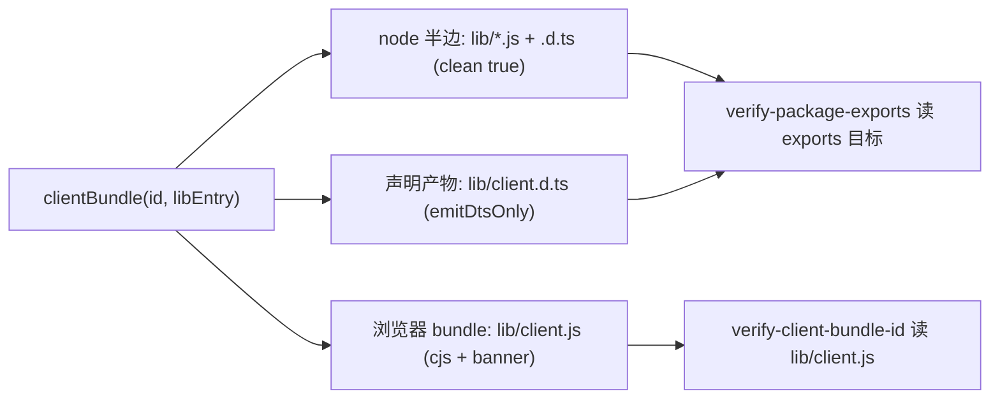
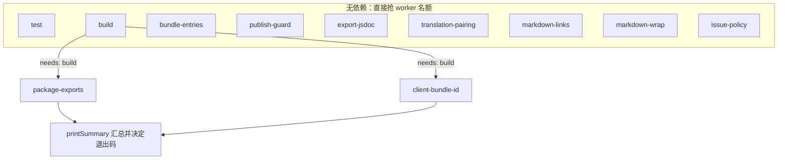
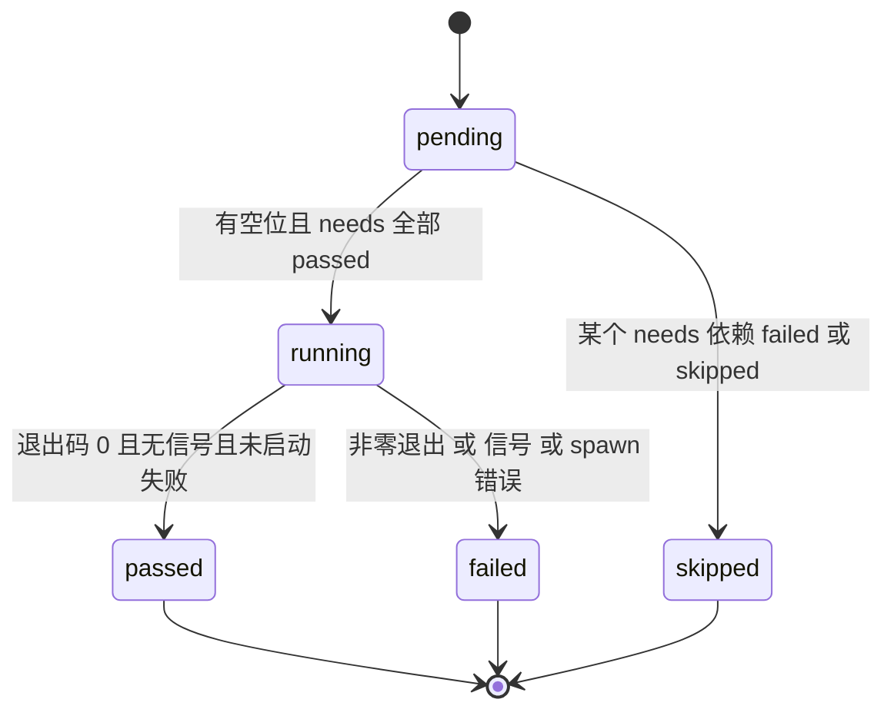

# 构建、测试与门禁套件

**`pnpm run gates` 是这个仓库唯一的一处「我改对了没有」的答案。** 本地跑它，CI 也只跑它：`.github/workflows/ci.yml` 的工作只有一个 job，`pnpm install --frozen-lockfile` 之后执行 `pnpm run gates`，没有第二套只属于 CI 的检查。所以门禁红了再推上去，等于把发现问题的责任从本地推给 CI——本仓库的规则是反过来写的：整套门禁必须在开 PR 之前本地全绿，红门禁不许推上去让 CI 去发现。

这一页按「构建 → 测试 → 门禁图 → 各门禁断言了哪些产物事实 → 门禁自身如何被测试 → 本地与 CI 的关系」的顺序讲。门禁背后的插件组合语义（`dsh.bundle`、`dsh.client`、入口 id 归属）见[插件组合与 bundle 层](../architecture/plugin-composition-and-bundles.md)，测试用例的分层策略见[测试策略](../testing/testing-strategy.md)，issue 与 PR 的策略引擎见 [CI 与 issue 策略](ci-and-issue-policy.md)，发布互锁的下游流程见[发布与打包](release-and-publishing.md)。

## 构建：每包一份 tsdown，浏览器半边走共享 preset

根 `build` 是 `pnpm -r run build`，逐个包跑各自 manifest 里的 `"build": "tsdown"`。也就是说构建的所有权落在包上，根脚本只负责扇出：`tsdown` 是各包自己的 `devDependencies`（不是根 devDependencies），产物落在包内 `lib/`，`format: ['esm']`、`dts: true`、`clean: true`、`fixedExtension: false`（因此输出 `.js` 而不是 `.mjs`），target 统一 `es2024`。`pnpm-workspace.yaml` 只声明 `packages/*/*`，工作区里当前是六个包。

声明了 `dsh.client` 的包（`ui-memo`、`ui-memo-settings`、`openwiki-visualize` 等）不手写配置，而是调用 `scripts/tsdown.client.ts` 的 `clientBundle(id, libEntry)`，一次返回**三份** tsdown 配置，顺序即产物顺序：

- **node 半边** `name: id`，`entry` 由调用点显式列出，`outDir: 'lib'`，`clean: true`（唯一负责清目录的那一份）。
- **浏览器 bundle** `name: '<id>/client'`，`format: ['cjs']`、`platform: 'browser'`，`entryFileNames` 钉死为 `client.js`，`clean: false`（node 半边已经清过，并发清会删掉自己刚写的东西），`sourcemap: true`，并把 `window.__ModuleLoader__.load({ id: <包名>, factory: (require) => { … } })` 写成 banner/footer。
- **声明产物** `name: '<id>/client-types'`，`dts: { emitDtsOnly: true }`，`clean: false`——因为 CJS 包装的浏览器面没有声明 chunk，`./client` 的 `.d.ts` 必须单独跑一遍。



一次 `clientBundle()` 调用产出的三份配置与它们各自的产物，以及随后读取这些产物的两个产物门禁。

preset 把「注册 id 必须是包名」这条运行时契约提前到构建期：`workspacePackage(id)` 在 `packages/*/*/package.json` 里找 `name === id` 的包，找不到就抛错，所以调用点写错或包改名后忘了改配置，构建直接失败，而不是产出一个 id 对不上任何启动图行的 bundle。`PLATFORM_MODULES` 是 shell 种子模块表的**唯一副本**（`react`、`react-dom`、`@deepseek-ai/cordis`、`zod`、`@tanstack/react-virtual` 与若干 `dsh-client-*`），shell 增删平台模块时改这里；`deps.neverBundle`/`alwaysBundle` 与 `moduleTableWords()` 都从它派生，另有 `clientPurityPlugin` 把「另一个插件的浏览器半边」从静默重复实例变成构建错误。

## 测试：一个 root vitest 配置，两份测试来源

根 `test` 是 `vitest run`，没有任何 per-package `vitest.config.ts`。`vitest.config.ts` 的 `test.include` 只有两条：`packages/*/*/tests/**/*.spec.{ts,tsx}` 与 `scripts/tests/**/*.spec.ts`。第二条是关键——**门禁脚本自己的测试和包测试跑在同一套里**，所以 `test` 门禁绿意味着门禁逻辑也绿。

配置解决三件容易踩的事：

- **工作区包别名到源码。** `@zhangj1164/dsh-memo`、`/client`、`/types` 等映射到对应 `src/*.ts`。原因是已发布的 `./client` 面是 `export type *` 的纯类型投影，运行时解析会得到一个空模块，客户端测试会以一条和真实原因无关的错误失败；顺带地，测试跑源码也意味着构建坏了不会悄悄改变测试的含义。别名用精确正则（`^…$`）而不是 Vite 的对象形式，因为对象形式的包前缀匹配会把 `@zhangj1164/dsh-memo` 一并吞掉 `/client` 与 `/types`。
- **React 与 ReactDOM 钉到同一份。** 通过 `createRequire(new URL('./packages/client/ui-memo/package.json', …))` 解析 `react`、`react-dom`、`react/jsx-runtime`、`react/jsx-dev-runtime`。shell 打包的是 React 18，工作区里被 hoist 上来的 ReactDOM 19 与 React 18 并存会在第一条断言之前就抛 "Incompatible React versions"，hook 也会以 "Invalid hook call" 这种看似无关的形态失败。
- **标准装饰器降级。** `scripts/vitest-decorators.ts` 的 `standardDecorators()` 作为 `enforce: 'pre'` 插件对含 `@Identifier` 语法的 `.ts/.tsx` 文件跑 `ts.transpileModule`，其余文件原样放行。`@Remote` 装饰的 `TypertRemoteService` 子类依赖它，因为它全局生效，各包不需要自己的 vitest 配置。

jsdom 不是全局环境，而是按文件用 `// @vitest-environment jsdom` docblock 打开（六个渲染型 spec 都这么做），其余测试留在 node 环境。

## 门禁图：三个聚合，一张有依赖的运行图

`scripts/run-gates.ts` 定义三个聚合（`Mode`），包脚本只是它们的别名：`gates` → `check-all`、`gates:hygiene` → `hygiene`、`gates:doc-sync` → `doc-sync`。`check-all` 当前是 11 个门禁，其余两个是 `check-all` 的子集：

| 门禁 id | 出现在 | 依赖 | 读什么 / 断言什么 |
| --- | --- | --- | --- |
| `test` | check-all | 无 | `pnpm run test`，vitest 全量（包测试 + 门禁测试） |
| `build` | check-all | 无 | `pnpm run build`，扇出到各包 tsdown，产出 `lib/` |
| `package-exports` | check-all | `needs: ['build']` | 读产物与 manifest：每个 `exports` 的 `default`/`types` 目标、根 `main`/`types` 都必须存在 |
| `client-bundle-id` | check-all | `needs: ['build']` | 读 `lib/client.js`：注册 id 等于包名、每个 `require` 都能被模块表回答 |
| `bundle-entries` | check-all | 无 | 只读源码：各 `dsh.bundle` 的 patch 插入的入口 id 不得重复 |
| `publish-guard` | check-all | 无 | 只读 manifest：带 `workspace:` 范围的包必须把互锁接进 `prepublishOnly` |
| `export-jsdoc` | check-all、hygiene | 无 | 只读 `packages/*/*/src/**/*.ts`：每个对外导出名都有完整 JSDoc |
| `translation-pairing` | check-all、doc-sync | 无 | 双语 README 三件套齐全、哈希记录一致、结构签名一致 |
| `markdown-links` | check-all、doc-sync | 无 | 相对链接目标存在，`#fragment` 命中真实标题 slug 或 `<a id>` |
| `markdown-wrap` | check-all、doc-sync | 无 | 一个段落必须占一个物理行 |
| `issue-policy` | check-all | 无 | `node --test .github/issue-management/policy.test.mjs` |



`check-all` 的依赖图：只有两个产物门禁声明了 `needs: ['build']`，其余门禁都是叶子，`after`（只等前驱落地、不要求成功）目前没有被任何门禁使用。

这张图有两个并发根——`test` 与 `build` 互不依赖。这一点成立的前提正是上一节的选择：`test` 跑源码而不是 `lib/`，否则它就必须排在 `build` 后面。产物门禁与源码门禁的分界也沿这条线划：`package-exports` 与 `client-bundle-id` 断言的是「构建产物是不是 manifest 承诺的东西」，所以它们必须等 `build`；`bundle-entries`、`publish-guard`、`export-jsdoc` 与三个 doc-sync 门禁读的都是源码或 manifest，不声明依赖。

一个容易形成错误心智模型的地方：`check-all` 里写着 `hygieneLeafGates({ artifactNeeds: ['build'] })`，但 `hygieneLeafGates()` 目前并不消费这个选项，因此 `export-jsdoc` 在 `check-all` 中**不**等待构建。这与它只读源码的事实一致（见下文），读这一页时不要假设 hygiene 门禁需要产物。

### 调度语义：needs、skipped 与退出码

`runGates()` 在启动任何子进程之前先 `validateGateGraph()`：空图、重复 id、指向未知门禁的 `needs`/`after`、依赖环（DFS 报出完整环路径）都会直接抛错，而不是让调度器跑到一半卡住。随后它是一个「就绪即启动」的循环：前驱全部 `passed`（`needs`）或全部落地（`after`）的 `pending` 门禁在有 worker 空位时启动，否则 `Promise.race` 等最早结束的那个。



单个门禁的状态机；`skipped` 只由 `needs` 触发，`after` 的前驱失败不会让后继跳过。

- **`failed` 的判定是三条一起**：`exitCode === 0`、`signalCode === null`、没有 spawn 错误。少任何一条都算失败，所以被信号杀掉的子进程不会被误读成通过。
- **依赖失败会传染成 `skipped`**：一个 `pending` 门禁只要某个 `needs` 前驱 `failed` 或 `skipped`，就以 `durationMs: 0` 标记为 `skipped`，`error` 写成 `dependency failed or skipped: <ids>`，不再启动子进程。
- **退出码把 `skipped` 也算失败**：只要存在一个 `allowFailure !== true` 且状态是 `failed` 或 `skipped` 的门禁，进程退出码就是 1。`allowFailure` 是唯一的例外通道（当前 11 个门禁都没有使用），汇总里会把它标成 `NON-BLOCKING`。
- **诊断不互相掩盖**：`formatGateResultReason()` 把 `error`、`exit N`、`signal SIG*` 三类事实分别列出，一个存在不会遮住另一个。

### 并发：默认封顶 4，`DSH_GATE_CONCURRENCY` 覆盖

默认 worker 数是 `min(门禁数, min(4, availableParallelism()))`——三个模式都走这条 `localCap` 分支。理由写在源码注释里：有几个文档门禁各自要建一整套解析工作（`export-jsdoc` 建一个完整 `ts.Program`，两个 Markdown 门禁各自解析整份文档树），在大机器上不封顶等于拿内存换那点 wall clock。`check-all` 的 11 个门禁因此最多同时跑 4 个。

`DSH_GATE_CONCURRENCY` 覆盖默认值，值必须是正整数（`parseInt` 后必须是安全整数且 ≥ 1，否则抛错），启动日志会打印 `running N gate(s) with M worker(s) from <来源>`，来源是 `$DSH_GATE_CONCURRENCY` 或 CPU 说明。相关环境变量还有 `DSH_GATE_VERBOSE=1`：默认通过的门禁只打一行 `PASS`，verbose 才把通过门禁的输出也展开。

子进程不走 shell：`runGate()` 以仓库根为 `cwd`、合并 `gate.env` 后 `spawn(gate.command, gate.args)`，stdin 立即结束，stdout/stderr 收集到结果里（`streamOutput: true` 的门禁直接透传）。`pnpmScript()`/`pnpmExec()` 通过 `pnpmInvocation()` 从 `npm_execpath` 解析出 pnpm 的可执行路径，因此 **runner 必须通过 `pnpm run` 启动**——直接用 `node scripts/run-gates.ts check-all` 会因为没有 `npm_execpath` 而报错。

## 门禁各自钉住哪一条产物事实

这几条断言覆盖的是「构建产物与 manifest 之间不许漂移」。其中导出目标、注册 id、`workspace:` 范围三条各自对应过一次真实故障——`exports` 指向 `lib/types/…` 这种永不产出的布局、改名后注册 id 与包名脱钩、`@zhangj1164/dsh-memo@0.1.0` 把 `workspace:^` 发到了 registry——所以修复方式从来不是放宽门禁，而是把门禁钉在那条事实上。

**导出目标是承诺，产物必须兑现**（`verify-package-exports`）。它递归走每个包的 `exports`，把裸字符串当运行时目标、`default` 当运行时目标、`types` 当类型目标，逐个 `existsSync`；再检查 `exports` 之外的根 `main`/`types`。**没有任何排除项**：带 `dsh.client` 的包同样要有声明产物。这条门禁的价值在于 `import type` 会照样通过一个指向不存在文件的 `exports` 映射，断裂只在消费方运行时才出现。

**浏览器 bundle 必须能启动**（`verify-client-bundle-id`）。它从 `dsh.client.platform === 'web'` 的包出发，按 `./client` 的 `default` 目标读 `lib/client.js`，然后断言四件事：`window.__ModuleLoader__.load({ id: … })` 的 id 严格等于包名（否则浏览器只会报 `bundle <url> loaded without registering "<id>"`，既不点包名也不给解法，这正是仓库曾经发出一个挂不上的 memo UI 的方式）；每个字面量 `require` 都是模块表里的词（平台基线 ∪ 该包 `inject` ∪ `dsh.client.external`）；不许出现非字面量 `require`；每个声明的行都必须解析到一个真的声明了 `dsh.client` 的包——子路径按所属包判定，因为浏览器会把 `<pkg>/client` 归一化成 `<pkg>`。

**组合入口 id 不许撞**（`verify-bundle-entries`）。它读每个声明 `dsh.bundle` 的包的 patch，用针对性扫描（不是 YAML 解析器）抽出 `insert:` 下的 `- id:`，然后：同一个 patch 内重复插入同一 id **必定失败**；两个 bundle 插入同一 id，只有双方的 patch 都用 `not both` 标记加该 id 本身把互斥写下来时才降级为一条提示，否则失败。门禁自己也写明了它的边界：它只看得到本仓库发布的 bundle，部署方用自己的 profile 启用两个互斥层是仓库之外的事。

**发布互锁必须接上**（`verify-publish-guard`）。任何带 `workspace:` 范围的包（四个依赖字段都算）必须把 `scripts/publish-guard.mjs` 作为 `prepublishOnly` 跑，且它必须解析到仓库里那一份——用解析而不是字符串比对，因为深拷贝接线时最容易错的就是 `../../../` 少一层或多一层。它只读 manifest：能验证接线，不能观察一次真实发布；真正阻断发布的是 `publish-guard.mjs`。

**对外 API 必须有文档**（`verify-export-jsdoc`）。它用 `ts.createProgram` 建一个只读程序（仓库目前没有根 `tsconfig.base.json`，所以实际生效的是 `skipLibCheck: true`、`noLib: true`、`types: []` 这套退化选项），遍历 `packages/*/*/src/**/*.ts`，对导出的函数、公共类成员、命名空间成员、内联可调用类型要求参数与非 void 返回值文档，对导出声明要求描述散文；框架协议槽（`Config`、`inject`、`name`、`reusable`、`apply`）、构造函数、继承来的契约与源码再导出豁免，无法分类的形态 fail closed。对不导出 `src/*` 的包，它先按 `exports` 反查公开名，只检查那些名字。因为它读的是源码而不是 `lib/`，它在 `check-all` 里不声明 `needs`。

## doc-sync：三类文档门禁

两个 Markdown 门禁（`verify-md-links`、`verify-md-wrap`）共享 `scripts/markdown.ts`（mdast + GFM 解析与遍历）和 `scripts/repo-files.ts`（glob 展开、按 realpath 去重符号链接、排除 `.agents/notes/archived/` 这段冻结历史）；`verify-translation-pairing` 不依赖它们，用自己的逐行解析器算结构签名。前两者的扫描范围是仓库自撰的 README（根与各包）、`AGENTS.md`、`.github/AGENTS.md` 与 `.agents/skills/**/*.md`——`docs/` 与 `openwiki/` 不在其内。

- **`verify-translation-pairing`**：一份 README 是三件套 `README.md` + `README.zh.md` + `README.i18n.yaml`。第三个文件记录两侧内容的 git blob 哈希（先归一化 CRLF 到 LF，否则 Windows 检出记下的哈希在 CI 上永远对不上），校验时要求两侧哈希都对得上、两侧都有指回对方的语言切换链接、且标题层级序列 / 代码围栏数量与 info / 表格行数 / 列表类型序列算出的结构签名完全一致。改了任一侧就用 `pnpm run verify-translation-pairing --write --all` 重新记录，`--list` 看全局状态。
- **`verify-md-links`**：相对链接与图片、定义的目标文件必须存在；目标若是 `.md`，`#fragment` 还必须命中真实的锚点（GitHub slug 算法，或正文中显式的 `<a id="…">`；同一文件的 `#anchor` 也检查）。URL、协议相对与根绝对路径按设计排除；非 Markdown 目标上的 `#fragment`（如 `file.ts#L10`）不判定。
- **`verify-md-wrap`**：一个段落在源码里只能占一个物理行。它按 AST 看 `paragraph` 节点的起止行，会先屏蔽 VitePress frontmatter 与 `:::` 容器分隔符，从不改写文件。

## 门禁自己也被测试

`scripts/tests/` 下的四个 spec 被 root vitest 的 `scripts/tests/**/*.spec.ts` 收进来，因此**门禁的解析与判定规则由 `test` 门禁自己覆盖**：其中三个测门禁（`bundle-entries`、`client-bundle-id`、`package-exports`），一个测共享构建 preset（`tsdown-client`，即 `clientBundle`/`moduleTableWords`/`workspacePackage` 的规则）。它们 import 被测模块导出的纯函数，用构造的 bundle 文本、patch 片段或 manifest 夹具断言「该拒的拒、该放的放」，包括复现当初酿成故障的那些形状（注册 id 与包名不一致、`exports` 指向 `lib/types/client.js` 这种 tsdown 扁平布局永远不会产出的路径）。

这里有一条刻意划出的分界：**单元测试只钉规则，全仓库范围的断言留在门禁里**。`package-exports` 的 spec 注释写得很直接——门禁读 `lib/`，而 `lib/` 是构建产物、干净检出里不存在，所以一个断言全局的单元测试会在任何还没构建的机器上失败。于是 `pnpm run test` 可以在 `build` 之前跑，全局事实交给 `needs: ['build']` 的门禁在构建之后断言。`issue-policy` 走另一条路：它是自己的 `node --test` 门禁，直接跑 `.github/issue-management/policy.test.mjs`。

还有一条关于门禁修复的规则：**门禁不能给自己的修复做担保**。issue-policy 工作流把 `policy.mjs` 从默认分支检出来跑（`ref: ${{ github.event.repository.default_branch }}`），所以在引入策略修复的那个 PR 上根本无法验证这条修复——必须先把策略修复自己走一遍 PR 落到 `main`，再重跑被挡住的 PR。推广到所有门禁：门禁红了要去改被测的对象，不许为了让门禁变绿而削弱门禁；一个「只有在修好自己之后才会绿」的门禁，修复要单独落地。

## 本地优先，CI 只是同一套的复跑

`.github/workflows/ci.yml` 只有一个 job：checkout、`pnpm/setup`、node 22、`pnpm install --frozen-lockfile`、`pnpm run gates`。干净检出里没有 `lib/`，依赖图保证 `build` 先跑完，两个产物门禁才启动；`test` 因为跑源码，可以和 `build` 并行。

另有两个 workflow 复跑其中单个门禁，而不是新增一类检查：`verify-translation-pairing.yml` 按 README 路径过滤、只跑 `pnpm run verify-translation-pairing`；`issue-policy.yml` 在 issue/PR 事件上跑策略引擎。它们是更快的反馈通道，不改变「`gates` 聚合是唯一权威」这件事。

因此本地日常是：

```sh
pnpm install
pnpm run test           # 源码测试 + 门禁测试，不需要先构建
pnpm run gates          # 提交前必须全绿：build 之后才跑两个产物门禁，其余门禁直接并发
pnpm run gates:doc-sync # 只改了文档时的快速回路
pnpm run gates:hygiene  # 只改了导出 JSDoc 时的快速回路
```

## 扩展点与常见失败

**加一个门禁**要动两处：在根 `package.json` 增加 `verify-*` 脚本（实现放 `scripts/`），再在 `gatesForMode()` 里用 `pnpmScript()` 挂上去；如果它读构建产物就加 `needs: ['build']`，只读文档或源码就不加。`pnpmExec()` 与 `nodeGate()` 分别覆盖「跑一个可执行工具」和「`node --test` 一个测试文件」两种形态。加完顺手更新 `AGENTS.md` 的命令清单与门禁计数，并想清楚它是 doc-sync/hygiene 的子集还是只属于 `check-all`。

**加一个包**要保证三件事与门禁一致：`"build": "tsdown"`（浏览器半边用 `clientBundle(id, entry)`，`id` 必须等于 manifest `name`）、`tests/` 下至少一个 `.spec.ts`（否则 `test` 门禁虽绿但包没有覆盖）、`exports` 里每个目标都指向 tsdown 真的会产出的路径。带 `workspace:` 范围的包还要接上 `prepublishOnly` 互锁，否则 `publish-guard` 会红。

常见红门禁的读法：日志里每个失败门禁都会打印 `command:`（它实际跑的命令）、`outcome:`（错误 / 退出码 / 信号）与完整输出，末尾的汇总再按门禁重复一遍并标出 `NON-BLOCKING` 例外。如果连 `run-gates:` 前缀都没有、只有一句 `npm_execpath is unavailable`，那是 runner 没通过 `pnpm run` 启动，而不是某个门禁失败。
