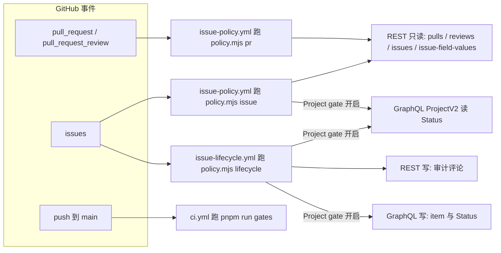
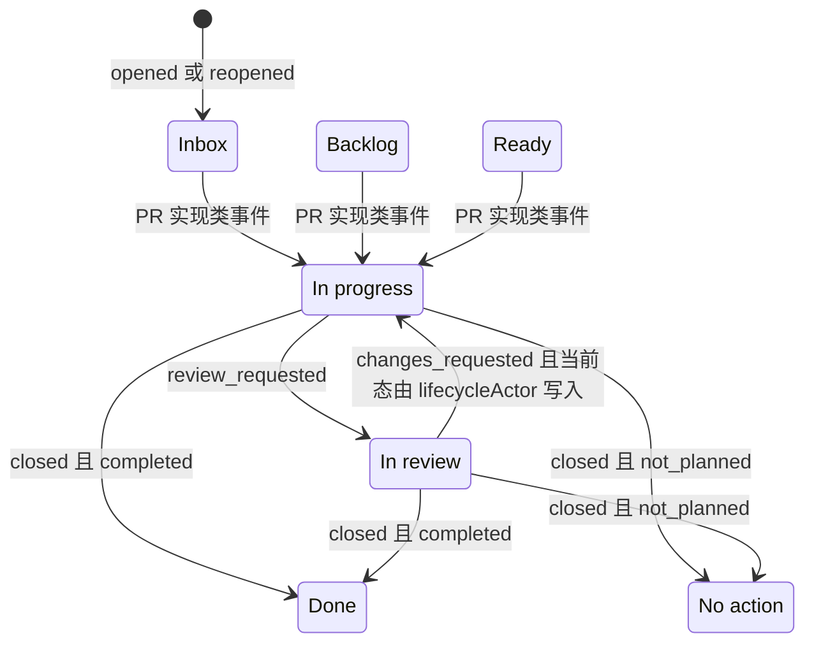
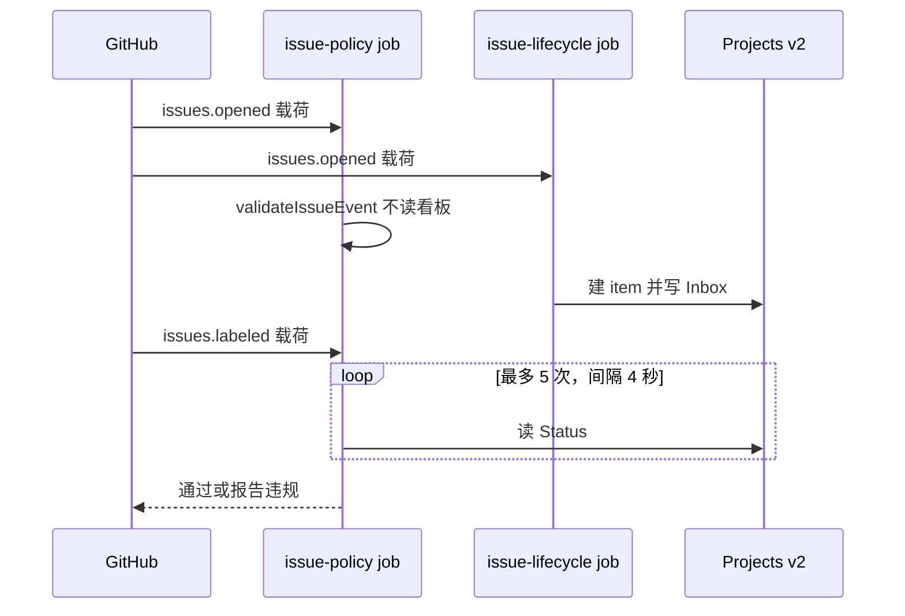
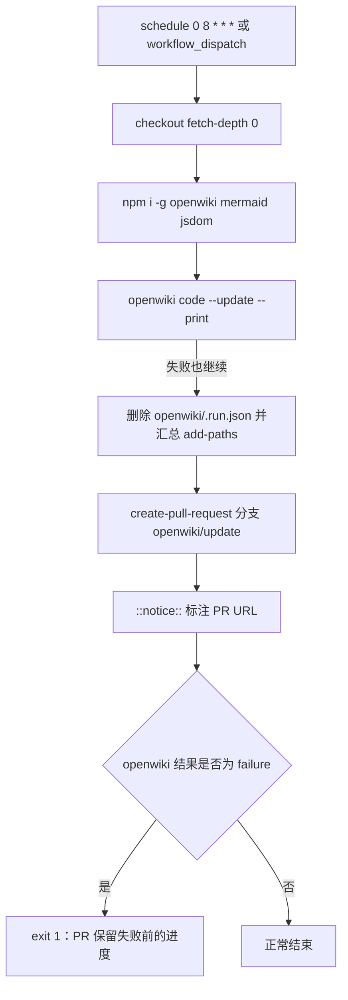

# CI、issue 策略与仓库自动化

**这个仓库的「规则」有两层实现：一层是 `scripts/run-gates.ts` 在本地和 CI 上都能跑的代码门禁，另一层是 `.github/issue-management/policy.mjs` 在 GitHub 事件上运行的议题策略。** 前者管「代码是不是对的」，后者管「工单与 PR 的元数据是不是对的」；两者的交汇点是 `check-all` 聚合里的 `issue-policy` 门禁，它用 `node --test` 跑策略引擎自己的测试。这一页讲第二层以及围绕它的四个 workflow，代码门禁本身见[构建、测试与门禁套件](build-test-and-gates.md)。

GitHub 侧一共四条自动化线，触发源都是仓库事件，没有一条是「另一套检查」：

| Workflow | 触发 | 做什么 | 可写权限 |
| --- | --- | --- | --- |
| `ci.yml` | PR `opened`/`synchronize`/`reopened`，push 到 `main` | `pnpm install --frozen-lockfile` 后执行 `pnpm run gates` | `contents: read` |
| `issue-policy.yml` | `pull_request`（8 种 action）、`pull_request_review`（`submitted`）、`issues`（5 种 action） | `policy.mjs pr` 或 `policy.mjs issue`，只读判定并 `::error::` 报告 | `contents`/`issues`/`pull-requests` 全部 `read` |
| `issue-lifecycle.yml` | `issues`（含 `field_added`/`field_removed`）、`pull_request`、`pull_request_review` | `policy.mjs lifecycle`：写 Project Status、建 Project item、写审计评论 | `contents: read`、`issues: write` |
| `verify-translation-pairing.yml` | 只改了 README 路径的 PR 与 push | `pnpm run verify-translation-pairing` | `contents: read` |

另有一条不依赖仓库事件的时间驱动线：`openwiki-update.yml` 每天定时跑 OpenWiki 并把生成结果作为 PR 提交。它和上面四条不是同类，因为它改的是文档产物而不是判定某个事件。



同一批事件被两个 workflow 分别接收：一个只读判定，一个写看板与评论；两者都通过 `policy.mjs` 的同一个模块实现规则。

## CI：唯一权威门禁的一次复跑

`ci.yml` 只有一个 job，步骤就是 checkout、`pnpm/action-setup`、`actions/setup-node`（node 22，`cache: pnpm`）、`pnpm install --frozen-lockfile`、`pnpm run gates`。没有任何 CI 专属的检查项，也没有矩阵——因此「本地全绿」与「CI 全绿」是同一个断言，红门禁推上去只是把发现问题的责任转交给 CI。`--frozen-lockfile` 保证 CI 判定的是锁文件钉住的那份依赖图，而不是安装时顺手升级出来的版本。

`permissions: contents: read` 是整条工作流唯一的权限声明。CI 里的所有门禁都只读源码、manifest 与构建产物，不需要写回仓库。

## 策略引擎：一个模块，三个子命令，两个调用方

`policy.mjs` 既是 CLI 又是库。`main()` 只认三个子命令——`pr`、`issue`、`lifecycle`——其它参数直接抛用法错误；文件底部用 `import.meta.url === pathToFileURL(process.argv[1]).href` 做入口守卫，因此被 `node --test` import 时不会执行 `main()`，十几个校验函数可以被测试直接调用。事件载荷从 `GITHUB_EVENT_PATH` 指向的 JSON 文件读，配置从同目录的 `config.json` 导入，除此之外它只跟 GitHub API 打交道——没有本地状态，也没有缓存。

| 子命令 | 调用方 | 读什么 | 判定/写入 |
| --- | --- | --- | --- |
| `pr` | `issue-policy.yml`（所有非 `issues` 事件） | PR 本体、review requests、reviews、正文里的引用、被引用 issue 的快照 | `validatePullRequest`，失败即 `::error::` 并抛错退出 |
| `issue` | `issue-policy.yml`（仅 `issues` 事件） | 事件载荷；Project gate 开启时再加上 Issue 快照与 Status | `validateIssueEvent` 或 `validateIssue` |
| `lifecycle` | `issue-lifecycle.yml` | 同一批事件、Project item、Status 变更时间线 | 写 Status、建 item、upsert 审计评论 |

`issue-policy.yml` 把两个判定命令拆成两步：`Validate pull request` 的条件是 `github.event_name != 'issues'`，`Validate issue` 的条件是 `github.event_name == 'issues'`。两个步骤传的环境变量也略有差别——PR 步骤只给 `GITHUB_TOKEN`，issue 步骤给 `GH_TOKEN` 外加 `DSH_PROJECT_TOKEN` 与 `DSH_PROJECT_GATE`；引擎的 `token()` 两个名字都接受。

### 为什么策略从默认分支检出，以及由此产生的「门禁不能担保自己的修复」

两个 issue 管理 workflow 的 checkout 都不是默认行为，而是显式钉到默认分支：

```yaml
- uses: actions/checkout@3d3c42e5aac5ba805825da76410c181273ba90b1
  with:
    ref: ${{ github.event.repository.default_branch }}
    persist-credentials: false
```

这段配置有三个互相独立的意图，读这一页时不要把它们混成一个：

- **`ref: default_branch` 让判定用的代码来自 `main`，而不是 PR 的 head。** 一个 PR 若修改 `policy.mjs`，`issue-policy.yml` 仍然用 `main` 上的那份去判定这个 PR，于是 **引入策略修复的那个 PR 无法验证这条修复**——这正是 `AGENTS.md` 里那条「Do not let a gate guard its own fix」的机械成因。修复流程因此是：先把策略修复自己走一遍 PR 落到 `main`，再重跑被挡住的 PR；绝不放宽门禁来让它变绿。
- **`persist-credentials: false` 让检出的工作区里没有可用的 git 凭据。** 这两个 job 会执行仓库里的 js 代码并同时把 token 放进环境变量，因此检出阶段不留下能推回去的凭据。
- **checkout action 固定到完整 commit SHA**（而 `ci.yml` 用的是 `@v7` 这类主版本标签）。被执行且持有 token 的流程用不可变引用，是这里的取舍；`openwiki-update.yml` 同样逐个 action 钉 SHA。

**但测试是可以被 PR 验证的。** `ci.yml` 的 checkout 是 PR 合并引用，`pnpm run gates` 里的 `issue-policy` 门禁跑的是 PR 自己那份 `.github/issue-management/policy.test.mjs`。所以新规则的测试在 PR 上就能红/绿，变的只是「线上判定依据哪一版代码」。理解了这一点，就不会误以为策略修复 PR 是完全无法自证的。

## issue 侧被强制的规则

`validateIssue` 是 issue 规则的唯一实现，`validateIssueEvent` 只是把它不需要网络的字段投影进去：事件载荷里没有 `priority` 和 `status`，于是显式传 `null`，含义是「没查过」而不是「缺失违规」。事件载荷畸形（`body` 为 `null`、缺 `labels`/`assignees`、标签是裸字符串）时它报违规而不是抛错。

**关闭的 issue 在函数第一行就被放过。** `state === 'closed'` 直接返回空数组，于是两个调用方——事件门禁与生命周期审计——都不会去改写历史工单：它是在当时那套规则下填的，为了满足今天的新规则而重写它的标签或正文属于改历史，不是执行策略。代价是关闭后也不再审计 Status 与关闭原因的一致性，这条检查随 Project 那一半一起只在开放工单上生效。

### 正文：折叠、字数与 Owner 行

| 规则 | 判定方式 | 违规报错（原文） |
| --- | --- | --- |
| 必须有一个 `<details>` 区域 | 出现次数 ≥ 1 | `正文必须包含默认收起的 <details> 区域` |
| `<details>` 必须成对闭合 | 线性扫描开合标签，深度失衡即失败 | `details 标签必须成对闭合` |
| 必须默认收起 | 开标签里出现 `open` 属性即失败 | `details 必须默认收起，不得设置 open` |
| 外露正文 ≤ 50 单位 | `BODY_LIMIT = 50` | `正文外露部分为 N 单位，超过 50 单位` |
| 多 assignee 时首行写 Owner | 首个非空行匹配 `Owner: @login`，且 login 必须在 assignees 里（大小写归一、去重） | `多个 Assignees 时首个非空行必须是 Owner: @login` / `Owner 必须属于 Assignees` |
| 0 或 1 个 assignee 时不得写 Owner 行 | 唯一例外是 0 assignee 且 `config.allowUnassignedOwner` 为 `true` | `零或一个 Assignee 时不得写 Owner 行` |

「单位」不是字符数也不是词数，而是一个刻意简化的两段计数：先把 HTML 注释整段删掉，只保留 `<details>` 之外的部分（`extractOutsideDetails`），再把图片与链接替换成它们的链接文本、`<https://…>` 去掉尖括号保留 URL、其余 HTML 标签与 HTML 实体替换成空格，并清掉 `` ` ``、`*`、`~`、`[]`、`{}`、`()`、`<>`、`#`、`!`、`|` 这些标记字符；最后统计两样东西之和——`\p{Script=Han}` 字符数，以及连续 Latin/数字/`_./:@+-` 段的数量。所以 50 单位大致等于「一句中文加少量英文标识符」，折叠区里的复现步骤与验收条件完全不占预算，这也是五个 issue 模板都以「一句话 + 一个折叠区」结尾的原因。

### 标题、标签与 Project 字段

- **标题必须含中文**（`\p{Script=Han}` 至少一个字符）；**标题不得带元数据前缀**——`[Bug] …`、`P1: …`、`area/web: …`、`Owner - …` 这类把 Type、Priority、Status、area 或 Owner 塞进标题的写法会被一条正则一并拒绝。
- **恰好一个分类标签**：`bug` 或 `enhancement` 二者之一，一个都不行、两个也不行（`CATEGORY_LABELS` 就这两个）。
- **issue 上不得出现 `kind/*`**：任何 `kind/` 前缀都算违规，包括 PR 允许的那六个；`LEGACY_LABELS` 里的旧标签（`feature`、`bug-fix`、`doc`、`cleanup`、`testing`、`dependencies`、`ci`、`cli`、`llm`、`web-search`，以及 `kind/bug`、`kind/documentation`）同样被拒。`source/*` 反过来只允许用在 issue 上。
- **Status 必须在 `config.json` 的 `statuses` 里**（`Inbox`、`Backlog`、`Ready`、`In progress`、`In review`、`Done`、`No action`）。
- **终态与关闭原因必须对应**：`Done` 要求 issue 已关闭且 `state_reason` 是 `completed`，`No action` 要求已关闭且为 `not_planned`；反过来，任何非终态 Status 都要求 issue 仍开放。
- **Priority 只能为空或 P0–P3**（大小写不敏感）。issue 的 Priority 不是标签，而是从 `issue-field-values` 端点读出的 `Priority` 单选字段值；该端点是组织专属能力，在用户仓库上返回 404，引擎把它当「没有自定义字段」而不是错误，于是降级为 `null`。

### 两项不强制：Issue Type 与 Project Status

这两条是本页最容易被读错的地方，需要分开记：

- **原生 Issue Type 不检查。** 模板 frontmatter 里写着 `type: Bug`/`Feature`/…，但 Issue Types 是组织级特性，用户仓库对任何 issue 都报不出 type，要求它等于让门禁永远无法通过。源码注释把这条决定和恢复条件写在一起：仓库迁进组织、模板的 `type` 开始产出值之后再把它加回来。分类角色暂时由「恰好一个分类标签」承担。
- **Project Status 只在调用方真的读过看板时才是硬要求。** `validateIssue` 用 `projectChecked` 区分两种缺失：`projectChecked === true` 时，`status === null` 意味着「必须加入 Project，并具有合法的 Status」；没读过看板时，`status === null` 只是「未检查」。这个布尔量由 `issueSnapshot(number, status)` 的第二个参数决定——传 `undefined` 会去读 Project 并把快照标记为已检查，传显式的 `null` 则报告「没查」。

## PR 侧被强制的规则

PR 规则有**适用范围**，`requiresPullRequestPolicy` 一句话说清：`!isDraft && authorType 不是 Bot/App && (有 review request || 已有 review)`。也就是说 Draft PR、机器人/App 提交的 PR（Dependabot、OpenWiki 更新 PR 都在此列）不受约束，而一个人工 PR 在第一次请求评审或拿到第一条 review 之前也不受约束——此时门禁只打印「PR 尚未进入 Issue policy 强制范围」，而不是伪造一条通过。

进入范围后，`validatePullRequest` 强制下面这些不变量：

| 维度 | 规则 |
| --- | --- |
| 引用 | 正文必须引用至少一个同仓库 Issue；被引用对象必须是 Issue，指向 PR 的 `#N` 报错 `#N 不是同仓库 Issue` |
| `kind/*` | 恰好一个，且必须是六个之一：`kind/feature`、`kind/bug-fix`、`kind/doc`、`kind/testing`、`kind/cleanup`、`kind/dependency`；其它 `kind/*` 单独报「不支持的 kind/*」 |
| 旧标签 | `LEGACY_LABELS` 一律拒绝 |
| `source/*` | PR 上不允许（仅用于 Issue） |
| Priority | 最多一个 `p0`–`p3` |
| `area/*` | 至少一个；取值不枚举，`area/future-domain` 这类新域直接可用 |

引用解析（`parseReferences`）先剥掉 HTML 注释、代码围栏与行内代码，避免一段示例文本被当成关联；然后匹配三种写法——`#N`、`owner/repo#N`、`https://github.com/owner/repo/issues/N`——只保留本仓库或未写仓库的引用，跨仓库引用直接忽略。`Fixes`/`Closes`/`Resolves`（含 `fixed`、`closed`、`resolved` 等词形）紧跟引用时记为**解决型**，其余引用记为**关联型**；`retainIssueReferences` 再按实际解析到的 Issue 过滤一次，因此 `Resolves #123` 指向一个 PR 时不算解决任何东西。

解决型引用会拉起 Priority 同步：最多一个 `p*` 标签，且取值必须等于所有被解决 Issue 的 Priority 里最高的那个（`p0` 最高）。三条分支——没有 PR 标签但有 Issue Priority 时报「PR Priority 应为 pX」；有 PR 标签但不是每个被解决 Issue 都设了 Priority 时报「有 Priority 的解决型 PR 要求每个被解决 Issue 都设置 Priority」；都有时比对最高值。纯关联型引用不触发这层约束。

**50 单位的外露正文限制只属于 issue**，`validatePullRequest` 不检查 PR 正文长度；PR 模板里的三行 HTML 注释（`Fixes #NN` / 关联 / Priority）在解析引用前会被剥掉，所以模板写满也不会自己制造一条「已关联 issue」的假象。

## 生命周期与 Project 看板（手动开关）

看板写入是这套自动化里唯一**默认关闭**的部分，开关由两个值共同构成，缺一不可：

- 仓库变量 `DSH_MEGA_PLUGINS_PROJECT_GATE` 必须等于字符串 `'true'`。
- 仓库 secret `DSH_MEGA_PLUGINS_ISSUE_TOKEN` 必须是一个带 `project` scope 的 **classic PAT**。

用变量而不是 secret 当开关，原因写在 workflow 注释里：job 级 `if` 里引用 secret 在语法上不成立，所以必须有一个非敏感的变量当开关，secret 只在步骤的 `env` 里出现。用 classic PAT 而不是 App token 或 fine-grained PAT，原因是看板属于一个用户账号，前两者都够不到用户拥有的 Projects v2。

`projectToken()` 的失败语义是刻意的：gate 打开而 token 缺失时**抛错**，不回退到 `github.token`——回退只会把「secret 忘了配」伪装成一条权限错误。看板调用走 `projectToken()`，其余所有仓库调用仍然用 workflow 自己的 `github.token`，project token 不外溢到别的请求。

读看板的 GraphQL 从 `repository(owner: …).owner.projectV2(number: …)` 进，而不是 `organization(login: …)`：仓库所有者在当前是用户，`organization` 查询会直接 NOT_FOUND；走 `repository.owner` 则 User 与 Organization 两种 owner 用同一段查询，仓库将来搬家也不用改。拿到项目后还要对两条事实做断言：`project.title` 必须等于 `config.projectTitle`（`Mega-Plugins Issue Management`）、项目里必须有 `Status` 字段；任一不满足就抛错，而不是静默写不进去。

### issue 事件上的三个写入

`runLifecycle` 对 `issues` 事件的处理很短，但覆盖了四种动作：

- `opened` → Status 写 `Inbox`；
- `closed` → 按 `state_reason` 写 `Done`（`completed`）或 `No action`（`not_planned`）；
- `reopened` → 回到 `Inbox`；
- 其它动作（`edited`、`assigned`、`labeled`、`field_added` …）不改 Status。

无论哪一种动作，之后都走两步：`ensureProjectItem`（没有 item 就用 `addProjectV2ItemById` 建一个，已存在则不重复调用）和 `auditIssue`（重新读快照、跑 `validateIssue`、upsert 评论）。所以 `field_added`/`field_removed` 这类不改变 Status 的事件，价值在于「有人动了字段之后重新审计一次」。

### PR 事件上的前进式投影

PR 侧不是「设置状态」，而是「把被解决的 issue 往前推」，理由是避免自动化把人工摆放的卡片拽回来。三件事定义了这个投影：

1. `resolvingIssueStatusCommand` 把事件翻译成一个命令：`pull_request` 的 `opened`/`edited`/`synchronize`/`reopened`/`labeled`/`unlabeled` → `implementation`；`review_requested` → `review-requested`；`pull_request_review` 且 review 状态是 `changes_requested` → `changes-requested`。其它情况都不构成状态信号：`review_request_removed`、review 状态为 `approved` 或 `commented`、以及 `pull_request_review` 的 `dismissed` 都返回 `null`。
2. `nextResolvingIssueStatus` 在 `ACTIVE_STATUS_ORDER`（`config.statuses` 去掉 `Done` 与 `No action`，即 `Inbox → Backlog → Ready → In progress → In review`）里比较下标，只有目标状态**严格靠后**才返回目标，否则返回 `null` 表示不动。
3. 唯一的例外是 `changes-requested` 把 `In review` 退回 `In progress`：只有当当前 Status 的**最后一位写入者**就是 `config.lifecycleActor`（`zhangj1164-issue-bot`）时才允许。人工把卡片移到 `In review` 之后，机器人不会因为一条 review 意见把它拽回 `In progress`。`statusActorOf` 就是这条判断的依据，它对「没有 item」「没有请求时间线」「最后一条事件与当前 Status 不符」三种情况一律返回 `null`（未知演员），而不是拿两个缺失值做相等比较。



自动化只写这些边：实现类事件只能向前推进，唯一的回退需要「上一位改状态的是机器人」这个前提；`Done` 与 `No action` 只由关闭原因决定。人工在看板上可以任意移动，机器人不会覆盖它。

生命周期不负责判定 PR 元数据，也没这个必要：测试里有一条专门钉住这个解耦——同一个来源不明的 PR 会被 `validatePullRequest` 报错，而它仍然能推进被解决 issue 的 Status。

### 两个 workflow 的竞态与有界重试

`issue-policy.yml` 与 `issue-lifecycle.yml` 从**同一个 issue 事件**启动，彼此之间没有顺序保证；而 Project item 是由 lifecycle 创建的。于是「刚打开的 issue 立刻打标签」这一秒里，门禁可能在看板还没有 item 时就去读 Status。

处理方式分两处，都是「不放松规则、只容忍延迟」：

- `opened` 事件完全不读 Project：`runIssueCheck` 对 `action === 'opened'` 走 `issueSnapshot(number, null)`，只从同一条 REST 响应取标题、正文、标签、状态来判定，Status 显式记为「未检查」。新建 issue 不可能已经有 item，要求成员身份就是要求它输一场赢不了的竞态。
- 其余事件走 `awaitProjectStatus`：默认最多 5 次、每次间隔 4 秒，一旦读到非 `null` 的 Status 就停止；窗口结束时仍是 `null` 就照旧报错。两个边界值都是参数，测试注入 `delayMs: 0` 就能在不等待的情况下断言「等到 item 落地」与「窗口关闭仍然失败」两条路径。

`issue-lifecycle.yml` 另有一层串行化：`concurrency.group` 以事件里的 issue/PR 编号为键（取不到时退回 run id），`cancel-in-progress: false`。同一张卡片的并发写入因此排队而不是互相取消，看板不会被两个交错的 GraphQL mutation 写成中间态。



两个 job 无先后顺序，`opened` 只读 REST 快照、后续事件用有界重试读看板，竞态被吸收而不被放宽。

### 审计评论：一个 marker，三种动作

`auditIssue` 的结果落成一条由 bot 自己的评论，位置由 `AUDIT_MARKER`（`<!-- dsh-mega-plugins-issue-policy -->`）标识，认领条件是「作者 `user.type === 'Bot'` 且正文包含 marker」——人工写的评论即使贴了同样的 marker 也不会被改写。之后是三态：没有错误且已存在 → 删除那条评论；有错误且正文相同 → 什么都不做（避免每次事件都产生一条编辑）；有错误且正文不同或不存在 → `PATCH` 或 `POST`。评论正文是 marker 加一行 `⚠️ Issue policy 未通过：` 和逐条错误列表，因此 issue 上看到的具体违规文案与门禁 `::error::` 输出是同一批字符串。

写评论用的是 job 的 `github.token`，所以 `issue-lifecycle.yml` 需要 `issues: write`，而 `issue-policy.yml` 连这个都不需要。

## 模板、PR 模板与 Dependabot

`.github/ISSUE_TEMPLATE/config.yml` 关掉了空白 issue（`blank_issues_enabled: false`），五个模板（Bug / Feature / Idea / Research / Task）都是「frontmatter + 一句中文 + 一个折叠区」：

- `labels:` 预填恰好一个分类标签——Bug 用 `bug`，其余四个用 `enhancement`。这不是排版偏好：issue 必须恰好有一个分类标签，模板留空就等于「新开的 issue 一开出来就违规」。`policy.test.mjs` 有一个测试直接读模板目录的 frontmatter 来钉住这条。
- `type:` 写着 `Bug`/`Feature`/…，但如上一节所述，这个值目前不进任何判定，它是仓库将来迁入组织后恢复 Type 检查的接口。
- 正文的 HTML 注释提示「标题写中文行动或结果句；外露正文不超过 50 单位」，与正文规则同源。

`.github/pull_request_template.md` 用三行注释教作者写 `Fixes #NN`（解决并自动关闭）与 `Related to #NN`（仅关联），正文给一行 `关联 Issue：` 和一个折叠的「变更与验证」区。它不参与校验，但决定了 PR 正文里引用是否被解析成解决型——`Fixes` 与 `Related to` 的差别，正是 Priority 同步与 issue 状态推进是否发生的差别。

`.github/dependabot.yml` 管 npm 与 github-actions 两个生态，都按 `0 4 * * *`（`Asia/Shanghai`）跑，`cooldown.default-days: 30`，并给 PR 打上 `kind/dependency` + `area/infra`。这组标签刚好满足 PR 侧「恰好一个允许的 `kind/*` + 至少一个 `area/*`」，而 Dependabot 的 `authorType` 是 `Bot`，本来就落在 PR 策略的豁免面里——所以依赖升级 PR 不需要引用 issue 也能过门禁。

## 翻译配对：只按 README 路径触发

`verify-translation-pairing.yml` 是「同一个门禁的更快的反馈通道」，而不是另一个检查：触发条件是 PR 或 push 到 `main` 且变更路径命中 `README.md`、`README.zh.md`、`packages/**/README.md`、`packages/**/README.zh.md`，执行的命令与 `check-all` 里的 `translation-pairing` 门禁完全相同（`pnpm run verify-translation-pairing`）。改一份 README 却漏了另一侧时，这里会比整套 `gates` 先给出反馈。脚本自身的判定逻辑见[构建、测试与门禁套件](build-test-and-gates.md)。

## OpenWiki 的定时更新：生成页面通过 PR 落地

`openwiki-update.yml` 是仓库里唯一一条时间驱动的自动化：`schedule` 是 `0 8 * * *`，另有 `workflow_dispatch` 可手动触发；权限是 `contents: write` 与 `pull-requests: write`。它的每一步都有一个具体原因：

- **`fetch-depth: 0`。** `openwiki code --update` 要把 `HEAD` 与「上次文档化到的那个 commit」做 diff；浅克隆里那个 commit 不在，更新就会在一份空的变更摘要上跑——看起来成功，实际什么都没更新。
- **全局安装 `openwiki@0.7.3`，外加 `mermaid` 与 `jsdom`。** 后两者是可选项，只为 Mermaid 图提供高保真校验；缺了它们生成照样成功，只是图的校验精度下降。
- **`openwiki code --update --print` 加 `continue-on-error: true`。** 这一步允许失败，好让后续步骤仍然把**已经生成的页面**提交上去；失败通过最后一步单独的 `exit 1` 传播。
- **`rm -f -- openwiki/.run.json`。** 运行态文件是瞬时的，不能进仓库。
- **`add-paths` 是 `openwiki`、`AGENTS.md`、`.github/workflows/openwiki-update.yml`，存在 `CLAUDE.md` 时再加它。** 生成页面与 `AGENTS.md` 里的 OpenWiki 段落一并提交；workflow 文件本身也在列表里，所以对未来这个 workflow 的改动同样会经过这条自动化 PR 的路径。`CLAUDE.md` 只有在文件存在时才加入，因为 `git add` 一个不存在的路径会让整次暂存失败。
- **`peter-evans/create-pull-request` 固定分支 `openwiki/update`**，标题与 commit message 都是 `docs: update OpenWiki`，PR 正文写明「`OpenWiki result: failure` 时这个 PR 只保留失败前完成的页面，合并它就是让那部分进度成为下一次定时运行的基线」。

这条流程的关键约定是**生成页面不手改**：`AGENTS.md` 要求不要手工编辑生成的 OpenWiki 页面（除非明确要求），而是改源码/文档让 OpenWiki 重新生成。所以 `openwiki/` 下的内容应该来自这条定时 PR，而不是某个人的编辑器。



定时更新的一次运行：失败不阻断 PR 创建，但会在 PR 建好之后让 workflow 变红，把「进度已保存」与「本次更新不完整」两个事实同时留在记录里。

## 策略引擎自己的测试

`.github/issue-management/policy.test.mjs` 用 `node:test`，跑在 `check-all` 的 `issue-policy` 门禁里（`nodeGate('issue-policy', ['.github/issue-management/policy.test.mjs'])`），**不在** root vitest 的 `include` 范围内——那两个模式是 `packages/*/*/tests/**` 与 `scripts/tests/**`，都覆盖不到 `.github/`。这也正合适：引擎是纯 `.mjs`、只依赖 `node:` 内置模块与 `config.json`，用 `node --test` 就能零构建运行。本地单跑：

```sh
node --test .github/issue-management/policy.test.mjs
```

测试直接 import 导出的纯函数，覆盖的都是「规则而不是实现」的事实：`validateBody` 的三条 details 规则与 Owner 规则；`validateIssue` 的分类标签唯一性、`kind/*` 与旧标签拒绝、标题前缀拒绝、终态与关闭原因对应、未知 Status 拒绝、`projectChecked` 两种缺失语义；`validateIssueEvent` 对畸形载荷的容错；关闭 issue 的短路；`parseReferences` 的解决/关联拆分与 `retainIssueReferences` 对 PR 引用的剔除；`requiresPullRequestPolicy` 的豁免面与六个 canonical kind；Priority 同步的三条分支；`statusActorOf` 与 `awaitProjectStatus` 的边界（注入 read 和零延迟）；以及一处跨文件断言——所有 issue 模板都恰好预填一个分类标签。旧标签表在测试里独立抄了一份而不是 import 常量，为的是让「实现放宽了自己」也能被测试抓到。

## 改动这一层时的落点

- **加一个 Project Status**：改 `config.json` 的 `statuses`。注意模块加载时会校验 `In progress` 与 `In review` 必须存在、`lifecycleActor` 必须非空，缺一个就在 import 阶段抛错（门禁会在没有网络调用之前失败）。
- **加一个 PR kind**：同时改 `PR_KINDS` 与测试里的独立清单，否则「不支持的 `kind/*`」会立刻拒掉它。
- **改规则本身**：先让策略修复自己走 PR 落到 `main`，再重跑被挡住的 PR；不要为了让某个 PR 变绿而放宽判定。
- **打开 Project 校验**：设仓库变量 `DSH_MEGA_PLUGINS_PROJECT_GATE=true`，并把 `DSH_MEGA_PLUGINS_ISSUE_TOKEN` 配成带 `project` scope 的 classic PAT。只配一半会在 `policy.mjs issue` 上直接抛 `DSH_PROJECT_TOKEN 未设置：Project 校验已启用，但没有 project scope 的 token`，而 lifecycle job 因为 `if` 不成立干脆不跑。
- **改 OpenWiki 更新流程**：改 `openwiki-update.yml` 之后，这份改动也会被下一条定时 PR 一并提交，所以涉及它的改动要预期与生成页面同批落地。

排错时的读法：`issue-policy.yml` 里每条违规都是一行 `::error::<原文>`，末尾再抛「Issue policy 未通过，共 N 项」；issue 上的同一批文案出现在审计评论的列表里。只看到 `PR 尚未进入 Issue policy 强制范围` 不是失败，是还没进入范围。看到「目标 Project 不存在或标题不匹配」「Project 缺少 Status 字段」则是配置与看板不一致，不是代码 bug。
