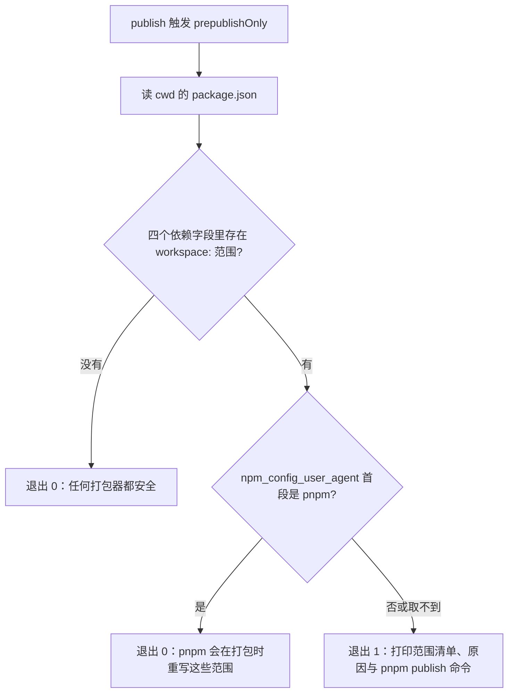
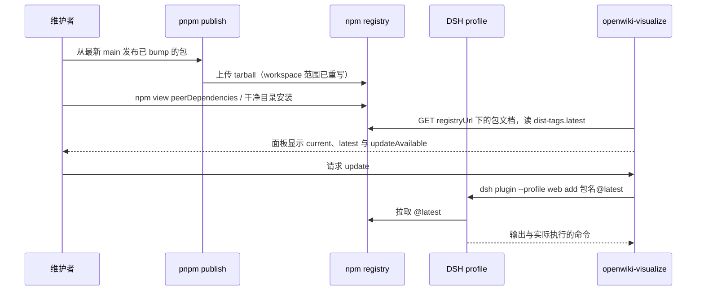

# 发布与打包

这个仓库没有 release workflow，也没有 release tag：发布是人在本机跑的一条命令，而这条命令只能是 `pnpm publish`。registry 上的发布时间因此就是唯一的发布锚点——`.agents/skills/plugin-release` 的锚定步骤正是用 `npm view <pkg> time --json` 代替 `git tag`。这条规则原本只是一句散文，散文没能阻止一次坏发布；现在它由两个机制支撑：包内 `prepublishOnly` 上的 `scripts/publish-guard.mjs` 互锁，以及 `pnpm run verify-publish-guard` 门禁。

这一页讲发布这一侧的全部契约。插件怎么组合、`dsh.bundle` 怎么分层见[插件组合与 bundle 层](../architecture/plugin-composition-and-bundles.md)，`publish-guard` 在 11 个门禁里的位置与调度语义见[构建、测试与门禁套件](build-test-and-gates.md)，自更新动作在运行时的完整形态见 [OpenWiki 预览](../systems/openwiki-visualize.md)。

## 唯一合法的发布器是 pnpm publish

一次真实事故定义了这条规则：`@zhangj1164/dsh-memo@0.1.0` 以 `"@zhangj1164/dsh-telemetry": "workspace:^"` 作为 peer 范围发到了 registry，任何 npm 消费者安装它都会得到 `EUNSUPPORTEDPROTOCOL: Unsupported URL Type "workspace:"`。它之所以能上架，是因为 pnpm 对 `workspace:` 协议只打印一条警告——于是在工作区里安装、`pnpm run gates` 全绿、甚至本机 DSH 里能跑，全都无法暴露这个缺陷；缺陷只在第一台用 npm 装它的机器上出现。

分叉出在打包这一步。`pnpm publish` 在 pack 时把 `workspace:^` / `workspace:*` 替换成被引用包的真实版本，`dependencies`、`devDependencies`、`peerDependencies` 都一样；`npm publish` 把协议原文写进 registry 上的 manifest。所以两者的差别不是「风格」而是产物本身：一个能被任何包管理器解析，另一个只有 pnpm 工作区能读懂。

本仓库里需要这条重写的地方集中在备忘套件：`@zhangj1164/dsh-memo` 对 telemetry、github-issue、client-ui-memo 三个包声明 `workspace:^`（peer）与 `workspace:*`（dev），`@zhangj1164/dsh-client-ui-memo` 又对 memo 与 github-issue 声明同样的范围。telemetry、github-issue、openwiki-visualize、client-ui-memo-settings 四个包没有工作区范围，它们的 manifest 在任何打包器下都一样。

`lib/` 被 `.gitignore` 忽略，干净检出里不存在。因此 registry 上的 tarball 必须是构建产物本身：`prepare: "tsdown"` 是产出 `lib/` 的那条路径，它同时服务两种安装——git 安装下载的是源码、由 `prepare` 现场构建（pnpm ≥10 需要 profile 的 `allowBuilds` 授权），registry 安装下载的是已经构建好的 `lib/`、不需要任何构建授权。这也是 README 里「registry 仍是更好的默认」那句话的实质内容。

## 互锁：prepublishOnly 上的 publish-guard

`scripts/publish-guard.mjs` 不重新实现那条重写。它只检查决定重写是否会发生的那一个事实——现在跑的是哪个打包器——并在打包器做不到时中止发布。



`publish-guard.mjs` 的判定路径：没有 `workspace:` 范围就直接放行，有范围才去看打包器身份。

三处细节决定了它的性格。

- **范围从哪里找。** 四个依赖字段 `dependencies`、`devDependencies`、`peerDependencies`、`optionalDependencies` 全部扫描，任何一个值以 `workspace:` 开头都算。这就是「manifest 声明了工作区范围」的定义，与门禁共用同一条判据。
- **怎么判断打包器。** 取 `process.env.npm_config_user_agent` 的第一段（`pnpm/11.20.0 npm/? node/v24…` 的第一段是 `pnpm`）。这是 pnpm 与 npm 都在执行生命周期脚本时注入的环境变量，也是唯一不需要额外插件就能读到的打包器身份。
- **失败即拒绝，且拒绝是有用的。** 拿不到身份（变量缺失）时它不假设「大概是 pnpm」，而是当作不安全：`refuse to publish` 加退出码 1，并打印范围清单、`EUNSUPPORTEDPROTOCOL` 的后果，以及两条正确的后续命令——`pnpm publish --filter <包名>` 与 `npm view <包名>@<version> peerDependencies`。fail-closed 的取舍写在脚本头部：错误放行的代价是一份没人能安装的 manifest，错误拒绝的代价是一条显式命令。

这条 fail-closed 还有一个日常操作后果：手工 `node scripts/publish-guard.mjs` 直接跑也会被拒，因为那种调用方式压根没有打包器。想验证互锁，要么通过 `pnpm run`（此时 `npm_config_user_agent` 是 pnpm，放行），要么在 `pnpm publish` 里跑。

互锁对 git 安装完全无影响，原因在于 `prepublishOnly` 的触发条件：npm 与 pnpm 在 `publish` 打包前都会执行它，而两者都不会在 `install` 时执行它。所以 `github:zhangj1164/dsh-mega-plugins#path:packages/memo/dsh-memo` 这类安装既不经过 guard，也照旧保留 manifest 里的 `workspace:^`——因为没有东西重写一份直接从 checkout 读出来的 manifest。pnpm 会为那些范围打一条 peer 警告，boot 不受影响：profile 逐包命名了启动需要的一切，并设了 `autoInstallPeers: false`，那些范围没有东西可解析。

## 门禁：让接线不会悄悄消失

互锁保护不了任何东西，除非包真的跑它。而「跑它」是逐包的样板：新包，或者一个后来才采用 `workspace:` 范围的包，会静默漏掉这一行。`scripts/verify-publish-guard.ts` 就是补这个洞的静态门禁——它读 manifest，不看产物、不需要构建，因此在 `check-all` 里不声明 `needs`。

它报三类违规，每条都写明后果：

| 违规形状 | 门禁的判据 | 报出的后果 |
| --- | --- | --- |
| 有 `workspace:` 范围但没跑 guard | `prepublishOnly` 里找不到以 `scripts/publish-guard.mjs` 结尾的 token | 在 pnpm 之外的任何打包器下，这些范围会原文上架 |
| 跑了，但指向别处 | 该 token 按包目录 `resolve` 后不等于仓库根的 `scripts/publish-guard.mjs` | 命名的不是本仓库那一份 guard |
| 跑了，但文件不存在 | `existsSync` 失败 | guard 名存实亡 |

第二类为什么用 `resolve` 而不是字符串比对，源码注释说得直接：拷贝接线时最容易犯的错就是 `../../../` 少一层或多一层，落到仓库外或落到一个不存在的文件上——只有真的解析一次路径，这种错才会以「指向别处」而不是「看起来对」的形态暴露出来。门禁失败时输出的修复模板也钉死了深度：`"prepublishOnly": "node ../../../scripts/publish-guard.mjs"`，因为六个包都在 `packages/<组>/<包名>` 的同一层。

这条门禁的边界必须读清楚：**它验证的是接线，不是发布。** 它观察不到一次绕过 `prepublishOnly` 的发布——例如把 `pnpm pack` 出来的 tarball 直接上传——真正阻断发布的是 `publish-guard.mjs` 本身。两者是分工而不是冗余：guard 在发布现场 fail closed，门禁保证下一个包不会忘掉 guard。

当前的接线状态是三个包接了线、两个包真的需要它：

| 包 | `files` 里的 patch | `prepare` | `prepublishOnly` | `workspace:` 范围 |
| --- | --- | --- | --- | --- |
| `@zhangj1164/dsh-telemetry` | `cordis.patch.yml` | `tsdown` | 无 | 无 |
| `@zhangj1164/dsh-github-issue` | `cordis.patch.yml` | `tsdown` | 无 | 无 |
| `@zhangj1164/dsh-memo` | `cordis.patch.yml` | `tsdown` | 有 | peer ×3、dev ×3 |
| `@zhangj1164/dsh-client-ui-memo` | 无（该包没有 `dsh.bundle`） | `tsdown` | 有 | peer ×2、dev ×2 |
| `@zhangj1164/dsh-client-ui-memo-settings` | `cordis.patch.yml` | `tsdown` | 有 | 无 |
| `@zhangj1164/dsh-openwiki-visualize` | `cordis.patch.yml` | `tsdown` | 无 | 无 |

`dsh-client-ui-memo-settings` 接了互锁却没有工作区范围，这无害：guard 在没有范围时第一行就放行，门禁也只要求「有范围必须有接线」，不禁止「没范围也接线」。

## 发布前必须为真的事

一个包可以发布，当且仅当下面每一条都成立。它们不是检查表文学，每一条都对应一次真实的坏发布或一个能观察到的失败。

- **版本已经 bump，且 bump 走 PR 落在 `main` 上。** `pnpm publish` 拒绝一棵脏的、或落后于远端的树（`ERR_PNPM_GIT_UNCLEAN`），所以版本号只能先经 PR 进入 `main`，发布动作才可能成功。只改 `devDependencies` 的 bump 不构成发版理由——消费者不安装那些依赖，一个仍能解析的已发布范围不需要新版本。
- **`files` 仍然包含 `lib/**/*.js` 与 `lib/**/*.d.ts`，并且声明了 `dsh.bundle` 的包还包含 `cordis.patch.yml`。** 六个包的 `main` 与 `types` 都指向 `lib/`，每个 `exports` 的运行时与类型目标同样指进 `lib/`（只有 `./package.json` 那一条是 manifest 自身），`publishConfig.access` 都是 `public`。漏掉 patch 的后果与漏掉 `lib/` 不同——装得上，但 `dsh.bundle.patch` 指向一个 tarball 里不存在的文件，这一层永远激活不了。
- **`prepare` 能在干净检出里产出 `lib/`。** 它今天就是 `tsdown`，与 `build` 同一个命令。这条同时决定 registry 安装有没有产物、git 安装能不能构建。
- **带 `workspace:` 范围的包已经把 guard 接进 `prepublishOnly`。** 否则 `pnpm run gates` 会红在 `publish-guard` 上，而这正是它该红的时候。
- **所有待发版本的 manifest 已经全部改完再开始打包。** `dsh-memo` 与 `dsh-client-ui-memo` 互为 peer、都写 `workspace:^`，工作区图因此在 peer 层面是循环的。发布顺序只能尽量贴近依赖图（telemetry → github-issue → memo → client-ui-memo），真正保证 tarball 里范围正确的是「打包前把每一个待发版本都定好」——一个依赖包后发版，先发的那个 tarball 里写的就是旧版本号。
- **打完先读 tarball 里的 manifest，而不是读工作树里的。**

```sh
pnpm run gates
cd packages/<组>/<包名> && pnpm pack --pack-destination <tmp>
tar -xOf <tmp>/<tarball>.tgz package/package.json
```

读的是四件事：新版本号、全文没有 `workspace:` 字符串、被重写后的 peer 范围指向本批要发布的版本、`files` 与预期一致。这一步是发布前唯一能看见「用户将拿到什么」的窗口。

发布动作本身属于人。`.agents/skills/plugin-release` 明确停在 `pnpm publish` 之前，`dsh-plugin-contribute` 的 pause guard 也把 `pnpm publish` / `npm publish` 列进必须先停下来确认的动作清单；技能负责把版本、顺序、命令和发布后要看的读数准备齐。

## 发布之后：核对 registry 副本

发布成功不等于发布正确。registry 上的 manifest 是消费者的唯一来源，所以每次发布后都要对着 registry 核对两件事：

```sh
npm view <pkg>@<version> peerDependencies   # 必须没有 workspace: 范围
npm install <pkg>@<version>                 # 在一个干净目录里跑，必须成功
```

第一条直接对上那次事故：`peerDependencies` 字段里出现任何 `workspace:` 都意味着这一次发布走错了打包器。第二条补上第一条看不见的部分——peer 范围写得对人也不一定能装，干净目录里没有工作区、没有 link、没有缓存，它验证的是 npm 用户眼中的那个包。

这两条也是唯一能覆盖「本地一切正常」盲区的检查。工作区内的安装由 pnpm 处理协议、只打印警告，因此它对已发布包的正确性没有发言权；`pnpm run gates` 同理，它证明的是源码与产物一致，不是 registry 上的副本可安装。

## 下游消费者：预览插件按 registry 自更新

`@zhangj1164/dsh-openwiki-visualize` 把这个仓库的发布变成了它自己的更新源，因此它是发布契约最直接的下游消费者：一次发布的产物质量，会直接表现为这台机器上一次自更新成功还是失败。



一次发布从 `pnpm publish` 到运行中面板上的「有更新可用」，再回到 profile 安装，中间的每个箭头都是一处可失败的边界。

它读到的 `current` 就是装下来的那份 manifest 的版本号：`readOwnVersion()` 从构建产物旁边的 `../package.json` 读 `version`（`lib/index.js` 往上两级即包根），读不到时退化为 `0.0.0`。所以「面板说我是什么版本」与「registry 上发布了什么版本」是同一个数字，没有第二套版本来源。

`checkUpdate()` 做一次真实 HTTP：GET `${registryUrl}/${encodePackageName(packageName)}`，取 `dist-tags.latest`，然后 `updateAvailable = latest !== current && meetsMinimum(latest, current)`。相等不算更新，registry 上出现比本机更旧的版本也不算更新（那是回滚，不是升级）。registry 不可达时它不抛错、也不把结果说成「已是最新」：报告里带 `failure.code = 'registry-unreachable'`，`updateAvailable` 保持 `false`。这条刻意的处理保证离线机器不会看起来像已经更新到最新版。

检查和安装是两个独立步骤，这是设计而不是实现顺序。`version({ cached: true })` 只回答上一次结果、不再打 registry；启动时的检查是 fire-and-forget（挂在 `ctx.effect` 里，失败被吞掉），因此它不阻塞插件挂载。`update()` 则必须被显式调用，因为它会改写 profile 的依赖：它跑 `dsh plugin --profile <profileName> add <packageName>@latest`，把实际执行的命令行和合并输出一起返回，`reloadRequired` 为 `true`；命令失败也是一种结果（`updated: false`、`reloadRequired: false`），不伪装成成功。

相关配置全部是 `Config` 字段，部署可以改写：`registryUrl`（默认 `https://registry.npmjs.org`）、`packageName`（默认本包）、`profileName`（默认 `$DSH_PROFILE` 或 `web`）、`dshCommand`、`updateCheckOnStart`、`registryTimeoutMs`。因此一个私有 registry 或内部镜像只需要改 `registryUrl`，而不需要改代码。

`tests/service.spec.ts` 的 version/update 组把这套语义钉在断言上：更高版本报 `updateAvailable: true`；与自身 manifest 相等的版本不报更新；registry 抛错时得到 `registry-unreachable` 且 `updateAvailable` 为假；`cached` 请求不会产生第二次 fetch；`updateCheckOnStart` 为真时启动恰好查一次；`update()` 跑的命令参数逐项断言为 `['plugin', '--profile', 'web', 'add', '@scope/pkg@latest']`，失败时 `updated` 为假。

## 失败模式速查

| 现象 | 原因 | 位置 |
| --- | --- | --- |
| 消费者安装报 `EUNSUPPORTEDPROTOCOL: Unsupported URL Type "workspace:"` | registry 上的 manifest 带着 `workspace:` 范围，即这次发布没走 `pnpm publish` | 重发一个补丁版本；发布前用 `pnpm pack` 读 tarball 内 manifest |
| `publish-guard: refusing to publish …` | 打包器不是 pnpm，或身份取不到 | 改用 `pnpm publish --filter <包名>` |
| 发布被 `ERR_PNPM_GIT_UNCLEAN` 拒绝 | 工作树脏或落后远端 | 先让 bump 走 PR 落到 `main`，再从最新 `main` 发布 |
| `pnpm run verify-publish-guard` 报未保护范围 | 一个新包或新采用 `workspace:` 范围的包漏了 `prepublishOnly` | 按门禁输出的模板接线 |
| 装上了但某个 bundle 层不生效 | `files` 漏了 `cordis.patch.yml`，`dsh.bundle.patch` 指向 tarball 里不存在的文件 | 补 `files` 后重发 |
| 面板显示 `registry-unreachable` 而不是「已是最新」 | 自更新检查连不上 registry | 这是刻意的 fail-closed 读法，不是缺陷 |
