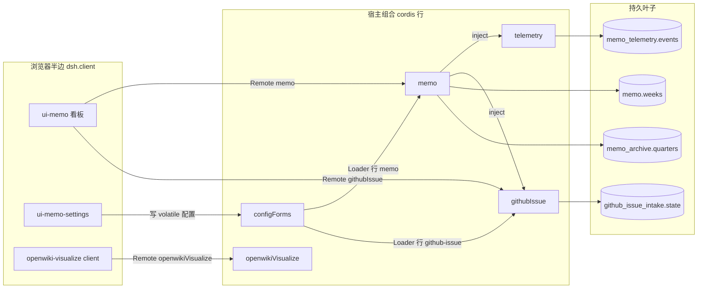

# 快速上手：这个仓库是什么，从哪里开始

`zhangj1164/dsh-mega-plugins` 是一个 pnpm monorepo，交付两条产品线上的六个 DSH 插件：一条本地优先的个人备忘套件（`telemetry`、`githubIssue`、`memo` 三个宿主服务，加备忘看板与 Settings 页两个浏览器面），以及 Web 右 Sidebar 里的 OpenWiki 预览。`pnpm-workspace.yaml` 的 `packages:` 只有一行 `packages/*/*`，根 `package.json` 是 private 的聚合脚本入口：`pnpm run build`、`pnpm run test`、`pnpm run gates`。

这一页不重复系统总览，只做两件事：把值得先建立的地图压缩到一屏，然后把「你手上这类改动」路由到该读的那一页。工作流程的唯一权威是 [AGENTS.md](../AGENTS.md)；本 wiki 是按需检索的上下文——手上有源码时先读源码与测试，它们是事实来源。

## 一屏地图：六个包、两侧、入口 id

| 包 | 目录 | 半边 | 服务键 | 组合入口 id |
|---|---|---|---|---|
| `@zhangj1164/dsh-telemetry` | `packages/telemetry/dsh-telemetry` | 仅宿主 | Cordis `Service` `telemetry` | `telemetry` |
| `@zhangj1164/dsh-github-issue` | `packages/github-issue/dsh-github-issue` | 仅宿主 | `TypertRemoteService` `githubIssue` | `github-issue` |
| `@zhangj1164/dsh-memo` | `packages/memo/dsh-memo` | 宿主（浏览器半边在别的包） | `TypertRemoteService` `memo` | `memo` **和** `ui-memo` |
| `@zhangj1164/dsh-client-ui-memo` | `packages/client/ui-memo` | 仅浏览器 | 空 `apply()` | 无自有 bundle，`ui-memo` 行由 `dsh-memo` 的 patch 插入 |
| `@zhangj1164/dsh-client-ui-memo-settings` | `packages/client/ui-memo-settings` | 仅浏览器，但自带 bundle | 空 `apply()` | `ui-memo-settings` |
| `@zhangj1164/dsh-openwiki-visualize` | `packages/openwiki/dsh-openwiki-visualize` | 同一个包两半都有 | `TypertRemoteService` `openwikiVisualize` | `openwiki-visualize` |

三个宿主包里有两条依赖边值得先知道：`memo` 的静态 `inject` 是 `['storageDomain', 'telemetry', 'githubIssue']`，所以单独装 `dsh-memo` 启动不了（profile 的 `autoInstallPeers: false` 让安装只带来命令点名的包）；`githubIssue` 只静态 inject `llm`，对 `telemetry` 用 `ctx.get()` 可选读取，缺席时照常工作、只是不留日志。

最容易踩的一处命名巧合：`telemetry`、`github-issue`、`memo` 三个包都导出 `./client`，内容是一句 `export type *`——那是给客户端复用的类型投影，运行时解析只会得到空模块；真正的浏览器半边是 manifest 里的 `dsh.client`，宿主按包名取回 `lib/client.js`。为什么这样拆、两侧的 `inject` 各管什么，见 [插件组合与 bundle 层](architecture/plugin-composition-and-bundles.md)。



箭头方向就是调用、注入或写入的方向；浏览器侧只有四条边——三个 Remote 命名空间加一条 `configForms`，没有跨包的浏览器半边引用。OpenWiki 预览的叶子是 workspace 里的 `openwiki/` 目录与一个被监督的子进程，图中省略。

## 第一次进仓库

```sh
pnpm install
pnpm run gates        # check-all：11 个门禁，含 test、build、产物、卫生、文档同步与 issue 策略
```

先让 `pnpm run gates` 跑绿，把这次运行当作基线；它红了就先定位，别在红的基线上改代码。门禁内部顺序并非随意：`package-exports` 与 `client-bundle-id` 读的是构建产物，所以声明 `needs: ['build']`；本地三种聚合都把并发夹到 4 个 worker（多个文档门禁各自构建完整 `ts.Program`），可用 `DSH_GATE_CONCURRENCY` 覆盖。只想快速循环时用窄聚合：`pnpm run gates:hygiene`（导出 JSDoc）、`pnpm run gates:doc-sync`（双语配对 + Markdown 链接 + 段落不硬换行）。完整图见[构建、测试与门禁套件](operations/build-test-and-gates.md)。

## 强制工作流：分支 → 门禁 → PR

`main` 永远可发布，任何改动都只能经审查过的 PR 进入。步骤没有「小改动例外」，也不对维护者和自动化破例：

1. **先同步 `main`**：`git fetch origin && git switch main && git pull --ff-only origin main`。不要从过期的 `main` 切分支，更不要在 `main` 上开发。
2. **切分支**：`<kind>/<short-slug>`，kind 与改动的标签一致——`fix/memo-llm-failure-passthrough`、`feat/ui-memo-settings-section`、`docs/agents-workflow`。一个分支只承载一处连贯改动。
3. **在分支上做完**：实现、测试、文档一起改，小步提交。
4. **本地跑完整门禁**：`pnpm run gates` 全绿再开 PR。红的门禁不要推上去让 CI 发现。
5. **UI 改动要目视验证**：重建受影响的 bundle 后，在运行中的 DSH Web（`http://127.0.0.1:3080`）里看一遍。单测通过对用户可见改动只是必要条件。
6. **开 PR**：至少引用一个 Issue，正好一个 `kind/*` 标签、至少一个 `area/*` 标签，并写清验证方式。
7. **PR 上门禁通过后** squash-merge 进 `main`，删分支。

两条配套规则：任何改动都从 Issue 开始，但 Issue 是工作项而非直提 `main` 的许可证；门禁不能给自己的修复当裁判——issue 策略工作流从默认分支检出 `policy.mjs`，所以策略自身的修复要先走自己的 PR 落到 `main`，再重跑被卡住的 PR，绝不为了过门禁而放宽门禁。

## 四条不能破的线

1. **从 `main` 切分支，走 PR。** 见上一节；这是流程约束，也是评审要拦的第一件事。
2. **`pnpm run gates` 必须在本地全绿。** 门禁不是建议，是提交前的门槛。
3. **发布只用 `pnpm publish`，绝不用 `npm publish`。** npm 会把 `workspace:` 协议原样写进发布清单（`@zhangj1164/dsh-memo@0.1.0` 就这样把 `"@zhangj1164/dsh-telemetry": "workspace:^"` 当成 peer range 发了出去，npm 用户安装直接 `EUNSUPPORTEDPROTOCOL`），而 `pnpm publish` 会在打包时把每个 `workspace:` range 替换成对端真实版本。现在每个带 `workspace:` range 的包都以 `prepublishOnly` 跑 `scripts/publish-guard.mjs`：packer 不是 pnpm 就在打包前中止，认不出 packer 也一律拒绝（fail closed）；`pnpm run verify-publish-guard` 负责保证这条接线不被悄悄摘掉。发布后复核：`npm view <pkg>@<version> peerDependencies` 里不能有 `workspace:`，干净的 `npm install <pkg>@<version>` 必须成功。
4. **不新增硬编码的部署可变值。** URL、端点、端口、阈值、提示词片段、存储路径都必须是校验过的 schemastery `Config` 字段，由 `cordis.patch.yml` / `dsh.profile` 覆盖；只有协议常量、外部规范与安全不变量保持固定。要让部署在 Settings 里改，还得把它放在 `.volatile()` 节点下并在用点读 getter，否则设置页保存成功而服务仍用旧值。`DEFAULT_*` 常量与测试钩子不算可配置性。

还有一条容易被忽略、但会直接决定设计形状的边界：面板发起的 Remote 调用落在 turn 之间，`ctx.approval.request()` 需要 open turn 与 `agent`，所以「用户点击 → 宿主执行敏感操作」拿不到人工确认。这类能力只有两种合规形态——不注册 `@Remote`（如 `readExternalPath`），或包装成 turn 内 tool。详见[能力与审批边界](concepts/capability-and-approval-boundaries.md)。

## 按任务路由

| 你要做的事 | 先读 | 你会拿到什么 |
|---|---|---|
| 建立全局模型：谁在宿主、谁在浏览器、状态落在哪 | [系统总览](architecture/overview.md) | 六包合并表、装配四步顺序、失败定位表、五类改动的落点 |
| 加一个宿主能力（新服务、新包、新配置字段） | [备忘服务](systems/memo-service.md) | 一个 `TypertRemoteService` 的完整样本：18 个方法的请求/结果信封、失败码、写守卫、inject 与可选服务 |
| 在浏览器加一块面（面板、Sidebar tab、Settings section） | [备忘看板 UI](systems/memo-board-ui.md)、[备忘设置页](systems/memo-settings-ui.md) | slot 注册与 key 约定、controller 与 RPC 包装、草稿状态机与 `configForms` 守卫 |
| 加或改一个 Remote 方法 | [宿主 ⇄ 浏览器 Remote 契约](architecture/host-client-remote-contract.md) | `@Remote` 命名、唯一 `request` 参数、`{ args: { request } }` 线上的双层信封，以及守住它的门禁 |
| 加持久状态、改行 schema、处理迁移 | [存储与持久化](architecture/storage-and-persistence.md) | 四个域声明 + 一个 JSON 账本的行 schema、开/关生命周期、写重试、坏行在启动时的症状 |
| 让某个值可从 `cordis.yml` 覆盖，或从 Settings 免重启改 | [配置与实时设置](concepts/configuration-and-live-settings.md) | schemastery `Config` 契约、`.volatile()` ref 如何被 Loader 就地提交、按版本围栏的写入、仍需要重启的改动 |
| 改 bundle patch、入口 id、安装清单、git 安装 | [插件组合与 bundle 层](architecture/plugin-composition-and-bundles.md) | 有序 patch 模型、一个 id 一个 owner、「装子集也干净」的三条安装路线、守门门禁 |
| 发布新版本，或改自更新路径 | [发布与打包](operations/release-and-publishing.md) | `pnpm publish` 契约、publish guard 与它的接线门禁、每个 manifest 发什么、发布后复核 |
| 改门禁、构建产物、测试运行环境 | [构建、测试与门禁套件](operations/build-test-and-gates.md)、[测试策略](testing/testing-strategy.md) | tsdown 与共享 client preset、根 vitest 的别名/装饰器/jsdom 配置、11 条门禁的依赖图 |
| 改 CI、Issue/PR 策略、Project 自动化 | [CI、Issue 策略与仓库自动化](operations/ci-and-issue-policy.md) | 工作流如何调门禁、`policy.mjs issue`/`pr` 的标签与正文规则、需要 PAT 的 Project 开关 |
| 改模型调用、路由解析或失败语义 | [LLM 路由与失败事实](concepts/llm-route-and-failure-facts.md) | `request → Config → agentDefaultModel` 的解析顺序、共享流式助手、保留的失败码/消息/状态 |
| 改周/月/季/年标签或周 id | [四维周期日历](concepts/period-calendar.md) | 标签形状、周一起始的 ISO 周与周四规则、宿主唯一的 enumerate/contains 对 |
| 用宿主服务（`llm`、`fs`、`sessionQuery`、`storageDomain`、`configForms`…） | [DSH 宿主服务](integrations/dsh-host-services.md) | 结构化声明而非 import 的宿主契约，以及让「部分安装」仍可启动的可选读取规则 |
| 触到 GitHub 侧（建 issue、列可认领 issue、凭据） | [GitHub REST 集成](integrations/github-rest.md)、[GitHub issue 服务](systems/github-issue-service.md) | URL 解析、两个受支持的操作、token 解析顺序、超时与稳定失败码 |
| 改遥测写入/读取或日志分析 | [遥测服务](systems/telemetry-service.md)、[日志分析到 issue 报告](workflows/log-analysis-to-issue.md) | 带序号的写入链与脱敏、读时再脱敏、按 `featureCodeRef` 分组，以及跨插件诊断管线 |
| 改 OpenWiki 预览 | [OpenWiki 预览](systems/openwiki-visualize.md) | 环境探测、wiki 检测、被监督子进程与端口解析、版本检查与显式自更新、右栏 tab 与 iframe |
| 改一条端到端流程 | [分析与导出](workflows/analyze-and-export.md)、[issue 派发](workflows/issue-intake-autopilot.md)、[季度归档与只读](workflows/quarter-archive-and-read-only.md)、[会话总结成周记](workflows/session-summary-to-week.md) | 每个流程的调用链、失败分支、持久副作用，以及哪些守卫在方法内部强制 |

## 读完之后

地图部分只需要四页就能补齐：[系统总览](architecture/overview.md) 给整体与失败定位，[插件组合与 bundle 层](architecture/plugin-composition-and-bundles.md) 给装配与安装，[宿主 ⇄ 浏览器 Remote 契约](architecture/host-client-remote-contract.md) 给唯一的调用通道，[存储与持久化](architecture/storage-and-persistence.md) 给状态叶子。剩下的页面都是这四页的展开，按上表挑一行进去即可。

改动要落纸时，`docs/plans/` 放经过验证的设计（按日期、每批改动一份）；Issue 跟踪与技能配置在 `docs/agents/`。双语文档是一对一对的：改完任一侧 README 后用 `pnpm run verify-translation-pairing --write --all` 重新对账，否则 `gates:doc-sync` 会红。
