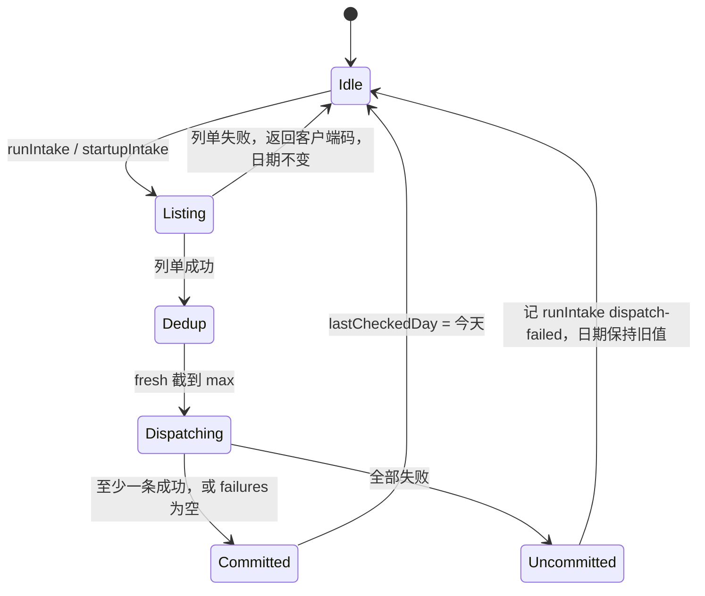
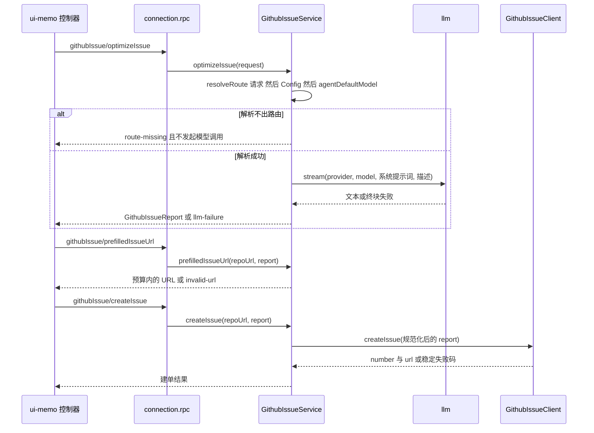

# GitHub issue 服务（宿主）

`GithubIssueService` 是把「失败分析 → 结构化 issue 正文 → 真的建单 → 把 issue 交给一个会话」串成一条链的宿主服务。它以服务键 `githubIssue` 挂在 cordis 上，是 `TypertRemoteService` 的子类，把七个方法标注成 `@Remote` 端点；包本身没有浏览器半边（`package.json` 里只有 `dsh.bundle`，没有 `dsh.client`，`src/client.ts` 只是 `export type * from './types.ts'` 的类型投影），所以它是**被 UI 插件消费的后端**，而不是一个能自己点开的功能面（[index.ts](../../packages/github-issue/dsh-github-issue/src/index.ts#L377-L386)、[client.ts](../../packages/github-issue/dsh-github-issue/src/client.ts#L1-L10)、[package.json](../../packages/github-issue/dsh-github-issue/package.json#L45-L66)）。

这条链上的每一步都有独立的失败语义和独立的依赖要求。本页只记录**每个方法自己的形状**：要什么、成功回来什么、以哪个码失败、走之前先做了什么本地判定。接单循环的时序（哪天算一天、跨重启去重、每个分支怎么收尾）在 [Issue 自动接单循环](../workflows/issue-intake-autopilot.md) 展开。

## 服务身份与只有 llm 的硬依赖

```ts
export class GithubIssueService extends TypertRemoteService {
  static inject = ['llm']
  static Config = Config
```

`inject` 里只有 `llm` 一项，这是本页的核心设计点而不是遗漏（[index.ts](../../packages/github-issue/dsh-github-issue/src/index.ts#L386-L387)、[index.ts](../../packages/github-issue/dsh-github-issue/src/index.ts#L243-L252)）：

| 协作者 | cordis 服务键 | 读取方式 | 缺失时的后果 |
|---|---|---|---|
| 模型运行时 | `llm` | `static inject` + `ctx.get('llm')` | 服务不激活 |
| 遥测 | `telemetry` | `ctx.get('telemetry')`，声明为结构化 `TelemetrySink` | 不记录事件，业务行为不变 |
| 存储域 | `storageDomain` | `optionalService(ctx, 'storageDomain')` | 无持久状态：建单与列取照旧，每日启动检查关闭 |
| 会话控制器 | `sessionController` | `optionalService(...)` | 派发能力整体不可用，报 `session-unavailable` |
| 自动化任务 | `schedule` | `optionalService(...)` | 派发改为直接排入提示词 |
| 工作区注册表 | `workspaceRegistry` | `optionalService(...)` | 会话按目录创建，不进侧栏分组 |
| Agent 注册表 | `agents` | `optionalService(...)` | 同上，派发整体不可用 |
| 部署默认模型 | `agentDefaultModel` | `ctx.get('agentDefaultModel')?.currentSelection()` | 路由解析少一级 |

理由写在 `TelemetrySink` 的注释里：遥测是诊断依赖，**一个诊断依赖绝不该成为服务拒绝激活的理由**。存储、会话控制器与自动化任务属于 Web 组合，缺了它们应该少一项能力，而不是整包装不上。于是 `static inject` 只保留「没有它这个方法根本没有意义」的那一个，其余全部按需读取并在缺失处返回稳定失败或退回一条仍在工作的路径（[index.ts](../../packages/github-issue/dsh-github-issue/src/index.ts#L243-L252)、[index.ts](../../packages/github-issue/dsh-github-issue/src/index.ts#L1320-L1328)）。测试把这条契约钉成两半：没有 `telemetry` 时成功与失败两次调用都照常返回（[github-issue.spec.ts](../../packages/github-issue/dsh-github-issue/tests/github-issue.spec.ts#L453-L474)），没有会话组件时派发明确报 `session-unavailable` 而不是伪造会话（[intake-service.spec.ts](../../packages/github-issue/dsh-github-issue/tests/intake-service.spec.ts#L269-L290)）。

## 方法一览：请求、结果、失败码、所需服务

七个 `@Remote` 方法分三组：两条模型路径、一条纯计算的 URL 构造，以及四条 GitHub 接单路径。

| 方法 | 请求要点 | 成功值 | 失败码 | 这条路径要什么 |
|---|---|---|---|---|
| `generateReport(request)` | `pluginIds`、`totalEvents`、`totalFailures`、`failureGroups[]`，可选 `window`、`provider`、`model` | `GithubIssueReport`，`labels` 固定 `['bug','telemetry']` | `route-missing`、`llm-failure` | `llm` + 可选 `agentDefaultModel`；遥测可选 |
| `prefilledIssueUrl(request)`（同步，不返回 Promise） | `repoUrl`（空串回落到 `Config.repoUrl`）、`report` | 预填 URL 字符串 | `invalid-url` | 什么都不需要：不碰模型、不碰 GitHub |
| `optimizeIssue(request)` | `description`，可选 `provider`、`model` | `GithubIssueReport`，`labels` 固定 `['bug']` | `empty-input`、`route-missing`、`llm-failure` | `llm` + 可选 `agentDefaultModel` |
| `createIssue(request)` | `repoUrl?`、`report` | `{ number, url }`（冻结） | 本地 `invalid-request`；之后是客户端码 `invalid-repo`、`auth-missing`、`auth-failure`、`rate-limited`、`invalid-request`、`http-failure`、`network-failure` | 每次调用新建一个 `GithubIssueClient`（token 已解析） |
| `listClaimableIssues(request = {})` | `repoUrl?`、`claimLabel?`、`max?` | `GithubIssueTask[]`（冻结） | 同上客户端码 | 同上 |
| `dispatchIssue(request)` | `issue`、`cwd?`、`agentPreset?` | `{ sessionId }` | `session-unavailable`、`dispatch-failed` | `sessionController`（必需）+ 可选 `schedule` / `workspaceRegistry`；可选 `autopilotCwd` / `autopilotPreset` / `autopilotPrompt` |
| `runIntake(request = {})` | `repoUrl?`、`claimLabel?`、`max?`、`cwd?`、`agentPreset?` | `{ checkedAt, repoUrl, claimable, dispatched, skipped, failures }` | 列表失败**原样**返回（客户端码）；单条派发失败进 `failures` 数组 | 上面两组 + 可选 `storageDomain`（不挂仍能跑，只是不记忆） |

`GithubIssueFailureCode` 是这张表里接单部分的契约本身——`auth-missing`（没有凭据）与 `auth-failure`（凭据被拒）刻意分成两个码，因为这是两种修法不同的部署问题，消息只负责给人读（[types.ts](../../packages/github-issue/dsh-github-issue/src/types.ts#L138-L163)）。注意 `prefilledIssueUrl` 的 `invalid-url` **不在**这个联合里：它是预填这条纯路径自己的失败码，与 GitHub 的 HTTP 分类无关（[types.ts](../../packages/github-issue/dsh-github-issue/src/types.ts#L94-L105)）。把 HTTP 状态收敛成这些码的规则由 [GitHub REST 集成与凭据](../integrations/github-rest.md) 负责，本页只说上层怎么用。

`runIntake` 与 `listClaimableIssues` 的 `request` 带默认值 `{}`，所以「什么都不指定、全用配置」是一次合法调用；其余五个方法要求真正的请求体（[index.ts](../../packages/github-issue/dsh-github-issue/src/index.ts#L634-L638)、[index.ts](../../packages/github-issue/dsh-github-issue/src/index.ts#L673-L677)）。数量参数统一经 `clampCount` 收敛到 1..100 的整数，所以请求里传超过 20 的值仍然被接受——`maxIssuesPerRun` 的 schema 上界 20 只约束配置，不约束一次调用的 `max`（[index.ts](../../packages/github-issue/dsh-github-issue/src/index.ts#L1329-L1334)）。

## 纯函数层与服务层的分工

这个包把「可以用输入完全决定的行为」全部推到两个无宿主依赖的模块，服务方法只负责编排、失败分类与状态。改动时先确认一件事属于哪一层，能少写很多分支：

| 纯函数 | 所在模块 | 职责 | 谁调用它 |
|---|---|---|---|
| `issueBody(report)` | `intake.ts` | 删掉首行 `## 标题`、其后空行、归一 CRLF、trim 末尾 | `createIssue` |
| `renderDispatchPrompt(template, issue)` | `intake.ts` | 替换 `{number}`/`{title}`/`{url}`/`{body}`/`{labels}`，未知占位符原样保留 | `dispatch` |
| `localDayKey(now, tz)` | `intake.ts` | 把时刻格式化成 IANA 时区下的 `YYYY-MM-DD` | `runIntake`、`startupIntake` |
| `isValidTimeZone(tz)` | `intake.ts` | 空串合法，其余用 `Intl.DateTimeFormat` 试构造 | `intakeTimeZone` |
| `parseRepository(repoUrl)` | `github.ts` | 拆 owner/repo，容忍一个尾斜杠，接受任意 host | `GithubIssueClient` 构造 |
| `streamLlmText(llm, route, system, user)` | `llm-text.ts` | 收集文本并把终块失败事实保留成 `LlmTextFailure` | 两条模型方法 |

`firstNonBlank`、`clampCount`、`normalizeWorkspacePath`、`buildReportUserPrompt`、`extractTitle`、`buildPrefillUrl`、`optionalService`、`describeError` 属于服务侧私有的模块级函数，只被本文件使用（[index.ts](../../packages/github-issue/dsh-github-issue/src/index.ts#L1207-L1334)）。`buildPrefillUrl` 虽然是纯函数，但它是 `prefilledIssueUrl` 端点唯一的规则来源，下面单独展开。`llm-text.ts` 与 `dsh-memo` 的同名模块刻意保持结构一致，因为 `dsh-github-issue` 是下层、`dsh-memo` 依赖它而不是反过来（[llm-text.ts](../../packages/github-issue/dsh-github-issue/src/llm-text.ts#L1-L22)）。

## 模型路径：路由与失败事实

两条模型方法的骨架相同：先解析路由，解析不出就**不发起调用**，直接返回 `route-missing`；解析出来才走 `streamLlmText`，失败时把 DSH 的码、消息与 HTTP 状态拼进 `llm-failure` 的消息里。区别只在**先后**：`optimizeIssue` 先判空描述（`empty-input`）再解析路由，`generateReport` 没有输入校验。标题从模型输出的第一个 `## ` 标题取，取不到时 `generateReport` 回落到 `Telemetry failures in <pluginIds>`、`optimizeIssue` 回落到 `New issue`；两个结果对象都冻结（[index.ts](../../packages/github-issue/dsh-github-issue/src/index.ts#L581-L613)、[index.ts](../../packages/github-issue/dsh-github-issue/src/index.ts#L1038-L1046)）。

路由三级（请求 → 本服务 `Config` → 部署 `agentDefaultModel`）、`route-missing` 与 `llm-failure` 为什么必须分开、以及 `streamLlmText` 如何区分终块失败与真空响应，都在 [模型路由与失败事实保全](../concepts/llm-route-and-failure-facts.md)。本服务这一侧值得单独记住的是 `firstNonBlank`：空白按「未提供」丢掉并 trim，所以一个 `provider: ''` 的请求不会遮蔽下一级（[index.ts](../../packages/github-issue/dsh-github-issue/src/index.ts#L560-L574)、[index.ts](../../packages/github-issue/dsh-github-issue/src/index.ts#L753-L765)）。

### 报告提示词只喂分析给出的事实

`generateReport` 的用户提示词由 `buildReportUserPrompt` 从分析结果逐字拼出：插件清单、分析窗口、事件与失败总数，然后每个失败组一行 `featureCodeRef`、`count`、可选的 `errorCode` / `errorMessage`、`route`、`lastFailureAt`、`attemptsAfterLastFailure`。**分析没有携带的事实不会被省略，而是写成 `not recorded`**；`pluginIds` 为空或 `window` 缺失同样落到这个词，失败组为空时写 `(none)`。这样模型分不清「没记」与「没事」的可能性就被消掉了（[index.ts](../../packages/github-issue/dsh-github-issue/src/index.ts#L1234-L1270)、[index.ts](../../packages/github-issue/dsh-github-issue/src/index.ts#L217-L218)）。

配套的系统提示词是另一半约束：只引用分析里出现的事实，不准提分析没有证据的机制（采样参数、token 预算、超时、分块、流式、响应解析被逐一点名），必须报告窗口与每组的路由/最近失败时间/之后又跑了几次、并说明「没有再次复现的失败不是当前缺陷」，缺失事实写 `not recorded`，且**禁止**写「需要补采集」——因为一个缺失的事实既可能是更早的事件也可能是缺口，而报告分不出（[index.ts](../../packages/github-issue/dsh-github-issue/src/index.ts#L253-L295)）。测试三向钉住：有值的三元组原样进提示词、全缺时四处 `not recorded`、系统提示词里那句禁令仍在（[github-issue.spec.ts](../../packages/github-issue/dsh-github-issue/tests/github-issue.spec.ts#L273-L344)）。

## 预填 URL：预算按合成后的 URL 计算

`prefilledIssueUrl` 是唯一的同步端点。它先校验 `repoUrl`：空串回落到 `Config.repoUrl`，然后必须匹配 `^https://github\.com/[^/]+/[^/]+$`，否则 `invalid-url`。这条校验比传输层的仓库解析**更窄**：`GithubIssueClient` 接受任意 host（GitHub Enterprise 靠独立的 `apiBaseUrl` 工作），但预填 URL 是给浏览器打开的 github.com 链接，所以企业部署能建单、却拿不到预填链接（[index.ts](../../packages/github-issue/dsh-github-issue/src/index.ts#L615-L631)、[github.ts](../../packages/github-issue/dsh-github-issue/src/github.ts#L67-L79)）。

真正的规则在 `buildPrefillUrl` 里，四条一起才成立（[index.ts](../../packages/github-issue/dsh-github-issue/src/index.ts#L1291-L1335)）：

1. **预算检查在合成后的 URL 上**，不是在正文长度上。`compose(body)` 用 `URLSearchParams` 组装 `title`、`body`、`labels` 三个参数，所以标题与标签花的是同一笔预算，且百分号编码会把它们放大——按正文长度定的规则依然会产出 GitHub 拒收的 URL。
2. **缩短是重复的，直到装得下。** 首轮若超限，每轮从正文尾部按「当前超出量」多切一点（至少 1 个字符）后重新合成；每轮至少消掉自己量到的溢出，所以几次内收敛，`MAX_PREFILL_TRUNCATION_PASSES = 32` 只是防病态输入空转。字符编码成多个 URL 字符时会多切一些，而多切只会更短。
3. **截断标记随正文一起进 URL。** `prefillTruncationNote` 被拼在被截断正文之后，读者因此知道这是部分正文；测试同时断言「保留部分是原文前缀」与「保留部分以标记结尾」，防止截断把正文弄乱。
4. **标记本身也超限时，正文只剩标记。** 这一支到达时说明标题一项就把预算吃光了；继续缩短标题等于谎报报告主题，所以正文让出全部空间，代码选择发出「最长的仍能装下的东西」而不是一个 GitHub 会拒绝的 URL。

`maxPrefillUrlLength <= 0` 关掉整段缩短逻辑，原样返回完整 URL。测试把预算规则测得很细：长正文必须变短且保留前缀、标题与标签各占预算、标题独占预算时正文退化成标记、`0` 关闭缩短（[github-issue.spec.ts](../../packages/github-issue/dsh-github-issue/tests/github-issue.spec.ts#L57-L116)）。

## 直接建单：本地先拒，再规范化正文

`createIssue` 在碰 GitHub 之前做完全部本地判定：`report.title` 与 `report.body` 必须是字符串、`title` trim 后非空，否则 `invalid-request`；`labels` 逐项 trim 并丢掉空名。正文经 `issueBody` 处理——`optimizeIssue` 会把标题重复写成正文第一行的 `## 标题`（这样同一段文本既能填预填表单也能直接提交），而 GitHub 的标题是独立字段，照发就会显示两遍标题，所以首个 `## ` 行被删掉、其后空行一并清掉、CRLF 归一化、末尾空白 trim（[index.ts](../../packages/github-issue/dsh-github-issue/src/index.ts#L656-L677)、[intake.ts](../../packages/github-issue/dsh-github-issue/src/intake.ts#L34-L51)）。测试断言发出去的 JSON body 里既没有那个标题行、也没有空标签，且空标题的请求一次 fetch 都不发（[intake-service.spec.ts](../../packages/github-issue/dsh-github-issue/tests/intake-service.spec.ts#L43-L74)、[intake.spec.ts](../../packages/github-issue/dsh-github-issue/tests/intake.spec.ts#L13-L25)）。

凭据解析在建单前发生但只做一次：`token` → `tokenEnv` → `tokenCommand`，结果缓存，因此「没有凭据」是 `GithubIssueClient` 给出的 `auth-missing`，也不会重跑子进程（[index.ts](../../packages/github-issue/dsh-github-issue/src/index.ts#L1037-L1080)；完整凭据流程见 [GitHub REST 集成与凭据](../integrations/github-rest.md)）。

有了 `createIssue`，「格式化 issue」和「提交 issue」才合成一步——预填 URL 需要用户打开表单再按 Submit，从而没人能自动接手这个 issue。这个能力也是仓库里被点名「turn 之间的一次点击就替用户做成有外部后果的事」的案例之一，权限与审批视角见 [敏感能力与审批边界](../concepts/capability-and-approval-boundaries.md)。

## 认领清单与派发

`listClaimableIssues` 只是把仓库、标签、数量解析好交给客户端；PR 剔除、标签大小写不敏感复核都在客户端做（[index.ts](../../packages/github-issue/dsh-github-issue/src/index.ts#L683-L701)、[github.ts](../../packages/github-issue/dsh-github-issue/src/github.ts#L142-L173)）。

`dispatchIssue` 与 `runIntake` 都落到私有的 `dispatch`。派发是**两步**，每一步都照实失败，不伪造成功（[index.ts](../../packages/github-issue/dsh-github-issue/src/index.ts#L798-L898)）：

1. **建会话。** `sessionController.create(...)`——走控制器而不是 Agent 注册表，是为了让派发出的会话带上部署的 preset 与工作区归属策略，和用户从 Web 里手动开的会话一致；抛错即 `dispatch-failed`。没有控制器（或控制器不带 `prompt`）在更早一步就报 `session-unavailable`。
2. **交付工作。** 挂载了 `schedule` 时，把渲染好的提示词登记为该会话的一次性自动化任务（`after_seconds` 取 `dispatchTaskDelaySeconds`），任务到点由 Schedule 服务送进会话；没挂 `schedule`（非 Web 组合）则退回 `controller.prompt({ mode: 'queue' })`，也就是 Web 端发提示词走的同一条持久排入路径。两条路径被拒都是 `dispatch-failed`，且带上「会话已建但工作交付被拒」的消息。
3. **命名是尽力而为。** `rename` 属于呈现而不是派发契约，失败只 `warn`；标题 `Issue #<n>: <title>` 按码点截到 120，避免切在代理对中间。

提示词由 `renderDispatchPrompt` 用 `{number}`/`{title}`/`{url}`/`{body}`/`{labels}` 渲染配置模板，未知占位符**原样保留**，让模板里的笔误看得见（[intake.ts](../../packages/github-issue/dsh-github-issue/src/intake.ts#L53-L73)、[intake.spec.ts](../../packages/github-issue/dsh-github-issue/tests/intake.spec.ts#L27-L43)）。会话落在哪个项目由 `workspacePlacement` 决定：把 `cwd` 与 `workspaceRegistry` 记录的目录按分隔符归一化后比对（只在大小写不敏感的文件系统上折叠大小写），命中就改传 `workspaceId`，否则按目录创建并在侧栏留作未分组——`create` 的 `workspaceId` 与 `cwd` 互斥，所以两者只发一个（[index.ts](../../packages/github-issue/dsh-github-issue/src/index.ts#L856-L889)）。

`runIntake` 在派发之前先做去重：已派发过的 issue 号进 `skipped`，新面孔进 `fresh`，再截到 `max` 条按顺序派发；派发失败的条目进 `failures` 而整个 pass 仍然 `ok: true`（[index.ts](../../packages/github-issue/dsh-github-issue/src/index.ts#L710-L740)）。

### 本地日只在一次成功的 pass 之后才提交

`runIntake` 的提交规则是一个「全或无」的判断，值得单独记住，因为它决定了坏掉的一天是「被记住」还是「下次重试」（[index.ts](../../packages/github-issue/dsh-github-issue/src/index.ts#L740-L770)）：

```ts
const day = localDayKey(checkedAt, this.intakeTimeZone())
if (dispatched.length === 0 && failures.length > 0) {
  // 一个 issue 都没进会话：这一天不算检查过
  this.trackError('runIntake', { code: 'dispatch-failed', ... })
} else {
  await this.commitIntakeState(day, dispatched)
}
```

三个分支的含义各不相同：

| 这一轮的结果 | `commitIntakeState` | 后果 |
|---|---|---|
| 列单就失败（`listed.ok === false`） | 不调用 | 结果**原样**返回客户端码，不写状态，下次启动重试 |
| 至少派发成功一条（或本来就没有可派的 issue） | 调用，写入 `lastCheckedDay` 与新记录 | 这一天算完成，同日重启不再检查 |
| 一条也没派发、但存在失败 | 不调用，但记一条 `runIntake` 的 `dispatch-failed` 错误事件 | 日期保持旧值，下次启动重试 |

第二条分支里「本来就没有可派的 issue」和「全部已派发过」同样落进 `commit` 分支——没有失败就说明没有坏掉的东西，把这一天记为完成是对的。把「全部派发失败」也记为完成，是让一次失败的开机看起来像「今天没事可做」的写法，所以代码显式排除了它；测试分别钉住列单失败不写状态、Schedule 被拒与 fallback prompt 被拒都不提交日期、以及全部派发失败时 `lastCheckedDay` 保持原值（[intake-service.spec.ts](../../packages/github-issue/dsh-github-issue/tests/intake-service.spec.ts#L183-L190)、[intake-service.spec.ts](../../packages/github-issue/dsh-github-issue/tests/intake-service.spec.ts#L224-L268)）。

「今天」按 IANA 时区算，`localDayKey` 用 `Intl.DateTimeFormat` 取年月日，空时区跟随宿主；`autopilotTimeZone` 每次使用都重读，非法值回落到宿主时区并对每个新值只 warn 一次，不让一个拼错的时区把启动检查或派发打断（[intake.ts](../../packages/github-issue/dsh-github-issue/src/intake.ts#L75-L115)、[index.ts](../../packages/github-issue/dsh-github-issue/src/index.ts#L432-L448)）。测试同时钉住跨时区语义（`2026-11-01T16:30Z` 在上海是 11-02）与非法时区的回落（[intake.spec.ts](../../packages/github-issue/dsh-github-issue/tests/intake.spec.ts#L45-L63)、[config-volatile.spec.ts](../../packages/github-issue/dsh-github-issue/tests/config-volatile.spec.ts#L111-L118)）。



图：一次 pass 的四种出口。只有「列单成功且不全是失败」才写本地日；其余出口都留给下一次启动重试。

## 状态与生命周期

接单状态只有一行：最后完成的那一天，以及已经派发出去的 issue 记录。它声明为一个 storage-domain 域 `github_issue_intake`（版本 0，单表 `state`，键 `intake`），整体在运行时用 zod 校验；`@deepseek-ai/dsh-storage-domain` 是可选 peer，所以 `createIntakeDomain` 用动态 import，缺包时丢的是「每日检查」而不是整个插件（[spec.ts](../../packages/github-issue/dsh-github-issue/src/spec.ts#L34-L69)、[package.json](../../packages/github-issue/dsh-github-issue/package.json#L55-L66)）。没有存储时状态是冻结的空行，`intakePersistent` 保持 false（[index.ts](../../packages/github-issue/dsh-github-issue/src/index.ts#L341-L354)、[index.ts](../../packages/github-issue/dsh-github-issue/src/index.ts#L940-L966)）。

`[Service.init]` 的顺序值得记住：先开状态，`autopilotEnabled` 为假直接返回，没有持久状态则记一条 `state-unavailable` 并跳过检查（没有「已派发过什么」的记忆，重启就会给同一个 issue 开第二个会话），否则 `void this.startupIntake()`——**不 await**，GitHub 慢或不可达不该拖住宿主开机，失败只 warn，下一次启动重试（[index.ts](../../packages/github-issue/dsh-github-issue/src/index.ts#L466-L485)、[intake-service.spec.ts](../../packages/github-issue/dsh-github-issue/tests/intake-service.spec.ts#L292-L340)）。注意 `startupIntake` 自己会先读本地日、发现今天就返回，所以「同日第二次启动不做任何事」在钩子层再加一道闸，而不只靠 `runIntake` 的提交。

提交时**先更新内存，再落盘**：durable 写失败只 warn 并说明后果（「后续 pass 可能重复派发同一个 issue」），而不是假装写成功；同进程的下一次 pass 看到的仍是已派发状态。历史记录只保留最近 `MAX_DISPATCH_HISTORY = 500` 条，纯粹防止单个 JSON 文档无限增长（[index.ts](../../packages/github-issue/dsh-github-issue/src/index.ts#L968-L990)）。

## 遥测：成功也带路由

事件都记在插件 id `github-issue` 下，feature 锚点由 `featureCode(action)` 拼成 `github-issue:<action>`。成功事件由 `track` 写：`generateReport` 额外带被分析的 `pluginIds`，`optimizeIssue` 带路由，`createIssue` 带 issue 号，`dispatchIssue` 带 issue 号与会话 id（走 Schedule 时还带任务 id），`startupIntake` 带派发条数。失败事件由 `trackError` 写：`createIssue`、`listClaimableIssues`、两条模型方法的 `llmFailure` 与 `routeMissing`、以及 `startupIntake` / `runIntake` / `openIntakeState` 的失败（[index.ts](../../packages/github-issue/dsh-github-issue/src/index.ts#L1140-L1196)）。

三处设计判断值得抄：

- **成功事件也带 `provider`/`model`。** 只在坏的时候记路由，事后无法回答「现在服务这些调用的还是不是同一条路由」。
- **失败保留原码 + 路由 + 状态。** `llmFailure` 把 DSH 的 `code`/`message` 写进消息与事件，`status` 进元数据，所以 `NO_ADAPTER`、`AUTH`、`RATE_LIMIT`、`EMPTY_RESPONSE` 事后仍可区分（[github-issue.spec.ts](../../packages/github-issue/dsh-github-issue/tests/github-issue.spec.ts#L347-L451)）。
- **「没有路由」记成 `NO_MODEL_ROUTE`**，与 `dsh-memo` 用同一个码，所以一份套件级报告能把两个包按同一条线索归组（[index.ts](../../packages/github-issue/dsh-github-issue/src/index.ts#L229-L231)、[index.ts](../../packages/github-issue/dsh-github-issue/src/index.ts#L1160-L1178)）。

没有遥测时行为不变：这正是它不进 `static inject` 的验证点。

## 浏览器可达性：哪几个方法真的有消费者

七个方法都在 `@Remote` 上，所以都有线上名字；但「可寻址」不等于「有消费者」。仓库里的实际情况是：

| 方法 | 有谁在调 | 从浏览器到得了吗 |
|---|---|---|
| `optimizeIssue` | `ui-memo` 的 issue 编辑器 | 是 |
| `prefilledIssueUrl` | `ui-memo` 的 issue 编辑器；`dsh-memo` 的 `analyzeLogs`（进程内） | 是 |
| `createIssue` | `ui-memo` 的「直接提交到 GitHub」 | 是 |
| `generateReport` | 只有 `dsh-memo` 的 `analyzeLogs`，进程内直接调 | 线上可达，但没有浏览器消费者 |
| `listClaimableIssues` | 只有本服务的 `runIntake` | 线上可达，但没有消费者 |
| `dispatchIssue` | 无（仓库内没有调用者） | 线上可达，但没有消费者 |
| `runIntake` | 只有启动钩子 `startupIntake` | 线上可达，但没有消费者 |



图：issue 编辑器的三条路径各落到哪个协作者——模型路径经 `llm`，预填路径只在本服务内计算，建单路径经 `GithubIssueClient`。

面板侧的三次调用都在 `ui-memo` 的控制器里：`optimizeIssue` 只发 `description`（除非用户明确选了模型，才附加 `provider`/`model`——浏览器不参与路由解析），`prefilledIssueUrl` 与 `createIssue` 都发 `{ repoUrl, report }`，并把 `repoUrl` 交给宿主校验，所以 URL 长度预算与凭据永远留在宿主侧（[controller.ts](../../packages/client/ui-memo/src/client/controller.ts#L983-L1072)）。`generateReport` 的消费方式是另一种：`dsh-memo` 的 `analyzeLogs` 通过 `ctx.get('githubIssue')` 取到本服务，把 memo 自己解析出的路由作为请求覆盖传下去，再拿回报告、调一次 `prefilledIssueUrl` 组出预填链接；整条链的时序见 [日志分析到 issue](../workflows/log-analysis-to-issue.md)（[index.ts](../../packages/memo/dsh-memo/src/index.ts#L1957-L2000)）。

因此单独安装这个包**不会给用户任何可点开的东西**：它只插入一行组合（`github-issue` 这个 entry id 由它独占，`dsh-memo` 只 inject 而不插入，所以独立安装与 memo 套件安装能干净共存），剩下的作用面就是别的插件 `ctx.get('githubIssue')` 拿到这个服务（[cordis.patch.yml](../../packages/github-issue/dsh-github-issue/cordis.patch.yml#L1-L30)、[index.ts](../../packages/memo/dsh-memo/src/index.ts#L734-L734)）。

## 配置与生效时机

`Config` 有 18 个字段，其中 8 个是 `.volatile()`——`repoUrl`、`claimLabel`、`maxIssuesPerRun` 与五个 `autopilot*`。这条分界决定「改一个值要不要重启」：

- **volatile 字段在使用点读 ref**（`this.config.repoUrl.get()`、`claimLabel.get()`、`maxIssuesPerRun.get()`、`autopilotPrompt.get()`），所以设置面板写入经 Loader 原地提交后，下一次调用就用了新值，不需要重挂。
- **其余十个在构造时复制进实例**（`maxPrefillUrlLength`、`prefillTruncationNote`、`provider`、`model`、`token`、`tokenEnv`、`tokenCommand`、`tokenCommandTimeoutMs`、`apiBaseUrl`、`requestTimeoutMs`），属于部署级，改了要改 `cordis.yml` 并重挂。`dispatchTaskDelaySeconds` 同样在构造时被读，且刻意**不进**设置面板：它给一次派发计时，不描述一次派发。
- `autopilotEnabled` 只在 `[Service.init]` 读一次：改了它，从**下一次宿主启动**起生效。

`config-volatile.spec.ts` 把两半都钉住：恰好这 8 个字段带 volatile 标记（面板少一个字段不会报错，只会静默消失），以及「原地提交的值在下一次 pass 就被使用」（[config-volatile.spec.ts](../../packages/github-issue/dsh-github-issue/tests/config-volatile.spec.ts#L70-L109)）。热生效语义本身见 [配置与热生效](../concepts/configuration-and-live-settings.md)。

## 测试锚点

| 文件 | 钉住的契约 |
|---|---|
| [github-issue.spec.ts](../../packages/github-issue/dsh-github-issue/tests/github-issue.spec.ts#L17-L117) | 预填 URL 的形状、`invalid-url`、`repoUrl` 回落、四条预算规则 |
| [github-issue.spec.ts](../../packages/github-issue/dsh-github-issue/tests/github-issue.spec.ts#L119-L247) | `empty-input`、路由优先级三级、空白按缺失、`route-missing` 时不发调用、失败码保留原码 |
| [github-issue.spec.ts](../../packages/github-issue/dsh-github-issue/tests/github-issue.spec.ts#L249-L344) | 报告提示词只含分析给出的事实、缺失写 `not recorded`、系统提示词的禁令与版式 |
| [github-issue.spec.ts](../../packages/github-issue/dsh-github-issue/tests/github-issue.spec.ts#L347-L474) | 成功的路由元数据、失败的原码 + 路由 + feature 锚点、`NO_MODEL_ROUTE`、无遥测时照常工作 |
| [github.spec.ts](../../packages/github-issue/dsh-github-issue/tests/github.spec.ts#L14-L112) | 仓库解析、Bearer 头、HTTP 状态到稳定码的分类、传输错误、PR 与标签过滤 |
| [intake-service.spec.ts](../../packages/github-issue/dsh-github-issue/tests/intake-service.spec.ts#L43-L74) | 建单前拒绝空标题/null、正文去重标题行、空标签被丢、无凭据时报 `auth-missing` 且不发请求 |
| [intake-service.spec.ts](../../packages/github-issue/dsh-github-issue/tests/intake-service.spec.ts#L76-L268) | 派发后下次 pass 跳过、日期与记录持久化、列单失败不记日期、工作区放置的四种回落、Schedule 与直接排入提示词两条交付路径、全部派发失败时不提交日期 |
| [intake-service.spec.ts](../../packages/github-issue/dsh-github-issue/tests/intake-service.spec.ts#L269-L340) | `session-unavailable`、启动检查的三个分支、无存储时一次 fetch 都不发 |
| [intake.spec.ts](../../packages/github-issue/dsh-github-issue/tests/intake.spec.ts#L13-L63) | `issueBody` 去标题行、占位符渲染与未知占位符保留、本地日与时区校验 |
| [config-volatile.spec.ts](../../packages/github-issue/dsh-github-issue/tests/config-volatile.spec.ts#L70-L118) | 8 个 volatile 字段、原地提交即时生效、非法时区回落 |

## 改动这块时要守住的东西

- **一个 `@Remote` 方法只能有一个名为 `request` 的形参。** 线上是 `{ args: { request } }` 的按名绑定，多一个形参就是一个客户端永远发不到的位置。这个包的七个方法都合规，但**没有任何源码扫描盖住它**：`remote-signatures.spec.ts` 硬编码读的是 memo 自己的 `src/index.ts`。要加第八个方法，得自己守这条规则（[remote-signatures.spec.ts](../../packages/memo/dsh-memo/tests/remote-signatures.spec.ts#L19-L56)、[index.ts](../../packages/github-issue/dsh-github-issue/src/index.ts#L581-L760)）。
- **新增可选依赖一律用 `optionalService` / `ctx.get`，不要加进 `static inject`。** 加进去就把「装不上」传染给每个部署，而这个包的独立性正是靠「诊断性、Web 专属的依赖全部可选」换来的（[index.ts](../../packages/github-issue/dsh-github-issue/src/index.ts#L1320-L1328)）。
- **新的失败要么复用 `GithubIssueFailureCode`，要么自成一条纯路径的码。** 别用一个码覆盖「没有凭据」和「凭据被拒」这类修法不同的情况。
- **派发的合规形态是「把工作交给 turn」，不要改成宿主自己动手。** `dispatchIssue` / `runIntake` 只建会话并登记任务（或排一句提示词），真正动代码、跑工具、开 PR 的是那个会话的 agent turn，审批在那里才有 open turn 可用；`createIssue` 则属于尚未收口的「turn 之间的宿主副作用」，补一个对话框不算收口，详见 [敏感能力与审批边界](../concepts/capability-and-approval-boundaries.md)。
- **派发有两个交付分支，改一个要同时改另一个。** `schedule` 存在时登记任务、缺失时退回 `controller.prompt`，两条都在失败时返回 `dispatch-failed` 并且都不提交本地日；只保留一条会让非 Web 组合失去派发能力，或让 Web 组合的派发在工作区面板上不可见（[intake-service.spec.ts](../../packages/github-issue/dsh-github-issue/tests/intake-service.spec.ts#L194-L240)）。
- **别把提交本地日的条件放宽成「pass 跑完就写」。** 现在的判据是 `dispatched.length === 0 && failures.length > 0` 才不写，把任何一种失败也算成完成，会让一次坏掉的开机被记为「今天没事」，而它本该在下次启动重试（[index.ts](../../packages/github-issue/dsh-github-issue/src/index.ts#L740-L770)）。
- **没有运行时不变式可依赖。** `invariant.ts` 只注册一个空安装函数并 `inject: ['githubIssue']`，理由是模型调用与 URL 构造都由本服务独占、不存在第二个权威；所以这里的约定全部靠测试而不是靠 invariants 兜底（[invariant.ts](../../packages/github-issue/dsh-github-issue/src/invariant.ts#L1-L27)）。
- **状态行只有一行。** 想改 `IntakeStateRow` 的形状就得同时改 zod schema 与域版本；往 `dispatched` 里塞别的东西会连带改变去重语义（去重判据是 issue 号集合）。
