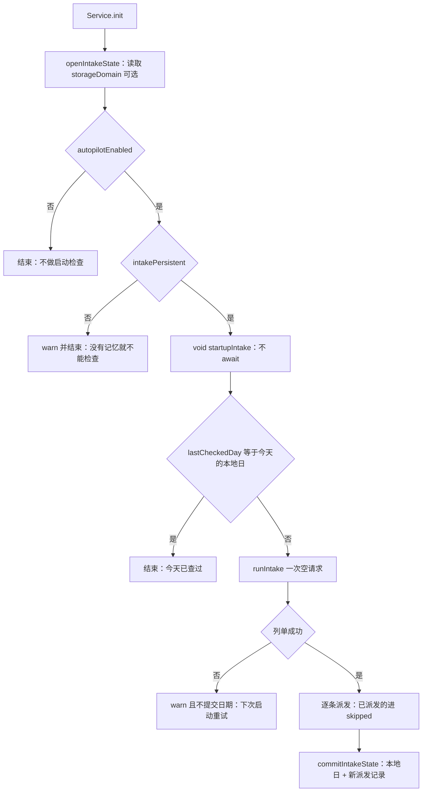
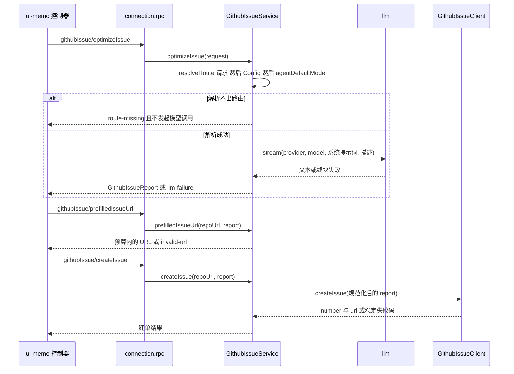

# GitHub issue 服务（宿主）

`GithubIssueService` 是整个仓库里唯一把「失败分析 → 结构化 issue 正文 → 真的建单 → 把 issue 交给一个会话」串成一条链的宿主服务。它以服务键 `githubIssue` 挂在 cordis 上，是 `TypertRemoteService` 的子类，把七个方法标注成 `@Remote` 端点；包本身没有浏览器半边（`package.json` 里只有 `dsh.bundle`，没有 `dsh.client`，`src/client.ts` 只是 `export type * from './types.ts'` 的类型投影），所以它是**被 UI 插件消费的后端**，而不是一个能自己点开的功能面（[index.ts](../../packages/github-issue/dsh-github-issue/src/index.ts#L377-L386)、[client.ts](../../packages/github-issue/dsh-github-issue/src/client.ts#L1-L10)、[package.json](../../packages/github-issue/dsh-github-issue/package.json#L45-L66)）。

这条链上的每一步都有独立的失败语义和独立的依赖要求，这正是本页要讲清的东西：哪些能力在没有遥测、没有存储、没有 Web 会话组件时依然可用，哪些会以一个稳定失败码收场，以及哪些失败事实必须留住。

## 服务身份与唯一的硬依赖

```ts
export class GithubIssueService extends TypertRemoteService {
  static inject = ['llm']
  static Config = Config
```

`inject` 里只有 `llm` 一项，这是刻意的选择而不是遗漏（[index.ts](../../packages/github-issue/dsh-github-issue/src/index.ts#L233-L251)、[index.ts](../../packages/github-issue/dsh-github-issue/src/index.ts#L1100-L1114)）：

| 协作者 | cordis 服务键 | 读取方式 | 缺失时的后果 |
|---|---|---|---|
| 模型运行时 | `llm` | `static inject`（硬依赖）+ `ctx.get('llm')` | 服务不激活 |
| 遥测 | `telemetry` | `ctx.get('telemetry')`，声明为结构化 `TelemetrySink` | 不记录事件，业务行为不变 |
| 存储域 | `storageDomain` | `optionalService(ctx, 'storageDomain')` | 无持久状态：接单仍可跑，但每日启动检查关闭 |
| 会话控制器 | `sessionController` | `optionalService(...)` | 派发能力整体不可用，报 `session-unavailable` |
| Agent 注册表 | `agents` | `optionalService(...)` | 同上 |
| 部署默认模型 | `agentDefaultModel` | `ctx.get('agentDefaultModel')?.currentSelection()` | 路由解析少一级 |

理由写在 `TelemetrySink` 的注释与 README 里：遥测是诊断依赖，一个诊断依赖绝不该成为服务拒绝激活的理由；存储与会话组件属于 Web 组合，缺了它们应该少一项能力，而不是整包装不上。于是 `static inject` 只保留「没有它这个方法根本没有意义」的那一个，其余全部按需读取并在缺失处返回稳定失败（[index.ts](../../packages/github-issue/dsh-github-issue/src/index.ts#L297-L339)、[index.ts](../../packages/github-issue/dsh-github-issue/src/index.ts#L779-L794)、[index.ts](../../packages/github-issue/dsh-github-issue/src/index.ts#L690-L693)）。测试把这条契约钉成两半：没有 `telemetry` 时成功与失败两次调用都照常返回（[github-issue.spec.ts](../../packages/github-issue/dsh-github-issue/tests/github-issue.spec.ts#L453-L474)），没有会话组件时派发明确报 `session-unavailable` 而不是伪造会话（[intake-service.spec.ts](../../packages/github-issue/dsh-github-issue/tests/intake-service.spec.ts#L146-L156)）。

## 方法一览：请求、结果、失败码、所需服务

七个 `@Remote` 方法分三组：两条模型路径、一条纯计算的 URL 构造，以及四条 GitHub 接单路径。接单的循环细节（何时算一天、去重与恢复）在 [Issue 自动接单循环](../workflows/issue-intake-autopilot.md) 展开，这里只记录每个方法自己的形状。

| 方法 | 请求要点 | 成功值 | 失败码 | 这条路径要什么 |
|---|---|---|---|---|
| `generateReport(request)` | `pluginIds`、`totalEvents`、`totalFailures`、`failureGroups[]`，可选 `window`、`provider`、`model` | `GithubIssueReport`，`labels` 固定 `['bug','telemetry']` | `route-missing`、`llm-failure` | `llm` + 可选 `agentDefaultModel`；遥测可选 |
| `prefilledIssueUrl(request)`（同步，不返回 Promise） | `repoUrl`（空串回落到 `Config.repoUrl`）、`report` | 预填 URL 字符串 | `invalid-url` | 什么都不需要：不碰模型、不碰 GitHub |
| `optimizeIssue(request)` | `description`，可选 `provider`、`model` | `GithubIssueReport`，`labels` 固定 `['bug']` | `empty-input`、`route-missing`、`llm-failure` | `llm` + 可选 `agentDefaultModel` |
| `createIssue(request)` | `repoUrl?`、`report` | `{ number, url }`（冻结） | 本地 `invalid-request`；之后是客户端码 `invalid-repo`、`auth-missing`、`auth-failure`、`rate-limited`、`invalid-request`、`http-failure`、`network-failure` | 每次调用新建一个 `GithubIssueClient`（token 已解析） |
| `listClaimableIssues(request = {})` | `repoUrl?`、`claimLabel?`、`max?` | `GithubIssueTask[]`（冻结） | 同上客户端码 | 同上 |
| `dispatchIssue(request)` | `issue`、`cwd?`、`agentPreset?` | `{ sessionId }` | `session-unavailable`、`dispatch-failed` | `sessionController` + `agents`；可选 `autopilotCwd` / `autopilotPreset` / `autopilotPrompt` |
| `runIntake(request = {})` | `repoUrl?`、`claimLabel?`、`max?`、`cwd?`、`agentPreset?` | `{ checkedAt, repoUrl, claimable, dispatched, skipped, failures }` | 列表失败**原样**返回（客户端码）；单条派发失败进 `failures` 数组 | 上面两组 + 可选 `storageDomain`（不挂仍能跑，只是不记忆） |

`GithubIssueFailureCode` 是这张表里接单部分的契约本身——`auth-missing`（没有凭据）与 `auth-failure`（凭据被拒）刻意分成两个码，因为这是两种修法不同的部署问题，消息只负责给人读（[types.ts](../../packages/github-issue/dsh-github-issue/src/types.ts#L138-L163)）。注意 `prefilledIssueUrl` 的 `invalid-url` **不在**这个联合里：它是预填这条纯路径自己的失败码，与 GitHub 的 HTTP 分类无关（[types.ts](../../packages/github-issue/dsh-github-issue/src/types.ts#L94-L105)）。把 HTTP 状态收敛成这些码的规则由 [GitHub REST 集成与凭据](../integrations/github-rest.md) 负责，本页只说上层怎么用。

`runIntake` 与 `listClaimableIssues` 的 `request` 带默认值 `{}`，所以「什么都不指定、全用配置」是一次合法调用；其余五个方法要求真正的请求体（[index.ts](../../packages/github-issue/dsh-github-issue/src/index.ts#L595-L599)、[index.ts](../../packages/github-issue/dsh-github-issue/src/index.ts#L634-L638)）。数量参数统一经 `clampCount` 收敛到 1..100 的整数，所以请求里传超过 20 的值仍然被接受——`maxIssuesPerRun` 的 schema 上界 20 只约束配置，不约束一次调用的 `max`（[index.ts](../../packages/github-issue/dsh-github-issue/src/index.ts#L1116-L1124)）。

### 模型路径：路由与失败事实

两条模型方法的骨架相同：先解析路由，解析不出就**不发起调用**，直接返回 `route-missing`；解析出来才走 `streamLlmText`，失败时把 DSH 的码、消息与 HTTP 状态拼进 `llm-failure` 的消息里。区别只在**先后**：`optimizeIssue` 先判空描述（`empty-input`）再解析路由，`generateReport` 没有输入校验。标题从模型输出的第一个 `## ` 标题取，取不到时 `generateReport` 回落到 `Telemetry failures in <pluginIds>`、`optimizeIssue` 回落到 `New issue`（[index.ts](../../packages/github-issue/dsh-github-issue/src/index.ts#L497-L556)、[index.ts](../../packages/github-issue/dsh-github-issue/src/index.ts#L1038-L1046)）。

路由三级（请求 → 本服务 `Config` → 部署 `agentDefaultModel`）、`route-missing` 与 `llm-failure` 为什么必须分开、以及 `streamLlmText` 如何区分终块失败与真空响，都在 [模型路由与失败事实保全](../concepts/llm-route-and-failure-facts.md)。本服务这一侧值得单独记住的一点是 `firstNonBlank`：空白按「未提供」丢掉并 trim，所以一个 `provider: ''` 的请求不会遮蔽下一级，而 `Config.provider` / `Config.model` 是构造函数里复制进实例字段的，改了要重新挂载才生效（[index.ts](../../packages/github-issue/dsh-github-issue/src/index.ts#L417-L430)、[index.ts](../../packages/github-issue/dsh-github-issue/src/index.ts#L483-L489)）。

### 报告提示词只喂分析给出的事实

`generateReport` 的用户提示词由 `buildReportUserPrompt` 从分析结果逐字拼出：插件清单、分析窗口、事件与失败总数，然后每个失败组一行 `featureCodeRef`、`count`、可选的 `errorCode` / `errorMessage`、`route`、`lastFailureAt`、`attemptsAfterLastFailure`。**分析没有携带的事实不会被省略，而是写成 `not recorded`**；`pluginIds` 为空或 `window` 缺失同样落到这个词，失败组为空时写 `(none)`。这样模型分不清「没记」与「没事」的可能性就被消掉了（[index.ts](../../packages/github-issue/dsh-github-issue/src/index.ts#L1000-L1036)、[index.ts](../../packages/github-issue/dsh-github-issue/src/index.ts#L208-L209)）。

系统提示词是与它配套的另一半约束：只引用分析里出现的事实，不准提分析没有证据的机制（采样参数、token 预算、超时、分块、流式、响应解析被逐一点名），必须报告窗口与每组的路由/最近失败时间/之后又跑了几次、并说明「没有再次复现的失败不是当前缺陷」，缺失事实写 `not recorded`，且**禁止**写「需要补采集」——因为一个缺失的事实既可能是更早的事件也可能是缺口，而报告分不出（[index.ts](../../packages/github-issue/dsh-github-issue/src/index.ts#L253-L295)）。测试三向钉住：有值的三元组原样进提示词、全缺时四处 `not recorded`、系统提示词里那句禁令仍在（[github-issue.spec.ts](../../packages/github-issue/dsh-github-issue/tests/github-issue.spec.ts#L273-L344)）。

### 预填 URL：预算按合成后的 URL 计算

`prefilledIssueUrl` 先校验 `repoUrl`：空串回落到 `Config.repoUrl`，然后必须匹配 `^https://github\.com/[^/]+/[^/]+$`，否则 `invalid-url`。这条校验比传输层的仓库解析**更窄**：`GithubIssueClient` 接受任意 host（GitHub Enterprise 靠独立的 `apiBaseUrl` 工作），但预填 URL 是给浏览器打开的 github.com 链接，所以企业部署能建单、却拿不到预填链接（[index.ts](../../packages/github-issue/dsh-github-issue/src/index.ts#L523-L533)、[github.ts](../../packages/github-issue/dsh-github-issue/src/github.ts#L67-L79)）。

真正的规则在 `buildPrefillUrl` 里，四条一起才成立（[index.ts](../../packages/github-issue/dsh-github-issue/src/index.ts#L1053-L1097)）：

1. **预算检查在合成后的 URL 上**，不是在正文长度上。`compose(body)` 用 `URLSearchParams` 组装 `title`、`body`、`labels` 三个参数，所以标题与标签花的是同一笔预算，且百分号编码会把它们放大——按正文长度定的规则依然会产出 GitHub 拒收的 URL。
2. **缩短是重复的，直到装得下。** 首轮若超限，每轮从正文尾部按「当前超出量」多切一点（至少 1 个字符）后重新合成；每轮至少消掉自己量到的溢出，所以几次内收敛，`MAX_PREFILL_TRUNCATION_PASSES = 32` 只是防病态输入空转。字符编码成多个 URL 字符时会多切一些，而多切只会更短。
3. **截断标记随正文一起进 URL。** `prefillTruncationNote` 被拼在被截断正文之后，读者因此知道这是部分正文；测试同时断言「保留部分是原文前缀」与「保留部分以标记结尾」，防止截断把正文弄乱。
4. **标记本身也超限时，正文只剩标记。** 这一支到达时说明标题一项就把预算吃光了；继续缩短标题等于谎报报告主题，所以正文让出全部空间，代码选择发出「最长的仍能装下的东西」而不是一个 GitHub 会拒绝的 URL。

`maxPrefillUrlLength <= 0` 关掉整段缩短逻辑，原样返回完整 URL。测试把预算规则测得很细：400 字符预算下的长正文必须变短且保留前缀、标题与标签各占预算（80 字符标题 + 40 字符标签 + 2000 字符正文仍必须 ≤ 400）、标题独占预算时正文退化成标记、`0` 关闭缩短（[github-issue.spec.ts](../../packages/github-issue/dsh-github-issue/tests/github-issue.spec.ts#L57-L116)）。

### 直接建单：正文规范化与本地先拒

`createIssue` 在碰 GitHub 之前做完全部本地判定：`title` 必须是字符串且 trim 后非空，`body` 必须是字符串，否则 `invalid-request`；`labels` 逐项 trim 并丢掉空名。正文经 `issueBody` 处理——`optimizeIssue` 会把标题重复写成正文第一行的 `## 标题`（这样同一段文本既能填预填表单也能直接提交），而 GitHub 的标题是独立字段，照发就会显示两遍标题，所以首个 `## ` 行被删掉、其后空行一并清掉、CRLF 归一化、末尾空白 trim（[index.ts](../../packages/github-issue/dsh-github-issue/src/index.ts#L568-L588)、[intake.ts](../../packages/github-issue/dsh-github-issue/src/intake.ts#L34-L51)）。测试断言发出去的 JSON body 里既没有那个标题行、也没有空标签，且空标题的请求一次 fetch 都不发（[intake-service.spec.ts](../../packages/github-issue/dsh-github-issue/tests/intake-service.spec.ts#L43-L74)、[intake.spec.ts](../../packages/github-issue/dsh-github-issue/tests/intake.spec.ts#L13-L25)）。

有了这一步，「格式化 issue」和「提交 issue」才合成一步——预填 URL 需要用户打开表单再按 Submit，从而没人能自动接手这个 issue。这个能力也是仓库里被点名「turn 之间的一次点击就替用户做成有外部后果的事」的案例之一，权限与审批视角见 [敏感能力与审批边界](../concepts/capability-and-approval-boundaries.md)。

### 认领清单与派发

`listClaimableIssues` 只是把仓库、标签、数量解析好交给客户端；PR 剔除、标签大小写不敏感复核都在客户端做（[github.ts](../../packages/github-issue/dsh-github-issue/src/github.ts#L142-L173)）。

`dispatchIssue` 与 `runIntake` 都落到私有的 `dispatch`，三步都照实失败，不伪造成功（[index.ts](../../packages/github-issue/dsh-github-issue/src/index.ts#L678-L730)）：

1. `sessionController.create({ cwd?, agentPreset? })`——走控制器而不是 Agent 注册表，是为了让派发出的会话带上部署的 preset 与工作区归属策略，和用户从 Web 里手动开的会话一致；抛错即 `dispatch-failed`。
2. `agents.get(sessionId).agent.followup(...)`——会话建好但没有发布出活着的 Agent、或提示词被拒，同样是 `dispatch-failed`。提示词由 `renderDispatchPrompt` 用 `{number}`/`{title}`/`{url}`/`{body}`/`{labels}` 渲染配置模板，未知占位符**原样保留**，让模板里的笔误看得见（[intake.ts](../../packages/github-issue/dsh-github-issue/src/intake.ts#L53-L73)、[intake.spec.ts](../../packages/github-issue/dsh-github-issue/tests/intake.spec.ts#L27-L43)）。
3. `rename` 是尽力而为：它是呈现而不是派发契约的一部分，失败只 `warn`，标题截到 120 字符。

`runIntake` 在派发之前先做去重：已派发过的 issue 号进 `skipped`，新面孔进 `fresh`，再截到 `max` 条按顺序派发；派发失败的条目进 `failures` 而整个 pass 仍然 `ok: true`（[index.ts](../../packages/github-issue/dsh-github-issue/src/index.ts#L634-L676)）。

## 状态与生命周期：本地日、去重与持久行

接单状态只有一行：最后完成的那一天，以及已经派发出去的 issue 记录。它声明为一个 storage-domain 域 `github_issue_intake`（版本 0，单表 `state`，键 `intake`），整体在运行时用 zod 校验；`@deepseek-ai/dsh-storage-domain` 是可选 peer，所以 `createIntakeDomain` 用动态 import，缺包时丢的是「每日检查」而不是整个插件（[spec.ts](../../packages/github-issue/dsh-github-issue/src/spec.ts#L34-L69)、[package.json](../../packages/github-issue/dsh-github-issue/package.json#L55-L66)）。没有存储时状态是冻结的空行，`intakePersistent` 保持 false（[index.ts](../../packages/github-issue/dsh-github-issue/src/index.ts#L341-L354)）。



图：启动检查的判定顺序，以及「日期只在列单成功后才提交」这条不变式。

四条不变式值得记住：

- **启动检查不 await，也不阻塞启动。** `[Service.init]` 先开状态，然后 `void this.startupIntake()`；GitHub 慢或不可达不该拖住宿主开机，失败只 warn，下一次启动重试（[index.ts](../../packages/github-issue/dsh-github-issue/src/index.ts#L450-L467)、[index.ts](../../packages/github-issue/dsh-github-issue/src/index.ts#L751-L770)）。
- **没有持久状态就不检查。** 没有「已经派发过什么」的记忆，重启就会给同一个 issue 开第二个会话，所以代码宁可不跑；测试用「不挂存储 + 打开 autopilot」验证 fetch 一次都没发生（[intake-service.spec.ts](../../packages/github-issue/dsh-github-issue/tests/intake-service.spec.ts#L182-L189)）。
- **日期在列单成功之后才提交。** 列单失败时 `runIntake` 直接把失败返回，`commitIntakeState` 根本没被调到，于是那次「今天」没有被记住（[intake-service.spec.ts](../../packages/github-issue/dsh-github-issue/tests/intake-service.spec.ts#L127-L133)）。
- **同一条 issue 永不二次派发，跨天也不。** 判断用的是 `dispatched` 里的 issue 号集合，与日期无关；历史记录只保留最近 `MAX_DISPATCH_HISTORY = 500` 条，纯粹防止单个 JSON 文档无限增长（[intake-service.spec.ts](../../packages/github-issue/dsh-github-issue/tests/intake-service.spec.ts#L77-L100)）。

提交时**先更新内存，再落盘**：durable 写失败只 warn 并说明后果（「后续 pass 可能重复派发同一个 issue」），而不是假装写成功。这一点很实际——同进程的下一次 pass 看到的仍是已派发状态（[index.ts](../../packages/github-issue/dsh-github-issue/src/index.ts#L796-L820)）。

「今天」按 IANA 时区算，`localDayKey` 用 `Intl.DateTimeFormat` 取年月日，空时区跟随宿主；`autopilotTimeZone` 每次使用都重读，非法值回落到宿主时区并对每个新值只 warn 一次，不让一个拼错的时区把启动检查或派发打断（[intake.ts](../../packages/github-issue/dsh-github-issue/src/intake.ts#L75-L115)、[index.ts](../../packages/github-issue/dsh-github-issue/src/index.ts#L432-L448)）。测试同时钉住跨时区语义（`2026-11-01T16:30Z` 在上海是 11-02）与非法时区的回落（[intake.spec.ts](../../packages/github-issue/dsh-github-issue/tests/intake.spec.ts#L45-L63)、[config-volatile.spec.ts](../../packages/github-issue/dsh-github-issue/tests/config-volatile.spec.ts#L111-L118)）。

## 凭据解析

token 只解析一次：`Config.token` → `process.env[Config.tokenEnv]`（默认变量名 `GITHUB_TOKEN`，名字为空则跳过）→ `Config.tokenCommand` 的标准输出（默认 `gh auth token`，让已登录 GitHub 的机器无需额外 secret）。命令带 `tokenCommandTimeoutMs`、`windowsHide` 与 64KB 缓冲上限，失败只 warn 并当作「没有凭据」；`tokenResolved` 一旦置真就不再重试，所以「没有凭据」是一个结果而不是每次请求都重跑一次子进程。**token 从不进日志。** 三段解析的完整机制、以及 `gh auth token` 这个默认值的运维含义，在 [GitHub REST 集成与凭据](../integrations/github-rest.md) 有更细的流程与失败分类（[index.ts](../../packages/github-issue/dsh-github-issue/src/index.ts#L836-L866)）。

## 遥测：成功也带路由

事件都记在插件 id `github-issue` 下，code 里的 feature 锚点是 `github-issue:<action>`。成功事件由 `track` 写：`generateReport` 额外带被分析的 `pluginIds`，`optimizeIssue` 带路由，`createIssue` 带 issue 号，`dispatchIssue` 带 issue 号与会话 id，`startupIntake` 带派发条数。失败事件由 `trackError` 写：`createIssue`、`listClaimableIssues`、两条模型方法的 `llmFailure` 与 `routeMissing`（[index.ts](../../packages/github-issue/dsh-github-issue/src/index.ts#L868-L984)）。

三处设计判断值得抄：

- **成功事件也带 `provider`/`model`。** 只在坏的时候记路由，事后无法回答「现在服务这些调用的还是不是同一条路由」。
- **失败保留原码 + 路由 + 状态。** `llmFailure` 把 DSH 的 `code`/`message` 写进消息与事件，`status` 进元数据，所以 `NO_ADAPTER`、`AUTH`、`RATE_LIMIT`、`EMPTY_RESPONSE` 事后仍可区分（[github-issue.spec.ts](../../packages/github-issue/dsh-github-issue/tests/github-issue.spec.ts#L347-L451)）。
- **「没有路由」记成 `NO_MODEL_ROUTE`**，与 `dsh-memo` 用同一个码，所以一份套件级报告能把两个包按同一条线索归组（[index.ts](../../packages/github-issue/dsh-github-issue/src/index.ts#L211-L231)）。

没有遥测时行为不变：这正是它不进 `static inject` 的验证点。

## 浏览器可达性：哪几个方法真的有消费者

七个方法都在 `@Remote` 上，所以都有线上名字；但「可寻址」不等于「有消费者」。仓库里的实际情况是：

| 方法 | 有谁在调 | 从浏览器到得了吗 |
|---|---|---|
| `optimizeIssue` | `ui-memo` 的 issue 编辑器 | 是 |
| `prefilledIssueUrl` | `ui-memo` 的 issue 编辑器；`dsh-memo` 的 `analyzeLogs`（进程内） | 是 |
| `createIssue` | `ui-memo` 的「直接提交到 GitHub」 | 是 |
| `generateReport` | 只有 `dsh-memo` 的 `analyzeLogs`，进程内直接调 | 线上可达，但没有浏览器消费者 |
| `listClaimableIssues` | 只有本服务的 `runIntake` | 线上可达，但没有消费者 |
| `dispatchIssue` | 无（仓库内没有调用者） | 线上可达，但没有消费者 |
| `runIntake` | 只有启动钩子 `startupIntake` | 线上可达，但没有消费者 |



图：issue 编辑器的三条路径各落到哪个协作者——模型路径经 `llm`，预填路径只在本服务内计算，建单路径经 `GithubIssueClient`。

面板侧的三次调用都在 `ui-memo` 的控制器里：`optimizeIssue` 只发 `description`（除非用户明确选了模型，才附加 `provider`/`model`——浏览器不参与路由解析），`prefilledIssueUrl` 与 `createIssue` 都发 `{ repoUrl, report }`，并把 `repoUrl` 交给宿主校验，所以 URL 长度预算与凭据永远留在宿主侧（[controller.ts](../../packages/client/ui-memo/src/client/controller.ts#L983-L1072)）。`generateReport` 的消费方式是另一种：`analyzeLogs` 把 memo 自己解析出的路由作为请求覆盖传下去，再拿回报告与预填 URL，整条链的时序见 [日志分析到 issue](../workflows/log-analysis-to-issue.md)（[index.ts](../../packages/memo/dsh-memo/src/index.ts#L1638-L1685)）。

因此单独安装这个包**不会给用户任何可点开的东西**：它只插入一行组合（`github-issue` 这个 entry id 由它独占，`dsh-memo` 只 inject 而不插入，所以独立安装与 memo 套件安装能干净共存），剩下的作用面就是别的插件 `ctx.get('githubIssue')` 拿到这个服务（[cordis.patch.yml](../../packages/github-issue/dsh-github-issue/cordis.patch.yml#L1-L30)、[index.ts](../../packages/memo/dsh-memo/src/index.ts#L649-L651)）。

## 配置与生效时机

`Config` 有 18 个字段，其中 8 个是 `.volatile()`——`repoUrl`、`claimLabel`、`maxIssuesPerRun` 与五个 `autopilot*`。这条分界决定「改一个值要不要重启」：

- **volatile 字段在使用点读 ref**（`this.config.repoUrl.get()`、`claimLabel.get()`、`maxIssuesPerRun.get()`、`autopilotPrompt.get()`），所以设置面板写入经 Loader 原地提交后，下一次调用就用了新值，不需要重挂。
- **其余字段在构造时复制进实例**（`maxPrefillUrlLength`、`prefillTruncationNote`、`provider`、`model`、`token`、`tokenEnv`、`tokenCommand`、`tokenCommandTimeoutMs`、`apiBaseUrl`、`requestTimeoutMs`），属于部署级，改了要改 `cordis.yml` 并重挂。
- `autopilotEnabled` 只在 `[Service.init]` 读一次：改了它，从**下一次宿主启动**起生效。

`config-volatile.spec.ts` 把两半都钉住：恰好这 8 个字段带 volatile 标记（面板少一个字段不会报错，只会静默消失），以及「原地提交的值在下一次 pass 就被使用」（[config-volatile.spec.ts](../../packages/github-issue/dsh-github-issue/tests/config-volatile.spec.ts#L70-L109)）。热生效语义本身见 [配置与热生效](../concepts/configuration-and-live-settings.md)。

## 测试锚点

| 文件 | 钉住的契约 |
|---|---|
| [github-issue.spec.ts](../../packages/github-issue/dsh-github-issue/tests/github-issue.spec.ts#L17-L117) | 预填 URL 的形状、`invalid-url`、`repoUrl` 回落、四条预算规则 |
| [github-issue.spec.ts](../../packages/github-issue/dsh-github-issue/tests/github-issue.spec.ts#L119-L247) | `empty-input`、路由优先级三级、空白按缺失、`route-missing` 时不发调用、失败码保留原码 |
| [github-issue.spec.ts](../../packages/github-issue/dsh-github-issue/tests/github-issue.spec.ts#L249-L344) | 报告提示词只含分析给出的事实、缺失写 `not recorded`、系统提示词的禁令与版式 |
| [github-issue.spec.ts](../../packages/github-issue/dsh-github-issue/tests/github-issue.spec.ts#L347-L474) | 成功的路由元数据、失败的原码 + 路由 + feature 锚点、`NO_MODEL_ROUTE`、无遥测时照常工作 |
| [github.spec.ts](../../packages/github-issue/dsh-github-issue/tests/github.spec.ts#L14-L112) | 仓库解析、Bearer 头、HTTP 状态到稳定码的分类、传输错误、PR 与标签过滤 |
| [intake-service.spec.ts](../../packages/github-issue/dsh-github-issue/tests/intake-service.spec.ts#L43-L189) | 建单前拒绝空标题/null；派发后下次 pass 跳过；日期与记录持久化；列单失败不记日期；无会话组件时报 `session-unavailable`；启动检查的三个分支 |
| [intake.spec.ts](../../packages/github-issue/dsh-github-issue/tests/intake.spec.ts#L13-L63) | `issueBody` 去标题行、占位符渲染与未知占位符保留、本地日与时区校验 |
| [config-volatile.spec.ts](../../packages/github-issue/dsh-github-issue/tests/config-volatile.spec.ts#L70-L118) | 8 个 volatile 字段、原地提交即时生效、非法时区回落 |

## 改动这块时要守住的东西

- **一个 `@Remote` 方法只能有一个名为 `request` 的形参。** 线上是 `{ args: { request } }` 的按名绑定，多一个形参就是一个客户端永远发不到的位置。这个包的七个方法都合规，但**没有任何源码扫描盖住它**：`remote-signatures.spec.ts` 硬编码读的是 memo 自己的 `src/index.ts`。要加第八个方法，得自己守这条规则（[remote-signatures.spec.ts](../../packages/memo/dsh-memo/tests/remote-signatures.spec.ts#L19-L56)、[index.ts](../../packages/github-issue/dsh-github-issue/src/index.ts#L497-L644)）。
- **新增可选依赖一律用 `optionalService` / `ctx.get`，不要加进 `static inject`。** 加进去就把「装不上」传染给每个部署，而这个包的独立性正是靠「诊断性、Web 专属的依赖全部可选」换来的。
- **新的失败要么复用 `GithubIssueFailureCode`，要么自成一条纯路径的码。** 别用一个码覆盖「没有凭据」和「凭据被拒」这类修法不同的情况。
- **派发的合规形态是「把工作交给 turn」，不要改成宿主自己动手。** `dispatchIssue` / `runIntake` 只建会话并排队提示词，真正动代码、跑工具、开 PR 的是那个会话的 agent turn，审批在那里才有 open turn 可用；`createIssue` 则属于尚未收口的「turn 之间的宿主副作用」，补一个对话框不算收口，详见 [敏感能力与审批边界](../concepts/capability-and-approval-boundaries.md)。
- **没有运行时不变式可依赖。** `invariant.ts` 只注册一个空安装函数并 `inject: ['githubIssue']`，理由是模型调用与 URL 构造都由本服务独占、不存在第二个权威；所以这里的约定全部靠测试而不是靠 invariants 兜底（[invariant.ts](../../packages/github-issue/dsh-github-issue/src/invariant.ts#L1-L27)）。
- **状态行只有一行。** 想改 `IntakeStateRow` 的形状就得同时改 zod schema 与域版本；往 `dispatched` 里塞别的东西会连带改变去重语义（去重判据是 issue 号集合）。
