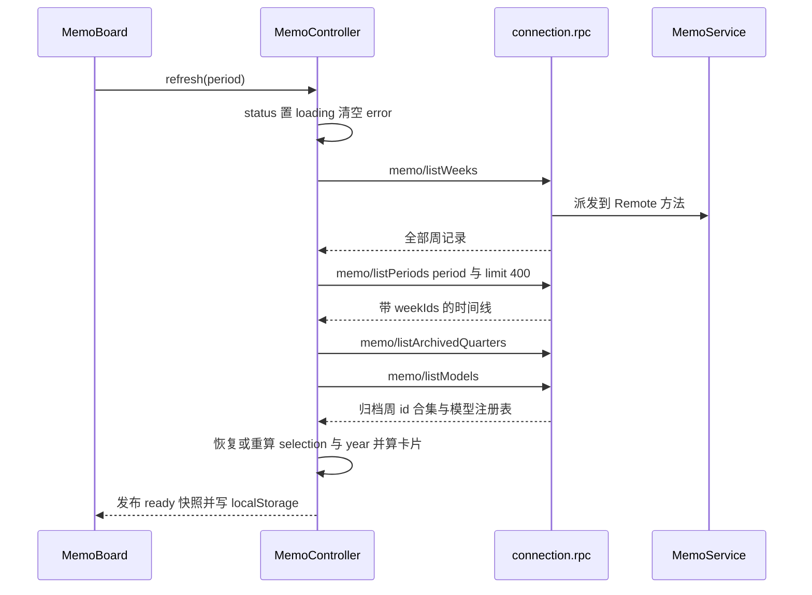

# 备忘看板 UI（浏览器）

备忘套件由两侧组成：宿主侧 `MemoService`（见[备忘服务](memo-service.md)）负责日历、存储、模型调用与归档；浏览器侧 `@zhangj1164/dsh-client-ui-memo` 只做一件事——把那批卡片画出来，并把用户的每个点击翻译成一次 `@Remote` 调用。这个包的 node 半边是空的 `apply()`（[index.ts](../../packages/client/ui-memo/src/index.ts#L1-L9)），真正的功能面通过 `exports["./client"]` 交付、由 `package.json` 的 `dsh.client` 声明发现，再经共享 preset 打成一个 CJS bundle。

本页讲的是这一半的内部结构：入口怎么注册、控制器发什么、卡片模型怎么算、哪个状态的归属在哪一侧，以及每个动作落在宿主的哪个方法上。两侧共用的命名与包装约定见[宿主 ⇄ 浏览器 Remote 契约](../architecture/host-client-remote-contract.md)；日历为什么只有一份答案见[四维周期日历](../concepts/period-calendar.md)。

## 一个 id，两处注册：侧栏只出字形

入口 `apply(ctx, config)` 在槽位服务上做两次注册，两次用的是同一个 id：

```ts
export const MEMO_PANEL_ID = 'memo'
export const MEMO_PANEL_ORDER = 30
```

- `sidebar.panellist` 的注册只带 `id`、`order` 与一个 `label` 函数（thunk）：字形组件 `MemoGlyph` 拿到侧栏按当前宽度给的 `size`，画一只 `currentColor` 描边的便签，`aria-hidden="true"`（[index.ts](../../packages/client/ui-memo/src/client/index.ts#L79-L94)、[index.ts](../../packages/client/ui-memo/src/client/index.ts#L144-L149)）。**按钮本身不归这个插件管**：侧栏自己渲染按钮、自己算无障碍名、自己维护激活态（激活色靠 `currentColor` 继承）。`label` 之所以是 thunk，是为了让侧栏按钮跟着当前语言走而不必订阅 locale 状态。
- `main` 的注册用同一个 id 作 `key`（[index.ts](../../packages/client/ui-memo/src/client/index.ts#L151-L160)）。于是「选中这个 id」在布局里就等价于「打开备忘看板」，不需要任何额外的映射表。

面板是作为 **React 元素**挂上去的（`React.createElement(MemoBoard, {...})`），而不是直接调用组件函数。这条细节有回归来历：早先的实现是 `MemoBoard({...})`，钩子在渲染之外执行，面板一打开就抛 `Invalid hook call`；`entry.spec.tsx` 因此断言注册出去的是一个合法元素（[entry.spec.tsx](../../packages/client/ui-memo/tests/entry.spec.tsx#L195-L201)）。

关闭不是组件内部状态，而是**一次布局导航**：

```ts
const close = (): void => { ctx.layout.selectPanel(CONVERSATION_PANEL_ID) }
```

`CONVERSATION_PANEL_ID = 'conversation'` 是布局留给会话面板的协议常量，不是部署变量（[index.ts](../../packages/client/ui-memo/src/client/index.ts#L39-L45)、[index.ts](../../packages/client/ui-memo/src/client/index.ts#L138-L142)）。测试把「按关闭 → 布局收到 `conversation`」钉成一条用例（[entry.spec.tsx](../../packages/client/ui-memo/tests/entry.spec.tsx#L203-L212)）。

这个入口只注册这两项，**不再注册 `settings.section`**：同一个控制器如果在两处生效，会出现两份并存的看板（[entry.spec.tsx](../../packages/client/ui-memo/tests/entry.spec.tsx#L122-L127)）。配置页由兄弟包 `@zhangj1164/dsh-client-ui-memo-settings` 通过 `settings.section` 提供，与看板互不影响（[index.ts](../../packages/client/ui-memo-settings/src/client/index.ts#L1-L8)）。

其余三件装配工作都在 `apply()` 里：

| 装配项 | 做法 | 释放方式 |
|---|---|---|
| 样式 | 把 `styles.ts` 导出的 `CSS_TEXT` 写进 `<style data-dsh-plugin="memo">` 挂到 `document.head`；颜色全是 `--dsw-alias-*` token，主题切换不需要 JS | `ctx.effect` 的 disposer 移除节点 |
| 词典 | `ctx.locale.register('memo', { zh, en })` | 同上 |
| 控制器 | `new MemoController({ rpc: connection.rpc, repoUrl, locale: () => ctx.locale.getLocale().active })` | `ctx.effect(() => () => controller.dispose(), ...)` |

要求注入的服务是 `['slots', 'layout', 'locale', 'theme', 'connection']`（[index.ts](../../packages/client/ui-memo/src/client/index.ts#L63-L67)）。`connection` 缺失时不抛异常，只 `console.error` 后返回——这条也有用例（[entry.spec.tsx](../../packages/client/ui-memo/tests/entry.spec.tsx#L262-L274)）。`Config` 里唯一的部署变量是 `repoUrl`（默认 `DEFAULT_REPO_URL`），它是 issue 编辑器「建单」时要写的仓库，插件不硬编码它（[index.ts](../../packages/client/ui-memo/src/client/index.ts#L47-L61)）。

看板还从入口拿到三个 shell 能力：`close`、`openUrl`（`window.open(url, '_blank', 'noopener,noreferrer')`）与 `copyText`（`navigator.clipboard.writeText`）。它们是 props 而不是模块级调用，测试因此可以注入替身（[index.ts](../../packages/client/ui-memo/src/client/index.ts#L154-L160)、[MemoBoard.tsx](../../packages/client/ui-memo/src/client/MemoBoard.tsx#L32-L44)）。

## `{ args: { request } }` 与双层信封

浏览器这一侧完全不生成 descriptor，只发一条字符串 endpoint，包装函数是同一条形状的三个薄壳：

```ts
await rpc.call('/api', `${service}/${method}`, { args: { request } })
```

`callRemote(rpc, service, method, request)` 负责拼 channel、拼 `${service}/${method}`、把请求塞进 `args.request`，然后**只解传输信封**：`envelope.ok && envelope.value !== undefined` 时把内层业务结果原样返回；否则用 `envelope.error` 合成失败（缺 `code` 时兜底 `transport-failure`），`rpc.call` 抛异常则返回 `rpc-failure`（[controller.ts](../../packages/client/ui-memo/src/client/controller.ts#L77-L110)）。`callMemo` 与 `callGithubIssue` 只是把服务名固定成 `'memo'` / `'githubIssue'`（[controller.ts](../../packages/client/ui-memo/src/client/controller.ts#L112-L141)）。

因此每个动作都要读两层的 `ok`：一层是通道，一层是业务。看板是同一个插件里少见的**双服务**消费者——卡片写 `memo/*`，issue 编辑器写 `githubIssue/*`，而后者只作为类型投影被引用，运行时仍是同一条 RPC 通道。两层信封为什么不能省、以及无参方法也必须保留 `request` 形参的原因，见[宿主 ⇄ 浏览器 Remote 契约](../architecture/host-client-remote-contract.md)。

## 控制器：不可变视图状态 + 动作

`MemoController` 是「一份快照 + 一组动作」的经典 store：`getSnapshot()` 返回当前引用，`subscribe(fn)` 收订阅，私有 `set(patch)` 用 `{ ...state, ...patch }` 换掉整个对象再通知（[controller.ts](../../packages/client/ui-memo/src/client/controller.ts#L293-L308)）。`dispose()` 置位并把监听清空，之后 `emit()` 直接返回，所以插件重载不会留下第二份订阅。React 一侧由 `useView` 把它接进 `useState`，快照引用变化才重渲染（[MemoBoard.tsx](../../packages/client/ui-memo/src/client/MemoBoard.tsx#L1237-L1245)）。

`MemoViewState` 的字段可以按职责分成五组（[controller.ts](../../packages/client/ui-memo/src/client/controller.ts#L143-L219)）：

| 组 | 字段 | 说明 |
|---|---|---|
| 加载 | `status`（`cold` / `loading` / `ready` / `error`）、`error`、`busy` | `status` 描述整块数据的生命周期，`busy` 描述单次动作是否在飞 |
| 时间线 | `weeks`、`selection`、`periods`、`visiblePeriods`、`years`、`year` | `periods` 是该维度未过滤的全量时间线，`visiblePeriods` 是当前年份下真正要渲染的标签 |
| 卡片 | `cards`、`totalCards` | `totalCards` 让空态能区分「一条都没有」与「这个周期没有」 |
| 生成物 | `analysis`、`report`、`logAnalysis`、`issueReport`、`analysisProvider`、`analysisModel` | 都是视图态，不是存储数据 |
| 归档与路由 | `archivedWeekIds`、`archivedQuarters`、`routeProvider`、`routeModel`、`providers`、`catalogError`、`modelChoice` | 全部由宿主解析后原样保留，浏览器只读 |

### `refresh`：一次加载做四件事



图：一次 `refresh` 的四条宿主调用，以及本地重算与落盘的位置。

顺序与失败语义都写在 `refresh(period?)` 里（[controller.ts](../../packages/client/ui-memo/src/client/controller.ts#L321-L400)）：

1. 先把 `status` 置 `loading`、清空 `error`，并把 `selection.period` 改成目标维度。
2. `memo/listWeeks` 失败 → `status: 'error'` 并带着宿主消息返回；成功则把结果拷成数组。
3. `memo/listPeriods` 带 `{ period, limit: 400 }`。**400 是刻意的**：宿主把 `limit` 夹在 1..400，而标签规则与年份切换器都从这一条时间线推出来，取短了就会静默隐藏年份切换器本该提供的年份（[controller.ts](../../packages/client/ui-memo/src/client/controller.ts#L77-L85)）。失败同样落到 `error`。
4. 再读归档季度与模型注册表。这两条**不会**把整块数据打成错误态：归档读失败只换一句警告（卡片仍显示为可编辑），模型注册表读失败只写 `catalogError`（看板照常 `ready`）。
5. 恢复选中项、算 `years` / `year` / `visiblePeriods` / `selection` / `cards` / `totalCards`，一次 `set()` 发布，最后 `writeSelection`。

两个派生 getter 也在这里：`targetWeek` 找出当前选中周期拥有的 `weekIds`，交给 `targetWeekId` 决定新增落点；`activePeriod` 返回选中项对应的 `MemoPeriodEntry`（[controller.ts](../../packages/client/ui-memo/src/client/controller.ts#L310-L319)）。

`refresh` 有两个触发点，而不是一个：

- **看板挂载时**：`status === 'cold'` 就跑一次 `refresh()`（[MemoBoard.tsx](../../packages/client/ui-memo/src/client/MemoBoard.tsx#L166-L168)）。控制器自己不预加载，`cold` 因此是「没人要过数据」的准确表示。
- **通道重置时**：`apply()` 里挂 `ctx.on('connection/reset', () => void controller.refresh())`（[index.ts](../../packages/client/ui-memo/src/client/index.ts#L130)）。断线重连后宿主可能已经换了一套数据，看板必须重新读，而不是信任内存里的那份。`entry.spec.tsx` 用「先把首次加载的调用清空，再触发事件，断言又出现 `memo/listWeeks`」把这条钉住（[entry.spec.tsx](../../packages/client/ui-memo/tests/entry.spec.tsx#L229-L240)）。

## 四维时间线与卡片模型（`logic.ts`）

`logic.ts` 是这一半唯一的纯模块：不碰 React、不碰 RPC、不碰 DOM（唯一的 IO 面是一个可选的 `StorageLike`），所以每条规则都能直接测。

**卡片模型。** `MemoCard` 是「一条 entry + 它所在的周」，`toCards(weeks)` 把所有周的 entry 摊平、带上 `weekId`，按 `createdAt` 倒序、同刻用 id 兜底排序；某周没有 `entries` 数组时按空处理（[logic.ts](../../packages/client/ui-memo/src/client/logic.ts#L14-L28)、[logic.ts](../../packages/client/ui-memo/src/client/logic.ts#L61-L82)）。

**归属只做成员判断。** `cardsInPeriod(cards, weekIds)` 把宿主给的 `weekIds` 装进 `Set`，然后看每张卡的 `weekId` 在不在里面。这里没有任何日期运算——周期归属是宿主算好的，浏览器只判断成员，这是「看板与时间线不可能给出两个答案」的实现方式（[logic.ts](../../packages/client/ui-memo/src/client/logic.ts#L84-L98)）。

**新增落点。** `targetWeekId(selection, weekIds, currentWeekId)` 的优先级是：当前周若在这个周期里就用当前周（新卡片立刻出现在眼前）→ 否则用周期的最后一个周（回填历史周期）→ 再否则用宿主给的当前周（宿主拒绝凭空造一个非当前周）。三者都没有时返回 `undefined`，`addCard` 会以「no target week for the selected period」收场（[logic.ts](../../packages/client/ui-memo/src/client/logic.ts#L100-L122)、[controller.ts](../../packages/client/ui-memo/src/client/controller.ts#L805-L820)）。

**标签与年份切换器都在本地算。** 四个维度的标签都以年份开头（`2026-W37`、`2026-09`、`2026-Q3`、`2026`），所以 `yearOf(label)` 就是取前四位，年份切换器和标签过滤因此都不需要额外宿主调用（[logic.ts](../../packages/client/ui-memo/src/client/logic.ts#L273-L285)）。

| 规则 | 函数 | 关键点 |
|---|---|---|
| 某个周期有没有备忘 | `periodHasCards(entry, withCards)` | 从卡片判断，**不看 `weekCount`**：宿主会为当前周建一条零 entry 的行，正数只说明有行不说明有备忘 |
| 渲染哪些标签 | `visiblePeriods(entries, cards, year, limit = 10)` | 先按年份过滤，再保留「`current` 或至少有一张卡」，最后截断到 `PERIOD_TAG_LIMIT`；当前周期无条件保留，否则用户无法往空周期里写 |
| 年份切换器提供哪些年 | `selectableYears(entries, cards, currentYear)` | 当前年份恒定在内，其余只保留「至少有一个标签」的年份，倒序 |
| 标签怎么显示 | `periodDisplay(period, label)` | 周缩成 `W37`，季度写成 `2026 Q3`，畸形标签原样透出而不是显示空白 |

（[logic.ts](../../packages/client/ui-memo/src/client/logic.ts#L287-L358)、[logic.spec.ts](../../packages/client/ui-memo/tests/logic.spec.ts#L220-L279)）

两条可推导的性质值得记住：年份切换**不发请求**（时间线在维度加载时就全在内存里，`selectYear` 只重算），而「切年份先于切标签」是必要顺序——一次会话总结可能落在早年的周上，先切年再切标签才不会让选中标签在界面上没有对应 chip（[controller.ts](../../packages/client/ui-memo/src/client/controller.ts#L748-L798)、[controller.ts](../../packages/client/ui-memo/src/client/controller.ts#L654-L662)）。

面板只是把这三个派生结果照原样画出来：维度行是四个 `role="tab"` 按钮（`PERIODS` 的顺序），年份下拉只在 `years` 非空时出现，历史 chip 行渲染 `visiblePeriods`（`data-current` 标宿主认定的当前周期）。所以「界面上少了某个年份或某个周期」永远可以回溯到 `logic.ts` 的两条过滤规则，而不是某个组件里的临时判断（[MemoBoard.tsx](../../packages/client/ui-memo/src/client/MemoBoard.tsx#L301-L340)）。

## localStorage：记住什么、什么时候不信它

三个键、两类记忆，读失败一律退化成默认值而不报错：

| 键 | 内容 | 读出时的校验 |
|---|---|---|
| `dsh-memo:period` | 维度 id | 必须是 `PERIODS` 里的四个之一 |
| `dsh-memo:label` | 周期标签 | 必须匹配该维度的正则（`labelMatches`） |
| `dsh-memo:model` | `{ provider, model }` 的 JSON | 两半都得是非空字符串；空串表示「没有选择」 |

（[logic.ts](../../packages/client/ui-memo/src/client/logic.ts#L49-L59)、[logic.ts](../../packages/client/ui-memo/src/client/logic.ts#L239-L255)、[logic.ts](../../packages/client/ui-memo/src/client/logic.ts#L184-L237)）

`StorageLike` 只有 `getItem` / `setItem`，所以「忘掉选择」被编码成写入空串而不是 `removeItem`。写入一律包在 `try/catch` 里：一个满的或被禁用的 localStorage 不值得让看板失败。

选中项的恢复不是照抄，而是一次三方裁决（[controller.ts](../../packages/client/ui-memo/src/client/controller.ts#L353-L371)）：

- 只有**显式切维度**（`refresh(period)` 带参数）才跳过 `readSelection`——用户的动作压过存储，因为存下的标签属于被离开的那个维度。
- 恢复出来的年份必须在 `years` 里，否则退回最新年份。
- 恢复出来的标签必须在 `visiblePeriods` 里（就是「该年还提供这个标签」），否则退到同年最新标签。理由写在代码里：恢复到一个看不见的周期，用户就没有出口。

当前周期归属由宿主的 `current` 字段给出，本地不重算。

**模型选择**的记忆与失效规则在控制器一侧：`usableChoice` 只在「注册表读到了且不含这个 provider」时丢弃选择并擦掉存储；读到 `catalogError` 表示注册表**未知**而非**为空**，这时保留选择，因为一次读取抖动不该静默改变模型（[controller.ts](../../packages/client/ui-memo/src/client/controller.ts#L479-L505)）。`selectModel(choice)` 只接受非空的两半、且 provider 必须是宿主刚报过的注册项，返回布尔值表示是否记下（[controller.ts](../../packages/client/ui-memo/src/client/controller.ts#L507-L532)）。发送时 `modelOverride()` 会再核一次注册表，避免两次加载之间 provider 消失（[controller.ts](../../packages/client/ui-memo/src/client/controller.ts#L908-L926)）。

## 每个用户动作落在哪个宿主方法

所有写入路径都是「发一条 Remote → 成功后 `refresh()`」，所以卡片状态永远来自重新读，而不是本地拼装。下表是看板动作与宿主方法的一一对应，供工作流页面接手时对照：

| 用户动作 | 控制器方法 | 发出的调用（服务 / 方法 / 关键字段） | 之后发生什么 |
|---|---|---|---|
| 写一条备忘并提交 | `addCard(content)` | `memo/addEntry` `{ weekId: targetWeek, type: 'text', content }` | `refresh()` |
| 编辑卡片并确认 | `updateCard(card, text)` | `memo/updateEntry` `{ weekId, entryId, content, force: true }` | `refresh()` |
| 复制卡片 | `duplicateCard(card, suffix)` → `addCard` | `memo/addEntry`（同一漏斗，内容后接副本后缀） | `refresh()` |
| 删除卡片并确认 | `deleteCard(card)` | `memo/deleteEntry` `{ weekId, entryId, force: true }` | `refresh()` |
| 归档本季度 | `archiveCurrentQuarter()` | `memo/archiveQuarter` `{ label }` | 只重读 `memo/listArchivedQuarters` |
| 取消归档 | `unarchiveQuarter(label)` | `memo/unarchiveQuarter` `{ label }` | 只重读 `memo/listArchivedQuarters` |
| 打开会话总结器 | `loadArchivedSessions()` | `memo/listArchivedSessions` `{}` | 结果交回对话框，不写看板状态 |
| 开始总结 | `summarizeSessions(ids, maxChars?)` | `memo/summarizeSession` `{ sessionIds, weekId, language, maxChars? }` | `refresh('week')` → 必要时先切年 → 切到写入周 |
| AI 分析（梳理 / 总结 / 分析） | `analyze(type)` | `memo/analyze` `{ period, periodLabel, analysisType, provider?, model? }` | 写 `analysis` 与「谁答的」 |
| 导出报告 | `exportReport()` | `memo/exportReport` `{ period, periodLabel, provider?, model? }` | 写 `report` 并 `downloadMarkdown` |
| 日志分析 | `analyzeLogs()` | `memo/analyzeLogs` `{}` | 写 `logAnalysis`（含预填 issue URL） |
| 优化 issue 描述 | `optimizeIssue(text)` | `githubIssue/optimizeIssue` `{ description, provider?, model? }` | 写 `issueReport` |
| 在 GitHub 打开预填表单 | `issuePrefillUrl()` | `githubIssue/prefilledIssueUrl` `{ repoUrl, report }` | `openUrl(url)` |
| 直接提交到 GitHub | `createIssue()` | `githubIssue/createIssue` `{ repoUrl, report }` | `openUrl(返回的 issue URL)` |
| 刷新 / 切维度 | `refresh()` / `selectPeriod(p)` | 见 `refresh` 一节的四条调用 | 重建时间线；切维度时先清 `analysis` 与 `report` |
| 切年份 / 切标签 | `selectYear(y)` / `selectLabel(l)` | **不发调用** | 只在本地时间线上重算卡片，并清掉过期结果与错误 |

（[controller.ts](../../packages/client/ui-memo/src/client/controller.ts#L805-L1072)、动作绑定见 [MemoBoard.tsx](../../packages/client/ui-memo/src/client/MemoBoard.tsx#L166-L260)、分析工具栏见 [MemoBoard.tsx](../../packages/client/ui-memo/src/client/MemoBoard.tsx#L404-L454)）

几处值得单独说明的取舍：

- **`force: true` 不是绕过校验，而是把确认前移。** 宿主对「写非当前周」要求 `force`，否则回 `past-week-requires-force`；看板在编辑对话框里先摆出 `forceConfirmText`（「该卡片属于历史周期，保存后 AI 分析结果可能变化」），再固定带 `force: true` 发出（[MemoBoard.tsx](../../packages/client/ui-memo/src/client/MemoBoard.tsx#L893-L923)、[locales.ts](../../packages/client/ui-memo/src/client/locales.ts#L68)）。宿主仍保留归档拒绝作为第二道门。
- **复制是新增，不是别名。** `duplicateCard` 走 `addCard`，因此副本有自己的 identity 与时间戳，并共享同一条归档守卫（[controller.ts](../../packages/client/ui-memo/src/client/controller.ts#L869-L877)）。
- **预填 URL 由宿主拼。** 看板只把 `repoUrl` 与 `report` 递过去；github-issue 服务拥有 URL 长度上限，正文超长时它会自己截短。浏览器若自行拼 URL 就绕开了这条规则（[controller.ts](../../packages/client/ui-memo/src/client/controller.ts#L1015-L1040)）。
- **导出走浏览器下载。** `downloadMarkdown` 造一个 `text/markdown` 的 Blob、`a[download]` 点一下、再 `revokeObjectURL`，文件名是 `memo-report-<label>.md`（[controller.ts](../../packages/client/ui-memo/src/client/controller.ts#L1145-L1161)）。
- **日志分析报告里的「复制完整正文」与 issue 编辑器的不是同一份。** 两个 `copied` 哨兵键（`issue-body` / `log-body`）分开，确认态才不会出现在用户没按的那颗按钮上（[MemoBoard.tsx](../../packages/client/ui-memo/src/client/MemoBoard.tsx#L46-L57)、[MemoBoard.tsx](../../packages/client/ui-memo/src/client/MemoBoard.tsx#L212-L252)）。

## 归档 = 只读叠加层，而不是另一套数据

浏览器拿到的归档答案只有两份：`archivedWeekIds`（所有已归档季度拥有的周 id 合集）与 `archivedQuarters`（季度本身，含 `label`、`archivedAt`、`weekIds`）。`readArchivedQuarters` 把宿主的返回冻结后重建这个 `Set`，只做合并，不做推导（[controller.ts](../../packages/client/ui-memo/src/client/controller.ts#L402-L432)）。

于是只读判断是一行成员测试，并且**跨四个维度一致**：一张卡只带 `weekId`，只要它落在集合里就是只读的，与用户当前在哪个维度翻看无关。

| 判断 | 方法 | 用途 |
|---|---|---|
| 这张卡只读吗 | `isArchived(card)` | 卡片槽位换成「取消归档」、详情对话框不给编辑 |
| 新增会写进归档吗 | `targetArchived` / `targetArchivedQuarter()` | 输入框禁用且直接在原处给出「取消归档」出口 |
| 当前季度已归档吗 | `archivedQuarterLabel()` | 只有季度维度才回答，工具栏据此在「归档 / 取消归档」之间切换 |

守卫是**双重**的：按钮层禁用一次，写入方法里再判一次——归档可能在一个编辑对话框开着的时候落地，所以 `updateCard` / `deleteCard` 各自在开头再查一遍（[controller.ts](../../packages/client/ui-memo/src/client/controller.ts#L834-L906)）。测试直接断言「归档后 `addEntry` / `updateEntry` / `deleteEntry` 一次都没发出去」（[controller.spec.ts](../../packages/client/ui-memo/tests/controller.spec.ts#L721-L746)）。

读不到归档时的处理是本页最值得记住的一条失败语义：`readArchivedQuarters` 把任何失败折叠成空集合加 `ok: false`，`refresh` 随后把 `status` 留在 `ready`、把卡片显示为可编辑，**但在 `error` 槽里明说**「the archived quarters could not be read; cards are shown as editable」（[controller.ts](../../packages/client/ui-memo/src/client/controller.ts#L390-L395)）。理由是「读不到」与「没归档」在屏幕上会长得一模一样，而这个歧义曾经掩盖了整个特性：宿主归档成功 13 次，客户端读回永远为空，界面上没有任何东西解释为什么。

## 生成物与对话框：状态归属的切分

哪些东西放控制器、哪些放组件，这条边界是明确划出来的：

- **控制器持有**：`analysis`、`report`、`logAnalysis`、`issueReport`，以及它们的来源信息 `analysisProvider` / `analysisModel`。理由是不管谁挂在看板上，结果都属于同一个业务状态。
- **组件持有**：`draft`、`analysisType`、`openCard`、`editing`、`pendingDelete`、`showIssueEditor`、`showSessionSummary`、`issueText`、`copied`，以及 `collapsedResults`（结果卡片折叠只是呈现）。折叠状态刻意不写进控制器或存储（[MemoBoard.tsx](../../packages/client/ui-memo/src/client/MemoBoard.tsx#L149-L164)）。

对应的清理动作因此也是本地的：`clearAnalysis` / `clearReport` / `clearLogAnalysis` 只改视图态，从不通知宿主（[controller.ts](../../packages/client/ui-memo/src/client/controller.ts#L1089-L1112)）。三张生成物卡片共用 `ResultCard` 这一外壳（标题 + 折叠 + 关闭），目的只是让三处的可操作项不会各自漂移。

**模型切换器挂在分析动作上。** `ModelSplitButton` 是一个按钮的两个热区：左边跑分析，右边打开菜单；菜单里第一项是「跟随默认」并附带当前路由，随后按 provider 分组列出宿主报过的每个模型（[MemoBoard.tsx](../../packages/client/ui-memo/src/client/MemoBoard.tsx#L617-L744)）。两条细节是刻意的：

- 注册表为空**或读不到**都不能切换，但只有「读不到」有值得显示的理由，`catalogError` 因此变成提示文案而不是空菜单。
- 已 pin 的模型若不在该 provider 当前目录里，仍然追加一条候选——目录是建议性的，把用户的选择判为无效等于静默换模型（[MemoBoard.tsx](../../packages/client/ui-memo/src/client/MemoBoard.tsx#L1219-L1235)）。

「实际是哪个模型答的」写在分析结果卡片里（`provider · model`），当前路由则放在 caret 的 tooltip 上，因为跟随部署默认是常态，不该长期占工具栏宽度。

**会话总结对话框**自己管生命周期（[MemoBoard.tsx](../../packages/client/ui-memo/src/client/MemoBoard.tsx#L961-L1058)）：

- 打开时才 `loadArchivedSessions`，因为多数访客不会打开它，而会话归档在两次访问之间会变。
- 已经写进目标周的行被标记且不可选，这是宿主去重守卫的客户端一半——理由在请求前就可见，而不是被拒绝之后。
- 「全选」按宿主给的 `maxSessions` 截断，行在达到上限时变为不可选，所以请求不会因超限被拒。
- 提交后若全成功就关闭（看板已经切到目标周）；有失败则留在原地列出每条原因，并重读列表让新写入的行显示徽标。

## 浏览器刻意不决定的事

这一侧的边界比它做的事更容易讲错，所以单独列出来。四条「不做」都有具体代价与具体证据。

**不选模型路由。** 请求里没有 `provider` / `model`，除非用户从宿主报过的注册表里 pin 了一个。宿主的 `resolveRoute` 才是唯一的事实来源：`请求 → 服务 Config → 部署 agentDefaultModel`（[index.ts 宿主](../../packages/memo/dsh-memo/src/index.ts#L1134-L1150)）。原始缺陷正是浏览器硬编码了一个 provider「custom」，而没有任何部署注册它，于是每次 AI 调用都以 `NO_ADAPTER` 失败、并被报成「模型没有输出」。测试因此有一条总断言：在用户未 pin 的情况下，`addEntry`、`analyze`、`exportReport`、`analyzeLogs`、`optimizeIssue` 的请求里都不许出现这两半（[controller.spec.ts](../../packages/client/ui-memo/tests/controller.spec.ts#L382-L395)、[fake-rpc.ts](../../packages/client/ui-memo/tests/fake-rpc.ts#L537-L550)）。注意 `githubIssue` 那侧同样会自己解析路由（它先读请求、再读自己的 `Config`、最后读部署默认），所以浏览器 pin 了选择时要把同一个选择一起带过去，否则面板会用「刚分析完的模型以外的模型」去优化 issue。

**不算日历。** 浏览器拿到的是宿主已经解析好的 `weekIds`，`cardsInPeriod` 只做 `Set` 成员判断；它复制到本地的唯一日历知识是四个标签正则，而且只用于校验 localStorage 里记住的标签还能不能用。这也写在依赖图里：这个包只从 `@zhangj1164/dsh-memo/client` 导入**类型**，从不导入 `@zhangj1164/dsh-memo/period`，所以包里根本没有那套日历数学可调。为什么只允许一份日历见[四维周期日历](../concepts/period-calendar.md)。

**不推导哪些周被归档。** `archivedWeekIds` 是宿主 `listArchivedQuarters` 返回的 `weekIds` 合集，浏览器只做集合合并与成员测试。由谁决定一个季度拥有哪些周、以及归档为什么必须先于写入检查，见[季度归档与只读](../workflows/quarter-archive-and-read-only.md)。

**不拼 issue URL、不持凭据。** 预填 URL 由 github-issue 服务构造（它拥有长度上限），建单由宿主完成（凭据与正文归一化都在宿主）。浏览器这两条路径上只是把 `repoUrl` 与 `report` 递过去，再 `openUrl` 结果。

## 测试覆盖的边界

三份测试各自守一段：

| 文件 | 守什么 | 代表性断言 |
|---|---|---|
| `tests/entry.spec.tsx` | 真实 `apply()` 对最小 ctx 替身的装配 | 恰好两条注册且共享 id；字形按 `size` 画且 `aria-hidden`；标签来自 locale；样式节点随 disposer 移除；`main` 注册的是元素不是裸调用；关闭 → 布局收到 `conversation`；`connection/reset` 触发重载；缺 `connection` 不抛异常 |
| `tests/controller.spec.ts` | 线上形状与动作语义 | 刷新必发 `memo/listPeriods`；空卡片不发请求；未 pin 时请求里没有 provider/model；provider 消失则丢弃选择、注册表读不到则保留；归档后三写全被拦；总结落在目标周并跟过去 |
| `tests/logic.spec.ts` | 纯规则 | `periodHasCards` 不被 `weekCount` 骗；`visiblePeriods` 保留当前周期并在最旧端截断；`selectableYears` 只提供有标签的年份；`readSelection` 拒绝跨维度标签与会抛异常的存储 |

中间那层替身 `tests/fake-rpc.ts` 本身也是被测契约的一部分：它**只从 `payload.args.request` 取请求体**（换个键名就当没传），回包显式包成 `{ ok: true, value: { ok, value } }`（少包一层会让加载器把数组当 `{ ok }` 读），用宿主同样的「星期四规则」生成 `weekIds`，拒绝非规范季度标签，并且在 `analyze` 里对未注册的 provider 真的失败——否则「浏览器猜路由」这个缺陷会照样通过全部测试（[fake-rpc.ts](../../packages/client/ui-memo/tests/fake-rpc.ts#L121-L176)、[fake-rpc.ts](../../packages/client/ui-memo/tests/fake-rpc.ts#L354-L362)、[fake-rpc.ts](../../packages/client/ui-memo/tests/fake-rpc.ts#L429-L449)、[fake-rpc.ts](../../packages/client/ui-memo/tests/fake-rpc.ts#L484-L498)）。

入口用例还顺手钉住了一条纯 CSS 不变式：`.dsh-memo-split` 必须 `position: relative` 且不能被 `overflow` 裁剪，否则绝对定位的模型菜单会被按钮容器切掉；这条断言读的是注入后的样式文本（[entry.spec.tsx](../../packages/client/ui-memo/tests/entry.spec.tsx#L158-L193)）。

## 相关页面

- [宿主 ⇄ 浏览器 Remote 契约](../architecture/host-client-remote-contract.md)——命名、双层信封与 bundle 门禁；本页是这条契约最大的消费者。
- [备忘服务](memo-service.md)——本页所有调用另一侧的完整实现。
- [四维周期日历](../concepts/period-calendar.md)——`weekIds` 从哪来、为什么只有一份。
- [分析与导出](../workflows/analyze-and-export.md)——`analyze` / `exportReport` 的提示词与报告形状。
- [季度归档与只读](../workflows/quarter-archive-and-read-only.md)——归档与取消归档的完整流程。
- [会话总结到周](../workflows/session-summary-to-week.md)——从官方归档会话到一条周内卡片。
