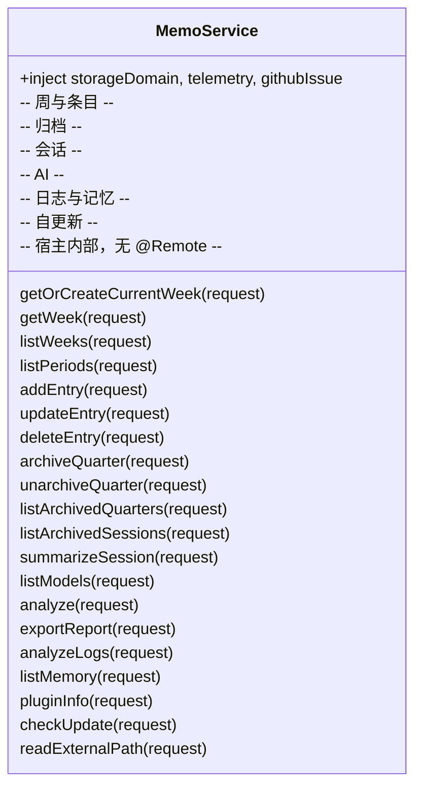
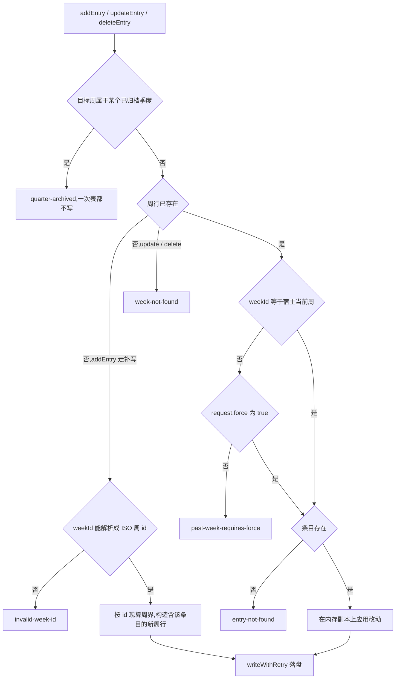
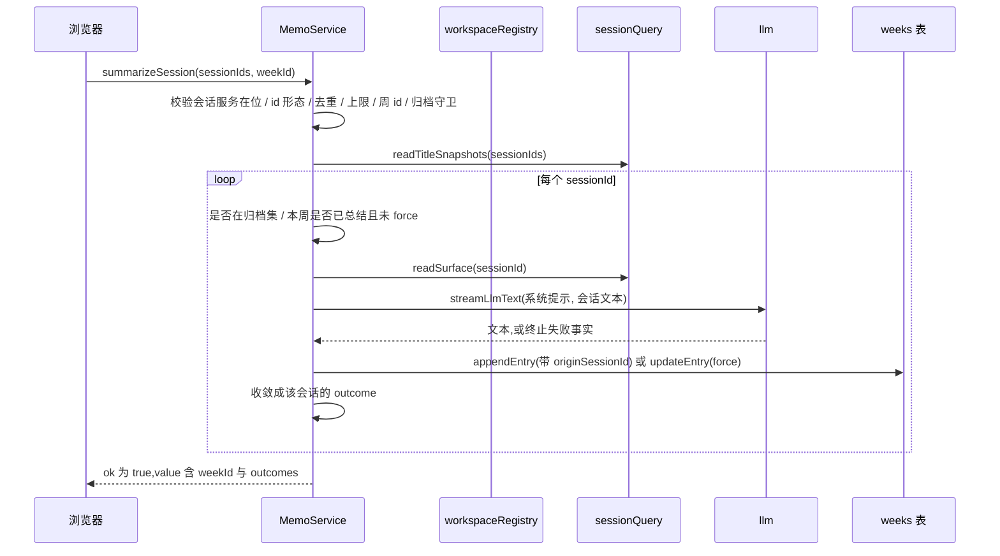

# 备忘服务：按周存储、归档、会话、AI、日志与自更新

`@zhangj1164/dsh-memo` 的宿主半边是一个类：`MemoService extends TypertRemoteService`，服务键是 `memo`（`super(ctx, 'memo')`，并通过 `declare module '@deepseek-ai/cordis'` 给 `Context` 挂上 `memo` 字段）。它把几件互不相干的事装进同一个服务：ISO 周为键的备忘存储、季度归档这一层只读标记、把官方归档会话总结成周内卡片、通过 `llm` 做分析与报告导出、通过 `telemetry` + `githubIssue` 把日志失败写成一份 issue 报告、以及一组只读的版本与更新检查。此外还有一份 `$DSH_HOME/memo/ledger.json` 账本，专门存 `analyze` 的结果。

数据全在本地：周行在 `memo` 域的 `weeks` 表，归档在 `memo_archive` 域的 `quarters` 表，账本是明文 JSON（域、键形状、行 schema 与打开失败语义见[存储与持久化](../architecture/storage-and-persistence.md)）。浏览器那一半只负责画卡片和把点击翻译成调用，见[备忘看板 UI](memo-board-ui.md)；两侧共用的命名与双层信封约定见[宿主 ⇄ 浏览器 Remote 契约](../architecture/host-client-remote-contract.md)。

## 方法面：19 个线上端点，加 1 个宿主内部方法

服务对外一共 20 个公开方法：**19 个带 `@Remote` 装饰器**，可以被任何客户端按 `${service}/${method}` 寻址；第 20 个是 `readExternalPath`，它有方法体、有请求/结果类型，**刻意没有 `@Remote` 注册**，因此没有线上名字。

图：按能力分组的全部公开方法；除最后一项外，每个都在 `@Remote('…')` 下注册了线上名字。

**每个方法都恰好声明一个名叫 `request` 的形参**，即使它不带输入（客户端发 `{ args: { request } }`，协议按名绑定）。这条规则由 [`remote-signatures.spec.ts`](../../packages/memo/dsh-memo/tests/remote-signatures.spec.ts#L19-L56) 守着——它直接读 `src/index.ts` 源码、逐个匹配 `@Remote('…')` 与其后的方法签名，要求形参只有一个且必须以 `request` 开头。证据：源码里 `@Remote` 出现 19 次（[index.ts](../../packages/memo/dsh-memo/src/index.ts#L872-L2104)），README 的方法表列的也是这 19 个（[README.md](../../packages/memo/dsh-memo/README.md#L62-L94)）。

### 周与时间线（7 个）

| 方法 | 请求 | 成功 `value` | 失败码 |
|---|---|---|---|
| `getOrCreateCurrentWeek` | `provider?`、`model?`（保留字段，本调用不用） | 当前 `MemoWeek`；无行时新建一条 `entries: []` 的空周 | 无（见"三条失败通道"） |
| `getWeek` | `weekId` | `MemoWeek` 或 `null` | 无 |
| `listWeeks` | `from?`、`to?`（对 `weekStart` 的半开区间） | `MemoWeek[]`，新→旧 | 无 |
| `listPeriods` | `period`（`week`/`month`/`quarter`/`year`）、`limit?`（缺省 26，夹到 1..400） | `MemoPeriodEntry[]`，新→旧，每项带 `id`、`label`、`start`/`end`、`current`、`weekIds`、`weekCount` | 无 |
| `addEntry` | `weekId`、`type`、`content`、`attachmentRef?`、`source?` | 新 `MemoEntry` | `quarter-archived`、`invalid-week-id` |
| `updateEntry` | `weekId`、`entryId`、`content`、`force?` | 改后的 `MemoEntry` | `quarter-archived`、`week-not-found`、`past-week-requires-force`、`entry-not-found` |
| `deleteEntry` | `weekId`、`entryId`、`force?` | `true` | 与 `updateEntry` 相同 |

两点容易被读漏。其一，`getOrCreateCurrentWeek` 是**会写盘的读方法**：当前周没有行时它 `put` 一条空周行，所以"只是打开面板看了一眼"同样产生持久状态，也同样走写重试（[index.ts](../../packages/memo/dsh-memo/src/index.ts#L1133-L1157)）。其二，`addEntry` 的 `invalid-week-id` 只在"周行还不存在"的补写分支上出现——补写必须从周 id 现算周界，历史上这里写入全零周界，行违反 `weekEnd > weekStart`，而域在打开时校验每一行，于是那一行让整个插件再也起不来；现在补写走 `mondayOfWeekId`，用例把"零周界行被 schema 拒绝""补写拿到真实周界（1999-W07 → 2/15–2/21）""非法 id 一条都不落盘"三半都钉住了（[index.ts](../../packages/memo/dsh-memo/src/index.ts#L1191-L1247)、[memo.spec.ts](../../packages/memo/dsh-memo/tests/memo.spec.ts#L103-L147)）。

`listPeriods` 是四维导航的宿主侧答案：它按 `period` 维度从当前周期往回产生 `limit` 个标签，每个标签带上 `weekIdsInPeriod` 算出的周 id 列表，以及用**实际存过的周 id** 计算的 `weekCount`。**空周期照样列出**——一个还没有卡片的月份是合法的"加第一张卡"的落点，省掉它会让时间线跳过日历上看得见的月份（[index.ts](../../packages/memo/dsh-memo/src/index.ts#L2054-L2090)）。周归属的星期四规则本身归[四维周期日历](../concepts/period-calendar.md)。

### 归档（3 个）

| 方法 | 请求 | 成功 `value` | 失败码 |
|---|---|---|---|
| `archiveQuarter` | `label`（必须匹配 `^\d{4}-Q[1-4]$`） | `MemoArchivedQuarter`（`label`、`archivedAt`、宿主解析出的 `weekIds`） | `invalid-quarter-label` |
| `unarchiveQuarter` | `label`（同一正则） | `{ label, archived }`，`archived` 表示是否真删掉了一行 | `invalid-quarter-label` |
| `listArchivedQuarters` | 无 | `MemoArchivedQuarter[]`，按标签旧→新 | 无 |

归档是**标记而不是搬运**：周行一条都不动，只在自己的域里多一行 `{ label, archivedAt }`。请求必须给季度标签、而不是"你正在看的那个周期"——年跨四个季度，一个周的周一还可能落在上一个季度，从周期起点反推季度会归档错的季度（[index.ts](../../packages/memo/dsh-memo/src/index.ts#L870-L946)）。周 id 不落盘，每次读都由同一套日历推出来。完整流程与取舍见[季度归档与只读](../workflows/quarter-archive-and-read-only.md)。

### 会话（2 个）

| 方法 | 请求 | 成功 `value` | 失败码 |
|---|---|---|---|
| `listArchivedSessions` | 无 | `{ sessions, workspaces, maxSessions, currentWeekId, summaryMaxChars, summaryMaxCharsLimit }` | `session-service-unavailable`（带 `service: 'workspaceRegistry' \| 'sessionQuery'`） |
| `summarizeSession` | `sessionIds`、`weekId?`、`provider?`、`model?`、`force?`、`language?`、`maxChars?` | `{ weekId, outcomes[] }` | 顶层：`session-service-unavailable`、`invalid-session-id`、`no-sessions`、`too-many-sessions`、`invalid-week-id`、`quarter-archived`；单会话（在 outcome 里）：`session-not-archived`、`already-summarized`、`session-unreadable`、`session-empty`、`llm-failure` |

`listArchivedSessions` 的候选集来自 `workspaceRegistry.archivedSessionIds`，在这里过滤掉 subagent 会话、按 `createdAt` 新→旧排序，并用一遍扫描 `weeks` 表按 `originSessionId` 建立 `summarizedWeekIds`（[index.ts](../../packages/memo/dsh-memo/src/index.ts#L956-L1050)、[index.ts](../../packages/memo/dsh-memo/src/index.ts#L1880-L1900)）。`sessionQuery` 只供标题与 header——而且标题优先走 `sessionProjectionCache` 的零 I/O 读，只有缓存答不出的会话才折叠整份日志（[index.ts](../../packages/memo/dsh-memo/src/index.ts#L1088-L1112)）。返回里还顺手给出只含"至少托住一个归档会话"的 `workspaces`（供选择器做项目过滤）、`maxSessions`、宿主算出的 `currentWeekId` 与夹好的长度窗口，好让选择器在**发请求之前**就知道哪些会话已总结、最多能选几个。

### AI（3 个）

| 方法 | 请求 | 成功 `value` | 失败码 |
|---|---|---|---|
| `listModels` | 无 | `{ provider, model, providers[], catalogError? }` | **没有失败变体**（所有降级都在 `ok: true` 的 value 里） |
| `analyze` | `period`、`periodLabel`、`analysisType`（`梳理`/`总结`/`分析`）、`provider?`、`model?` | `MemoAnalysis`（`summary`、`generatedAt`、`modelProvider`、`modelName`） | `no-entries`、`llm-failure` |
| `exportReport` | `period`、`periodLabel`、`provider?`、`model?` | Markdown 字符串 | `no-entries`、`llm-failure` |

`listModels` 刻意不给失败变体：没挂 `llm`、`listProviders()` 抛异常、一个 provider 都没注册，这三种情况都返回 `ok: true` 加空的 `providers` 与一句 `catalogError`，因为"部署没有模型路由"不该让看板打不开（[index.ts](../../packages/memo/dsh-memo/src/index.ts#L1392-L1435)、[types.ts](../../packages/memo/dsh-memo/src/types.ts#L478-L518)）。每个 provider 的目录是**并发分别取**的：一个适配器抛错只会变成它自己的 `error`，不会遮住别人的模型。`analyze` / `exportReport` 先把周期的条目按 `createdAt` 升序收集起来，再判空、解析路由、发一次模型调用；提示词与报告形状见[分析与导出](../workflows/analyze-and-export.md)。

### 日志（1 个）与记忆（1 个）

| 方法 | 请求 | 成功 `value` | 失败码 |
|---|---|---|---|
| `analyzeLogs` | `pluginIds?`、`repoUrl?`、`provider?`、`model?` | `{ report, issueUrl, analysis }` | `no-plugins-configured`、`github-issue-failure` |
| `listMemory` | `period?`、`limit?`（默认 50） | `MemoMemoryEntry[]`，新→旧 | `ledger-error` |

`analyzeLogs` 对每个插件调一次 `telemetry.analyzeForPlugin`，把结果合并成**一份**报告：总数相加、`window` 取各插件并集、失败组拼接后按 `count` 降序；空插件集合被拒绝为 `no-plugins-configured`，而不是报成"一套什么都没记录的套件"。报告与预填 URL 由 `githubIssue` 服务生成（它持有 URL 长度上限），任一步失败都折成 `github-issue-failure` 并保留底层 message（[index.ts](../../packages/memo/dsh-memo/src/index.ts#L1951-L2049)、[index.ts](../../packages/memo/dsh-memo/src/index.ts#L426-L447)）。细节见[从日志分析到 issue](../workflows/log-analysis-to-issue.md)与 [Issue 服务](github-issue-service.md)。

`listMemory` 是唯一直接读文件的端点：它同步读 `$DSH_HOME/memo/ledger.json`（读路径顺带做一次旧账本迁移）、按 `period` 过滤、截到 `limit`，读失败时返回 `ledger-error`——这个码**不在** `MemoMemoFailure` 联合里，是 `MemoListMemoryResult` 自己声明的失败形状（[index.ts](../../packages/memo/dsh-memo/src/index.ts#L2104-L2121)、[types.ts](../../packages/memo/dsh-memo/src/types.ts#L356-L358)）。

### 自更新与版本信息（2 个）

| 方法 | 请求 | 成功 `value` | 失败码 |
|---|---|---|---|
| `pluginInfo` | 无 | `{ currentVersion, packageName, registryUrl, profileName }` | 无 |
| `checkUpdate` | 无 | `{ currentVersion, latestVersion, updateAvailable, packageName, registryUrl, manualCommand, checkedAt }` | `update-check-failed` |

这一对是刻意拆开的，因为**打开设置页不该花钱**：`pluginInfo` 只读本地事实（自己的 `package.json` 版本 + Config 里的更新目标），`checkUpdate` 才发一次网络请求。运行时版本从 `new URL('../package.json', import.meta.url)` 同步读取，`src/`（测试）与 `lib/`（发布物）两种布局都成立；读不到就报 `0.0.0` 而不是猜——比较结果因此偏向"有更新"（[index.ts](../../packages/memo/dsh-memo/src/index.ts#L1716-L1748)）。`checkUpdate` 请求 npm registry 的 install-v1 元数据（`AbortSignal.timeout(updateCheckTimeoutMs)`）、取 `dist-tags.latest`、用只比数字核心的 `compareVersions` 判断是否更新（不可解析的一对回落到字符串序，绝不误报升级），然后渲染一条可复制的 `dsh plugin --profile … add --save-exact <pkg>@<ver> --registry=<url>`；HTTP 非 2xx、无 `latest`、网络错误都折成 `update-check-failed` 并记一条 `memo:checkUpdate` 遥测（[index.ts](../../packages/memo/dsh-memo/src/index.ts#L1670-L1738)、[index.ts](../../packages/memo/dsh-memo/src/index.ts#L680-L740)、[update-check.spec.ts](../../packages/memo/dsh-memo/tests/update-check.spec.ts#L30-L120)）。

**宿主从不自己安装任何东西。** `checkUpdate` 是只读查询，它只报告事实与命令；弹窗里可以触发的安装走**部署自己的** `pluginManager/installBundle`，因此 profile 锁、兼容性检查与回滚都留在平台侧，而不是本服务重新实现一遍（[README.md](../../packages/memo/dsh-memo/README.md#L138-L142)）。这条分工的理由与 `readExternalPath` 是同一个：面板点击发生在两个 turn 之间，那里既请不到审批，也不该长出第二套安装实现。包名、registry、profile、超时都是 Config 字段，镜像或 fork 不改代码就能改指向（[cordis.patch.yml](../../packages/memo/dsh-memo/cordis.patch.yml#L20-L23)）。

### 唯一不注册的方法：`readExternalPath`

`readExternalPath` 走 `fs.resolve` + `fs.readText`，返回文件文本，不添加任何条目、不问确认，也不出现在 Remote 表面上——用例取该服务的 `typertRemote` 标记表做正反两向断言（含 `addEntry`、不含 `readExternalPath`），并断言读完后 `listWeeks` 一字未变（[index.ts](../../packages/memo/dsh-memo/src/index.ts#L1904-L1940)、[external-path.spec.ts](../../packages/memo/dsh-memo/tests/external-path.spec.ts#L98-L136)）。

它的失败码按 `FsErrorCode` **逐个映射**：`FS_NOT_FOUND` / `ENOENT` → `path-not-found`；`FS_NOT_TEXT` / `FS_NOT_REGULAR_FILE` → `path-not-text`；`FS_TOO_LARGE` → `path-too-large`；`FS_PERMISSION_DENIED` / `FS_SANDBOX_DENIED` / `EACCES` / `EPERM` → `approval-denied`；其余（含不带 code 的抛出）→ `fs-error`；没挂 `fs` 时额外有 `fs-unavailable`。返回给调用方的码与记进遥测的码是同一个，每个失败都带 `path`——早先所有情况都报一个 `approval-denied`，缺文件、二进制文件与真正的权限拒绝无法区分（[index.ts](../../packages/memo/dsh-memo/src/index.ts#L2295-L2340)、[external-path.spec.ts](../../packages/memo/dsh-memo/tests/external-path.spec.ts#L155-L200)）。它为什么必须留在宿主内部、以及"一次面板点击发生在两个 turn 之间"这条理由，见[能力与审批边界](../concepts/capability-and-approval-boundaries.md)。

## 三条失败通道，而不是一条

业务结果统一是 `{ ok: true, value }` 或 `{ ok: false, error }`，`error` 由 `failure()` 私有工厂 `Object.freeze`。但服务里实际有**三条**不同的失败通道，混淆它们就会误判行为：

1. **业务失败**（`ok: false`）：`MemoMemoFailure` 联合里的码（`week-not-found`、`quarter-archived`、`llm-failure`、`update-check-failed`……），多数带结构化上下文（`weekId`、`entryId`、`label`、`path`、`sessionId`、`service`、`limit`……），其余只给 `message`（[types.ts](../../packages/memo/dsh-memo/src/types.ts#L269-L322)）。客户端读这一层。
2. **生命周期错误**（抛异常）：`requireTable()` / `requireArchiveTable()` 在域还没打开时直接 `throw`，而不是返回类型声明里列出的 `not-initialized`（[index.ts](../../packages/memo/dsh-memo/src/index.ts#L2382-L2390)、[index.ts](../../packages/memo/dsh-memo/src/index.ts#L1129-L1135)）。`MemoGetWeekResult` 之类的类型里确实列了 `not-initialized`，但实现选择让"服务生命周期坏了"以异常暴露，而不是伪装成一次可重试的业务失败。
3. **持久写失败**（抛异常）：`writeWithRetry` 在重试预算耗尽后把最后一次错误**原样抛出**（例如 `EPERM`），用例断言 `getOrCreateCurrentWeek` 会 `rejects` 而不是返回 `ok: false`（[index.ts](../../packages/memo/dsh-memo/src/index.ts#L2162-L2178)、[memo.spec.ts](../../packages/memo/dsh-memo/tests/memo.spec.ts#L1094-L1108)）。对浏览器而言这表现为传输层失败，而不是业务信封里的一个码。

业务结果的形状有两处例外，都是刻意的：`listModels` 的类型**没有失败变体**（[types.ts](../../packages/memo/dsh-memo/src/types.ts#L508-L518)），`listMemory` 的 `ledger-error` **不在** `MemoMemoFailure` 联合内（[index.ts](../../packages/memo/dsh-memo/src/index.ts#L2104-L2121)）。

写重试只救两种 errno：`EPERM` 与 `EBUSY`——Windows 上"临时文件 rename 覆盖目标时目标被占用"的纯时序竞争。`EACCES` 被刻意排除，它是真实的权限问题，等待不会修好；每次重试的退避 `storageWriteRetryDelayMs * 2^n` 封顶 5000 ms，所以正常路径一次都不睡。重试覆盖周行 `put` 与归档 `put` / `delete`（[index.ts](../../packages/memo/dsh-memo/src/index.ts#L333-L354)、[index.ts](../../packages/memo/dsh-memo/src/index.ts#L2162-L2178)、[memo.spec.ts](../../packages/memo/dsh-memo/tests/memo.spec.ts#L1064-L1108)）。这一层的介质含义见[存储与持久化](../architecture/storage-and-persistence.md)。

## 依赖：必需的 `inject`，可选的 `ctx.get`

服务声明 `static inject = ['storageDomain', 'telemetry', 'githubIssue']`（[index.ts](../../packages/memo/dsh-memo/src/index.ts#L741-L743)）。这三个是**必需**的：缺任何一个，插件不挂载，而不是降级运行。

| 必需依赖 | 用在哪 | 缺失后果 |
|---|---|---|
| `storageDomain` | `[Service.init]` 里依次 `open(memoDomainSpec)` 与 `open(memoArchiveDomainSpec)`，并对每个域用 `ctx.effect` 注册 `domain.close()`（标签分别 `memo.domainClose` / `memo.archiveDomainClose`） | 服务不挂载；归档域打不开同样拖垮整个备忘服务 |
| `telemetry` | `track` / `trackError` 记事件；`analyzeLogs` 里 `analyzeForPlugin` | 不挂载；代码里仍留了 `ctx.get('telemetry')` 的缺失分支（`analyzeLogs` 返回 `github-issue-failure`，`track` 静默跳过） |
| `githubIssue` | `generateReport` 生成报告、`prefilledIssueUrl` 拼预填链接 | 不挂载；`analyzeLogs` 的缺失分支返回 `github-issue-failure` |

另外六个服务是**可选读取**，一律 `this.ctx.get(...)` 探一下、缺失就给一句能解释的原因，而不是让部署组合起不来：

| 可选服务 | 谁在读 | 缺失时的返回值 |
|---|---|---|
| `llm` | `analyze` / `exportReport` / `summarizeSession`（经 `streamLlmText`）、`listModels`（`listProviders` / `listModels`） | 前三个各得 `llm-failure`，其 `failureCode` 是 `LLM_UNAVAILABLE`（或路由为空时的 `NO_MODEL_ROUTE`）；`summarizeSession` 把它放进**该会话的 outcome**；`listModels` 仍 `ok: true`，`providers: []` 加 `catalogError: 'the llm service is not mounted'` |
| `fs` | `readExternalPath` | `fs-unavailable`（带 `path`），同时记一条同码遥测 |
| `workspaceRegistry` | `listArchivedSessions` / `summarizeSession` 的选人范围 | `session-service-unavailable`，`service: 'workspaceRegistry'` |
| `sessionQuery` | 同上（标题、header、`readSurface`） | `session-service-unavailable`，`service: 'sessionQuery'` |
| `sessionProjectionCache` | `listArchivedSessions` 的零 I/O 标题 | 缓存缺席只是少一条快路径：标题回落到折叠日志 |
| `agentDefaultModel` | `resolveRoute` 的最后一级回退 | 可选链读不到就留空路由，随后 `streamLlmText` 报 `NO_MODEL_ROUTE`；`listModels` 则把空串写进 `provider` / `model` |

可选服务全都用结构化接口（`FsTextSource`、`SessionArchiveSource`、`ProjectionCacheSource`、`LlmModelCatalog`）声明，而不是 import 具体类，所以本包对 DSH 的这些服务没有硬依赖（[index.ts](../../packages/memo/dsh-memo/src/index.ts#L2206-L2230)、[index.ts](../../packages/memo/dsh-memo/src/index.ts#L2370-L2380)）。

`Config` 全部字段是 `Volatile` ref（共 17 个），服务每个方法内部通过 getter 现场读（`this.config.provider?.get()` 等），构造期不拷贝任何值——因为 Loader 提交 volatile-only 改动时**不重挂插件**，拷贝会把值冻结在启动那一刻。`config-volatile.spec.ts` 一半盯"每个顶层字段都必须带 `.volatile()`"，另一半盯"原地提交后下一次调用就用新值"（[index.ts](../../packages/memo/dsh-memo/src/index.ts#L117-L208)、[index.ts](../../packages/memo/dsh-memo/src/index.ts#L755-L835)、[config-volatile.spec.ts](../../packages/memo/dsh-memo/tests/config-volatile.spec.ts#L57-L108)）。字段清单与新增字段时的同步规则见[配置与实时设置](../concepts/configuration-and-live-settings.md)。

## 写守卫：先归档只读，再"非当前周需 force"

三个写方法（`addEntry`、`updateEntry`、`deleteEntry`）以及 `summarizeSession` 的目标周，都过同一组闸门。顺序是有意义的：**归档判定最先**，因为它必须在任何内存副本被改动、任何 `put` 之前返回。

图：一次备忘写入要过的闸门与顺序，五类拒绝都在落盘之前返回。

**归档只读是宿主的规则，不是浏览器的规则。** 同一个 Remote 方法任何客户端都能调，而且归档可能在某个编辑对话框已经打开的时候落地，所以 `archivedWeekFailure(weekId)` 在方法体里再判一次：遍历归档行、用 `weekIdBelongsToPeriod(weekId, 'quarter', label)` 判定，命中即返回 `quarter-archived` 并且**一条记录都不改**（[index.ts](../../packages/memo/dsh-memo/src/index.ts#L1139-L1152)、[index.ts](../../packages/memo/dsh-memo/src/index.ts#L1191-L1196)）。因为判据与 `listArchivedQuarters` 解析 `weekIds` 用的是同一族星期四规则，守卫不可能和"哪些周属于这个季度"漂移。用例覆盖四件事：三写全被拒且内容没变（且解归档后才恢复可写）、被归档季度拥有的**每一个**周都被拒、未归档季度之外的当前周照旧可写、归档当前季度会连今天一起关掉（解归档是唯一出口）（[memo.spec.ts](../../packages/memo/dsh-memo/tests/memo.spec.ts#L711-L820)）。

**第二道门是"不是当前周就要 `force`"。** 判据是 `request.weekId !== computeWeekBounds().weekId`，因此它不只覆盖过去周——**未来的周同样需要 `force: true`**；语义上这是"承认 AI 分析结果可能因此变化"，缺失时在改动前返回 `past-week-requires-force`（[index.ts](../../packages/memo/dsh-memo/src/index.ts#L1253-L1300)、[index.ts](../../packages/memo/dsh-memo/src/index.ts#L1299-L1345)）。注意顺序：先 `week-not-found`，再 force 判定——所以对一个不存在的旧周调用只会得到 `week-not-found`，用例正是这样断言的（[memo.spec.ts](../../packages/memo/dsh-memo/tests/memo.spec.ts#L168-L191)）。

`updateEntry` 只改 `content` 与 `updatedAt`：`id`、`type`、`attachmentRef`、`source`、`originSessionId`、`createdAt` 全部从旧条目原样带过来，所以"编辑内容"不是"替换条目"，也不可能借编辑洗掉来源（[index.ts](../../packages/memo/dsh-memo/src/index.ts#L1280-L1298)）。

## 会话总结：一次调用，每个会话一条结果

`summarizeSession` 是本页流程最密的方法。它的顶层闸门在循环之前一次性判完，之后**每个会话各自成败**，绝不因为一个会话出问题就丢掉已经成功的总结：

图：`summarizeSession` 的闸门、每会话循环与两条写入分支。

**顶层闸门**（任一失败则整次 `ok: false`）：两个会话服务在位 → `sessionIds` 每项都是非空字符串（否则 `invalid-session-id`，带 `sessionId`）→ 去重后非空（`no-sessions`）→ 不超过 `sessionSummaryMaxSessions`（`too-many-sessions`，带 `limit`）→ `weekId`（请求给的值，否则当前 ISO 周）能被 `mondayOfWeekId` 解析（`invalid-week-id`）→ 目标周不在已归档季度（`quarter-archived`）。通过之后顶层**永远**是 `ok: true`（[index.ts](../../packages/memo/dsh-memo/src/index.ts#L1512-L1585)）。

**每会话 outcome** 记录一段独立的失败：不在官方归档集 → `session-not-archived`；本目标周已有该会话的总结且 `request.force !== true` → `already-summarized`（带已有的 `entryId`）；`readSurface` 抛错 → `session-unreadable`；抽取出的用户/助手文本为空 → `session-empty`；模型调用失败 → `llm-failure`（保留 `failureCode`、provider、model、status）；写入本身失败 → 把 `addEntry` / `updateEntry` 的错误原样搬进 outcome。成功时 outcome 带 `entry`。`force: true` 且有既有总结时走 `updateEntry` 而不是再追加一条，所以同一周同一会话始终只有一张卡。遥测的 `success`/`failure` 取决于"是否至少写成一条 entry"，metadata 带 `requested` / `succeeded` / `failed` 计数（[index.ts](../../packages/memo/dsh-memo/src/index.ts#L1586-L1665)、[types.ts](../../packages/memo/dsh-memo/src/types.ts#L643-L670)）。

**来源（provenance）只有一个入口。** 公开的 `MemoAddEntryRequest` 里根本没有 `originSessionId` 字段；能写它的只有私有的 `appendEntry(request, originSessionId)`，而唯一传这个参数的调用点就是 `summarizeSession`（[index.ts](../../packages/memo/dsh-memo/src/index.ts#L1207-L1248)、[index.ts](../../packages/memo/dsh-memo/src/index.ts#L1625-L1645)）。README 把这条说成"来源是被记录的不是被推断的"：`originSessionId` 与 `source` 是两个字段，前者指被总结的会话、后者指用户链接的本地文件，混用一个字段会让文件路径长得像 session id（[types.ts](../../packages/memo/dsh-memo/src/types.ts#L27-L35)、[README.md](../../packages/memo/dsh-memo/README.md#L126-L128)）。来源脚注也在客户端之外渲染：模型返回之后，宿主用 `sessionSummarySourceTemplate` 的 `{sessionId}` / `{sessionTitle}` 占位符拼上去，模型既看不到也伪造不了，浏览器若自行添加则其他客户端就没有这段。用例断言默认模板产出 `…\n\n来源会话：session-a`、自定义模板产出 `[Fix CI](session-a)`，且条目带 `originSessionId`（[session-transcript.ts](../../packages/memo/dsh-memo/src/session-transcript.ts#L239-L257)、[session-summary.spec.ts](../../packages/memo/dsh-memo/tests/session-summary.spec.ts#L319-L335)）。

**一次调用一个模型请求，一个会话一条卡片。** 这既是"周视图读起来像每个对话产出了什么"，也是让一个超长会话挤不掉其他会话的手段。送进模型的只有用户与助手文本：system 消息、工具结果、工具合成的用户消息都被跳过，整体按 `sessionSummaryTranscriptMaxChars` 裁剪——超预算时保留头与尾、中间换成一条省略标记。语言与长度在提示词里落成散文而不是 id：`{language}` 被替换成 `Simplified Chinese` / `English`，`{maxChars}` 取夹到 `[100, sessionSummaryMaxCharsLimit]` 后的值，自定义提示词若省掉某个占位符就等于对该轴选择退出（[index.ts](../../packages/memo/dsh-memo/src/index.ts#L210-L280)、[index.ts](../../packages/memo/dsh-memo/src/index.ts#L1752-L1805)、[session-transcript.ts](../../packages/memo/dsh-memo/src/session-transcript.ts#L118-L237)）。完整的产品行为见[会话总结到周](../workflows/session-summary-to-week.md)。

## 路由解析与失败事实

`resolveRoute` 的优先级是**请求 → 服务 `Config` → 部署的 `agentDefaultModel`**，都没有就返回空串，绝不硬编码任何 provider；`agentDefaultModel` 是"这个部署用哪个模型"的唯一既有事实来源（[index.ts](../../packages/memo/dsh-memo/src/index.ts#L1347-L1357)）。原来浏览器硬编码一个没人注册的 provider 那次事故，就是这条链被绕开的结果。模型调用统一走 `streamLlmText`：它在没有 `llm` 时给 `LLM_UNAVAILABLE`、路由任一半为空时给 `NO_MODEL_ROUTE`，把 DSH 终止 `finish` chunk 里的 `code` / `message` / `status` 原样保留，把逃逸的传输异常记作 `LLM_STREAM_THREW`，文本为空时给 `EMPTY_RESPONSE`（[llm-text.ts](../../packages/memo/dsh-memo/src/llm-text.ts#L67-L129)）。

`llmFailure(feature, route, failure)` 再把它翻成业务失败：`code: 'llm-failure'` 加 `failureCode`、`message`（带 provider 与 model）、`provider`、`model`、可选 `status`，同时**自己记一条**遥测（[index.ts](../../packages/memo/dsh-memo/src/index.ts#L1358-L1382)）。为什么"没配路由"和"模型真的返回空"必须分成两个码，见[模型路由与失败事实](../concepts/llm-route-and-failure-facts.md)。

## 遥测锚点

所有事件都记在 `pluginId: 'memo'` 下，`action` 就是方法名。成功走 `track(action, 'success', metadata)`，按设计是**尽力而为**：`this.ctx.get('telemetry')?.track(...)`，取不到就什么都不记。失败走 `trackError(action, { code, message, featureCodeRef }, metadata)`（[index.ts](../../packages/memo/dsh-memo/src/index.ts#L2126-L2160)）。`featureCodeRef` 的实测锚点：

| 锚点 | 出处 |
|---|---|
| `memo:analyze`、`memo:exportReport`、`memo:summarizeSession` | `llmFailure` 按 `memo:${feature}` 拼，以及 `summaryFailure` 的逐会话错误 |
| `memo:readExternalPath` | 无 `fs` 的失败分支与映射后的读失败都用它（成功走 `track`） |
| `memo:ledger` | `listMemory` 的兜底 catch |
| `memo:checkUpdate` | `checkUpdate` 的 `update-check-failed` |
| `memo:listModels` 等降级 | **不记 `trackError`**：`listModels` 的三种降级只记 `track('listModels', 'failure', …)` 加 `reason`。`analyze` / `exportReport` / `summarizeSession` / `analyzeLogs` / `listArchivedSessions` / `listWeeks` 之类"没有专门失败锚点"的路径，要么经 `llmFailure` 拿到锚点，要么只在成功时记一条 event |

锚点不是装饰：`telemetry` 的失败分组就是按 `featureCodeRef` 聚合的（`row.error?.featureCodeRef ?? 'unknown'`），缺这个字段的事件会落进 `unknown` 组——而 `analyzeLogs` 的整份报告正是按这些分组组织的（[index.ts](../../packages/telemetry/dsh-telemetry/src/index.ts#L271-L300)）。两条配套的不变式：

- **成功事件也带路由**。`analyze`、`exportReport`、`listModels`、`analyzeLogs`、`summarizeSession` 的成功事件都带 `routeFacts(route)` 的 `provider` / `model`；解析出来是空串就记空串。空串意味着"什么都没解析到"，而缺少这两个键说明事件早于这条约定，两者不能合并（[index.ts](../../packages/memo/dsh-memo/src/index.ts#L2118-L2124)、[memo.spec.ts](../../packages/memo/dsh-memo/tests/memo.spec.ts#L968-L1057)）。
- **同一个失败不记两次**。`summaryFailure` 对 `llm-failure` 跳过 `trackError`，因为 `llmFailure` 已经带着路由记过一条；重复记录会把日志分析读到的失败计数灌水，其余每会话错误则各记一条 `memo:summarizeSession`（[index.ts](../../packages/memo/dsh-memo/src/index.ts#L1779-L1800)）。

注意 `listModels` 会出现"RPC 结果与遥测结论不一致"的情形：返回值永远是 `ok: true`，但降级时它记的是 `result: 'failure'` 加 `reason`（`llm-unavailable` / `providers-threw` / `no-provider`）。这是刻意的——面板要能打开，运维侧仍要知道注册表读不到。

## `analyze` 的账本副作用

`analyze` 成功之后有一次**不属于 storage-domain** 的写入：把本次结果追加进 `$DSH_HOME/memo/ledger.json`——`{ id: randomUUID(), period, periodLabel, analysisType, summary, generatedAt }`，新条目插到最前，整份列表按 `LEDGER_CAPACITY = 500` 截断，文档形状是 `{ schemaVersion: 1, analyses: [...] }`（[index.ts](../../packages/memo/dsh-memo/src/index.ts#L1460-L1475)、[index.ts](../../packages/memo/dsh-memo/src/index.ts#L599-L607)）。

这份账本的算子全是"读失败就空、写失败就算"的风格：`parseLedger` 读不懂就 `undefined`、`readLedgerAt` 折成空账本、`writeLedgerAt` 返回布尔而不是抛错，所以**账本写不进去不会让这次分析失败**，内存里的结果照旧返回给调用方，下一次成功写会重新序列化整份列表（[index.ts](../../packages/memo/dsh-memo/src/index.ts#L449-L502)、[index.ts](../../packages/memo/dsh-memo/src/index.ts#L591-L599)）。读路径还会做一次 `legacyLedgerFile()`（平台 home 顶层的 `memo/ledger.json`）到 DSH home 的一次性合并：按 `id` 并集、新→旧、截到 500，写成功后才把旧文件改名成 `.migrated` 回执；顺序反了会在写失败时丢掉唯一一份数据（[index.ts](../../packages/memo/dsh-memo/src/index.ts#L537-L589)）。路径解析与迁移分支的完整说明见[存储与持久化](../architecture/storage-and-persistence.md)。

一个容易误会的点：`weeks` 行 schema 里有可选的 `analysis` 字段，但当前实现**从不写它**——`analyze` 既不 `put` 周行，也不回填分析；结果只走"返回值 + 账本"两条路。所以"上一次分析存在哪"的答案是账本，而不是周行（[spec.ts](../../packages/memo/dsh-memo/src/spec.ts#L46-L57)、[index.ts](../../packages/memo/dsh-memo/src/index.ts#L1438-L1476)）。`listMemory` 就是这份账本的读口：`period` 可选过滤、`limit` 默认 50。用例把"`analyze` 写的能被 `listMemory` 读回"钉成一条（[ledger-home.spec.ts](../../packages/memo/dsh-memo/tests/ledger-home.spec.ts#L165-L181)）。

## 测试边界

| 文件 | 守什么 | 代表性断言 |
|---|---|---|
| [`memo.spec.ts`](../../packages/memo/dsh-memo/tests/memo.spec.ts) | 周生命周期、条目增删改、分析与导出、日志分析、路由解析、四维时间线、季度归档、归档写守卫、模型目录、成功事件的遥测路由、写重试 | 补写周拿到真实周界；三写被归档守卫拦下且内容未变；空周期照列；`EPERM` 两次后第三次成功、`EACCES` 一次都不重试、预算耗尽则 reject |
| [`session-summary.spec.ts`](../../packages/memo/dsh-memo/tests/session-summary.spec.ts) | 会话选择器与总结 | subagent 被过滤；缺 `workspaceRegistry` 报 `session-service-unavailable`；缓存命中的标题不折叠日志；来源脚注与 `originSessionId`；只把用户/助手文本送进模型；重复拒/`force` 复用同一条；坏会话被隔离成单个 outcome；超上限被拒 |
| [`remote-signatures.spec.ts`](../../packages/memo/dsh-memo/tests/remote-signatures.spec.ts) | 方法的线上形状 | 扫源码要求每个 `@Remote` 方法只有一个 `request` 形参；自带"至少找到 10 个、且含 `listArchivedQuarters`"的哨兵，防止正则失效后整份检查空过 |
| [`config-volatile.spec.ts`](../../packages/memo/dsh-memo/tests/config-volatile.spec.ts) | 配置契约 | 17 个顶层字段全部 volatile；原地提交 provider/model 后下一次调用即用新值 |
| [`update-check.spec.ts`](../../packages/memo/dsh-memo/tests/update-check.spec.ts) | 版本与更新 | `pluginInfo` 零请求；命令字符串逐字符比对；镜像/profile 改写生效；503 与 DNS 失败报 `update-check-failed` |
| [`ledger-home.spec.ts`](../../packages/memo/dsh-memo/tests/ledger-home.spec.ts) | 账本路径与迁移 | 未设/显式/空白/带 `~` 的 `DSH_HOME`；只合并一次；按 id 去重；新路径不可写时仍显示旧条目 |
| [`external-path.spec.ts`](../../packages/memo/dsh-memo/tests/external-path.spec.ts) | 宿主内部读文件 | 不在 Remote 表面上；不加任何条目；九个 errno/code 的逐个映射；遥测记的码与返回的码一致 |

签名检查的耦合方向值得说明：它检查的是**源码里的声明**，所以新增一个方法会被自动纳入规则（不需要往测试里加名字）；反过来，一旦给它加第二个形参、改掉 `request` 这个形参名、或者更换装饰器写法，就必须同步这份测试，否则它会失败——同一变更也要补 README 的方法表。这条规则不是风格洁癖：`listArchivedQuarters` 曾经完全没有形参，宿主归档成功 13 次、客户端的读却永远为空，整个特性看起来什么也没做（[remote-signatures.spec.ts](../../packages/memo/dsh-memo/tests/remote-signatures.spec.ts#L5-L18)、[types.ts](../../packages/memo/dsh-memo/src/types.ts#L415-L426)）。

## 相关页面

- [备忘看板 UI](memo-board-ui.md)——同一批方法的浏览器侧消费者。
- [宿主 ⇄ 浏览器 Remote 契约](../architecture/host-client-remote-contract.md)——命名、按名绑定与双层信封。
- [存储与持久化](../architecture/storage-and-persistence.md)——两个域、行 schema、账本路径与迁移、写重试的介质语义。
- [四维周期日历](../concepts/period-calendar.md)——`weekIds`、周四归属规则与 `weekIdBelongsToPeriod`。
- [配置与实时设置](../concepts/configuration-and-live-settings.md)——`Config` 的 volatile 契约。
- [模型路由与失败事实](../concepts/llm-route-and-failure-facts.md)——为什么 `NO_ADAPTER` 与 `EMPTY_RESPONSE` 必须分开。
- [能力与审批边界](../concepts/capability-and-approval-boundaries.md)——`readExternalPath` 为什么留在宿主内部。
- [分析与导出](../workflows/analyze-and-export.md)、[会话总结到周](../workflows/session-summary-to-week.md)、[季度归档与只读](../workflows/quarter-archive-and-read-only.md)、[从日志分析到 issue](../workflows/log-analysis-to-issue.md)——四条端到端工作流。
- [Issue 服务](github-issue-service.md)——`analyzeLogs` 的报告与预填 URL 由谁生成。
