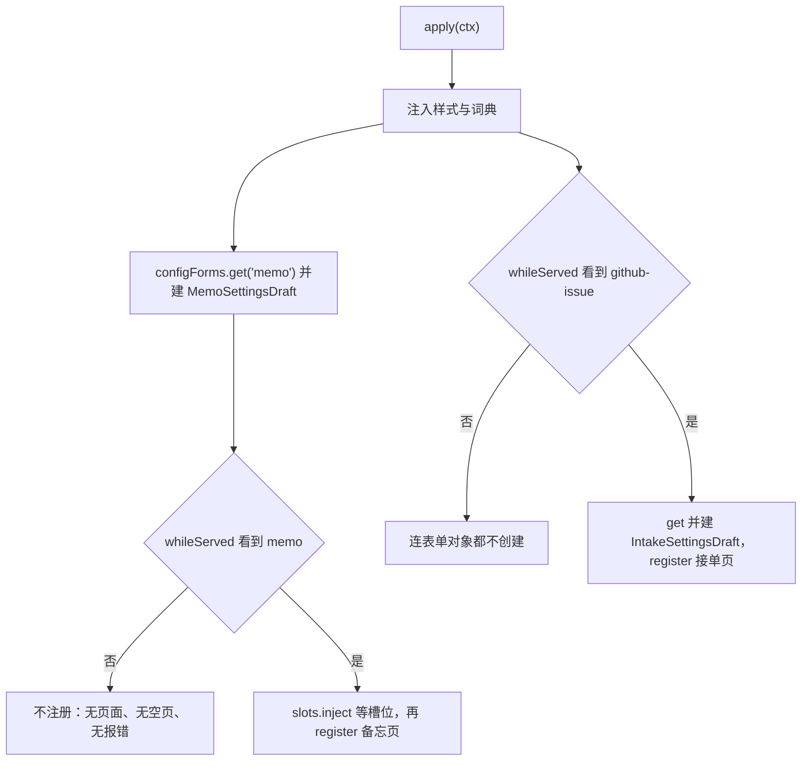
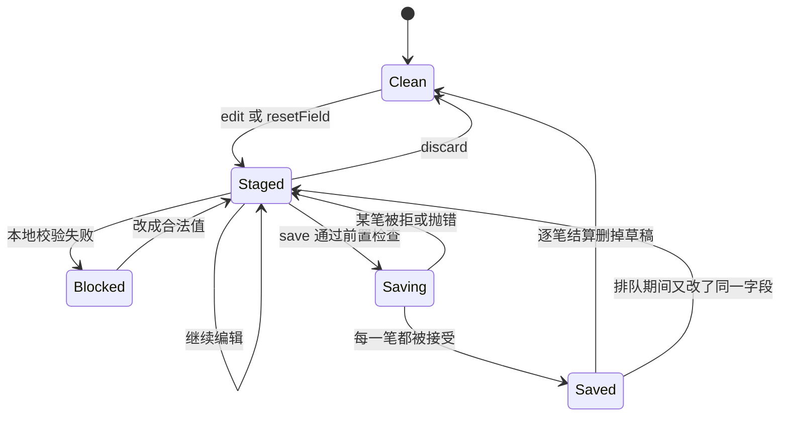

# 备忘设置页 UI（浏览器）

`@zhangj1164/dsh-client-ui-memo-settings` 是备忘套件里唯一把宿主配置摆到浏览器上的包。它把两个 Loader 行——`memo` 与 `github-issue`——的 `Config` 投影成 DSH Web 的 Settings 页：保存写进 profile 的用户层，随后由 `cordis-plugin-loader` 原地提交给运行中的服务，不需要重启。它是一个纯 UI 包，node 半边的 `apply()` 是空函数，只为了让插件在宿主 `cordis.yml` / Loader 里占一行；真正的功能面通过 `exports["./client"]` 交付、由 `package.json` 的 `dsh.client` 声明发现（[index.ts](../../packages/client/ui-memo-settings/src/index.ts#L1-L11)、[tsdown.config.ts](../../packages/client/ui-memo-settings/tsdown.config.ts#L16-L19)）。

这个包不持有任何配置值。值属于两个宿主，页面只在 `ctx.configForms` 之上暂存草稿、逐字段提交。本页讲它自己的结构：入口如何装配与门控、草稿状态机的生命周期、字段声明这个扩展点、复述的边界落在哪、以及测试钉住了什么。热生效那一半（`volatile`、loader 的原地提交、哪些改动仍要重启）见[配置与热生效](../concepts/configuration-and-live-settings.md)，两个宿主内部见[备忘服务](memo-service.md)与[GitHub 接单服务](github-issue-service.md)，`settings.section` 这类座位的组装规则见[插件组合与 bundle 层](../architecture/plugin-composition-and-bundles.md)。

## 一次 `apply`，两份互不相识的页面

`apply(ctx)` 先做两件全局装配（样式、词典），再把两个命名空间的表单接到各自的草稿模型上、分别注册一页。要求注入的服务只有三个：`['slots', 'locale', 'configForms']`（[index.ts](../../packages/client/ui-memo-settings/src/client/index.ts#L108-L109)）。

| 装配项 | 做法 | 释放方式 |
|---|---|---|
| 样式 | 把 `styles.ts` 的 `CSS_TEXT` 写进 `<style data-dsh-plugin="memo.settings">` 挂到 `document.head`；颜色全部走 `--dsw-alias-*` token，主题切换不需要 JS | `ctx.effect` 的 disposer 移除节点 |
| 词典 | `ctx.locale.register('memo.settings', { zh, en })`，一份词典覆盖两页 | 同上 |
| 备忘页草稿 | `ctx.configForms.get('memo')` → `new MemoSettingsDraft(form)`，**在 `apply` 里无条件创建** | `ctx.effect(() => () => draft.dispose())` |
| 备忘页 | `whileServed(['memo'], () => slots.inject('settings.section', () => slots.register(...)))` | `ctx.effect` |
| 接单页 | `whileServed(['github-issue'], () => { form; draft; register; return () => { off(); draft.dispose() } })` | `ctx.effect` |

两个页面的导航身份写成常量，而不是从宿主包里导入：浏览器包不能依赖宿主包，而这些 id 是 bundle 已发布的 Loader 行名（[index.ts](../../packages/client/ui-memo-settings/src/client/index.ts#L77-L106)）。

```ts
const NS = 'memo.settings'
export const MEMO_SETTINGS_SECTION_ID = 'memo'
export const MEMO_SETTINGS_SECTION_ORDER = 20          // 已发布座位里 plugins 是 15
export const MEMO_SETTINGS_NAMESPACE = 'memo'
export const INTAKE_SETTINGS_SECTION_ID = 'github-issue'
export const INTAKE_SETTINGS_SECTION_ORDER = 21        // 紧跟在备忘页之后
export const INTAKE_SETTINGS_NAMESPACE = 'github-issue'
```

**命名空间就是 Loader 行 id**：`dsh-settings` 用 entry 的 `options.id` 作为表单命名空间，所以 `ctx.configForms.get('memo')` 里的字符串与 `memo` bundle patch 插入的那一行是同一个东西。`label` 以 thunk 形式传入（`() => t('nav')` / `() => t('intakeNav')`），语言切换不需要重新注册整页；`order` 决定导航位置，`id` 决定 section 的身份。渲染交给 Settings 外壳在内容列里完成——加一页永远不需要改外壳（[index.ts](../../packages/client/ui-memo-settings/src/client/index.ts#L81-L106)、[index.ts](../../packages/client/ui-memo-settings/src/client/index.ts#L157-L193)）。

两处实现细节值得记住：

- **`slots` 是结构化读取的。** `@deepseek-ai/dsh-client-ui-slots` 是外壳自带的平台模块，本仓库并不安装，所以 `ctx.slots` 的类型增强在本地缺失。入口只声明它实际用到的两个成员（`inject` 与 `register`）并做一次窄化 cast，服务缺失时 `console.error` 后直接返回，不抛异常（[index.ts](../../packages/client/ui-memo-settings/src/client/index.ts#L44-L135)）。用例「报告缺失的 slots 而不是抛错」把这条钉住（[entry.spec.tsx](../../packages/client/ui-memo-settings/tests/entry.spec.tsx#L200-L205)）。
- **注入面把 store 和动作分开。** `inject()` 返回 `{ hooks: { memoSettings: draft }, edit, resetField, save, discard }`：`hooks` 的每一项会被槽位系统变成页面的 `use<Name>` 钩子（于是 `useMemoSettings` 拿到 `useSyncExternalStore` 语义），而四个动作是普通闭包，点击不经过 store 的重新订阅（[index.ts](../../packages/client/ui-memo-settings/src/client/index.ts#L144-L155)）。

## `whileServed`：装了包却什么都没有，是设计行为

两页的注册都包在 `ctx.configForms.whileServed([namespace], register)` 里。它的语义是「宿主正在服务这个命名空间时才执行 `register`，命名空间消失或返回的 disposer 被调用时撤销」；多命名空间是 `some` 语义，而这里两处都只传单元素数组，因此**两页各自只 gate 在自己的宿主上，互不依赖**——没装 `@zhangj1164/dsh-github-issue` 就只有备忘页，接单页也不要求先装备忘。

门控之所以必要，是因为页面**不可能**自己判断宿主在不在：`dsh-settings` 的 `describe()` 用 `volatileForm()` 为每个 entry 生成表单，一个没有任何 `.volatile()` 字段的 entry 会被整条跳过；于是命名空间从不被服务，`whileServed` 的回调永不执行，这一页既不注册、也不报错、更不会留下一张空页或一行多余导航。**单独安装这个包是无害操作**：它的 bundle patch 只插入自己的一行 `ui-memo-settings`，没有对应宿主时整包在浏览器里不留痕迹（[cordis.patch.yml](../../packages/client/ui-memo-settings/cordis.patch.yml#L1-L20)、[entry.spec.tsx](../../packages/client/ui-memo-settings/tests/entry.spec.tsx#L150-L153)）。



图：入口的两道独立门控。`whileServed` 管命名空间，`slots.inject` 管槽位是否已声明——两个条件都满足才会真正注册；缺任何一个都表现为「页面不出现」，而不是一张空页。

**两个草稿的生命周期并不对称**，因为它们服务的对象不同：备忘的 `form` 与 `draft` 在 `apply` 里创建、随整个客户端存活（宿主镜像本来就不依赖页面是否挂载，`getSnapshot()` 随时可用）；接单的 `form` 与 `draft` 都在 gate 回调内部创建，命名空间不再被服务时随 disposer 一起 `dispose()`，没装接单宿主的 profile 连表单对象都不会建（[index.ts](../../packages/client/ui-memo-settings/src/client/index.ts#L137-L193)）。

## 草稿状态机（`draft.ts`）

`SettingsDraft<F, V>` 一份实现服务两个命名空间，子类只绑定字段规格与值形状（[form.ts](../../packages/client/ui-memo-settings/src/client/form.ts#L134-L141)、[intake-form.ts](../../packages/client/ui-memo-settings/src/client/intake-form.ts#L107-L113)）。类本身既是模型又是自己的 store：`getSnapshot()`/`subscribe()` 被槽位系统变成页面的钩子，每次变化构造一个新视图对象，从不原地改（[draft.ts](../../packages/client/ui-memo-settings/src/client/draft.ts#L114-L148)）。

视图里的九个字段可以按来源分成三组（[draft.ts](../../packages/client/ui-memo-settings/src/client/draft.ts#L54-L73)）：

| 来源 | 字段 | 含义 |
|---|---|---|
| 宿主快照 | `status`、`writable`、`values` | `loading` / `ready` / `unavailable`、文档是否可写、已接受的 section |
| 页面暂存 | `drafts`、`busy`、`notice` | 键按字段名；`notice` 只有 `saved` / `saveFailed` / `null` |
| 每次投影重算 | `overridden`、`dirty`、`invalid` | 由快照与暂存共同派生，不单独维护 |

三条派生规则决定了页面上一切「看起来对不对」：

- **`dirty` 是文本不等**：`acceptedText()` 把未设置的字段读成空串，暂存的原文与它不同即为脏。于是「在一个本来未设置的字段上点恢复默认」不脏，保存也不会写任何东西（[draft.ts](../../packages/client/ui-memo-settings/src/client/draft.ts#L81-L84)、[form.spec.ts](../../packages/client/ui-memo-settings/tests/form.spec.ts#L62-L68)）。
- **`invalid` 只在 `number` 与 `select` 上有**：数字必须是整数字面量且落在声明区间，select 的值必须属于声明选项；`text` / `multiline` / `toggle` 永远不非法（[draft.ts](../../packages/client/ui-memo-settings/src/client/draft.ts#L92-L105)）。
- **`overridden` 只看用户层的键存在性**：`snapshot.user` 上有这个字段就算被部署覆盖过，即使它的值与默认值恰好相同——比较值看不出这件事，所以徽标与「恢复默认」只能从宿主文档本身读（[draft.ts](../../packages/client/ui-memo-settings/src/client/draft.ts#L266-L274)、[form.spec.ts](../../packages/client/ui-memo-settings/tests/form.spec.ts#L79-L85)）。



图：一个字段的草稿状态。`discard` 可从任何已暂存状态回到 Clean；`notice` 会被下一次 `edit` / `resetField` / `discard` 清空，所以「已保存」不会粘在页面上。

### 保存：逐字段、遇拒即停、只结算自己那一笔

`save()` 的前置条件是五件事同时成立，否则**静默返回**（不写、不报错、`notice` 不变）：命名空间 `ready`、文档 `writable`、没有正在进行的写入、有脏字段、且没有任何本地校验错误（[draft.ts](../../packages/client/ui-memo-settings/src/client/draft.ts#L189-L192)）。

随后它按 `this.fields` 的顺序（也就是分组与字段的渲染顺序）只收集脏字段，并把暂存文本翻译成宿主类型：

```ts
for (const spec of this.fields) {
  if (!view.dirty.includes(spec.field)) continue
  const text = (this.drafts[spec.field] ?? '').trim()
  if (text === '') { writes.push({ spec }); continue }        // 空 → unset
  const value = spec.kind === 'number'
    ? Number(text)
    : spec.kind === 'toggle' ? text === 'true' : text          // 布尔 / 文本
  writes.push({ spec, value })
}
```

四件事决定了这条路径的观感（[draft.ts](../../packages/client/ui-memo-settings/src/client/draft.ts#L194-L231)）：

- **空态是 unset，不是空串。** 清空（或只剩空白）的字段写成一次 `form.unset(field)`，用户层的键被删掉，值回到 schema 默认——这正是「留空即复位」在这两个宿主上成立的原因。开关没有空态：关掉它暂存的是非空文本 `'false'`，写出的是布尔 `false`，走 `set` 而不是 `unset`。
- **文本在保存时被 trim。** `provider`、`sessionSummaryPrompt` 这类字段的暂存原文经过 `.trim()` 才发出，所以首尾空白不会被写进配置；纯空白等价于一次复位。而 `dirty` 的判断用的是未 trim 的原文，两者并不完全对称。
- **一次被拒中止整轮。** `set`/`unset` 返回 `false` 或抛错都结束循环，`notice` 变成 `saveFailed`，被拒字段与它后面尚未提交的字段都还是脏的，用户改完再存即可。被拒通常意味着 revision 过期（同一字段在别处被改过），接下来该做的是读新快照，而不是重试同一个值。
- **每笔只结算自己的草稿，且要「没被改过」。** 写入前记下当时的暂存文本，成功之后再比对一次：只有文本仍然相同才删掉这一笔的草稿。排队期间用户又改了同一字段，新的草稿保留下来，旧写入的成功不会把它抹掉（[form.spec.ts](../../packages/client/ui-memo-settings/tests/form.spec.ts#L155-L162)）。

**revision 栅栏在传输层，不在页面里。** 页面调用的是逐字段的 `set`/`unset`，每笔都带共享镜像快照里最新的命名空间 revision，由 `ConfigForm` 完成比对、拒绝与恢复读；页面自己不持版本号，也刻意不走批量 `mutate`——批量写没法在中途停下，而「遇错即停、其余草稿留在页面上」正是这里要的语义（[2026-10-29 设计](../../docs/plans/2026-10-29-memo-settings-panel-design.md#L49-L63)、[fake-form.ts](../../packages/client/ui-memo-settings/tests/fake-form.ts#L69-L94)）。

宿主快照变化时，`onHostChange()` 把**逐字等于已接受文本**的草稿丢掉，然后重算视图（[draft.ts](../../packages/client/ui-memo-settings/src/client/draft.ts#L239-L250)）。判据是原文相等而不做 trim，所以只有宿主真的追上了才清；这一条让「保存成功」不需要页面记账——写入的结算与快照的追上各自独立生效。`dispose()` 释放对宿主表单的订阅并清空监听，两个 draft 的释放分别挂在各自 `ctx.effect` 上（[entry.spec.tsx](../../packages/client/ui-memo-settings/tests/entry.spec.tsx#L193-L198)）。

## 字段与分组声明：加一个设置改哪里

扩展点是声明表，不是页面代码。一个字段完全由 `FieldSpec` 描述——`field`（命名空间的 `Config` 字段名）、`group`（渲染到哪一组）、`kind`（`text` / `number` / `select` / `multiline` / `toggle`）、`label` 与 `hint`（词典键）、以及数字字段的 `min`/`max`、选择字段的 `options`；分组由 `GroupSpec` 的 `group` + `title` 描述（[draft.ts](../../packages/client/ui-memo-settings/src/client/draft.ts#L16-L45)）。渲染、校验、保存、覆盖徽标、恢复默认全部由共享层按这两张表完成，所以**加一个设置的改动面是固定的四处**：字段规格一行、必要时一组 `GroupSpec`、两条词典串（label + hint）、以及宿主 schema 里那个字段确实标了 `.volatile()`。

### `memo` 命名空间：4 组 9 字段

| 字段 | 控件 | 分组 | 宿主默认 | 页面约束 |
|---|---|---|---|---|
| `provider` | text | AI 分析（`ai`） | 无（未设置） | — |
| `model` | text | `ai` | 无（未设置） | — |
| `sessionSummaryLanguage` | select | 归档会话总结（`summary`） | `auto` | `auto` / `zh` / `en` |
| `sessionSummaryMaxSessions` | number | `summary` | `5` | 1–20 |
| `sessionSummaryTranscriptMaxChars` | number | `summary` | `24000` | 1000–200000 |
| `sessionSummaryMaxChars` | number | `summary` | `300` | 100–4000 |
| `sessionSummarySourceTemplate` | multiline | 总结文案（`prose`） | `\n\n来源会话：{sessionId}` | — |
| `sessionSummaryPrompt` | multiline | `prose` | 宿主内置提示词 | — |
| `repoUrl` | text | GitHub（`repo`） | `https://github.com/zhangj1164/dsh-mega-plugins` | — |

字段顺序就是提交顺序，也是页面上从上到下的顺序（[form.ts](../../packages/client/ui-memo-settings/src/client/form.ts#L79-L125)）；宿主侧的默认值与区间见 memo schema 本身（[src/index.ts](../../packages/memo/dsh-memo/src/index.ts#L285-L297)）。三处只有读宿主才能知道的语义：`provider`/`model` 留空意味着请求不带路由、由宿主解析部署的默认模型；`sessionSummarySourceTemplate` 的 `{sessionId}`、`{sessionTitle}` 与提示词里的 `{language}`、`{maxChars}` 是服务端渲染时替换的占位符（页面只解释、不求值）；memo 的 `repoUrl` 是它自己生成 issue 预填链接时传给 `githubIssue` 的仓库覆盖（[src/index.ts](../../packages/memo/dsh-memo/src/index.ts#L1679-L1682)），与接单页的 `repoUrl` 是**两份独立的值**。

### `github-issue` 命名空间：3 组 8 字段

| 字段 | 控件 | 分组 | 宿主默认 | 页面约束 |
|---|---|---|---|---|
| `repoUrl` | text | 接单（`intake`） | 插件默认仓库 | — |
| `claimLabel` | text | `intake` | `ready-for-agent` | — |
| `maxIssuesPerRun` | number | `intake` | `3` | 1–20 |
| `autopilotEnabled` | toggle | 自动派发（`autopilot`） | `false` | — |
| `autopilotCwd` | text | `autopilot` | `''` | — |
| `autopilotPreset` | text | `autopilot` | `''` | — |
| `autopilotTimeZone` | text | `autopilot` | `''` | — |
| `autopilotPrompt` | multiline | 提示词模板（`prompt`） | 插件内置派发提示词 | — |

声明在 [intake-form.ts](../../packages/client/ui-memo-settings/src/client/intake-form.ts#L44-L99)，宿主侧的 8 个易变字段与默认值见 [src/index.ts](../../packages/github-issue/dsh-github-issue/src/index.ts#L151-L170)。这 8 个字段**全部且恰好**是宿主标记 `.volatile()` 的那 8 个——宿主的 `tests/config-volatile.spec.ts` 用等值断言钉住这份名单，多标一个字段也会失败——因为只有易变字段会被投影成表单（[config-volatile.spec.ts](../../packages/github-issue/dsh-github-issue/tests/config-volatile.spec.ts#L71-L87)）。三个字段的语义全靠宿主解释，页面只负责写：`claimLabel` 留空不是「列出所有 open issue」，而是 unset 后回到 `ready-for-agent`（宿主的 `firstNonBlank` 会把字面空串当值用，所以页面写 unset 而不是空串才是正确形状）；`autopilotCwd`/`autopilotPreset`/`autopilotTimeZone` 的默认本身就是空串，空串在那里表示「跟随宿主默认」；`autopilotEnabled` 的值即时入库、跨重启存活，但首次启动检查在 `Service.init` 只跑一次，所以它从下一次宿主启动才改变行为——页面文案明确写了这一点（[locales.ts](../../packages/client/ui-memo-settings/src/client/locales.ts#L110-L119)）。

### 留在部署层的字段

页面的裁剪是刻意的，而两类理由不同（[form.ts](../../packages/client/ui-memo-settings/src/client/form.ts#L22-L39)）：

| 命名空间 | 字段 | 为什么不上页面 |
|---|---|---|
| `memo` | `storageWriteRetries`、`storageWriteRetryDelayMs` | 易变字段，但属于部署级的耐久性旋钮，属于 `cordis.yml` 的领域 |
| `memo` | `logAnalysisPlugins` | 易变字段，但它是列表值、只能整份替换，且描述的是「本部署要分析哪些插件」 |
| `memo` | `sessionSummaryMaxCharsLimit` | 易变字段，但它约束的是**另一个界面**（备忘面板）长度选择器的上界，改动它会改变别处的可选范围 |
| `github-issue` | `token`、`tokenEnv`、`tokenCommand`、`apiBaseUrl`、`requestTimeoutMs` | 凭据与部署级传输设置，既不该出现在浏览器界面里，也不是 `.volatile()` |
| `github-issue` | `provider`、`model`、`tokenCommandTimeoutMs`、`maxPrefillUrlLength`、`prefillTruncationNote` | 不是 `.volatile()`，根本不会进入任何表单 |

表的头三行是纯粹的界面裁剪——字段本来就是易变的，页面只是选择不展示。后两行则是**机制上不可投影**：要让它们出现在页面上，改的不是声明表，而是宿主 schema，并按[配置与热生效](../concepts/configuration-and-live-settings.md)里的规则确认服务在调用点读 ref；凭据那一行还有「不该进浏览器」这层理由叠加在上面。

## 复述的边界与枚举：宿主仍然是权威

浏览器读不到 schema，所以数字上下界与语言枚举在页面里复述了一份（[form.ts](../../packages/client/ui-memo-settings/src/client/form.ts#L63-L76)、[intake-form.ts](../../packages/client/ui-memo-settings/src/client/intake-form.ts#L44-L49)）：

```ts
const SESSION_SUMMARY_MAX_SESSIONS = { min: 1, max: 20 }
const SESSION_SUMMARY_TRANSCRIPT_MAX_CHARS = { min: 1_000, max: 200_000 }
const SESSION_SUMMARY_MAX_CHARS = { min: 100, max: 4_000 }
const SUMMARY_LANGUAGES = ['auto', 'zh', 'en']
const MAX_ISSUES_PER_RUN = { min: 1, max: 20 }
```

两份拷贝的效力并不相同，这是最容易读错的一处：

- **数字是镜像，宿主是规则。** 宿主校验每一笔写入并拒绝越界值，页面复述区间只为省一次往返：本地拦下时提示「超出允许范围」/「请输入整数」并禁用保存按钮；漏网的越界值仍会被宿主拒绝。schema 改了，两边都要改。
- **语言枚举只存在于页面里。** memo 的 schema 是 `s.any<'auto' | 'zh' | 'en'>().default('auto')`——`s.any` 在运行时不限制取值，那三个字母只是 TS 类型标注；服务解析时把除 `zh`/`en` 之外的一切（包括 `auto` 与任意字符串）都当作「跟随请求语言、请求没带就中文」（[src/index.ts](../../packages/memo/dsh-memo/src/index.ts#L293-L293)、[src/index.ts](../../packages/memo/dsh-memo/src/index.ts#L1471-L1476)）。所以这个三选一的约束完全由页面守着，宿主的「权威」在这里只体现为不关心。
- **文本、多行、开关没有本地边界**，它们的正确形状由语义决定（空即复位），不由校验决定。

「已覆盖」与「恢复默认」同样不能靠比较值推断，只能读 `snapshot.user` 的键存在性；「恢复默认」也不是一次立即写入，而是一次暂存（[draft.ts](../../packages/client/ui-memo-settings/src/client/draft.ts#L161-L172)）。页面因此没有「必填」校验：清空一个必填字段不是校验失败，而是恢复默认。

## 页面本身（`SettingsSection`）

两个命名空间的页面是两个薄包装：各自把词典解析成 `SettingsCopy`、带上自己的字段与分组表，再把外壳注入的钩子转发给同一个 `SettingsSection`（[MemoSettingsSection.tsx](../../packages/client/ui-memo-settings/src/client/MemoSettingsSection.tsx#L50-L83)、[IntakeSettingsSection.tsx](../../packages/client/ui-memo-settings/src/client/IntakeSettingsSection.tsx#L43-L72)）。渲染规则集中在共享组件里（[SettingsSection.tsx](../../packages/client/ui-memo-settings/src/client/SettingsSection.tsx#L206-L266)）：

- **只有 `ready` 才渲染分组与动作。** `loading` 与 `unavailable` 各显示一行提示、不画表单；`ready` 且不可写时表单照常渲染，但每个控件与按钮都禁用，并额外显示一行只读提示——一个禁用但可见的表单比一张空页更能说明「值在哪、为什么不能改」。
- **每行 = label + 可选覆盖徽标 + hint + 可选错误 + 控件 + 可选恢复按钮。** 控件 id 固定为 `dsh-memo-setting-<field>`，label 用 `htmlFor` 指向它，hint 的 id 是 `<id>-hint` 并由 `aria-describedby` 关联；非法行额外渲染一条 `role="alert"` 的错误文案，控件带 `aria-invalid`。
- **保存按钮的启用条件是四个条件同时成立：** 可写且 `ready`、不在写入中、有脏字段、没有非法值；写入中按钮文案变成「保存中…」。「放弃修改」只要「不在写入中且有脏字段」。保存结果用 `role="status"` 的一行提示呈现。
- **控件选择由 `kind` 决定：** `toggle` 是 checkbox（`checked = value === 'true'`），`select` 渲染声明里的 `options` 并用 `selectLabels` 覆盖文案（备忘页把 `auto`/`zh`/`en` 翻成「自动」「中文」「英文」），`multiline` 是 4 行 textarea，`number` 带 `min`/`max`/`step=1`，其余是 text。值是「暂存优先」：`drafts` 里没有这个字段就显示已接受的值（[SettingsSection.tsx](../../packages/client/ui-memo-settings/src/client/SettingsSection.tsx#L91-L155)、[MemoSettingsSection.tsx](../../packages/client/ui-memo-settings/src/client/MemoSettingsSection.tsx#L22-L27)）。

样式是一串导出的 `CSS_TEXT`：类名统一用 `.dsh-memo-settings-*` 前缀，颜色与边框全部是 `--dsw-alias-*` token，没有任何字面色值（[styles.ts](../../packages/client/ui-memo-settings/src/client/styles.ts#L1-L102)）。用例同时钉住「注入到 `style[data-dsh-plugin="memo.settings"]`」与「卸载时被移除」（[entry.spec.tsx](../../packages/client/ui-memo-settings/tests/entry.spec.tsx#L207-L213)）。

## 词典

所有用户可见文案都在 `locales.ts`，两页共用同一个命名空间 `memo.settings`、两份完整字典 `zh` / `en`，键是 `MemoKey | IntakeKey` 的联合，所以任何一页新增词条都必须同时补齐两种语言（[locales.ts](../../packages/client/ui-memo-settings/src/client/locales.ts#L14-L122)）。服务端的占位符 `{sessionId}`、`{sessionTitle}`、`{language}`、`{maxChars}`、`{number}`、`{title}`、`{url}`、`{body}`、`{labels}` 刻意不翻译——这两个页面只解释它们，从不求值。

两处文案与机制的关系需要留意：

- `autopilotEnabled` 的 label 是「首次启动检查」而不是「自动派发」，hint 明说「每天第一次启动 DSH 时」生效——把「值存下来了」与「行为下次启动才变」写清楚，是这一页唯一需要读者跨进程理解的地方（[locales.ts](../../packages/client/ui-memo-settings/src/client/locales.ts#L110-L111)）。
- `claimLabel` 的 hint 写着「不能留空」，而机制上留空是 unset → 回到 `ready-for-agent`，保存不会被拦。这条文案比机制更严格，改动该字段或改写文案时别把它当成一条校验规则。

## 测试钉住了什么

五个文件、一个共享替身，分工很清（`FakeForm` 复现「写入要么结算成新快照并通知、要么被拒且什么都不改」，`user` 层决定覆盖徽标）：

| 文件 | 钉住的行为 |
|---|---|
| [form.spec.ts](../../packages/client/ui-memo-settings/tests/form.spec.ts#L29-L175) | 暂存不写、只保存改过的字段、空白写成 unset、空字段上的恢复默认是 no-op、放弃修改、覆盖徽标来自 `user` 层、非法数字与越界、区间端点被接受、按渲染顺序写并在第一次被拒处停下且保留草稿、只读与不可用都不写、宿主追上后丢草稿、旧写入不抹掉更新的草稿、订阅与 `dispose` |
| [intake-form.spec.ts](../../packages/client/ui-memo-settings/tests/intake-form.spec.ts#L38-L86) | 数字写成 `number`、开关写成 `boolean`、纯空白等于复位、`0`/`21` 被拒而 `3` 通过、恢复默认变成一次 `unset` |
| [MemoSettingsSection.spec.tsx](../../packages/client/ui-memo-settings/tests/MemoSettingsSection.spec.tsx#L61-L174) | 四组全部渲染、保存按钮的启用时机、写入与成功提示、覆盖徽标的恢复按钮、非法数字的 `role="alert"`、放弃修改、只读禁用、`loading`/`unavailable` 不画表单、被拒后保留输入、占位符在 hint 里可见 |
| [IntakeSettingsSection.spec.tsx](../../packages/client/ui-memo-settings/tests/IntakeSettingsSection.spec.tsx#L69-L103) | 三组与全部字段渲染、拨动开关写出布尔、纯空白仓库保存为 `unset` |
| [entry.spec.tsx](../../packages/client/ui-memo-settings/tests/entry.spec.tsx#L121-L213) | 注入清单、两次 `whileServed` 各拿单元素命名空间、每页一个 section 且导航身份正确（order 20 < 21 且都排在已发布的 `plugins`=15 之后）、命名空间没人服务时一个 section 都不注册、两页各自拿到驱动自己表单的注入面、卸载时全部 disposer 可安全执行、缺 `slots` 只报错不抛、样式注入与移除 |

页面级用例用 `useSyncExternalStore` 模拟外壳的钩子契约（[MemoSettingsSection.spec.tsx](../../packages/client/ui-memo-settings/tests/MemoSettingsSection.spec.tsx#L31-L54)），因此它们同时验证了「模型既当 store 又能被 React 订阅」这件事，而不只是渲染。

## 失效模式

- **页面不出现。** 先按顺序查三处，第一处命中即原因：宿主 `lib/` 里有没有 `.volatile()`；`dsh --profile web --dump-config` 里有没有 `ui-memo-settings` 行；浏览器有没有取到 `client.js`（[README](../../packages/client/ui-memo-settings/README.md#L90-L96)）。三者分别对应「命名空间没被服务」「bundle 层没成为 profile 的一行」「包不是 profile 的直接依赖」。
- **页面出现但写不进。** 文档只读（`writable: false`）、命名空间不是 `ready`、或根本没有脏字段时，保存路径都会静默返回；前两种在页面上有提示，第三种只是按钮禁用。
- **写入被拒。** 通常是 revision 过期或宿主 schema 拒绝：`notice` 变 `saveFailed`，草稿全部留在页面上，正确的后续动作是看新快照再改，而不是重试同一个值。
- **边界漂移。** 页面复述的数字与 schema 一旦不同步，用户会被本地校验拦住一个宿主本来就接受的值；反向的漏网之鱼由宿主拒绝。
- **文本首尾空白被吃掉。** 保存时 `trim()`，所以只有空白的多行文案等于一次复位，而不是写入一串空格。

## 相关页面

- 热生效的完整链路与「哪些改动仍需重启」：[配置与热生效](../concepts/configuration-and-live-settings.md)
- 座位与 bundle 层：[插件组合与 bundle 层](../architecture/plugin-composition-and-bundles.md)
- 两个宿主：[备忘服务](memo-service.md)、[GitHub 接单服务](github-issue-service.md)
- 被这两个设置影响的另一个界面：[备忘看板 UI](memo-board-ui.md)
