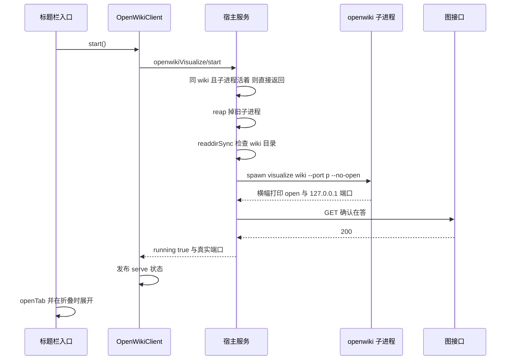
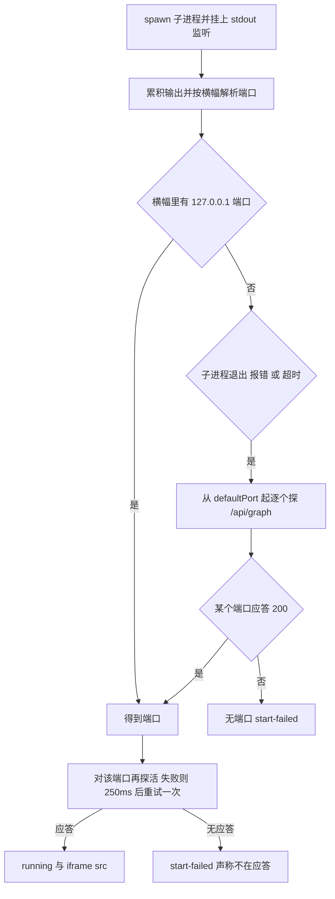

# OpenWiki 预览（宿主服务 + 浏览器半边）

`@zhangj1164/dsh-openwiki-visualize` 把 OpenWiki 官方的 `openwiki visualize` 阅读器搬进 DSH Web：发现工作区里的 wiki、在 loopback 上把它跑起来、用一个右侧栏标签把 `http://127.0.0.1:<port>` 嵌进面板，同时报告 openwiki 与 DSH 的环境、并允许用户显式把自己更新到最新版。

之所以是「一个包拥有两半」，是因为 openwiki 是 CLI，没有可导入的库面：`package.json` 只有 `bin`，没有 `exports`，所以能被依赖的编程接口只有「子进程 + 回环 HTTP + 静态产物」三种（[openwiki-visualize-reference.md](../../docs/openwiki-visualize-reference.md#L324-L342)）。于是宿主半边负责子进程与判定，浏览器半边负责 iframe 与入口，而 `cordis.patch.yml` 只插入**一行**——包体 `lib/index.js` 是插件本体，浏览器半边由同一份 manifest 的 `dsh.client` 声明发现并从 `<package>/client` 取 `lib/client.js`（[cordis.patch.yml](../../packages/openwiki/dsh-openwiki-visualize/cordis.patch.yml#L1-L21)、[package.json](../../packages/openwiki/dsh-openwiki-visualize/package.json#L45-L58)）。

这个包的形状本身就体现了一条分工原则，本页围绕它展开：

- **`environment.ts` 只做判定。** 全是其参数的全函数，没有文件系统、没有子进程、没有网络、没有时钟、没有全局量。版本闸门、横幅解析、wiki 识别因此可以在**没有装 openwiki 的机器上**被测（[environment.ts](../../packages/openwiki/dsh-openwiki-visualize/src/environment.ts#L1-L17)）。
- **宿主服务持有全部副作用。** `spawn`、`readdirSync`、`fetch`、`Date.now()` 只出现在 `src/index.ts`，而它每一个「怎么判断」都委托给 `environment.ts`（[index.ts](../../packages/openwiki/dsh-openwiki-visualize/src/index.ts#L1-L20)）。

## 宿主服务：两个副作用与八个 Remote 方法

`OpenWikiVisualizeService` 继承 `TypertRemoteService`、以 `openwikiVisualize` 为服务键注册，所以浏览器半边能经 API Gateway 以 `openwikiVisualize/<method>` 调到它（[index.ts](../../packages/openwiki/dsh-openwiki-visualize/src/index.ts#L147-L165)、[index.ts](../../packages/openwiki/dsh-openwiki-visualize/src/index.ts#L263-L292)）。每个方法都返回 `OpenWikiResult<T>`——业务信封，与传输信封分开：传输层回答「调用到没到」，业务层回答「活干成没成」（[types.ts](../../packages/openwiki/dsh-openwiki-visualize/src/types.ts#L21-L31)、[host-client-remote-contract.md](../architecture/host-client-remote-contract.md#L81-L115)）。

| 方法 | 副作用 | 失败形状 |
|---|---|---|
| `environment` | 跑 `openwiki --help`、读 DSH 清单/跑 `dsh --version` | **永不失败**：没装 openwiki 是一个发现（`found: false`），不是错误 |
| `workspace` | `readdirSync` 工作区的 wiki 目录、递归数页 | **永不失败**：读不到目录就是 `hasWiki: false` |
| `status` | 无（只读快照） | 永不失败 |
| `start` | `reap` + `spawn` 子进程 + 探 `/api/graph` | `wiki-missing` / `start-failed` |
| `stop` | 回收子进程 | 永不失败 |
| `version` | 有缓存走缓存，否则同 `checkUpdate` | 见下 |
| `checkUpdate` | `fetch` 注册表 | 不抛：不可达写成 `registry-unreachable` 数据 |
| `update` | 跑 `dsh plugin … add` | 不抛：安装失败写在 `updated: false` |

构造函数里登记两个 `ctx.effect`，它们决定了这个插件的生命周期边界（[index.ts](../../packages/openwiki/dsh-openwiki-visualize/src/index.ts#L276-L292)）：

- **回收子进程。** disposer 里调 `reap()`。子进程**活不过一次 reload**，这正是「重载插件不会留下第二个占着下一个端口的服务器」的原因。
- **启动时的一次注册表检查。** `updateCheckOnStart` 为真时 fire-and-forget 地 `checkUpdate()`，`catch` 吞掉异常——它既不能拖慢挂载，也不允许自动安装任何东西。

## 启动与回收：一个子进程的生命周期

`start()` 的顺序里有四条互相保护的规则（[index.ts](../../packages/openwiki/dsh-openwiki-visualize/src/index.ts#L362-L392)）：

1. **同一个 wiki 的重复请求幂等。** 只有当已记录的 `serve.wikiPath` 等于本次目标 wiki **且**子进程还活着时，才直接返回当前状态——所以连点两次入口不会为同一个端口赛跑两个子进程。
2. **先回收，再判断。** 不是同一个 wiki（或子进程已死）时无条件 `reap()`，然后才检查目录，最后才 spawn。任何时刻最多一个被跟踪的子进程。
3. **唯一的前置条件是「wiki 目录可读」。** 检查方式是 `readdirSync(wikiPath)`，不是 `classifyWikiDir`：目录不存在就返回 `wiki-missing`，并把消息写成「先在工作区跑 `openwiki --init`」。分类是 `workspace` 探针的职责，`start` 不重复它（见[工作区探测](#工作区探测与页面计数)）。
4. **端口是偏好，不是承诺。** `resolvePort` 只接受 CLI 会接受的整数端口，否则退回 `defaultPort`，再不合法就退回字面量 `4321`（[index.ts](../../packages/openwiki/dsh-openwiki-visualize/src/index.ts#L497-L502)、[environment.ts](../../packages/openwiki/dsh-openwiki-visualize/src/environment.ts#L208-L210)）。



图：一次点击从入口到面板可嵌入；端口由子进程自己报，`running` 只在对 `/api/graph` 探活成功后才成立。

`spawnVisualizer` 的其余细节（[index.ts](../../packages/openwiki/dsh-openwiki-visualize/src/index.ts#L646-L671)）：工作目录就是 wiki 目录本身；`startedAt` 在等待端口之前取；返回的 `url` 固定拼成 `http://127.0.0.1:<port>`（`LOOPBACK_HOST` 是常量，CLI 也没有任何 flag 能改绑定地址）。命令行由 `visualizeArgs` 生成，`--no-open` **不可省**——面板自己就是阅读器，让 CLI 再开一次系统浏览器等于每次启动都多弹一个没人要的窗口（[environment.ts](../../packages/openwiki/dsh-openwiki-visualize/src/environment.ts#L234-L247)、[service.spec.ts](../../packages/openwiki/dsh-openwiki-visualize/tests/service.spec.ts#L286-L307)）。

`stop()` 只是 `reap()` 之后回一份 `running: false` 的状态；`reap()` 先清 `child`/`serve` 再 `kill()`，已退出的子进程不需要再杀，也不会报错（[index.ts](../../packages/openwiki/dsh-openwiki-visualize/src/index.ts#L397-L402)、[index.ts](../../packages/openwiki/dsh-openwiki-visualize/src/index.ts#L528-L539)）。

**子进程死了不会抛给调用者。** `status()` 的快照判据是 `serve !== undefined && isChildAlive()`，`isChildAlive` 看 `exitCode === null && !killed`：子进程自己退出后，状态变成 `running: false`，但仍带上最后一次的 `wikiPath` 与 `lastFailure`，面板因此能说「为什么没在跑」而不是白屏（[index.ts](../../packages/openwiki/dsh-openwiki-visualize/src/index.ts#L504-L526)）。

一处需要知道的边角：如果 spawn 之后**端口始终没拿到**（横幅没出现、候选探测也没命中），`start` 抛出并记为 `start-failed`，但 `this.child` 仍指向那个子进程而 `serve` 为空——状态里看不到它，它会一直占着端口，直到下一次 `start()`/`stop()` 或插件卸载时的 `reap()` 把它收掉。所以「失败后重试」在这个实现里同时也是清理动作。

## 端口从哪来：横幅优先，探测兜底

CLI 在 `EADDRINUSE` 上按自己的预算逐端口递增，所以「我要的端口」与「它真绑上的端口」可以不同，而唯一权威来源是它自己打印的横幅（`open:  http://127.0.0.1:<port>`，且只绑 loopback）。`awaitPort` 因此实现成两道保险（[index.ts](../../packages/openwiki/dsh-openwiki-visualize/src/index.ts#L673-L723)、[environment.ts](../../packages/openwiki/dsh-openwiki-visualize/src/environment.ts#L186-L210)）：

- **第一道：解析横幅。** stdout 分块累积进缓冲，每次 `data` 都跑一遍 `parseVisualizePort`；该函数先 `stripAnsi` 去掉 SGR 色码（CLI 横幅本身就带颜色），再用 `http://127.0.0.1:(\d{1,5})` 抓端口，最后用 `isPortInRange` 拒绝 `1024–65535` 之外的值（`environment.spec.ts` 里 `99999` 被拒）。
- **第二道：候选探测。** 子进程 `exit`、`error` 或 `spawnTimeoutMs`（默认 15 s）超时都走 `probeFallback`：按 `portCandidates(defaultPort, portAttempts)` 逐个 `GET /api/graph`，第一个应答 `ok` 的端口即答案。



图：端口发现的两道保险与最后的探活闸门；注意兜底探测的起点是**配置里的 `defaultPort`**，不是本次请求的端口。

三件事值得记住：

- **兜底探测的起点是 `settings.defaultPort`，不是调用方请求的端口。** 若调用方显式要了一个落在候选区间之外的端口，横幅又恰好没出现，兜底就找不到它。这是实现里的一处真实不对称，改动端口策略时最容易踩到（[index.ts](../../packages/openwiki/dsh-openwiki-visualize/src/index.ts#L698-L705)）。
- **`running` 之前还有一次探活。** `confirmServing` 对刚宣布的端口 `GET /api/graph`，失败则等 250 ms 再试一次，仍失败就抛——「宣布了端口随即死掉」的子进程不算服务器，不能被交出去嵌入（[index.ts](../../packages/openwiki/dsh-openwiki-visualize/src/index.ts#L660-L731)）。探活复用的是 `registryTimeoutMs` 作为 fetch 超时。
- **监听器一定会被摘掉。** `finish` 只结算一次，随后清 timer、摘 stdout/exit/error 监听；`awaitPort` 的每条路径（成功、失败、超时）都经过它，所以不会泄漏监听也不会二次 resolve。

探活选 `/api/graph` 而不是 `/` 不是随意：这是 openwiki visualizer 的固定路由之一，返回当前图 JSON，既证明进程在答也证明它已经建好图；同时它也是本仓库参考文档里认定为「0.7.2 内稳定」的 HTTP 契约（[openwiki-visualize-reference.md](../../docs/openwiki-visualize-reference.md#L213-L232)）。

## Windows 的 `.cmd` 与引号

`spawnCli` 在两个平台上走两条完全不同的路径，原因不是风格而是可行性（[index.ts](../../packages/openwiki/dsh-openwiki-visualize/src/index.ts#L733-L760)）：

- **非 Windows 直接 spawn。** `spawn(command, args, { cwd, stdio })`，不经过 shell。
- **Windows 交给命令处理器。** npm 装出来的 CLI 是 `.cmd` 垫片，Node 不查 `PATHEXT`（裸名字直接 `ENOENT`），而 Node 18.20 起无 shell 的 `.cmd` 会 `EINVAL`——命令处理器是唯一可走的路。但 shell 拼接**不会**替参数加引号，一个含空格的工作区路径会被静默拆成两个参数，于是 `spawnCli` 先把整行逐 token 引号化，再 `spawn(line, { shell: true })`。

引号规则在 `quoteForWindowsCommandLine` 里，是个小但要紧的函数（[environment.ts](../../packages/openwiki/dsh-openwiki-visualize/src/environment.ts#L113-L136)、[environment.spec.ts](../../packages/openwiki/dsh-openwiki-visualize/tests/environment.spec.ts#L188-L218)）：

| 情形 | 结果 | 为什么 |
|---|---|---|
| `--no-open`、`/repo/openwiki`、`4321` | 原样 | 没有特殊字符就不加引号，命令行更可读 |
| `C:\My Projects\openwiki` | 加双引号 | 空格会把一个参数拆成两个 |
| `a&b`、`a\|b`、`a>b`、`a^b` | 加双引号 | 命令处理器的元字符 |
| `%USERPROFILE%`、`a!b` | 加双引号 | `cmd` 即使在双引号内也会展开它们，所以必须当成特殊值处理 |
| `say "hi"` | `"say ""hi"""` | 内嵌引号翻倍，而不是提前结束引号段 |
| 空串 | `""` | 宁可传一个空参数，也不要把它整个丢掉 |

`runToCompletion` 建在同一层之上，负责一次性命令：合并 stdout+stderr 成一份输出、超时即 kill 并 reject（消息里带 `spawnTimeoutMs`）、退出码非零即 reject——除非调用方显式 `tolerateFailure`（[index.ts](../../packages/openwiki/dsh-openwiki-visualize/src/index.ts#L762-L800)）。`tolerateFailure` 只为一件事存在：`openwiki --help` 在非 TTY 下会把横幅打完然后非零退出（Ink TUI 的 `Raw mode` 报错），而那个退出码不是「这个命令」的失败（[openwiki-visualize-reference.md](../../docs/openwiki-visualize-reference.md#L81-L82)）。

## 环境闸门：openwiki 与 DSH

`environment()` 先探 CLI、再读 DSH，最后把两个检查合成一个布尔：`ok = openwiki.found && openwiki.meetsMinimum && dsh.meetsMinimum`；`node` 与 `platform` 只作诊断信息附带（[index.ts](../../packages/openwiki/dsh-openwiki-visualize/src/index.ts#L296-L312)）。

**openwiki 探针**（[index.ts](../../packages/openwiki/dsh-openwiki-visualize/src/index.ts#L541-L579)）跑 `openwiki --help`（带 `tolerateFailure`），从横幅里用 `OpenWiki\s+v<version>` 抠出版本。三种结局都写成数据而不是异常：

| 结局 | `found` | `failure.code` |
|---|---|---|
| 有横幅且版本可解析 | `true` | 无（`meetsMinimum` 由比较得出） |
| 答了但横幅里没有版本 | `true` | `version-unreadable` |
| spawn 失败 | `false` | 消息含 `ENOENT` → `openwiki-not-installed`，否则 `openwiki-probe-failed` |

服务层用例钉住了这条「缺失是发现，不是异常」：spawn 抛 `ENOENT` 时 `environment()` 仍是 `ok: true` 的信封，只是报告 `found: false`（[service.spec.ts](../../packages/openwiki/dsh-openwiki-visualize/tests/service.spec.ts#L231-L243)）。

**DSH 版本**优先从已安装清单里读：按 `dshVersionPackages` 顺序（默认 `@deepseek-ai/dsh-base`、`@deepseek-ai/dsh-web-app`）用 `createRequire` 解析 `<pkg>/package.json` 并取 `version`；都解析不到才退回 `dsh --version` 的第一个空白分隔 token；连这条路也断，就写成 `version: 'unknown'`、`meetsMinimum: false`、`source` 为错误消息——**fail closed**，闸门不会因为读不到版本而通过（[index.ts](../../packages/openwiki/dsh-openwiki-visualize/src/index.ts#L581-L612)、[index.ts](../../packages/openwiki/dsh-openwiki-visualize/src/index.ts#L122-L126)）。

版本比较本身是纯函数（[environment.ts](../../packages/openwiki/dsh-openwiki-visualize/src/environment.ts#L138-L175)、[environment.ts](../../packages/openwiki/dsh-openwiki-visualize/src/environment.ts#L271-L305)）：

- 先比 `major.minor.patch`，再比 prerelease；**空 prerelease 列表（正式版）高于任何非空列表**，于是 `0.1.5-rc.1 < 0.1.5` 由规则自然得出，不需要在每个调用点特判。
- prerelease 逐位比较：两侧都是纯数字则按数值比；一侧数字一侧字母则数字更小；否则按字符串。
- 任一侧不可解析时 `compareVersions` 返回 `undefined` 而不是猜一个顺序，`meetsMinimum` 因此为 `false`。`environment.spec.ts` 对「不可解析 → 不通过」和「`0.7.2-rc.1 < 0.7.2` 所以不过闸」都有断言。

## 工作区探测与页面计数

`workspace()` 把 `workspacePath/wikiDirName` 当 wiki 路径（默认 `openwiki`），`readdirSync` 成功才往下走；读不到目录、或分类判定不是 wiki，都返回 `hasWiki: false` 的成功结果——面板据此禁用入口，而不是弹一个错误（[index.ts](../../packages/openwiki/dsh-openwiki-visualize/src/index.ts#L316-L340)）。

判定本身在 `classifyWikiDir` 里，规则照抄阅读器自己的边界（[environment.ts](../../packages/openwiki/dsh-openwiki-visualize/src/environment.ts#L37-L70)、[environment.ts](../../packages/openwiki/dsh-openwiki-visualize/src/environment.ts#L249-L269)）：

- **脚手架不算内容。** `INSTRUCTIONS.md` 与 `log.md` 是 openwiki 写的生成脚手架、且被 visualizer 的图构建排除，所以「只有 `INSTRUCTIONS.md`」——一次被中断的 init 会留下的形状——必须被判定为**没有 wiki**（[environment.spec.ts](../../packages/openwiki/dsh-openwiki-visualize/tests/environment.spec.ts#L165-L186)、[service.spec.ts](../../packages/openwiki/dsh-openwiki-visualize/tests/service.spec.ts#L277-L283)）。
- **至少要有一个 `.md` 内容页**才可能是 wiki。
- **标记按强度取最强的一个**：`.page-manifest.json`（生成过程自己写的）> `index.md`（阅读器依赖的分节索引）> 任意 markdown（最弱证据）。`service.spec.ts` 同时钉住「`index.md` → marker `index`」与「manifest 优先于 index」。

`pageCount` 由 `countPages` 递归得出，深度预算 `MAX_PAGE_DEPTH = 12`，按 basename 排除同样的两个脚手架文件（[index.ts](../../packages/openwiki/dsh-openwiki-visualize/src/index.ts#L161-L166)、[index.ts](../../packages/openwiki/dsh-openwiki-visualize/src/index.ts#L217-L246)）。递归的理由是**与旁边的阅读器对齐**：visualizer 的图遍历是递归的，只数顶层会让面板报的页数与 iframe 里的节点数互相矛盾。`readdirSync` 抛错时按 0 计，不中断整次探测。

于是三条边界值得记住：`workspace` 会用 `classifyWikiDir`，`start` 只用「目录可读」；`pageCount` 只在 `hasWiki` 为真时出现；路径解析的优先级是「调用方给的 `path`」>「配置的 `defaultWorkspacePath`」>「`process.cwd()`」（[index.ts](../../packages/openwiki/dsh-openwiki-visualize/src/index.ts#L490-L495)）。

## 自检更新：check 与 install 是两步

**检查可以自动，安装绝不能自动。** 这不是谨慎的措辞，而是分成了两个 Remote 方法、两条路径（[index.ts](../../packages/openwiki/dsh-openwiki-visualize/src/index.ts#L404-L486)）。

`checkUpdate()` 只读不写：

| 步骤 | 行为 |
|---|---|
| 自身版本 | 读构建产物旁边的 `../package.json`（`fileURLToPath(new URL('../package.json', import.meta.url))`），读不到就 `0.0.0` |
| 注册表 URL | `<registryUrl 去掉尾部斜杠>/<包名>`，作用域名的 `/` 先编码成 `%2F`——不编码的话注册表会把 scope 当路径段并回 404 |
| 请求 | `fetch` + `AbortSignal.timeout(registryTimeoutMs)`，只取 `dist-tags.latest` |
| 判定 | `latest !== undefined && meetsMinimum(latest, current) && latest !== current`，即**严格更新**才算有更新；相等不算 |
| 失败 | 不抛：写成 `failure.code = 'registry-unreachable'` 的报告，`updateAvailable: false`——离线机器不能看起来像最新版 |

两份报告（成功与不可达）都会存进 `cachedVersion`，`version({ cached: true })` 直接返回缓存，不重复问注册表（[service.spec.ts](../../packages/openwiki/dsh-openwiki-visualize/tests/service.spec.ts#L387-L410)）。目前浏览器半边只调用 `checkUpdate`，`version` 这条缓存通道是宿主侧已就绪、面板尚未使用的口子。

`update()` 是另一次显式调用，它跑 `dsh plugin --profile <profileName> add <packageName>@latest`，并把**实际跑过的命令行**一起返回，好让用户能照着手动重跑（[index.ts](../../packages/openwiki/dsh-openwiki-visualize/src/index.ts#L455-L486)）：

- `profileName` 默认取 `process.env.DSH_PROFILE ?? 'web'`（[index.ts](../../packages/openwiki/dsh-openwiki-visualize/src/index.ts#L128-L145)）。
- 它**改写 profile 的依赖**，所以成功时 `reloadRequired: true`，失败时 `false`；面板据此提示「更新完成，请重新加载 DSH 使其生效」。
- 两种结局都是 `ok: true` 的业务结果：安装失败体现在 `updated: false` 与 `output`（错误消息）里，调用方必须读报告而不是读信封（[service.spec.ts](../../packages/openwiki/dsh-openwiki-visualize/tests/service.spec.ts#L424-L456)）。

## 浏览器半边：三处注册

`apply(ctx)` 按依赖顺序做三件事，另加两项全局装配（[client/index.ts](../../packages/openwiki/dsh-openwiki-visualize/src/client/index.ts#L100-L174)）：

| 项 | 座位/身份 | 说明 |
|---|---|---|
| 样式 | `<style data-dsh-plugin="openwiki">` 挂到 `document.head` | 浏览器包没有 CSS 流水线，样式以 `CSS_TEXT` 字符串交付；颜色全走 `--dsw-alias-*` token，跟随主题 |
| 词典 | `ctx.locale.register('openwiki', { zh, en })` | 中文是键集真相源，英文按它的键类型化，漏键是编译错误 |
| 标签类型 | `ctx.sidebarRightTabs.register(...)` | `id` = 包名 `@zhangj1164/dsh-openwiki-visualize`，`kind` = `openwiki`，`multiple: false` |
| 面板体 | 键控座位 `sidebar.right.pane.tab`，`key` = **标签 id** | 用 id 不用 kind：kind 可以被别的实现接管，id 不能 |
| 标题栏入口 | `conversation.session.header.utilities`，`id` = `openwiki-visualize`，`order` = `-20` | `open-in-app` 在同列表持 `-10`，所以本按钮渲染在它左边——紧挨着「在本地打开工作区」那个控件 |

必需的注入只有三个：`['slots', 'locale', 'connection']`。`sidebarRight` **刻意不在注入列表里**：一个 profile 可以完全不组合右侧栏，而这个插件在那里仍然有用（它照样报告环境与 wiki），所以只做结构化读取，缺失时 `console.warn` 并放弃打开（[client/index.ts](../../packages/openwiki/dsh-openwiki-visualize/src/client/index.ts#L86-L94)、[client/index.ts](../../packages/openwiki/dsh-openwiki-visualize/src/client/index.ts#L142-L162)）。

**标签类型必须延迟注册。** 它走 `ctx.inject(['sidebarRightTabs'], scoped => …)` 而不是在 `apply` 里读一次 context：右侧栏是部署组合进来的外壳包，它自己的 factory 可能在本插件之后才跑，一次性读会**静默地什么都没注册**。用 scoped 注入，注册等注册表出现；没有右侧栏的 profile 连标签类型都不出现，但面板体与标题栏入口照常贡献（[client/index.ts](../../packages/openwiki/dsh-openwiki-visualize/src/client/index.ts#L124-L140)、[entry.spec.tsx](../../packages/openwiki/dsh-openwiki-visualize/tests/entry.spec.tsx#L347-L427)）。

**打开是「先启动、再开标签」。** 入口的 `open()` 先 `await client.start()`，拿到状态后才 `sidebar.openTab('openwiki', { params: { port } })`；`start` 失败就什么都不开——一个只指向已停服务器的标签就是个死面板。随后仅当列**已折叠**（`isExpanded?.() === false`）才 `toggleExpanded?.()`：无条件 toggle 会把用户本来展开的列折起来（[client/index.ts](../../packages/openwiki/dsh-openwiki-visualize/src/client/index.ts#L142-L162)、[entry.spec.tsx](../../packages/openwiki/dsh-openwiki-visualize/tests/entry.spec.tsx#L227-L261)）。

## 控制器：一份状态、一个信封

两半之间只有一条数据通道，浏览器侧的 `OpenWikiClient` 是它的单一入口：面板与入口订阅同一个不可变状态对象，所以一次加载不会变成两次宿主往返（[controller.ts](../../packages/openwiki/dsh-openwiki-visualize/src/client/controller.ts#L1-L12)、[controller.ts](../../packages/openwiki/dsh-openwiki-visualize/src/client/controller.ts#L70-L106)）。

`callRemote` 是所有调用的唯一出口（[controller.ts](../../packages/openwiki/dsh-openwiki-visualize/src/client/controller.ts#L42-L68)）：

```ts
const envelope = await rpc.call('/api', `${SERVICE_KEY}/${method}`, { args: { request } })
```

它在 `/api` 信道上按 `openwikiVisualize/<method>` 寻址，载荷固定是 `{ args: { request } }`——宿主 `Remote` 方法都只收一个 `request` 对象，这就是网关期待的形状（[controller.spec.ts](../../packages/openwiki/dsh-openwiki-visualize/tests/controller.spec.ts#L42-L51)）。**拆两层信封**：传输层的 `ok` 为假时用它的 `error`；`rpc.call` 抛错时合成 `rpc-failure`。于是调用方只有一种形状要分支（[host-client-remote-contract.md](../architecture/host-client-remote-contract.md#L105-L115)）。

状态机就四个值加三个「进行中」标志（[controller.ts](../../packages/openwiki/dsh-openwiki-visualize/src/client/controller.ts#L70-L106)）：

- `status: 'cold' | 'loading' | 'ready' | 'error'`，初始 `cold`；`checking`、`updating`、`starting` 各自门控一条并发路径；`reloadToken` 是 iframe 的 `key`，`reload()` 只是把它 +1，从而强制重新加载而不动服务端。
- `ensureLoaded()` 只在 `cold` 或 `error` 时加载，这正是「面板与入口同时挂载却只有一次宿主往返」的原因（[controller.spec.ts](../../packages/openwiki/dsh-openwiki-visualize/tests/controller.spec.ts#L211-L222)）。
- `refresh()` 依次发 `environment`、`workspace`、`status` 三枪，**三者全成才算 `ready`**，否则 `error`，并把第一个失败记为 `failure`（优先级 environment > workspace > status）（[controller.ts](../../packages/openwiki/dsh-openwiki-visualize/src/client/controller.ts#L156-L176)）。
- `start()` 里有一条容易漏掉的分支：宿主回的信封可以是 `ok: true` 但 `running: false`（例如 `wiki-missing` 就写在状态里），这时必须把 `status` 置 `error` 并取 `serve.failure`，不能因为信封成功就当成功。

连接重置时整份状态重载：`ctx.on('connection/reset', () => void client.refresh())`（[client/index.ts](../../packages/openwiki/dsh-openwiki-visualize/src/client/index.ts#L111-L120)）。

## 面板与入口

面板是「一条细状态栏 + 一个 iframe」（[Pane.tsx](../../packages/openwiki/dsh-openwiki-visualize/src/client/Pane.tsx#L100-L177)）。iframe 直指回环 URL，**不经过 DSH 的代理**——openwiki 服务既不发 `X-Frame-Options` 也没有 `frame-ancestors` 指令，所以跨源嵌入是被允许的，它剩下的 CSP 约束的是被框住的那份文档而不是宿主页面（[Pane.tsx](../../packages/openwiki/dsh-openwiki-visualize/src/client/Pane.tsx#L1-L10)、[openwiki-visualize-reference.md](../../docs/openwiki-visualize-reference.md#L346-L371)）。这也是为什么 `src` 必须是裸的 `http://127.0.0.1:<port>`：visualizer 的路由表精确匹配 `/`，任何路径或查询串都会 404。

`iframe` 的四个属性各有用途：`sandbox="allow-scripts allow-same-origin allow-forms allow-popups allow-popups-to-escape-sandbox"`、`referrerPolicy="no-referrer"`、`title` 取 `tab.title`（测试正是用 `findByTitle('OpenWiki')` 找它）、`key={reloadToken}`。

能不能嵌入由 `blockingReason` 决定，**顺序即优先级**：没装 openwiki（`empty.noTool`）→ 版本低于下限（`empty.belowMinimum`，文案里带 `minimumVersion`）→ 工作区没有 wiki（`empty.noWiki`）（[Pane.tsx](../../packages/openwiki/dsh-openwiki-visualize/src/client/Pane.tsx#L25-L39)）。空态里显示这个理由或 `empty.startFailed`、附带最后一次失败消息、「重试」按钮（只在没有阻断理由时出现）、更新后的「请重新加载 DSH」提示、以及一条离线提示——阅读器的 force-graph、marked、DOMPurify、Mermaid 与 Google Fonts 全部来自 CDN，断网时页面会白或没样式（[Pane.tsx](../../packages/openwiki/dsh-openwiki-visualize/src/client/Pane.tsx#L149-L164)、[locales.ts](../../packages/openwiki/dsh-openwiki-visualize/src/client/locales.ts#L40-L40)）。

状态栏在 `running` 时才会出现「重新加载 / 在浏览器中打开 / 停止」三个按钮；版本控制组按 `updateAvailable` 二选一——有更新显示「更新到 x.y.z」（brand 变体），没有则显示「检查更新」（[Pane.tsx](../../packages/openwiki/dsh-openwiki-visualize/src/client/Pane.tsx#L63-L98)）。注意面板只消费环境报告里「openwiki 是否可用/是否达标」这一部分，`dsh`、`node`、`platform` 目前只出现在 Remote 返回值里，不渲染。

入口按钮的规则更简单：**不可用就禁用并说明原因**，`title` 与 `aria-label` 取「启动中」/阻断理由/「预览 OpenWiki」，`disabled = reason !== undefined || starting`。这样没有 wiki 的工作区看起来是「这里没有可预览的东西」，而不是一个坏掉的预览（[EntryButton.tsx](../../packages/openwiki/dsh-openwiki-visualize/src/client/EntryButton.tsx#L30-L87)、[entry.spec.tsx](../../packages/openwiki/dsh-openwiki-visualize/tests/entry.spec.tsx#L263-L320)）。

## 配置面与不放进配置的常量

`Config` 的 15 个字段全部是可部署性变量，都有 schema 默认值；`cordis.patch.yml` 里逐条列出同名默认值，部署只覆盖自己需要的那几项（[index.ts](../../packages/openwiki/dsh-openwiki-visualize/src/index.ts#L79-L145)、[cordis.patch.yml](../../packages/openwiki/dsh-openwiki-visualize/cordis.patch.yml#L19-L38)）：

| 字段 | 默认 | 作用 |
|---|---|---|
| `minOpenwikiVersion` | `0.7.2` | 预览愿意驱动的 openwiki 下限（0.7.2 正是本插件依赖其路由的那一版） |
| `minDshVersion` | `0.2.1-rc.2` | 目标右侧栏标签注册表所在的 DSH 版本 |
| `wikiDirName` | `openwiki` | wiki 相对工作区的目录名，也是 `visualize` 的默认目标 |
| `defaultPort` / `portAttempts` | `4321` / `20` | 首选端口与候选个数（与 CLI 自己的重试预算对齐） |
| `registryUrl` / `packageName` | `https://registry.npmjs.org` / 本包 | 更新检查问谁、问哪个包 |
| `openwikiCommand` / `dshCommand` | `openwiki` / `dsh` | 被探测与 spawn 的 CLI；`dsh` 只用于更新动作 |
| `profileName` | `$DSH_PROFILE` 或 `web` | 更新动作安装进的 profile |
| `dshVersionPackages` | `dsh-base`、`dsh-web-app` | 用于读运行中 DSH 版本的清单，按序 |
| `updateCheckOnStart` | `true` | 启动即检查（永不安装） |
| `spawnTimeoutMs` / `registryTimeoutMs` | `15000` / `8000` | 任一子进程的运行上限 / 注册表请求上限 |
| `defaultWorkspacePath` | 空 | 调用方没说工作区时用哪个 |

**反面同样重要：有些值不允许成为配置。** 部署改了它们，插件就不再和 CLI 说话了，所以它们是模块常量而不是 `Config` 字段（[index.ts](../../packages/openwiki/dsh-openwiki-visualize/src/index.ts#L79-L88)、[index.ts](../../packages/openwiki/dsh-openwiki-visualize/src/index.ts#L155-L165)、[environment.ts](../../packages/openwiki/dsh-openwiki-visualize/src/environment.ts#L54-L70)）：

| 常量 | 值 | 为什么不能变 |
|---|---|---|
| `GRAPH_PATH` | `/api/graph` | 既是探活依据也是图契约的路由；visualizer 路由表是固定精确匹配 |
| `LOOPBACK_HOST` | `127.0.0.1` | CLI 硬编码只绑 loopback，也没有任何 flag 能改 |
| `SERVICE_KEY` | `openwikiVisualize` | 浏览器半边的寻址前缀，两半必须同一个字符串 |
| `OPENWIKI_SCAFFOLD_FILES` | `INSTRUCTIONS.md`、`log.md` | 与 visualizer 图构建的排除集一致；改了页数就和阅读器对不上 |
| `OPENWIKI_MARKERS` | `.page-manifest.json`、`index.md` | openwiki 自己写下的标记文件名 |
| `MINIMUM_PORT` / `MAXIMUM_PORT` | `1024` / `65535` | CLI 自己的端口校验区间 |
| `visualizeArgs` | `visualize … --port … --no-open` | 子命令名与「不起浏览器」的语义 |
| `MAX_PAGE_DEPTH` | `12` | 页数遍历的深度预算，与阅读器的递归范围对齐 |

浏览器侧的对应物是三个导出常量：`OPENWIKI_TAB_KIND = 'openwiki'`、`OPENWIKI_TAB_ID = '@zhangj1164/dsh-openwiki-visualize'`、`OPENWIKI_ENTRY_ORDER = -20`（[client/index.ts](../../packages/openwiki/dsh-openwiki-visualize/src/client/index.ts#L35-L59)）。它们是已发布的身份，不是部署旋钮。

## 失效模式

| 现象 | 机制 | 处置 |
|---|---|---|
| 入口按钮灰着说「当前工作区没有 OpenWiki」 | `workspace.hasWiki` 为假（目录不存在，或只有脚手架文件） | 在项目根跑 `openwiki --init` |
| 说 openwiki 低于最低要求 | 横幅版本低于 `minOpenwikiVersion`，或 `environment` 侧的版本不可解析（fail closed） | 升级 CLI，或为本次部署降低下限 |
| 面板空着并给出「重试」 | `start` 返回 `start-failed`，消息里带命令、端口与超时 | 读失败文案；必要时检查 CLI 是否可执行 |
| `start` 成功过一次、之后状态自己变成 `running: false` | 子进程自行退出，`isChildAlive` 为假；`lastFailure` 随状态回传 | 重新点入口（同时会清掉可能残留的旧子进程） |
| 端口不是要求的那个 | CLI 在 `EADDRINUSE` 上递增，插件报的是横幅里的真实端口 | 正常行为，不要按请求端口去连 |
| 兜底探测找不到显然在跑的服务器 | 候选区间起点是 `defaultPort` 而非调用方端口 | 让请求端口落在候选区间内，或让它出现在横幅里 |
| 面板加载出来但没样式/白屏 | 阅读器的 CDN 资源不可达 | 让浏览器能访问 jsdelivr 与 Google Fonts |
| 标签根本打不开 | profile 没有组合右侧栏 → `sidebarRightTabs` 从不出现；宿主日志有告警 | 组合右侧栏，或改用面板外的入口 |
| 「更新完成」后行为没变 | `update` 改写 profile 依赖，需要重载 DSH | 按提示重新加载 |
| 检查更新说不可达 | `registry-unreachable` 被当成数据缓存下来 | 修网络后显式再检查一次 |

## 测试钉住了什么

四个文件分工清晰，替身各管一段（[service.spec.ts](../../packages/openwiki/dsh-openwiki-visualize/tests/service.spec.ts#L8-L123)、[entry.spec.tsx](../../packages/openwiki/dsh-openwiki-visualize/tests/entry.spec.tsx#L87-L186)）：

| 文件 | 钉住的行为 |
|---|---|
| [environment.spec.ts](../../packages/openwiki/dsh-openwiki-visualize/tests/environment.spec.ts#L18-L218) | 版本解析/比较/prerelease 次序、不可解析即不通过、ANSI 剥离、横幅版本与横幅端口（含 `99999` 被拒）、端口区间与候选序列、`visualizeArgs` 必带 `--no-open`、脚手架不算 wiki、manifest 优先、Windows 引号全套（空格、`&`、`\|`、`>`、`^`、`%`、`!`、内嵌引号、空串） |
| [service.spec.ts](../../packages/openwiki/dsh-openwiki-visualize/tests/service.spec.ts#L196-L457) | 环境闸门与「缺失是发现」、配置抬高下限、工作区识别与递归页数、脚手架-only 被拒、按横幅端口报告真实端口（`4325`）、无 wiki 时 `wiki-missing`、`stop` 后 `running: false`、同一 wiki 幂等（只 spawn 一次）、更新检查与相等版本不算更新、不可达写成数据、缓存不二次请求、启动即检查一次、更新命令 argv 精确、失败不谎称成功 |
| [controller.spec.ts](../../packages/openwiki/dsh-openwiki-visualize/tests/controller.spec.ts#L42-L222) | `/api` + `openwikiVisualize/<method>` + `{ args: { request } }` 的线上形状、传输失败与业务失败的分流、`refresh` 三枪与 `ready` 规则、`start` 的两种失败分支、`reloadToken`、`ensureLoaded` 只加载一次 |
| [entry.spec.tsx](../../packages/openwiki/dsh-openwiki-visualize/tests/entry.spec.tsx#L188-L427) | 注入清单、样式只注入一次、两份词典键集一致、标签 id/kind/`multiple`/标题、面板键用 id、入口 `order` 严格小于 `-10`、点击后带着端口开标签、折叠才展开、三种禁用理由、iframe 的 `src` 与 `sandbox`、未运行时给「重试」、无右侧栏时优雅降级、注册表迟到仍能注册 |

服务层用例用 `vi.hoisted` 造一个可驱动的子进程替身（能按索引 emit stdout / exit / error），并用 `vi.stubGlobal('fetch')` 同时应答图探测与注册表；浏览器层用例用假 client context 复现外壳的装配顺序——注册错误（座位、键、order）都能通过类型检查，只有接线用例能抓住（[service.spec.ts](../../packages/openwiki/dsh-openwiki-visualize/tests/service.spec.ts#L20-L123)、[entry.spec.tsx](../../packages/openwiki/dsh-openwiki-visualize/tests/entry.spec.tsx#L87-L120)）。

## 相关页面

- 两层信封、`@Remote` 与浏览器半边的构建契约：[宿主-客户端 Remote 契约](../architecture/host-client-remote-contract.md)
- 一行 bundle 如何插进 profile、`dsh.client` 如何被消费：[插件组合与 bundle 层](../architecture/plugin-composition-and-bundles.md)
- `Config` 字段的写出路径与哪些改动仍需重启：[配置与热生效](../concepts/configuration-and-live-settings.md)
- 宿主服务的座位与生命周期约定：[DSH 宿主服务](../integrations/dsh-host-services.md)
- 子进程与网络替身、jsdom 接线用例的位置：[构建、测试与门禁](../operations/build-test-and-gates.md)
- 被嵌入的 CLI 的权威事实（路由、横幅、端口递增、frame 策略）：[openwiki-visualize-reference.md](../../docs/openwiki-visualize-reference.md)
