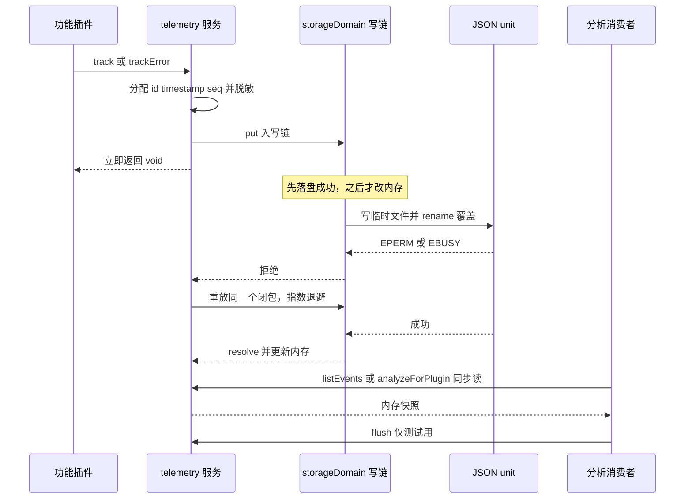
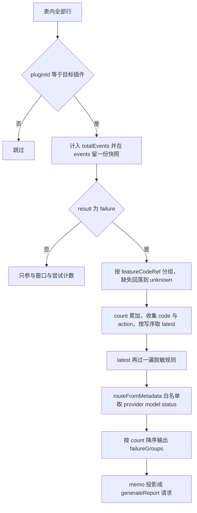

# 遥测服务（宿主）

`@zhangj1164/dsh-telemetry` 提供 cordis 服务键 `telemetry`，是这套插件里唯一的**本机事件日志**：功能插件用 `ctx.telemetry.track()` / `trackError()` 记下「谁试了什么、结果如何」，日志分析动作再用 `listEvents()` / `analyzeForPlugin()` 把它们读回来。它只写本机存储域，不发网络请求，也没有任何用户可见面（不注册模型工具、不带 UI）；它**不**继承 `TypertRemoteService`，因为浏览器永远不直接调用它——真正的 Remote 边界在消费方 `memo/analyzeLogs` 上（[index.ts](../../packages/telemetry/dsh-telemetry/src/index.ts#L1-L14)、[memo index.ts](../../packages/memo/dsh-memo/src/index.ts#L1638-L1655)、[README.md](../../packages/telemetry/dsh-telemetry/README.md#L93-L97)）。

这一页讲三件容易各自看对、合起来看错的事：**写入是 fire-and-forget 的排队操作**（同步读看不到还没落盘的事件），**顺序由序列号而不是时间戳决定**（同一毫秒里的失败与重试必须能分出先后），以及**脱敏是两遍的**（写入不可逆，所以读出时再跑一次同一套规则，才能覆盖「规则出现之前就写进去的行」）。

## 服务身份与生命周期

```ts
export class TelemetryService extends Service {
  static inject = ['storageDomain']
  static Config = Config
```

服务以 `super(ctx, 'telemetry')` 注册，并通过模块扩增把 `ctx.telemetry` 的类型挂到 cordis 上（[index.ts](../../packages/telemetry/dsh-telemetry/src/index.ts#L111-L126)）。`storageDomain` 是唯一的硬依赖：存储域不可用时它根本不激活，而不是降级成「只记内存」，因为一份重启就消失的日志对溯源没有价值。

初始化只有一件事——打开并独占遥测域，然后用 `ctx.effect` 把 `domain.close()` 挂成 disposer，让服务卸载时由自己负责关域（[index.ts](../../packages/telemetry/dsh-telemetry/src/index.ts#L161-L177)）：

```ts
protected async [Service.init](): Promise<void> {
  const domain = await this.ctx.storageDomain.open(telemetryDomainSpec)
  this.ctx.effect(() => async () => { await domain.close() }, 'telemetry.domainClose')
  const table = domain.table('events')
  this.table = table
  this.nextSeq = 1
  for (const [, row] of table.entries()) {
    const seq = row.seq ?? 0
    if (seq >= this.nextSeq) this.nextSeq = seq + 1
  }
}
```

域声明在最简形态上：`memo_telemetry`、`version: 0`、单表 `events`，键是事件 UUID，行 schema 在持久边界上校验（[spec.ts](../../packages/telemetry/dsh-telemetry/src/spec.ts#L15-L60)）。行 schema 有两条刻意的不对称：`seq` 在介质上可选、在交给调用方的 `TelemetryEvent` 上必需（否则第一次打开旧介质会把整份日志一起拒掉）；`result: 'failure'` 的行必须带 `error` 记录，靠 `refine` 在域边界拦住（[spec.ts](../../packages/telemetry/dsh-telemetry/src/spec.ts#L25-L51)、[types.ts](../../packages/telemetry/dsh-telemetry/src/types.ts#L39-L51)）。

失败语义都集中在两处。第一，`[Service.init]` 里 `open()` 没有 catch：域打不开，服务就不挂载，`ctx.get('telemetry')` 拿到 `undefined`，消费方（`memo/analyzeLogs`）转成 `github-issue-failure` 的业务失败而不是抛异常。第二，所有读写都经 `requireTable()`，生命周期错乱时抛 `telemetry: durable domain is not initialized`（[index.ts](../../packages/telemetry/dsh-telemetry/src/index.ts#L429-L435)）。

## 写路径：排队、重试、可丢

`track()` 与 `trackError()` 只在**调用点**做四件事：分配 `id`（UUID）、`timestamp`（`Date.now()`）、`seq`（`nextSeq++`），把 `metadata` 与 `error` 里的自由文本过一遍脱敏规则，然后把整行 `put` 排进域写链（[index.ts](../../packages/telemetry/dsh-telemetry/src/index.ts#L179-L221)）。差别只有两个：`trackError` 强制 `category: 'error'` 与 `result: 'failure'`；`track` 的 `category` 默认 `'user-action'`、`result` 默认 `'success'`。可选字段一律用 spread 合入（`...(input.sessionId === undefined ? {} : { sessionId })`），因为持久 schema 区分「没有这个键」与「键的值为 `undefined`」。

两个方法都返回 `void`：内部 `void this.trackWrite(this.writeWithRetry(...))` 把 Promise 记进 `pendingWrites`，谁都不 await。这正是 `flush()` 存在的原因——测试里必须先把在途写等到落定，同步的 `listEvents()` 才可能看到它们（[index.ts](../../packages/telemetry/dsh-telemetry/src/index.ts#L323-L342)）。



图：一次写入的完整路径，以及「读只能看见已落定的写」这条时序约束。

`writeWithRetry` 重放的是**已经构造好的那次写操作本身**，而不是重建记录；这是重试安全的全部理由——`id` 与 `seq` 在进循环前就分配好了，重建记录会在成功之后多写一条不同 id 的事件。只有 `EPERM` / `EBUSY` 算瞬时失败（`dsh-storage-json` 用「写临时文件 + rename 覆盖」发布 unit，Windows 上杀毒或索引器持有目标句柄时 rename 会失败），退避从 `storageWriteRetryDelayMs` 起每次翻倍、上限 5000 ms；`EACCES` 被刻意排除在瞬时集合之外，那是等一会儿也不会好的权限问题（[index.ts](../../packages/telemetry/dsh-telemetry/src/index.ts#L344-L365)、[index.ts](../../packages/telemetry/dsh-telemetry/src/index.ts#L438-L460)）。

重试预算耗尽时事件**被静默丢弃**：`track()` 的调用者无从得知，只有 `flush()` 会把那个拒绝重新抛出来，让测试不能把「少了一条事件」当成通过。这里有一个值得记住的副作用：`seq` 在 `track()` 调用点就已经消耗掉了，所以一次失败的写入会在存储里留下一个**序号空洞**——序列仍然严格单调，只是不再连续；排序与分组都不受空洞影响。

## 顺序契约：`seq` 定序，时间戳只做旧行兜底

日志的顺序不能交给 `Date.now()`：它只有毫秒分辨率，一次紧跟在失败之后的重试完全可能落在同一毫秒里，于是「之后」被算成 0 次，一个正在发生的缺陷读起来像一个已经停下的缺陷。所以每个事件带一个单调写序号 `seq`，并且全仓只有一个比较器：

```ts
const bySeq = (a.seq ?? 0) - (b.seq ?? 0)
return bySeq !== 0 ? bySeq : a.timestamp - b.timestamp
```

`seq` 缺席（旧介质里的行，读出为 `0`）时才回落到时间戳；两条同一毫秒的旧行在那个意义上不可再分，它们是唯一允许并列的输入（[index.ts](../../packages/telemetry/dsh-telemetry/src/index.ts#L462-L504)）。这个比较器被三处共用——`listEvents` 的排序、每个失败组 `latest` 的挑选、`attemptsAfterLastFailure` 的「之后」判定——共用它是为了让三处不会各自漂成三种不同的「更晚」。

序列在**开户时从存储最大值续上**：`nextSeq = 1`，遍历整张表，遇到 `seq >= nextSeq` 就抬到 `seq + 1`。这解释了两次关闭/重开之后为什么新事件仍排在所有旧行之后，也解释了「重启从 1 开始」为什么是一个真实缺陷——那样新事件会拿到旧记录已经持有的号，比较器随即整体退回比时间戳。续号的代价是开户时一次全表扫描（[index.ts](../../packages/telemetry/dsh-telemetry/src/index.ts#L161-L177)、[telemetry.spec.ts](../../packages/telemetry/dsh-telemetry/tests/telemetry.spec.ts#L369-L459)）。

`listEvents()` 的排序细节也一样重要：**先排序、后截断**。表按插入顺序迭代，先按 `limit` 截断再排序会把最老的几条返回，而「最新在前」是序号的属性、不是迭代顺序的属性（[index.ts](../../packages/telemetry/dsh-telemetry/src/index.ts#L241-L246)、[telemetry.spec.ts](../../packages/telemetry/dsh-telemetry/tests/telemetry.spec.ts#L157-L168)）。

## 读路径：同步、全表、内存态

`listEvents(query)` 与 `analyzeForPlugin(pluginId)` 都是**同步**方法，直接遍历存储域表的 `entries()` 快照。存储域把权威状态放在内存里（读同步；写先落盘成功才改内存，因此被拒绝的写不会让内存与介质不一致），所以「同步读」的代价是每次调用都把一个内存快照全扫一遍，而不是一次 I/O 往返（域的这一层契约见[存储与持久化](../architecture/storage-and-persistence.md)）。

- `listEvents` 按 `pluginId` / `category` / `result` / `from`（含） / `to`（不含）过滤，排序后截断。上限是 `Math.min(query.limit ?? 200, maxEventsPerQuery)`：调用方缺省时用 200，配置再把天花板压到 `maxEventsPerQuery`（默认 500）（[index.ts](../../packages/telemetry/dsh-telemetry/src/index.ts#L117-L118)、[index.ts](../../packages/telemetry/dsh-telemetry/src/index.ts#L223-L246)）。
- `analyzeForPlugin` **没有** limit 参数：它读该插件的全部事件，并且按组数乘以事件数地算「失败后的尝试次数」。日志规模上去时，这一侧才是先撞墙的地方，`maxEventsPerQuery` 管不到它。

`listEvents` 返回的是冻结的事件对象与冻结的 `error` 记录，但它唯一不深拷贝的字段是 `metadata`——那个对象与内存里的行是同一份。所以「调用方可以自由持有或修改返回值」只对能改的那一层成立：就地改写 `metadata` 会污染内存中的权威状态，直到下一次持久写覆盖它（[index.ts](../../packages/telemetry/dsh-telemetry/src/index.ts#L462-L504)）。

写入只在落盘成功后进入内存，这让「测试里 `track()` 之后立刻 `listEvents()` 能不能看到」变成一个纯时序问题，而不是一致性问题：看不到就是写还没落定，`flush()` 等它（[harness.ts](../../packages/telemetry/dsh-telemetry/tests/harness.ts#L29-L66)、[telemetry.spec.ts](../../packages/telemetry/dsh-telemetry/tests/telemetry.spec.ts#L117-L168)）。

## 脱敏契约：只改自由文本，分组键永远可读

写时脱敏发生在**写入之前**，并且不可逆。理由是这条日志的读者不只本机：`analyzeForPlugin` 的结果会成为模型提示词与预填的 issue 正文，所以这里漏掉一个密钥，它会在下一份报告里离开本机（[redaction.ts](../../packages/telemetry/dsh-telemetry/src/redaction.ts#L1-L37)）。

**只脱敏自由文本**：`error.message`、`error.stack`，以及 `metadata` 里递归的每一个字符串（数组和普通对象都走一遍；非字符串叶子保持值与类型；既非字符串也非普通数据的值会被 `String()` 掉，不让它未经检查地进存储）。**不脱敏**的是 `pluginId`、`action`、`category`、`result`、`sessionId`、`error.code`、`error.featureCodeRef`：这些是插件自己的分组键，脱敏它们保护不了任何插件没打算公开的东西，却会把日志分析赖以分组的信息毁掉（[index.ts](../../packages/telemetry/dsh-telemetry/src/index.ts#L380-L398)、[redaction.ts](../../packages/telemetry/dsh-telemetry/src/redaction.ts#L171-L212)、[README.md](../../packages/telemetry/dsh-telemetry/README.md#L47-L51)）。

规则的运行方式有四个约束：

1. **只编译一次。** 构造函数里 `compileRules(...)` 把规则编译进实例字段，写路径（每个用户动作都走）不再重建正则；`redact: false` 时编译结果是空数组，两遍脱敏都自动关掉（[index.ts](../../packages/telemetry/dsh-telemetry/src/index.ts#L141-L159)）。
2. **按顺序应用，先跑的规则命名。** 一个 token 既长又像 base64，默认集合把 `credential` 排在 `base64` 前面，读者因此看到「哪一类被移除了」而不只是「有东西被移除了」。`g` 与 `u` 标志强制加上，`flags` 里的 `g`/`y` 会被剥掉；替换文本里的 `{rule}` 换成规则名（[redaction.ts](../../packages/telemetry/dsh-telemetry/src/redaction.ts#L47-L169)）。
3. **坏规则被丢弃而不是抛出。** 配置里的正则写错，只是那条规则不生效——一个 typo 不该让宿主什么都记不下来（[redaction.ts](../../packages/telemetry/dsh-telemetry/src/redaction.ts#L127-L153)、[redaction.spec.ts](../../packages/telemetry/dsh-telemetry/tests/redaction.spec.ts#L136-L187)）。
4. **`redactionRules` 是替换而不是追加。** 默认集合就是一串具体的家族（邮箱、JWT、凭据、查询串凭据、家目录路径、`file:` URL、绝对路径、UNC、Windows 路径、身份证、手机号、IPv4/IPv6、长 hex、长 base64），部署觉得某一族太吵就写出自己那一套，而不是在我们这套上打补丁（[index.ts](../../packages/telemetry/dsh-telemetry/src/index.ts#L97-L109)、[telemetry.spec.ts](../../packages/telemetry/dsh-telemetry/tests/telemetry.spec.ts#L83-L99)）。

默认集合里还有几处刻意的「不吞」：单段路径（`/api`、`/v1`）不脱敏，因为那是通道名，一套连自己要解释的端点都嚼掉的规则是没人能调试的规则；路径规则遇到冒号终止，所以栈帧的 `:line:column` 位置保留下来；十八位数字要中间读得出日期才算身份证，十一数字要符合已分配的号段才算手机号——普通长数字因此幸存（[redaction.ts](../../packages/telemetry/dsh-telemetry/src/redaction.ts#L82-L122)、[redaction.spec.ts](../../packages/telemetry/dsh-telemetry/tests/redaction.spec.ts#L83-L134)）。

### 读出时再跑一遍同一套规则

写时脱敏不可逆，所以一条「规则出现之前就写进去」的行会把它本该删掉的内容原样留着。`analyzeForPlugin` 因此在出口处对每组失败携带的那条 `latest` 事件重跑**同一套编译后的规则**（`error.message`、`error.stack`、`metadata`）。这是那段文本变成模型提示词和预填 issue 之前的最后一道（[index.ts](../../packages/telemetry/dsh-telemetry/src/index.ts#L400-L427)）。

三个性质让这一遍既便宜又安全：它只作用于每组失败的那一条事件（成本按失败模式计，不按行计）；它是**幂等**的，因为已经带着 `[redacted:…]` 标记的值不匹配任何默认规则，回来时原样；它**没有自己的家族清单**，跑的就是部署当前的规则集，所以今天新增的一条规则能保护昨天写进去的行（[telemetry.spec.ts](../../packages/telemetry/dsh-telemetry/tests/telemetry.spec.ts#L462-L576)）。

边界也要说清：`listEvents` **不**重读——它是「宿主到底存了什么」的原始视图，也从不喂给报告；`redact: false` 时两遍都不跑，因为部署已经明确要一份逐字日志，读路径不该悄悄推翻这个选择。读路径同样不碰分组键，理由与写路径相同。

## `analyzeForPlugin` 返回什么，报告就只允许知道什么

`analyzeForPlugin(pluginId)` 是消费者的唯一入口，也是这个服务的**信息出口**：它返回的东西，就是下游报告提示词在遥测这一侧被允许知道的一切（[index.ts](../../packages/telemetry/dsh-telemetry/src/index.ts#L248-L321)、[types.ts](../../packages/telemetry/dsh-telemetry/src/types.ts#L132-L177)）。



图：一次 `analyzeForPlugin` 的分组路径，以及分析结果如何被消费方压缩成报告输入。

| 字段 | 语义 | 读取口径 |
|---|---|---|
| `totalEvents` / `totalFailures` | 该插件的全部事件数与失败数 | 全表扫描中按 `pluginId` 过滤后计数 |
| `window` | 该插件事件的 `[firstEventAt, lastEventAt]`，**无事件时缺席** | 只由该插件自己的事件定界，邻居插件的活跃不影响它；缺席表示「无话可说」，不是一个空区间 |
| `failureGroups[].featureCodeRef` | 分组键 | `error.featureCodeRef ?? 'unknown'` |
| `failureGroups[].count` | 组内失败数 | 组按 `count` 降序排列 |
| `failureGroups[].latest` | 组内**写序最晚**的那条失败（已再脱敏） | `compareOrder`，同一毫秒也分得出顺序 |
| `failureGroups[].errorCodes` | 组内出现过的不同错误码 | 集合去重后展开 |
| `failureGroups[].attemptsAfterLastFailure` | `latest` 之后、同一插件里、该组记录的 action 集合中任一 action 的事件数 | 按 action 而不是按总事件数：无关的读会把数字吹大，让一条旧失败看起来处在繁忙期；「之后」是写序，同一毫秒的重试也算 |
| `failureGroups[].route` | `latest` 所在的路由 | 白名单提取，见下 |

**路由白名单是这个服务唯一跨机器带出的元数据。** `routeFromMetadata` 只抄 `provider`、`model`、`status` 三个键，并要求前两者都是非空字符串、`status` 是有限数，缺一半就当作「这条事件没记录路由」，`route` 字段直接不出现。`metadata` 是插件自由填充的开放映射，而报告会变成 GitHub issue，所以整体拷贝等于把插件随手放进去的东西一起导出；增加一个键是一次有意的动作，不应该是调用方选择的副作用。「缺席 = 未记录」与「没有路由」被严格区分：旧事件天然没有 route，而一个显式记录了空路由的事件同样不会产生 route，两者含义不同（[index.ts](../../packages/telemetry/dsh-telemetry/src/index.ts#L516-L538)、[telemetry.spec.ts](../../packages/telemetry/dsh-telemetry/tests/telemetry.spec.ts#L257-L292)）。

### 消费方投影：分析结果比报告实际使用的更宽

`memo/analyzeLogs` 用 `ctx.get('telemetry')` 取服务（拿不到就返回 `github-issue-failure`），对 `logAnalysisPlugins`（默认 `['memo', 'github-issue']`）逐个调 `analyzeForPlugin`，再用 `mergeAnalyses` 合成一份：总数相加、窗口取并集、失败组拼接后按 `count` 重排（每组 `featureCodeRef` 已带插件前缀，不会撞名）。然后它把每个组压平成 `generateReport` 的请求字段——`errorCode` / `errorMessage` 只取 `latest.error` 的那一条、`lastFailureAt` 取 `latest.timestamp`、`attemptsAfterLastFailure` 原样、`route` 原样（[memo index.ts](../../packages/memo/dsh-memo/src/index.ts#L206-L215)、[memo index.ts](../../packages/memo/dsh-memo/src/index.ts#L413-L447)、[memo index.ts](../../packages/memo/dsh-memo/src/index.ts#L1638-L1675)、[github-issue types.ts](../../packages/github-issue/dsh-github-issue/src/types.ts#L13-L67)）。

这层投影有两个后果值得记住：

1. **`errorCodes`（复数）与 `latest.error.stack` 进不了报告。** 分析结果里带着它们，提示词构造只用到 `errorCode` / `errorMessage`（以及 `NOT_RECORDED` 占位）。所以读时脱敏覆盖 `stack` 是「上层可能加字段也不至于漏」的冗余，而不是当前提示词真会读到它。
2. **报告只能说它拿到的四件事**：路由、最后一次失败时间、失败后是否又跑过、错误码与消息。`buildReportUserPrompt` 把缺失项写成 `NOT_RECORDED`（而不是省略），让模型能区分「未记录」与「没有可说」，并在系统提示词里禁止编造分析未提及的机制（[github-issue index.ts](../../packages/github-issue/dsh-github-issue/src/index.ts#L1000-L1036)、[github-issue index.ts](../../packages/github-issue/dsh-github-issue/src/index.ts#L253-L295)）。

完整链路（谁调的、失败怎么收场）见[从日志分析到 Issue](../workflows/log-analysis-to-issue.md)，报告侧细节见[GitHub issue 服务](github-issue-service.md)，路由事实为什么必须逐字保全见[模型路由与失败事实保全](../concepts/llm-route-and-failure-facts.md)。

## 为什么它不是 Remote 服务

三个独立的理由，任何一个都足够：

- **调用方是宿主里的兄弟服务，不是浏览器。** `memo`、`github-issue` 都在宿主侧用 `ctx.get('telemetry')` 取它；`github-issue` 甚至把它声明成一个结构化的 `TelemetrySink`（只包含 `track` / `trackError`）而不是放进 `static inject`，这样没有遥测的部署照常激活（[github-issue index.ts](../../packages/github-issue/dsh-github-issue/src/index.ts#L233-L251)）。
- **一份「原始日志」不该是一个可任意翻查的浏览器端点。** 面向用户的是分析结果，而分析结果是带窄出口的投影：跨机器的路由只经白名单，自由文本在出口处重跑一遍脱敏，原始事件与 `stack` 都没有一条通到浏览器或提示词的路。
- **它没有自己的功能面。** 不带 UI、不注册模型工具，单独安装只多出别的插件可以消费的一个服务；`./client` 只是 `export type * from './types.ts'` 的类型投影，让浏览器侧能引用同一份类型定义而不产生第二份内容（[client.ts](../../packages/telemetry/dsh-telemetry/src/client.ts#L1-L10)、[package.json](../../packages/telemetry/dsh-telemetry/package.json#L8-L53)）。

顺带一提包内那个「空不变量」伴随插件：`invariant.ts` 注册了一个什么都不做的 installer，注释说明理由——事件的所有改动都经私有的写入路径，行 schema 在重开时校验，系统里不存在第二个权威（[invariant.ts](../../packages/telemetry/dsh-telemetry/src/invariant.ts#L14-L27)）。

## 配置与运维

| Config | 默认 | 作用 |
|---|---|---|
| `maxEventsPerQuery` | `500` | 一次 `listEvents` 返回的最大条数；`query.limit` 缺省 200，实际取值是两者较小者 |
| `redact` | `true` | 写时与读时脱敏的总开关。关掉会存逐字日志——这是调试自己规则集的部署需要的，也正因此那些记录不适合贴进 issue |
| `redactionMarker` | `[redacted:{rule}]` | 每条匹配的替换文本，`{rule}` 换成规则名 |
| `redactionRules` | 默认家族集合 | `{ name, pattern, flags? }`，按顺序应用；**替换**默认集合 |
| `storageWriteRetries` | `4` | 瞬时失败后的额外尝试次数（0..10）；`0` 表示只试一次 |
| `storageWriteRetryDelayMs` | `50` | 首次退避毫秒数（0..5000），每次翻倍，总上限 5000 ms |

配置用 Schemastery 声明并挂在服务的静态 `Config` 上（[index.ts](../../packages/telemetry/dsh-telemetry/src/index.ts#L55-L109)）；包自带的 bundle patch 只把它插进宿主组合并钉住 `maxEventsPerQuery: 500`（[cordis.patch.yml](../../packages/telemetry/dsh-telemetry/cordis.patch.yml#L1-L9)）。运维上有两个已知取舍：一次耗尽的写入会静默丢事件（只能靠 `flush()` 或日志层面察觉）；旧的逐字行只能靠读时脱敏兜住，不是一次数据迁移——想真正清掉必须重写存储。

## 扩展点

- **给失败事件加事实**：往 `metadata` 里加键是免费的（它会被脱敏、被持久化），但只有进入 `routeFromMetadata` 白名单的键才会跨出这个服务。加键时要同时改类型 `TelemetryFailureRoute`、白名单、以及消费方投影。
- **加脱敏家族**：写一条 `redactionRules` 配置即可，不需要改代码；读路径会自动把它应用到旧行上。反之，改代码里那份 `DEFAULT_REDACTION_RULES` 只影响使用默认值的部署。
- **加一个新的事件消费者**：用 `analyzeForPlugin` 而不是 `listEvents`——前者是唯一带脱敏复读与窄出口的读法；`listEvents` 的原始视图适合本机调试。
- **加一个新后端或新表**：改 `telemetryDomainSpec` 并遵守「新增字段必须可选」的介质兼容纪律，`seq` 就是这条纪律的样板（[spec.ts](../../packages/telemetry/dsh-telemetry/src/spec.ts#L25-L41)）。

## 测试落点

改动这个服务时，先看这几组用例——它们钉的是契约，不是实现：

- **写时脱敏**：`telemetry.spec.ts` 断言错误消息与栈被脱敏而 `code` / `featureCodeRef` 存活、嵌套 metadata 被递归处理且数字叶子保持类型、`redact: false` 逐字存储、部署自定义规则**替换**默认集合、以及已存的行不会被改写（[telemetry.spec.ts](../../packages/telemetry/dsh-telemetry/tests/telemetry.spec.ts#L32-L115)）。规则集本身由 `redaction.spec.ts` 逐样本覆盖：每种泄漏形状与控制样本各占一行，一条漏了会自己报出名字（[redaction.spec.ts](../../packages/telemetry/dsh-telemetry/tests/redaction.spec.ts#L83-L134)）。
- **读时脱敏**：旧行仍留在存储里逐字，但分析出口已经过规则；二次读不发生标记嵌套；`redact: false` 时不动；读路径跑的是部署当前规则而不是固定家族表（[telemetry.spec.ts](../../packages/telemetry/dsh-telemetry/tests/telemetry.spec.ts#L462-L576)）。
- **顺序**：钉住 `Date.now()` 后断言「同一毫秒的重试仍被计数」「同毫秒两条失败取后写的那条做 `latest`」「毫秒内倒序列出」「冷重启后序列续上」；另一个用例手写一份早于 `seq` 的 unit 文件，断言旧行读出 `seq: 0`、按时间戳兜底，且新写入排在所有旧行之后（[telemetry.spec.ts](../../packages/telemetry/dsh-telemetry/tests/telemetry.spec.ts#L295-L459)）。
- **分析口径**：按 `featureCodeRef` 分组、未知插件返回零且 `window` 缺席、窗口只由本插件事件定界、尝试次数按 action 且不跨插件（[telemetry.spec.ts](../../packages/telemetry/dsh-telemetry/tests/telemetry.spec.ts#L171-L292)）。
- **写重试**：注入两次 `EPERM` 后第三次成功（`attempts === 3`）、预算耗尽时事件被丢弃且 `flush()` 拒绝、`EACCES` 一次都不重试、`storageWriteRetries: 0` 只尝试一次（[telemetry.spec.ts](../../packages/telemetry/dsh-telemetry/tests/telemetry.spec.ts#L601-L661)）。注入点是测试专用后端 `json-flaky`：它包住真实的 JSON 后端、只装饰 `putRecord` / `deleteRecord`，所以被测路径下面仍是真实的域与真实的 unit，并且探针暴露 `attempts` / `arm(...)` 让用例瞄准「若干次成功之后的下一次写」（[flaky-storage.ts](../../packages/telemetry/dsh-telemetry/tests/flaky-storage.ts#L12-L99)、[harness.ts](../../packages/telemetry/dsh-telemetry/tests/harness.ts#L29-L66)）。
- **持久性**：冷重启后事件仍在（[telemetry.spec.ts](../../packages/telemetry/dsh-telemetry/tests/telemetry.spec.ts#L578-L599)）。

## 相关页面

- [存储与持久化](../architecture/storage-and-persistence.md) —— 域、表、行 schema 与打开/写入失败的共同契约
- [模型路由与失败事实保全](../concepts/llm-route-and-failure-facts.md) —— `provider` / `model` / `status` 为什么必须是这三个键
- [GitHub issue 服务](github-issue-service.md) —— 报告提示词那一侧如何消费这些事实
- [从日志分析到 Issue](../workflows/log-analysis-to-issue.md) —— 一次日志分析到建单的完整链路
