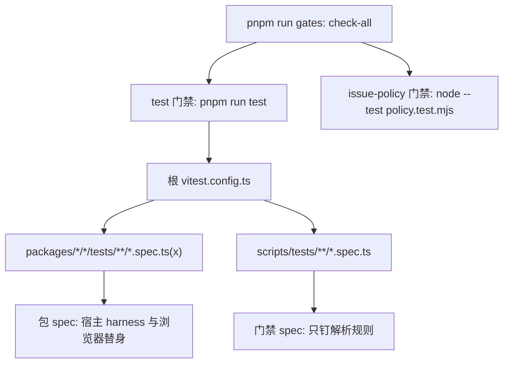
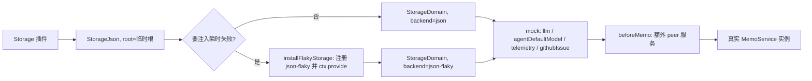

# 测试策略与测试接缝

这个仓库的测试不是在追覆盖率，而是在为**几类本地永远无法按需复现的失败**各留一个确定性的入口。四类失败决定了整套设计：Windows 上「杀毒软件或索引器按住文件、`rename` 撞上 `EPERM`」的定时竞争；部署里**没有注册**却被代码硬写进请求的模型 route；宿主与浏览器之间那层只有字符串约定的 Remote 命名缝；以及 `openwiki visualize` 这种要 spawn 子进程、读真实目录、探测真实端口的协作边界。

每一类都对应一个替身或一个真实边界，而不是一句「mock 掉就行」。这一页按「接缝一览 → 入口与发现 → 根配置的两个非显然事实 → 宿主 harness → 浏览器替身 → 子进程/文件系统接缝 → 钉契约的测试 → 三类 spec 的分工 → 本地验证期望」讲。门禁的调度与产物断言见[构建、测试与门禁套件](../operations/build-test-and-gates.md)，线上契约本身见[宿主 ⇄ 浏览器 Remote 契约](../architecture/host-client-remote-contract.md)，持久层语义见[存储与持久化](../architecture/storage-and-persistence.md)。

## 接缝一览

| 接缝 | 真身还是替身 | 让它可断言的东西 | 代表文件 |
|---|---|---|---|
| 存储介质 | 真 `StorageJson` + `mkdtemp` 临时根 | 落盘、重开、迁移后的文件事实 | memo / telemetry harness |
| 存储后端 | 注入 `json-flaky` 包装真实 `json` 后端 | 重试次数、重试预算、非瞬时 errno 不重放 | [flaky-storage.ts](../../packages/memo/dsh-memo/tests/flaky-storage.ts#L50-L99) |
| `llm` | mock 服务，只服务注册过的 route | `NO_ADAPTER`、route 解析、prompt 文本 | 两个宿主 harness |
| `telemetry` / `githubIssue` / `agentDefaultModel` | 记录型 mock，答固定值 | 上报了什么、回退到哪条 route | memo harness |
| `storageDomain` | 内存单表 mock | 状态读写（当介质语义不重要时） | [intake-harness.ts](../../packages/github-issue/dsh-github-issue/tests/intake-harness.ts#L74-L96) |
| peer 服务 | 由每个 spec 通过 `beforeMemo` 自挂 | 会话总结的候选集 | [session-summary.spec.ts](../../packages/memo/dsh-memo/tests/session-summary.spec.ts#L50-L100) |
| RPC（浏览器） | 答案表 + 真实 ISO 日历 | 传输信封层级、周期枚举、变更后刷新 | [fake-rpc.ts](../../packages/client/ui-memo/tests/fake-rpc.ts#L5-L13) |
| `configForms` | `FakeForm` | 暂存 vs 已接受、覆盖标记 | [fake-form.ts](../../packages/client/ui-memo-settings/tests/fake-form.ts#L26-L145) |
| 外壳 context | 对象字面量（`slots`/`locale`/`connection`/…） | 注册形状 | 三个 `entry.spec.tsx` |
| `node:child_process` | `vi.hoisted` + `vi.mock` 的假 spawn | 子进程生命周期、端口解析 | [service.spec.ts](../../packages/openwiki/dsh-openwiki-visualize/tests/service.spec.ts#L8-L123) |
| 文件系统 | 真临时工作区目录 | wiki 目录分类 | 同上 |
| 全局 `fetch` | `vi.stubGlobal` | 端口探测、registry 版本查询 | 同上 |
| 进程环境 | 真变量，测试内改后复原 | ledger 路径与一次性迁移 | memo harness / [ledger-home.spec.ts](../../packages/memo/dsh-memo/tests/ledger-home.spec.ts#L20-L64) |

同一张表里既有替身也有真身边界，这个混搭是刻意的：**能力边界用真身（存储介质、文件系统、子进程的输出流），只有「不可按需复现的外部输入」才用替身**（未注册的模型 route、杀毒软件造成的 errno、Host 的接受/拒绝决定）。

## 一套配置，两个 runner

`pnpm run test` 就是根目录的 `vitest run`，工作区里没有任何 per-package `vitest.config.ts`（[package.json](../../package.json#L9-L12)、[vitest.config.ts](../../vitest.config.ts#L53-L60)）。发现规则只有两条 `test.include`，它们划出的正是测试的两类来源：

- `packages/*/*/tests/**/*.spec.{ts,tsx}`——包的行为与契约测试。
- `scripts/tests/**/*.spec.ts`——门禁脚本自己的测试。

第二条容易被忽略但很关键：**门禁逻辑和包测试跑在同一套 vitest 里**，所以 `test` 门禁绿也意味着门禁代码本身绿。而 issue 策略套件走的是另一个 runner——`node --test .github/issue-management/policy.test.mjs`（`node:test` + `node:assert/strict`），在 `check-all` 里是一条独立门禁 `issue-policy`，不经过 vitest（[run-gates.ts](../../scripts/run-gates.ts#L172-L203)、[policy.test.mjs](../../.github/issue-management/policy.test.mjs#L1-L18)）。

一次 `pnpm run gates` 覆盖的两个 runner 与根 vitest 的两条发现规则。

发现规则还有一条隐含的命名约束：**只有 `*.spec.ts` / `*.spec.tsx` 是被收集的用例**。`harness.ts`、`fake-rpc.ts`、`fake-form.ts`、`flaky-storage.ts`、`intake-harness.ts` 都是普通模块，被 spec 显式 import，所以它们永远不会作为空套件被当成一个文件跑。反过来，把一个共享 harness 命名成 `*.spec.ts` 会让它变成「一个没有用例的套件」而失败。

## 根配置里两个不显然的事实

### 工作区包别名到 `src`，因为 `./client` 是纯类型投影

`resolve.alias` 把 `@zhangj1164/dsh-memo`、`/client`、`/types`（以及 github-issue、telemetry 的同名面）全部指到对应包的 `src/*.ts`（[vitest.config.ts](../../vitest.config.ts#L12-L52)）。原因是这些包的 `./client` 与 `./types` 面都是 `export type *` 的纯类型投影：**运行时解析它只会得到一个空模块**，客户端测试会以一条和真实原因毫不相干的错误失败。跑源码还买到第二个性质——构建坏了不会悄悄改变测试的含义。

别名用锚定的精确正则（`^…$`）而不是 Vite 的对象形式，因为对象形式先按包前缀匹配：一条 `@zhangj1164/dsh-memo` 会连 `@zhangj1164/dsh-memo/client` 和 `/types` 一起吞掉，于是 client 面的测试会拿到宿主入口。

### React / ReactDOM 钉到同一份，否则 jsdom 测试以无关理由失败

shell 打包的是 React 18，而工作区里被 hoist 上来的 ReactDOM 19 与 React 18 并存时，jsdom 组件测试会在第一条断言之前就抛 `Incompatible React versions`。所以配置用 `createRequire(new URL('./packages/client/ui-memo/package.json', …))` 解析 `react`、`react-dom`、`react-dom/client`、`react/jsx-runtime`、`react/jsx-dev-runtime`，五者必须是同一份拷贝（[vitest.config.ts](../../vitest.config.ts#L5-L10)、[vitest.config.ts](../../vitest.config.ts#L43-L50)）。`jsx-runtime` 那条同样是必需的：`react` 与 `react/jsx-runtime` 来自两份拷贝时，钩子会以 `Invalid hook call` 这种看似无关的形态失败。

配套的两件事：

- **jsdom 不是全局环境**，而是按文件用 `// @vitest-environment jsdom` docblock 打开。六个渲染型 spec（memo 看板、两个 Settings 页、三个 entry）这么做，其余测试留在 node 环境。因此 `jsdom` 与 `@testing-library/dom` 声明在根，而 `@testing-library/react` 声明在使用它的三个包里（[package.json](../../package.json#L25-L35)、[ui-memo/package.json](../../packages/client/ui-memo/package.json#L85-L85)）。
- **标准装饰器降级。** `@Remote` 装饰的 `TypertRemoteService` 子类要求 `standardDecorators()` 这个 `enforce: 'pre'` 插件先把装饰器语法用 `ts.transpileModule` 抹掉，再让 Vite 的默认解析器看代码；不含 `@Identifier` 的文件原样放行，所以它对每个包都安全，不需要 per-package 配置（[vitest-decorators.ts](../../scripts/vitest-decorators.ts#L16-L44)、[AGENTS.md](../../AGENTS.md#L110-L110)）。

jsdom spec 还共享一条清理约定：`afterEach(cleanup)` 之后要移除 `style[data-dsh-plugin]` 节点。插件会往 `<head>` 插一份自己的样式表，而某个用例断言的正是「只插一次」；没有这条清理，计数会跨用例泄漏（[entry.spec.tsx](../../packages/openwiki/dsh-openwiki-visualize/tests/entry.spec.tsx#L15-L18)、[entry.spec.tsx](../../packages/client/ui-memo/tests/entry.spec.tsx#L9-L12)）。

## 宿主服务 harness：真实存储域 + 记录型 mock

宿主侧的三个 harness 共享同一个骨架：在真实的 `Context` 上按顺序 `ctx.plugin()` 挂载插件，最后挂载被测服务本身，返回一个带 `dispose()` 的句柄。没有任何 `vi.mock` 参与——**宿主测试里的「真实」与「替身」是按能力边界划分的，不是按模块划分的**。

memo harness 的挂载顺序；顺序本身是契约，flaky 后端必须早于 `StorageDomain`。

### 真实存储域 + 临时根

memo harness 先挂 `Storage`，再挂 `StorageJson` 并把 `root` 指到 `mkdtemp(tmpdir()/dsh-memo-test-)`，然后挂 `StorageDomain`，最后才挂 `MemoService`（[harness.ts](../../packages/memo/dsh-memo/tests/harness.ts#L396-L431)）。**存储域、JSON 后端、真实落盘都是真的**，因为被测的正是「这一笔写到底有没有落到介质上、重开之后还在不在」。telemetry harness 用同一套骨架，并额外提供 `disposeKeepRoot()`：关掉 context 但保留存储根，让「冷重启后事件还在」这种测试能共用同一个目录（[harness.ts](../../packages/telemetry/dsh-telemetry/tests/harness.ts#L29-L66)、[telemetry.spec.ts](../../packages/telemetry/dsh-telemetry/tests/telemetry.spec.ts#L578-L599)）。

`github-issue` 的 harness 相反：它不需要持久语义，所以只挂 mock 的 `llm`、`telemetry`（可选）与 `agentDefaultModel`，并记录每次调用的 prompt 与 route（[harness.ts](../../packages/github-issue/dsh-github-issue/tests/harness.ts#L120-L177)）。intake 一侧更进一步：状态表的替身是一个**内存单表 `storageDomain` mock**，只有当「状态被读写了」这件事本身重要、而介质语义不重要时才这么做（[intake-harness.ts](../../packages/github-issue/dsh-github-issue/tests/intake-harness.ts#L74-L96)）。这三档是同一光谱上的选择，不是不一致。

### 环境隔离：ledger 的两处 home

memo 的 AI 分析 ledger 是这个套件里唯一绕过存储域、直接写文件系统的状态，而且它的一次性迁移会读取平台 home 下的 `memo/ledger.json`、合并后把原文件重命名成 `.migrated` 收据。因此 harness 默认把 `DSH_HOME`、`HOME`、`USERPROFILE` 三个变量一起指到本次测试的临时根，并在 `dispose()` 里恢复进程启动时的值；只隔离 `DSH_HOME` 会让一次测试运行吃掉并迁移开发者真实的 legacy ledger（[harness.ts](../../packages/memo/dsh-memo/tests/harness.ts#L301-L342)、[harness.ts](../../packages/memo/dsh-memo/tests/harness.ts#L364-L394)）。自己接管环境的用例显式传 `ledgerHome: 'inherit'`，然后自建临时目录、自设变量、`afterEach` 复原（[ledger-home.spec.ts](../../packages/memo/dsh-memo/tests/ledger-home.spec.ts#L20-L64)）。

harness 的失败路径也必须清理：挂载中任何一步抛错都会 `dispose` fiber、删掉临时根、恢复环境，然后才重新抛出——否则一个失败的用例会把 JSON 单元留在磁盘上，影响后续用例与真实目录（[harness.ts](../../packages/memo/dsh-memo/tests/harness.ts#L432-L450)）。

### `beforeMemo`：为 peer 服务留的扩展点

memo 服务的 `static inject` 是 `['storageDomain', 'telemetry', 'githubIssue']`，但会话总结还需要 `workspaceRegistry` 与 `sessionQuery` 这类生产组合里存在的 peer。harness 不替这些包背依赖，而是把 `beforeMemo(ctx)` 回调放在 mock 之后、`MemoService` 之前，让单个 spec 自己挂所需的服务（[harness.ts](../../packages/memo/dsh-memo/tests/harness.ts#L346-L360)、[harness.ts](../../packages/memo/dsh-memo/tests/harness.ts#L423-L423)）。会话总结的 spec 就在这个回调里挂两个 mock：一个只报官方归档集合的 `workspaceRegistry`，一个用一份 fixture 同时回答 header、title 快照与 surface 事件的 `sessionQuery`（[session-summary.spec.ts](../../packages/memo/dsh-memo/tests/session-summary.spec.ts#L50-L100)）。

### mock `llm`：只服务它注册过的 route

memo harness 的 `MockLlmService` 是这个套件里最重要的一处设计决定。它**只认识自己注册过的 route**：请求的 `provider` 不在注册表里，或 `model` 不在该 provider 的目录里，就返回一个终态的 `finish` 块，其 `reason` 是 `{ kind: 'error', failure: { code: 'NO_ADAPTER', … } }`——这正是 DSH 对「部署没注册这个适配器」的归一化形状（[harness.ts](../../packages/memo/dsh-memo/tests/harness.ts#L82-L188)）。文档注释把动机写得很直白：一个「接受任何 route」的 mock 曾让一个硬编码的、未注册的 provider 通过全部测试。

同一条设计延续到几个可配开关上：

- `behaviour: 'text' | 'empty' | 'route-error'` 决定正常出字、正常但空、还是带指定 `failure` 失败；`catalogThrows` / `extraProviders` 则让「整张注册表」与「部署默认的那一条 route」成为两件可区分的事。
- `calls` 记录每次调用的 `provider`、`model`、`system` 与首条消息的文本，于是 prompt 内容本身也能断言，而不只是「调用发生过」。
- `withoutLlm` 模拟「部署里根本没有模型 route」；`followAgentDefault` 挂一个 `agentDefaultModel` mock 并**不**给服务钉 route，逼它走真实部署的回退路径；两者都不用时，harness 把 `provider`/`model` 钉到 `TEST_ROUTE`，让 service 解析到 mock 注册过的那一条（[harness.ts](../../packages/memo/dsh-memo/tests/harness.ts#L301-L321)、[harness.ts](../../packages/memo/dsh-memo/tests/harness.ts#L411-L431)）。

`github-issue` 的 harness 把同一件事拆成三个独立替身，因为它的失败形态不同：正常出字、`finish` 带 `failure`、以及 `stream()` 直接抛（一个逃出 DSH 归一化的传输失败）。中间那个替身的注释指出，`error` / `aborted` 两种 finish reason 都携带必需的 `LlmFailure`，一个省略它的 mock 会让服务把机器可路由的错误码丢掉而无人发现（[harness.ts](../../packages/github-issue/dsh-github-issue/tests/harness.ts#L32-L89)）。

这套 mock 还让「配置在运行期被就地提交」这类契约可测：`config-volatile.spec.ts` 用 `updateVolatile` 改写 `ctx.memo.config.provider` 后立刻调用 `analyze`，断言失败码是 `NO_ADAPTER` 且回带的 provider/model 是**新值**——这证明服务在每次使用时读配置，而不是在构造时把它拷进实例字段（[config-volatile.spec.ts](../../packages/memo/dsh-memo/tests/config-volatile.spec.ts#L81-L108)）。

## 注入式 flaky JSON 后端：把 Windows 改名竞争变成确定性

真实的失败是 `dsh-storage-json` 单元用 `rename(tmp, target)` 发布时，Windows 上有另一个读句柄（杀毒、索引器）按住目标文件，于是得到 `EPERM`。这是纯定时竞争，**不可能按需复现**，所以测试换了个做法：不 mock 存储域，而是把**真实的 JSON 后端包一层**，只在最初 N 次持久写上前置一个注入失败（[flaky-storage.ts](../../packages/memo/dsh-memo/tests/flaky-storage.ts#L1-L10)）。

机制值得逐点看清：

- `installFlakyStorage` 从 `ctx.storage.backend.get('json')` 取到已经挂载的真实后端，注册一个名为 `json-flaky` 的包装后端；它的 `kv.open()` 打开真实单元，然后**只装饰 `putRecord` 与 `deleteRecord`**——两者都先 `injectFailure()` 再委托，`loadAll`、`setGlobal`、`close`、`backupRecord` 原样透传。所有状态仍落在介质上、仍经过真实 JSON 单元的发布路径，所以一次重试过的写必须真正活下来（[flaky-storage.ts](../../packages/memo/dsh-memo/tests/flaky-storage.ts#L39-L86)）。
- 注册之后还要 `ctx.provide('storage.backend.json-flaky', backend)`：域层是在**它配置里指定的那个后端**的生命周期键上激活的，包装后端必须在 `StorageDomain` 挂载前先提供这个键，否则域会等一个永不到来的后端（[flaky-storage.ts](../../packages/memo/dsh-memo/tests/flaky-storage.ts#L87-L90)）。
- 返回的探针有 `attempts` 与 `arm(failures, code)`：`arm` 让用例可以「先让前几笔写成功，再定向打坏接下来那一笔」，因此归档的 put 与 undo 的 delete 能被分别检验，而不是让 put 吃掉整个预算（[flaky-storage.ts](../../packages/memo/dsh-memo/tests/flaky-storage.ts#L26-L37)、[flaky-storage.ts](../../packages/memo/dsh-memo/tests/flaky-storage.ts#L91-L99)）。

由此得到的断言都是「第几次尝试」这种精确事实：两次失败后成功是 `attempts === 3`；归档 put 与 unarchive delete 各坏一次是 `4`；预算用尽时（一次初始 + 四次重试）写入以 `code: 'EPERM'` 拒绝且 `attempts === 5`；`EACCES` 一次都不重放（[memo.spec.ts](../../packages/memo/dsh-memo/tests/memo.spec.ts#L1064-L1111)）。telemetry 侧的四个用例是同构的：重放、预算用尽丢弃事件、`EACCES` 不重放、`storageWriteRetries: 0` 时只尝试一次（[telemetry.spec.ts](../../packages/telemetry/dsh-telemetry/tests/telemetry.spec.ts#L601-L660)）。

两个配套的可配置点让这些测试跑得快而生产仍然保守：生产默认是 4 次重试、基数 `50 ms` 的指数退避（上限 5 s），harness 在注入失败时把 `storageWriteRetryDelayMs` 覆盖成 `1`（[memo/index.ts](../../packages/memo/dsh-memo/src/index.ts#L333-L354)、[harness.ts](../../packages/memo/dsh-memo/tests/harness.ts#L429-L430)）。「哪些 errno 算瞬时」是一个显式集合 `{EPERM, EBUSY}`——`EACCES` 被刻意排除，因为它是真实权限问题的签名，等待不会修好它。

## 浏览器半边的替身：抓的是缝，不是组件

浏览器侧有三类替身，各自替掉一个**外壳提供的边界**。

### fake RPC：一个足够真实的宿主

`createFakeRpc()` 不是「返回固定值」的桩，而是模拟了宿主 memo 服务里 UI 真正依赖的三件事（[fake-rpc.ts](../../packages/client/ui-memo/tests/fake-rpc.ts#L5-L13)）：

- **线上形状**：`call()` 返回传输信封包着业务结果，也就是 `{ ok: true, value: { ok: true, value } }` 两层。把业务结果直接当返回值会塌掉一层，让 loader 去读一个数组的 `.ok`（[fake-rpc.ts](../../packages/client/ui-memo/tests/fake-rpc.ts#L484-L497)）。
- **真实日历**：`listPeriods` 用真正的 ISO 周 id 与「周四归属」规则枚举每个周期的周 id，所以看板的周期过滤是被真正执行的，而不是被 stub 掉（[fake-rpc.ts](../../packages/client/ui-memo/tests/fake-rpc.ts#L93-L216)）。
- **变更后刷新**：`addEntry` / `updateEntry` / `deleteEntry` / `archiveQuarter` / `summarizeSession` 都真的改内部状态，于是「点一下 → 重新拉一遍」这条循环里的错误（例如刷新后卡片重复）会暴露出来；`listArchivedSessions` 还会反映刚写进去的总结，让重开的挑选器不再邀请重复总结（[fake-rpc.ts](../../packages/client/ui-memo/tests/fake-rpc.ts#L287-L428)）。

它的失败开关也分两类：`failWith`（每个调用都失败）与 `failOn`（按方法名失败）。route 相关的那部分刻意复刻宿主语义：`analyze` 让请求里的 override 赢、但 provider 必须真的在注册表里，否则以 `llm-failure` 拒绝；`githubIssue/optimizeIssue` 复刻「请求 → Config → `agentDefaultModel`」的解析顺序，`noModelRoute` 才产生 `route-missing`（[fake-rpc.ts](../../packages/client/ui-memo/tests/fake-rpc.ts#L429-L469)）。

还有一个把不变量写成断言助手的例子：`expectNoModelRouteInRequests(calls)` 断言没有任何请求携带 `provider`/`model`。理由是浏览器**不能替部署决定 route**——它无法知道注册了哪些适配器；用户在选择器里选中的模型不算违规，因为那份目录来自宿主（[fake-rpc.ts](../../packages/client/ui-memo/tests/fake-rpc.ts#L537-L550)）。

### FakeForm：`configForms` 的接受/拒绝语义

Settings 页面的替身不是 RPC，而是 Host 的配置表单。`FakeForm` 实现了 `ConfigForm` 的两件关键行为：一次写要么落成一个新的已接受快照（并通知订阅者），要么被拒绝而什么都不改；而 `user` 层决定哪个字段算「已被用户覆盖」（[fake-form.ts](../../packages/client/ui-memo-settings/tests/fake-form.ts#L1-L30)）。`set` / `unset` / `mutate` 记录每一次写入并可整体拒绝，`replace` / `setWritable` / `setStatus` 则让用例驱动镜像状态（`ready`、不可写、以及别的一些状态）与 revision 递增（[fake-form.ts](../../packages/client/ui-memo-settings/tests/fake-form.ts#L69-L145)）。

`MemoSettingsDraft` 的整个存在理由就是「用户暂存了什么」与「Host 接受了什么」是两件事，所以它的 spec 专钉四种泄漏：一次保存写了比编辑更多的字段、拒绝时静默丢掉草稿、reset 没走到 `unset`、以及 Host 已追上后草稿还活着（[form.spec.ts](../../packages/client/ui-memo-settings/tests/form.spec.ts#L1-L80)）。

### 外壳 context：对象字面量，但跑的是真入口

三个 `entry.spec.tsx` 都不渲染组件树，而是把**真实的 `apply()`** 对着一个字面量造的外壳调用：`ctx.slots.register` 把注册项收进数组，`ctx.locale.register` 收字典，`ctx.get('connection')` 返回 `{ rpc: { call } }`（真 RPC 或答案表），`ctx.get('sidebarRightTabs') / ('sidebarRight')`（openwiki）与 `ctx.configForms`（settings）各自返回最小的可用实现（[entry.spec.tsx](../../packages/client/ui-memo/tests/entry.spec.tsx#L28-L100)、[entry.spec.tsx](../../packages/client/ui-memo-settings/tests/entry.spec.tsx#L63-L119)、[entry.spec.tsx](../../packages/openwiki/dsh-openwiki-visualize/tests/entry.spec.tsx#L87-L186)）。

这样测的是**注册决策**，而组件自身的渲染由各自的 spec 覆盖：`inject` 数组必须逐项相等、注册数量、每个注册的 `id`/`order`/`locale`/`label` 形状、tab 的 `kind`/`id`/`multiple`、pane 用 definition id 而不是 kind 作 `key`、会话头入口的 order 必须小于 `open-in-app` 的 `-10`（[entry.spec.tsx](../../packages/client/ui-memo/tests/entry.spec.tsx#L102-L120)、[entry.spec.tsx](../../packages/client/ui-memo-settings/tests/entry.spec.tsx#L121-L153)、[entry.spec.tsx](../../packages/openwiki/dsh-openwiki-visualize/tests/entry.spec.tsx#L188-L225)）。这些错误全都「类型检查过得去、只有真实外壳里才表现为什么都没发生」，所以必须由入口测试接住。

## 可视化插件：子进程与文件系统接缝

`dsh-openwiki-visualize` 的宿主侧要 spawn 两个 CLI、读真实目录、探测本机端口，因此它的 falsification 面比存储域那套更宽。

**子进程**用 `vi.mock('node:child_process')` 替掉：`spawn` 的假实现把每次调用连同三张 handler 表（stdout、stderr、child 事件）一起记录，并暴露 `emitStdout(index, text)` / `exit(index, code)` / `fail(index, error)`，所以用例可以按索引驱动「第几次 spawn」的 stdout、退出码或 spawn 错误。两个细节是必需的：共享状态必须用 `vi.hoisted` 构建（`vi.mock` 被提升到 import 之上），而 responder 用 `setTimeout(…, 0)` 触发——服务在 `spawn` 返回后**同步**挂监听器，晚一个 tick 的响应总能找到它们（[service.spec.ts](../../packages/openwiki/dsh-openwiki-visualize/tests/service.spec.ts#L8-L123)）。假 `spawn` 同时接受 `(command, args, options)` 与 Windows 上的 `(line, options)` 两种形态，并把后者切回 argv，于是断言谈的始终是参数而不是命令行字符串——这正好对应生产代码里「非 win32 直接 spawn、win32 经命令处理器」的分叉（[index.ts](../../packages/openwiki/dsh-openwiki-visualize/src/index.ts#L733-L760)）。

**文件系统**不 mock：每个用例 `mkdtemp` 一个真实工作区并在里面造 `openwiki/` 目录树，让 `readdirSync` 的分类逻辑真的跑一遍（脚手架文件、`index.md`、manifest、嵌套分节各有断言），`afterEach` 统一删根（[service.spec.ts](../../packages/openwiki/dsh-openwiki-visualize/tests/service.spec.ts#L134-L145)、[service.spec.ts](../../packages/openwiki/dsh-openwiki-visualize/tests/service.spec.ts#L186-L194)）。端口探测与 registry 查询走全局 `fetch`，所以用 `vi.stubGlobal('fetch')` 同时回答 `/api/graph` 探针与 npm registry 的 `dist-tags`（[service.spec.ts](../../packages/openwiki/dsh-openwiki-visualize/tests/service.spec.ts#L157-L170)）。

由此可断言的行为都是「对外事实」而不是内部实现：announce 的端口来自解析出的 banner，而不是请求的端口（CLI 会自增到 4325）；`visualize` 永远带 `--no-open`，因为面板自己嵌阅读器；同一个 wiki 的第二次 `start` 只 spawn 一次；启动时的版本检查是 fire-and-forget，所以用 `vi.waitFor` 等它发生（[service.spec.ts](../../packages/openwiki/dsh-openwiki-visualize/tests/service.spec.ts#L286-L321)、[service.spec.ts](../../packages/openwiki/dsh-openwiki-visualize/tests/service.spec.ts#L412-L422)）。纯函数部分（版本比较、banner 解析、端口范围、Windows 命令行引号、目录分类）完全不需要进程与网络，单独一个 `environment.spec.ts` 就够（[environment.spec.ts](../../packages/openwiki/dsh-openwiki-visualize/tests/environment.spec.ts#L18-L219)）。

浏览器半边则回到 fake RPC：`controller.spec.ts` 的假 caller 按 endpoint 查答案表，并特意断言发出的 payload 是 `{ args: { request: {} } }`——这是宿主生成的网关唯一接受的形参绑定形状（[controller.spec.ts](../../packages/openwiki/dsh-openwiki-visualize/tests/controller.spec.ts#L12-L51)）。

## 钉契约而不是钉行为的测试

有一小类测试不验证任何行为，只钉住「一旦破了也照样类型检查通过」的约定。它们的代价是维护成本，收益是把静默失败变成响亮的失败。

| 钉住的东西 | 怎么钉 | 加什么会撞上 |
|---|---|---|
| 每个 `@Remote` 方法只有一个名为 `request` 的形参 | 读 `src/index.ts` 源码文本，用正则抽出 `@Remote('name')` 后的签名；先断言抽到了 10 个以上且包含 `listArchivedQuarters`（防止重构后变成永远通过的空检查），再断言签名以 `request` 开头且不含逗号 | 新增 Remote 方法时形参名写错，或加了第二个形参 |
| `readExternalPath` 不在 Remote 面上 | `remoteMethods(memo)` 映射出的 endpoint 表必须含 `memo/addEntry`、**不含** `memo/readExternalPath` | 给这个只允许留在宿主内部的方法加上 `@Remote` |
| 每个顶层 `Config` 字段都是 volatile | 读 `Config` 的 schema 节点，按名排序比对完整列表，再断言没有节点的 `meta.volatile` 不是 `true` | 新增一个字段却忘了 `.volatile()`（它会从 Settings 面板里静默消失） |
| 浏览器半边的注册形状 | `inject` 数组逐项相等；注册数量；每项的 `id`/`order`/`locale`/`label`；tab definition 与 pane key 的对应；会话头入口 relative order | 新增或重排一个设置页、面板、tab、入口按钮 |
| 一次就地提交的配置在下一次调用就生效 | `updateVolatile` 后立即调用，断言请求用的是新值 | 把某个 Config 值在构造时拷进实例字段 |

前三行分别是 memo 的 [remote-signatures.spec.ts](../../packages/memo/dsh-memo/tests/remote-signatures.spec.ts#L5-L57)、[external-path.spec.ts](../../packages/memo/dsh-memo/tests/external-path.spec.ts#L98-L114) 与 [config-volatile.spec.ts](../../packages/memo/dsh-memo/tests/config-volatile.spec.ts#L57-L79)，第四行是三个 entry spec，第五行是同一份 config-volatile spec 的第二个用例。

`remote-signatures.spec.ts` 的注释把风险讲得最清楚：`listArchivedQuarters` 曾声明成**零个形参**，调用在方法体执行前就被拒了——宿主归档了 13 个季度，而客户端读回什么都没有，整个功能看起来「什么都没做」。当时没有一条测试能发现它，因为客户端测试用 fake RPC 应答、宿主测试直接调方法，**bug 恰好长在两者的缝上**。这就是为什么这类检查要读源码：线上的名字来自声明。

要留意的维护后果是具体的：加一个 Remote 方法时，形参必须恰好是一个名为 `request` 的参数；加一个 Settings 页时，`entry.spec.tsx` 里的注册数量、命名空间列表与 order 断言都要一起改；加一个 `Config` 字段时，volatile 列表要一起改；加一个 tab 类型则要改 browser half 的 tab/pane/入口三处断言。改这些测试是正常的连带更新，绕过它们才是问题。

## 三类 spec 的分工

| 类别 | 位置 | 存在理由 | 边界 |
|---|---|---|---|
| 包 spec | `packages/*/*/tests/**/*.spec.{ts,tsx}` | 行为、失败语义、注册形状、Remote 契约 | 跑源码；宿主用真实存储域，浏览器用替身 |
| 门禁 spec | `scripts/tests/**/*.spec.ts` | 门禁脚本的判定规则 | 只钉解析规则：整个工作区的断言留在门禁本身，因为它读 `lib/`，而干净检出里没有构建产物，单测断言它会在任何没构建过的机器上失败（[package-exports.spec.ts](../../scripts/tests/package-exports.spec.ts#L1-L13)） |
| issue 策略套件 | `.github/issue-management/policy.test.mjs` | issue / PR 策略引擎 | `node:test` + `node:assert/strict`，独立于 vitest；保留一份**独立 oracle**（合法的 kind 列表与旧版标签集合不 import 实现里的集合），并用 `readdirSync` 扫描 `ISSUE_TEMPLATE/`，于是「新增一个没预填分类标签的模板」也会失败（[policy.test.mjs](../../.github/issue-management/policy.test.mjs#L47-L61)、[policy.test.mjs](../../.github/issue-management/policy.test.mjs#L245-L263)） |

门禁 spec 的边界值得再说一句：它测的是 `checkPackage()` 这类纯函数对 export 目标的解析结论，而不是「本仓库现在合规」。后者是门禁的职责，且必须在构建之后跑。当前四条门禁 spec 对应 `scripts/` 下的被测目标：`package-exports`、`client-bundle-id`、`bundle-entries` 三个校验脚本与共享的 `tsdown.client.ts` preset，它们都只断言判定规则，不碰 `lib/`。

## 本地验证期望

一个改动的完成定义不是「跑了某个 spec」，而是**整套门禁本地全绿**：`pnpm run gates` 必须在开 PR 之前跑过并绿，红了不许推给 CI 去发现。门禁不绿时不许为了让它绿而弱化门禁；策略引擎尤其如此——`policy.mjs` 从默认分支检出，所以对策略自身的修复无法在引入它的 PR 上被验证，必须先在 `main` 落地（[AGENTS.md](../../AGENTS.md#L69-L87)）。

**用户可见的改动，单测通过是必要但不充分的。** 重建受影响的 bundle 之后，要在跑起来的 DSH Web（`http://127.0.0.1:3080`）里手工确认一次；这条规则针对的正是本仓库反复出现的失败形态——把组件当函数调用（见[备忘看板 UI](../systems/memo-board-ui.md)）、注册 id 与包名不一致、bundle 里出现模块表答不上的 `require`，它们的共同表现都是「面板什么都没显示」，而单元测试可以全绿（[AGENTS.md](../../AGENTS.md#L77-L77)）。

验证本身也有取向：挑**最窄的、安静的**那条能证明改动的检查，而不是顺手跑全量；失败时保留完整输出（不要截断、不要只贴最后一行）。新包在首次发布前必须先有 `tests/` 与至少一个 `.spec.ts`（[AGENTS.md](../../AGENTS.md#L106-L106)、[AGENTS.md](../../AGENTS.md#L125-L126)）。
