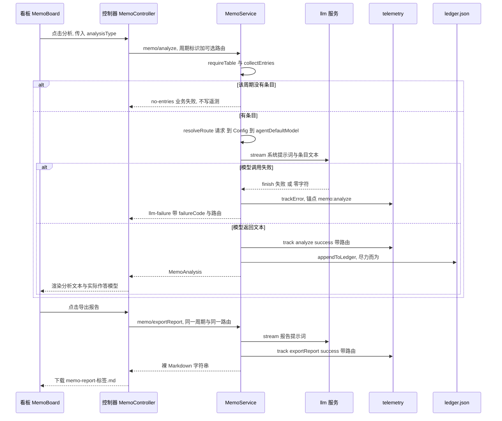

# 分析与导出：一次备忘分析的端到端路径

看板上的两个按钮——「分析」与「导出报告」——走的是**同一条链路的两条分支**：同一套周期选择、同一套条目收集、同一个路由解析、同一个流式调用助手、同一张失败码表、同一套遥测锚点。它们只在两处分叉：用哪段系统提示词，以及拿到的文本去了哪里。`analyze` 把文本当作一次分析：返回给看板、追加进账本；`exportReport` 把文本当作一份文件：原样交回浏览器，由浏览器下载成 `.md`。

本页只讲这条链路本身。端点清单与失败码全集见[备忘服务（宿主）](../systems/memo-service.md)；路由三级解析与失败事实的保全规则见[模型路由与失败事实保全](../concepts/llm-route-and-failure-facts.md)；"哪一周属于哪个周期"的星期四规则见[四维周期日历](../concepts/period-calendar.md)；看板侧的控件与状态布局见[备忘看板 UI](../systems/memo-board-ui.md)。

## 起点：类型在浏览器，条目在宿主

一次分析的输入被刻意拆成两半，分居两侧：

- **分析类型是浏览器的本地状态。** `MemoBoard` 用 `useState<MemoAnalysisType>('梳理')` 保存它，工具栏上三个 chip（`梳理`/`总结`/`分析`）只改这个 state，点左半按钮时才把它交给 `controller.analyze(analysisType)`。它不进 `MemoViewState`、不持久化、不随周期切换重置——刷新页面就回到 `梳理`（[MemoBoard.tsx](../../packages/client/ui-memo/src/client/MemoBoard.tsx#L59-L64)、[MemoBoard.tsx](../../packages/client/ui-memo/src/client/MemoBoard.tsx#L405-L425)）。
- **条目不由浏览器发送。** 请求里只有周期身份（`period` 维度 + `periodLabel` 标签）与可选的路由覆盖；宿主拿到后用 `collectEntries` 重新遍历自己的 `weeks` 表，按 `weekIdBelongsToPeriod` 筛出该周期的周行、拍平条目、按 `createdAt` 升序排序（[controller.ts](../../packages/client/ui-memo/src/client/controller.ts#L932-L955)、[index.ts](../../packages/memo/dsh-memo/src/index.ts#L1716-L1724)）。

第二条决定了一件容易被读漏的事：**被分析的永远是存储里的条目，而不是屏幕上渲染的卡片列表。** 看板上的卡片是 `listWeeks` + `listPeriods` 的客户端派生视图，两者之间可能隔着一次删除、一次未刷新的编辑，或者一个"周期里其实有卡片但当前年度标签没显示它"的状态；让宿主按周期重读，模型输入的来源就只有一处。

送进提示词的文本形状很朴素：每个条目一行 `- [<type>] <content>`，用换行拼接（[index.ts](../../packages/memo/dsh-memo/src/index.ts#L1249-L1255)）。因此 `image` / `file` 条目贡献的是它们的 `content` 文本——那条描述——`attachmentRef` 与 `source` 不进提示词，模型看不到图片本身。

## 编号请求序列

1. 用户按下分割按钮左半 → `controller.analyze(analysisType)`。控制器立刻置 `busy: true`、并把上一次的 `analysis` / `analysisProvider` / `analysisModel` 清空，所以旧结果不会在新请求期间留在屏幕上冒充新答案。
2. `modelOverride()` 决定这次带不带路由；`callMemo(rpc, 'analyze', { period, periodLabel, analysisType, ...(override) })` 经 `callRemote` 包成 `{ args: { request } }`，走 `rpc.call('/api', 'memo/analyze', …)`（[controller.ts](../../packages/client/ui-memo/src/client/controller.ts#L95-L110)）。
3. 宿主 `requireTable()` 取存储表。域还没打开时它**抛异常**，不是在业务信封里返回 `not-initialized`——这是本条链路上唯一的抛出点。
4. `collectEntries()` 收集该周期的条目（见上节）。
5. **判空即返回**：0 条 → `{ ok: false, error: { code: 'no-entries' } }`。此刻路由还没解析、模型一次都没调、遥测一条都没写。
6. `resolveRoute(request)` 逐半解析出 `{ provider, model }`。
7. 组提示词：`ANALYSIS_PROMPTS[request.analysisType]` 作为 `system`，条目文本作为唯一一条 user 消息；`streamLlmText` 把它交给 `llm.stream`。
8. **模型侧的每一种结局都在这里变成业务结果，没有一种会抛出去**：未挂 `llm` → `LLM_UNAVAILABLE`；解析出的路由半区为空 → `NO_MODEL_ROUTE`；`finish` 块 `reason.kind` 为 `error`/`aborted` → 保留 DSH 的 `code`/`message`/`status`；逃出归一化的异常 → `LLM_STREAM_THREW`；流正常结束但累计文本为 0 → `EMPTY_RESPONSE`（[llm-text.ts](../../packages/memo/dsh-memo/src/llm-text.ts#L67-L130)）。
9. `llmFailure('analyze', route, result)` 把上一步折成 `code: 'llm-failure'`，并把 `failureCode`、`provider`、`model`、`status` 提到失败对象的**顶层**，同时以 `featureCodeRef: 'memo:analyze'` 记一条 `trackError`（[index.ts](../../packages/memo/dsh-memo/src/index.ts#L1161-L1177)）。
10. 成功分支：**先** `track('analyze', 'success', { provider, model, period, periodLabel, analysisType })`。
11. **再** `appendToLedger({ id: randomUUID(), period, periodLabel, analysisType, summary, generatedAt })`：读账本（含一次性旧路径迁移）→ 头部插入 → 截到 500 条 → 整份重写。写失败被静默吞掉，不影响返回值。
12. 返回 `MemoAnalysis`（含 `modelProvider`/`modelName`），控制器把 `summary` 放进 `analysis`、把模型两半放进结果卡的模型行——"这段字是谁写的"在界面上一眼可见（[MemoBoard.tsx](../../packages/client/ui-memo/src/client/MemoBoard.tsx#L456-L470)）。

导出分支复用 3–9 步（提示词换成 `REPORT_EXPORT_PROMPT`，遥测 `feature` 换成 `exportReport`），同样在第 5 步判空、同样把 `no-entries` 交给调用方；它跳过第 11 步，把 `result.text` 裸字符串返回给控制器。

图：一次分析/导出的请求序列，以及空周期与模型失败两处收场。

## 空周期：`no-entries` 跑在路由之前

两个端点用同一段前置代码判空，所以空周期的行为完全一致：返回 `no-entries`，message 里带上 `periodLabel`（`no memo entries found for ${periodLabel}`），让看板能说清是哪个周期空（[index.ts](../../packages/memo/dsh-memo/src/index.ts#L1248-L1252)、[index.ts](../../packages/memo/dsh-memo/src/index.ts#L1288-L1292)）。用例把这条钉住：一条条目都不加的当前周，`analyze` 必须 `ok: false` 且 `error.code === 'no-entries'`（[memo.spec.ts](../../packages/memo/dsh-memo/tests/memo.spec.ts#L238-L250)）。

三个后果值得记住：

- **顺序是有意的。** 判空在 `resolveRoute` 之前，所以"周期为空"不会被误报成路由问题、`NO_MODEL_ROUTE`，也不会白花一次模型调用。
- **这条拒绝不留遥测。** 它直接 `this.failure(...)`，既不 `track` 也不 `trackError`。于是[遥测服务](../systems/telemetry-service.md)的日志分析读到的失败分组里**永远不会出现** `no-entries`：用户抱怨"点了没反应"时，遥测里查不到任何记录，只能回到"那个周期有没有条目"这个事实。这是取舍，不是遗漏——一个用户自己在界面上就能看懂的空周期，不该占满失败计数。
- **它是浏览器能看到的两种失败之一。** 另一种是 `llm-failure`；两者都通过 `error.message` 进入看板的错误横幅，而 `analysis` 保持为 `null`。

## 路由：这一次调用发给谁，由谁说了算

宿主侧 `resolveRoute` 的三级顺序是：**请求带的 `provider`/`model` → 本服务 `Config` → 部署的 `agentDefaultModel`**，并且是逐半解析而不是逐级选中（[index.ts](../../packages/memo/dsh-memo/src/index.ts#L1143-L1150)）。完整语义与两包差异见[模型路由与失败事实保全](../concepts/llm-route-and-failure-facts.md)。

浏览器这一侧的关键事实是：**请求默认不带路由。** `modelOverride()` 只在用户真的钉过一个模型时返回 `{ provider, model }`，而且在每次调用前重新对账——若记住的 provider 已不在宿主最近上报的 `providers` 里，就当场丢弃（[controller.ts](../../packages/client/ui-memo/src/client/controller.ts#L908-L926)）。没有钉过，两个键都不出现，宿主走自己的优先级；测试用一个共享断言把这条守住：未做任何选择时，任何请求都不得携带 `provider` 或 `model`（[fake-rpc.ts](../../packages/client/ui-memo/tests/fake-rpc.ts#L537-L550)、[controller.spec.ts](../../packages/client/ui-memo/tests/controller.spec.ts#L382-L395)）。

### 目录怎么到选择器：`listModels`，在 refresh 里

选择器里的每一个 provider、每一个模型，都来自宿主对 `llm` 服务的一次查询，而不是任何一份写死的清单：

- `MemoController.refresh()` 在读完周与时间线之后调用 `readRoute()` → `memo/listModels`，把 `provider`/`model`（不覆盖时会用哪条路由）、`providers`（每个带 `models`，读不出时带自己的 `error`）、`catalogError` 一起存进视图状态（[controller.ts](../../packages/client/ui-memo/src/client/controller.ts#L340-L395)、[controller.ts](../../packages/client/ui-memo/src/client/controller.ts#L434-L478)）。
- 打开菜单**不会**再发一次请求：目录是"上次刷新的快照"，所以新注册的 provider 要等一次刷新（或重新打开面板）才出现。
- 宿主侧 `listModels` 只列 `llm.listProviders()` 的结果，即**已注册、能真正承载调用**的路由；每个 provider 的 `listModels(id)` 用 `Promise.all` 并发取，一个适配器抛错只在自己那项留下 `error`，不遮住别人。整表读不出（没挂 `llm`、`listProviders()` 抛错、一个 provider 都没注册）时仍返回 `ok: true`，只是 `providers: []` 加一句 `catalogError`（[index.ts](../../packages/memo/dsh-memo/src/index.ts#L1200-L1237)、[types.ts](../../packages/memo/dsh-memo/src/types.ts#L487-L516)）。

### 为什么浏览器永远不硬编码路由

这条限制来自一个具体缺陷：浏览器曾经写死 provider `custom`，而没有任何部署注册它，于是每次 AI 调用都以 `NO_ADAPTER` 失败，还被上报成"模型没有产出"。根因是浏览器**无法知道**一个部署装了哪些适配器——那是宿主的注册表。所以不变式从"不发送路由"收紧成一句更精确的话：**只允许发送宿主自己上报过的 provider，并且只在该 provider 上报过的范围里选模型**。落地为三道检查：

| 检查 | 位置 | 拒绝什么 |
|---|---|---|
| `selectModel` 要求 `provider` 在本地上报的 `providers` 里、且两半都非空 | 控制器 | 手输或猜出来的路由 |
| `usableChoice` 在载入时丢弃 provider 已消失的旧选择，并清掉持久化 | 控制器 | 被移除/改名后的旧 provider |
| 菜单只渲染 `view.providers` 的项，provider 和模型都不可手输 | 看板 | 任何不在目录里的字面量 |

反过来，目录成员资格只是 advisory：某个 provider 的 `models` 里没有某个 id，并不表示请求会被拒绝，所以"钉过但当前目录没列"的模型仍然留在菜单里（`pinnedModel`），而不是被静默判为无效——悄悄换掉用户的选择等于换掉答案（[MemoBoard.tsx](../../packages/client/ui-memo/src/client/MemoBoard.tsx#L715-L744)、[types.ts](../../packages/memo/dsh-memo/src/types.ts#L461-L476)）。

**"注册表读不出"与"注册表是空的"必须分开。** `catalogError` 有值表示目录**未知**（一次瞬时读失败），此时角标禁用并给出原因、记住的选择被保留并照常发送；`providers: []` 而 `catalogError` 未定义表示**确实一个都没注册**，选择器没有可选项（[controller.ts](../../packages/client/ui-memo/src/client/controller.ts#L480-L505)、[MemoBoard.tsx](../../packages/client/ui-memo/src/client/MemoBoard.tsx#L644-L646)、[controller.spec.ts](../../packages/client/ui-memo/tests/controller.spec.ts#L517-L568)）。把两者混成一个"空"状态，会让一次网络抖动改写用户的分析模型。

选中结果记在浏览器本地（`dsh-memo:model`，`{ provider, model }` 一起存），因为 model id 脱离自己的 provider 就没有意义；没有任何服务端持久化，所以跨浏览器不共享（[logic.ts](../../packages/client/ui-memo/src/client/logic.ts#L184-L237)）。

## 失败在哪里变成业务结果，而不是抛出

这条链路上只有一处会抛：`requireTable()` 在存储域未初始化时 `throw`，对浏览器表现为传输层失败（`callRemote` 把它折成 `rpc-failure`；信封本身失败则是 `transport-failure`）（[index.ts](../../packages/memo/dsh-memo/src/index.ts#L1884-L1890)、[controller.ts](../../packages/client/ui-memo/src/client/controller.ts#L95-L110)）。其余每一种结局都是冻结的业务信封：

| 结局 | 产生处 | 形状 |
|---|---|---|
| 周期没有条目 | `analyze` / `exportReport` 方法体 | `ok: false`，`code: 'no-entries'` |
| 未挂 `llm` | `streamLlmText` | `llm-failure`，`failureCode: 'LLM_UNAVAILABLE'` |
| 路由半区为空 | `streamLlmText`（在 `llm.stream` 之前） | `llm-failure`，`failureCode: 'NO_MODEL_ROUTE'` |
| 适配器/凭据/限流等 | `finish` 的 `error` / `aborted` | `llm-failure`，`failureCode` 为 DSH 原码（`NO_ADAPTER`、`MISSING_CREDENTIAL`、`RATE_LIMIT`…），带 `provider`/`model`/可选 `status` |
| 流里逃出的异常 | `streamLlmText` 的 `catch` | `llm-failure`，`failureCode: 'LLM_STREAM_THREW'` |
| 流正常结束但零字符 | `streamLlmText` 末尾 | `llm-failure`，`failureCode: 'EMPTY_RESPONSE'` |

关键在于"失败"没有在层与层之间被压扁：`llmFailure` 把 DSH 的机器码和消息拼成一句带路由前缀的 message，同时把结构化事实原样留在顶层字段里，调用方与后续日志分析都不必解析字符串。用例分别钉住了 `EMPTY_RESPONSE`（模型答了、没内容）与 `NO_ADAPTER`（路由没注册）在**同一个业务码下**由 `failureCode` 区分（[memo.spec.ts](../../packages/memo/dsh-memo/tests/memo.spec.ts#L499-L544)）。

控制器只读 `result.error.message` 填进 `error` 横幅、把 `analysis` 留空；业务码本身不再分派——界面要说的是原因，不是码。

## 成功之后：遥测与账本，两条副作用，顺序固定

`analyze` 的成功分支有两条副作用，且顺序被写死：**先遥测，后账本**。

1. `track('analyze', 'success', …)` 带上 `routeFacts(route)`（`provider`、`model`）与 `period`、`periodLabel`、`analysisType`（[index.ts](../../packages/memo/dsh-memo/src/index.ts#L1269)、[index.ts](../../packages/memo/dsh-memo/src/index.ts#L1808-L1836)）。成功事件也带路由的理由很实际：只记失败的遥测能回答"哪条路由坏了"，却永远回答不了"改了路由有没有修好它"（[memo.spec.ts](../../packages/memo/dsh-memo/tests/memo.spec.ts#L968-L1017)）。同一条规则在 `listModels` 上还多守一层：解析出来但是空的路由记成空串 `''`，与"这条事件根本没有这个键"区分开——前者意味着"什么都没解析出"，后者意味着"这条事件早于路由记录"（[memo.spec.ts](../../packages/memo/dsh-memo/tests/memo.spec.ts#L1032-L1047)）。
2. `appendToLedger(...)` 追加一条长期记忆。它是**尽力而为**的：`writeLedgerAt` 把 `mkdir` + `writeFileSync` 整个包在 `try` 里并返回布尔值，`readLedgerAt` 与旧路径迁移同样只降级不抛——所以账本写不进去时，模型已经产出的分析照样返回给用户，下一次成功写入会把完整列表重新序列化一遍（[index.ts](../../packages/memo/dsh-memo/src/index.ts#L475-L502)、[index.ts](../../packages/memo/dsh-memo/src/index.ts#L551-L599)）。

账本的形状本身就是契约：

- **位置**：`$DSH_HOME/memo/ledger.json`（`DSH_HOME` 为空或纯空白时回落 `~/.dsh`，`~` 前缀按平台 home 展开）。旧版本落在平台 home 顶层的 `memo/ledger.json` 会在第一次读时按 id 合并进来，然后把旧文件改名成 `.migrated` 收据——合并过、改名失败也不会重复（[index.ts](../../packages/memo/dsh-memo/src/index.ts#L372-L411)、[index.ts](../../packages/memo/dsh-memo/src/index.ts#L514-L579)）。
- **条目**：`{ id: randomUUID(), period, periodLabel, analysisType, summary, generatedAt }`，头部插入、截到 `LEDGER_CAPACITY = 500`，最旧的先掉（[types.ts](../../packages/memo/dsh-memo/src/types.ts#L323-L345)、[index.ts](../../packages/memo/dsh-memo/src/index.ts#L309-L313)、[index.ts](../../packages/memo/dsh-memo/src/index.ts#L591-L599)）。
- **读取**：`listMemory` 读同一份文件、按 `period` 过滤、截到 `limit`，读失败给 `ledger-error`（这个码不在 `MemoMemoFailure` 联合里）。用例把"`analyze` 写进去的，`listMemory` 读得回来"当作路径契约的一部分（[index.ts](../../packages/memo/dsh-memo/src/index.ts#L1791-L1806)、[ledger-home.spec.ts](../../packages/memo/dsh-memo/tests/ledger-home.spec.ts#L165-L178)）。

两处容易误判的细节：

- **周行里的 `analysis` 字段从来没人写。** `MemoAnalysis` 只出现在返回值与账本条目里；`snapshotWeek` 会读 `row.analysis` 并原样带出，但 `analyze` 不做任何 `put`，其余四个写方法也不设这个字段。所以"周里存着最近一次分析"是类型上的可能，不是运行时的事实——要回顾历史分析，只能走 `listMemory`（[index.ts](../../packages/memo/dsh-memo/src/index.ts#L1246-L1279)、[index.ts](../../packages/memo/dsh-memo/src/index.ts#L2037-L2047)）。
- **账本条目里没有路由。** `MemoAnalysis` 有 `modelProvider`/`modelName`，`MemoMemoryEntry` 没有，所以内存面板回答不了"这条记忆是哪个模型写的"；回答这个问题只能靠同期遥测的 `analyze` 成功事件。

## 兄弟路径：`exportReport` 为什么只返回 Markdown

`exportReport` 把同一套骨架走到第 9 步，然后换一条收尾：`track('exportReport', 'success', { ...routeFacts, period, periodLabel })` 之后直接 `return { ok: true, value: result.text }`——不追加账本、不写周行、不产生任何持久状态（[index.ts](../../packages/memo/dsh-memo/src/index.ts#L1281-L1301)）。浏览器拿到字符串后放进 `report` 视图字段，并立刻 `downloadMarkdown(value, 'memo-report-<标签>.md')`，落成用户磁盘上的文件（[controller.ts](../../packages/client/ui-memo/src/client/controller.ts#L957-L981)、[controller.ts](../../packages/client/ui-memo/src/client/controller.ts#L1145-L1161)）。

这个不对称有三层理由，都能从代码形状读出来：

1. **账本存的是"分析"，不是"文档"。** `MemoMemoryEntry.analysisType` 是必填字段，唯一取值来源是 `MemoAnalysisType`——三个提示词对应的三个字面量；而 `MemoExportReportRequest` 连 `analysisType` 都没有。要把一份报告写进这个形状，得先凭空造出第四种类型。
2. **导出的产物本来就要离开宿主。** 报告正文的正确归宿是用户下载的那个 `.md`；宿主再存一份等价副本，只会得到两份会各自变旧的记录，而 `listMemory` 的读者（跨周期回顾、跨期比较）要的是分析文本。
3. **判据是副作用，不是权限。** 两条路径都不写周行、都不改卡片，区别只在于 `analyze` 额外写账本——所以"能不能导出"与"会不会留下记忆"是两件事，谁都不必为对方让步。

运维后果也很直接：**"上次分析过什么"在账本里查得到，"上次导出过什么"查不到。** 想审计导出，只有遥测里的 `exportReport` 成功事件（带路由与周期）；而导出的结果卡片也不标模型——只有分析结果卡片显示"谁写的"（[MemoBoard.tsx](../../packages/client/ui-memo/src/client/MemoBoard.tsx#L456-L480)）。若将来要把导出也纳入记忆，需要同时改账本形状与类型（见下节），而不是在 `exportReport` 里补一行 `appendToLedger`。

## 改动这里时必须同步的三处

**一、提示词选择。** `ANALYSIS_PROMPTS` 是一个以 `MemoAnalysisType` 为键的模块常量表，`REPORT_EXPORT_PROMPT` 是另一个常量——两者都**不是** `Config` 字段（对比 `sessionSummaryPrompt` 是可配置的 `Volatile`）。加第四种分析类型要同时动四处：`types.ts` 的 `MemoAnalysisType` 联合、`ANALYSIS_PROMPTS` 表、看板的 `ANALYSIS_TYPES` 列表、以及双语 locale 里对应的 `MemoKey`（[types.ts](../../packages/memo/dsh-memo/src/types.ts#L60-L62)、[index.ts](../../packages/memo/dsh-memo/src/index.ts#L630-L644)、[MemoBoard.tsx](../../packages/client/ui-memo/src/client/MemoBoard.tsx#L59-L64)）。因为 `analysisType` 会被原样抄进账本条目和遥测 metadata，旧条目的类型字面量必须保持可读——删掉一个旧的类型会让历史记忆失去解释。若部署需要改报告措辞，正确的扩展点是给这两个常量加 `Config` 字段（照 `sessionSummaryPrompt` 的样子），而不是在别处拼字符串。

**二、账本条目形状。** `MemoMemoryEntry` 定义、`appendToLedger` 的调用点、`listMemory` 的读者三者必须一起改。加字段（例如把 `modelProvider`/`modelName` 也存下来）时注意两个陷阱：`parseLedger` 只接受 `schemaVersion === LEDGER_SCHEMA_VERSION`（当前 `1`）的文档，否则整份账本读成空——**升级版本号而不写迁移就等于清空所有历史记忆**；而旧条目没有新字段，读取侧必须容忍缺失（[index.ts](../../packages/memo/dsh-memo/src/index.ts#L465-L473)、[index.ts](../../packages/memo/dsh-memo/src/index.ts#L309-L313)）。容量上限 `500` 是合并与追加共用的：合并按 `generatedAt` 排序取最新 500，追加是头部插入后截断，用例钉住了"迁移进来的旧条目可能因为满额而进不去，所以收据是改名而不是删除"（[ledger-home.spec.ts](../../packages/memo/dsh-memo/tests/ledger-home.spec.ts#L236-L256)）。

**三、遥测动作名。** `'analyze'` 与 `'exportReport'` 同时是**事件动作名**和**失败锚点**——`llmFailure` 用 `featureCodeRef: 'memo:<feature>'` 记 `trackError`，而日志分析正是按 `featureCodeRef` 分组、按动作名统计"最近一次失败之后还试过几次"。改名会同时切断历史序列与报告里的分组前缀，所以新增一条模型调用路径时，应照这三条一起做：成功事件带 `routeFacts`、失败事件带 `memo:<action>` 锚点、元数据键名保持 `provider`/`model`/`status`（`dsh-telemetry` 的 `routeFromMetadata` 只按这三个白名单键取值）。锚点的实际形状在测试夹具里就能读到：日志分析用例的失败分组正是按 `memo:analyze` 分组、并带上 `route` 与 `attemptsAfterLastFailure`（[memo.spec.ts](../../packages/memo/dsh-memo/tests/memo.spec.ts#L273-L309)、[memo.spec.ts](../../packages/memo/dsh-memo/tests/memo.spec.ts#L1049-L1061)）。相关链路见[遥测服务](../systems/telemetry-service.md)与 [Issue 服务](../systems/github-issue-service.md)。

## 测试锚点

- **宿主侧主线**：分析返回文本；空周 `no-entries`；导出返回 Markdown 字符串——三条在同一个 describe 里（[memo.spec.ts](../../packages/memo/dsh-memo/tests/memo.spec.ts#L215-L271)）。
- **失败映射**：`EMPTY_RESPONSE`、`MISSING_CREDENTIAL` 带 401、`NO_ADAPTER`、以及"请求覆盖能压过 `Config`"（[memo.spec.ts](../../packages/memo/dsh-memo/tests/memo.spec.ts#L460-L544)）。
- **成功也记路由**：`analyze`、`exportReport`、`listModels` 的成功事件都带 `provider`/`model`；解析为空时记空串而非省略键（[memo.spec.ts](../../packages/memo/dsh-memo/tests/memo.spec.ts#L968-L1062)）。
- **账本契约**：`analyze` 写入后 `listMemory` 读得回（[ledger-home.spec.ts](../../packages/memo/dsh-memo/tests/ledger-home.spec.ts#L165-L178)）；容量满时保留最新 500（[ledger-home.spec.ts](../../packages/memo/dsh-memo/tests/ledger-home.spec.ts#L236-L256)）。
- **控制器**：导出的失败只把 message 放进横幅、返回 `undefined`；未钉模型时两个键都不发送；钉过的选择严格校验、持久化、跨刷新恢复（[controller.spec.ts](../../packages/client/ui-memo/tests/controller.spec.ts#L305-L341)、[controller.spec.ts](../../packages/client/ui-memo/tests/controller.spec.ts#L397-L582)）。
- **看板**：默认类型 `梳理`、切类型后请求跟着变、失败横幅显示 `NO_ADAPTER` 原文、钉过的路由随请求走（[MemoBoard.spec.tsx](../../packages/client/ui-memo/tests/MemoBoard.spec.tsx#L376-L441)、[MemoBoard.spec.tsx](../../packages/client/ui-memo/tests/MemoBoard.spec.tsx#L819-L857)）。

## 相关页面

- [备忘服务（宿主）](../systems/memo-service.md)——端点清单、失败码全集、依赖降级语义。
- [备忘看板 UI](../systems/memo-board-ui.md)——分割按钮、菜单、结果卡片的界面契约。
- [模型路由与失败事实保全](../concepts/llm-route-and-failure-facts.md)——三级解析、失败事实的四个字段、遥测白名单。
- [四维周期日历](../concepts/period-calendar.md)——"哪一周属于这个周期"的星期四规则。
- [遥测服务](../systems/telemetry-service.md)——`memo:analyze` 这类锚点如何被分组、`routeFromMetadata` 的白名单。
- [Issue 服务](../systems/github-issue-service.md)——日志分析报告与预填 URL 的生成方。
