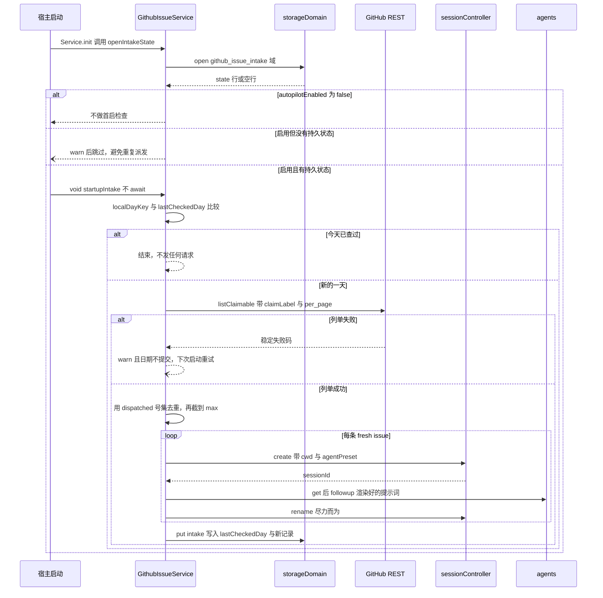

# Issue 接单与 Session 派发循环

这个工作流把「仓库里带接单标签的 open issue」变成「一个已经排队好提示词的 DSH 会话」，是 issue 闭环（自然语言 → `optimizeIssue` → `createIssue` → 接单 → 新会话处理）的后半段。实现在 `@zhangj1164/dsh-github-issue` 里；每个远程方法的形状见 [GitHub issue 服务](../systems/github-issue-service.md)，REST 请求与失败分类见 [GitHub REST 集成与凭据](../integrations/github-rest.md)。

循环里有三个参与者，缺一条链路就退化：GitHub 是「哪些 issue 带标签」的唯一事实来源；服务负责去重、派发与记账；宿主服务负责实际动作——`sessionController` 建会话、`agents` 投递提示词、`storageDomain` 保存那一行状态。缺 GitHub 则无事可做，缺会话组件则拒绝派发，缺存储则每日首启检查根本不运行。

## 一次 pass 的时序



图：一次接单 pass 的完整时序，含两个拒绝点——没有持久状态时跳过首启检查，列单失败时不提交日期。

## 阶段一：首启触发

自动触发点只有一个：`[Service.init]`。它先 `await openIntakeState()` 打开持久状态，再读一次 `autopilotEnabled`；关闭则直接返回。打开状态时按 `ctx.get('storageDomain')` 可选读取，域声明为 `github_issue_intake`（版本 0、单表单行、键 `intake`），`createIntakeDomain` 用动态 import 拿到 `defineDomain`，所以没有装这个可选 peer 时丢的是每日检查而不是整个插件（[index.ts](../../packages/github-issue/dsh-github-issue/src/index.ts#L459-L467)、[index.ts](../../packages/github-issue/dsh-github-issue/src/index.ts#L772-L794)、[spec.ts](../../packages/github-issue/dsh-github-issue/src/spec.ts#L49-L68)）。

判定分三层，任意一层不成立就不发起网络请求：

1. `autopilotEnabled` 为 false（默认值）——打开会话而没人要求是部署决策，不是插件安装时自带的惊喜。
2. `intakePersistent` 为 false——**第一个拒绝点**：没有「已经派发过什么」的记忆，重启就会给同一个 issue 开第二个会话，所以宁可 warn 一句也不跑（[intake-service.spec.ts](../../packages/github-issue/dsh-github-issue/tests/intake-service.spec.ts#L182-L189)）。
3. `lastCheckedDay` 等于今天的本地日——同一天内再启动一次直接结束，测试里连 `fetch` 都没有被调用（[intake-service.spec.ts](../../packages/github-issue/dsh-github-issue/tests/intake-service.spec.ts#L158-L170)）。

三层都通过后走 `void this.startupIntake()`：**检查不被 await**。打开一个会话是有用的工作，但不是服务可用的前提，GitHub 慢或不可达不该拖住宿主启动；异常与失败分支都只 warn，日期没提交，于是下一次启动重试（[index.ts](../../packages/github-issue/dsh-github-issue/src/index.ts#L751-L770)）。

这是一条启动钩子，不是调度器：宿主跨午夜持续运行时，检查发生在下一次启动而不是午夜。设计文档解释过为什么不用 Automation tasks 的 schedule——它的提醒只投递给创建它的那个会话，触发源也只有日历时间与 cron，没有「宿主启动」这个事件（[设计文档](../../docs/plans/2026-11-02-github-issue-intake-autopilot-design.md#L15-L22)、[设计文档](../../docs/plans/2026-11-02-github-issue-intake-autopilot-design.md#L74-L79)）。

## 阶段二：列单、去重与数量上限

`runIntake` 是 pass 的入口（`@Remote('runIntake')`，请求字段全部可选）。三类取值按「请求覆盖 → 配置」解析，空串按缺席处理（`firstNonBlank`）：`repoUrl`、`claimLabel`、`max`。`max` 经 `clampCount` 收敛到 1..100，之后**用两次**——先作为列单的 `per_page`，再去重之后作为 `fresh.slice(0, max)` 的上限；schema 里 `maxIssuesPerRun` 本身限制在 1..20，所以 100 这个上界只对请求级覆盖有意义（[index.ts](../../packages/github-issue/dsh-github-issue/src/index.ts#L634-L648)、[index.ts](../../packages/github-issue/dsh-github-issue/src/index.ts#L1116-L1124)、[index.ts](../../packages/github-issue/dsh-github-issue/src/index.ts#L150-L170)）。

列单本身由 `GithubIssueClient.listClaimable` 完成：`GET /repos/{owner}/{repo}/issues?state=open&labels=<claimLabel>&per_page=<max>`，返回数组里带 `pull_request` 键的行（GitHub 的 issues 接口会返回 PR）、缺 `number`/`title`/`html_url` 的行、以及标签与传入值大小写不敏感也不相等的行都被单独丢弃，而不是让整批失败（[github.ts](../../packages/github-issue/dsh-github-issue/src/github.ts#L142-L173)、[github.ts](../../packages/github-issue/dsh-github-issue/src/github.ts#L274-L295)）。

拿到列表后去重：`claimed` 是持久状态里 `dispatched` 的 issue 号集合，已出现过的进 `skipped`，其余进 `fresh`，再截到 `max` 条按响应顺序派发。返回值是 `{ checkedAt, repoUrl, claimable, dispatched, skipped, failures }`：`claimable` 是这次读到的全量候选，`dispatched` 只含真正建出会话的条目，`skipped` 只含被历史挡下的号，`failures` 记录被选中却没派发成功的号与稳定失败码（[index.ts](../../packages/github-issue/dsh-github-issue/src/index.ts#L641-L676)、[types.ts](../../packages/github-issue/dsh-github-issue/src/types.ts#L216-L262)）。

## 阶段三：派发

每条 `fresh` issue 都走私有的 `dispatch`，三步都照实失败：

1. `sessionController.create({ cwd?, agentPreset? })`——`cwd` 与 `agentPreset` 同样按「请求覆盖 → `autopilotCwd`/`autopilotPreset`」解析，空值当作省略字段，从而跟随宿主默认。
2. `agents.get(sessionId).agent.followup({ content: [{ type: 'text', text }], source: { kind: 'github-issue' } })`——把渲染好的提示词排进那个 Agent 的收件箱并唤醒驱动，不需要另一个 turn 已经打开。
3. `rename`（尽力而为，见下节）。

失败码按阶段区分：`create` 抛错是「会话建不出来」；会话建好但 `agents.get` 找不到活着的 Agent、或 `followup` 被拒，都是 `dispatch-failed`，消息说明是哪一段失败；`sessionController` 与 `agents` 任一缺失则在创建之前返回 `session-unavailable`，一个会话都不会被建出来（[index.ts](../../packages/github-issue/dsh-github-issue/src/index.ts#L365-L372)、[index.ts](../../packages/github-issue/dsh-github-issue/src/index.ts#L690-L730)）。

改名是 `Issue #<number>: <title>`，截到 120 字符，`void` 调用、失败只 warn：标题是呈现而不是派发契约的一部分，拿不到标题服务的部署仍然得到一个可用会话（[index.ts](../../packages/github-issue/dsh-github-issue/src/index.ts#L732-L749)）。测试把这条链路钉在记录上：一次 pass 之后 `sessionController.creates` 有 1 条、`followups` 有 1 条且文本含 `#1`、`renames` 里标题含 `Issue #1`（[intake-service.spec.ts](../../packages/github-issue/dsh-github-issue/tests/intake-service.spec.ts#L76-L100)）。

## 阶段四：提交与幂等性

`commitIntakeState` 在**列单成功之后**无条件执行，哪怕这一趟一条都没派发、或者全部派发失败。这是第二个拒绝点的另一面：列单失败时 `runIntake` 直接把失败返回，`commitIntakeState` 根本没被调过，于是那次「今天」没有被记住，下次启动（包括同一天的下一次重启）会重试。测试用 500 响应验证过：`row` 里什么都没有（[intake-service.spec.ts](../../packages/github-issue/dsh-github-issue/tests/intake-service.spec.ts#L127-L133)）。

去重靠**派发历史而不是日期**。判断只看 `dispatched` 里的 issue 号，与记录里的 `day` 字段无关，所以同一个 issue 即使仍然 open、即使换了一天，也不会被二次派发——它的会话已经存在，第二个只会重复劳动。反过来，单个 issue 派发失败只进 `failures`，不阻断同批其他 issue，也不会被记入历史，于是它在**下一天的第一趟 pass** 里会被重试（同一天的首启检查不会跑第二次）（[index.ts](../../packages/github-issue/dsh-github-issue/src/index.ts#L641-L664)）。历史只保留最近 `MAX_DISPATCH_HISTORY = 500` 条，纯粹防止单个 JSON 文档无限增长；被裁掉的记录不再参与去重，边界上的老 issue 若仍 open 且带标签就可能重新被派发（[index.ts](../../packages/github-issue/dsh-github-issue/src/index.ts#L347-L354)、[index.ts](../../packages/github-issue/dsh-github-issue/src/index.ts#L806-L820)）。

提交顺序是**先内存、后磁盘**：新行（`lastCheckedDay: day` 加上追加的记录，`slice(-500)`）先赋给 `this.intakeState`，然后才 `table.put`。durable 写失败只 warn，并且提示消息直接说出后果——「intake state could not be saved, so a later pass may dispatch the same issue again」。这个顺序的实际含义是：本进程内的下一次 pass 仍然看到已派发状态，不会重复派发；而进程重启后读到的是旧行，那一天等于没查过、那条 issue 也可能被再派发一次。没有 `intakeTable` 时函数在更新内存后直接返回，所以「不挂存储 + 手动调 `runIntake`」会派发、会更新内存、但什么都不会落盘（[index.ts](../../packages/github-issue/dsh-github-issue/src/index.ts#L796-L820)）。

另外，**记账与去重只存在于 `runIntake`**。`dispatchIssue` 这个远程方法直接落到同一个 `dispatch`，既不查历史也不写历史，所以「永不二次派发」这条保证只覆盖走 pass 的链路；手动调 `dispatchIssue` 会照建会话（[index.ts](../../packages/github-issue/dsh-github-issue/src/index.ts#L616-L619)）。

## 提示词模板与占位符

默认模板在代码里，`autopilotPrompt` 为空或未配置时它就是每个派发会话看到的第一段话：

```text
你在处理 GitHub issue #{number}：{title}

{url}

请按仓库 AGENTS.md 的工作流完成它：从最新 main 切分支、实现并补测试、跑通门禁、开 PR 并引用 #{number}。不要直接提交到 main。

Issue 正文：
{body}
```

`renderDispatchPrompt` 支持 `{number}`、`{title}`、`{url}`、`{body}`、`{labels}` 五个占位符；`{labels}` 用 `, ` 连接。替换用的是只认这五个名字的正则，所以**未知的 `{token}` 原样留在提示词里**而不是被清空——模板里的笔误应该看得见，而不是静默消失。测试同时钉住两侧行为：`{number}|{title}|{url}|{labels}|{body}` 全部替换，而 `'{number} {unknown}'` 渲染成 `'42 {unknown}'`（[intake.ts](../../packages/github-issue/dsh-github-issue/src/intake.ts#L20-L33)、[intake.ts](../../packages/github-issue/dsh-github-issue/src/intake.ts#L53-L73)、[intake.spec.ts](../../packages/github-issue/dsh-github-issue/tests/intake.spec.ts#L27-L43)）。

模板与 Session 摆放位置在每次派发时现读，所以设置面板改完立刻影响下一次 pass；测试用一个只有 `TASK {number}: {title}` 的模板断言 `followups[0].text` 正好是 `TASK 1: Issue 1`，同时断言 `creates` 收到 `{ cwd, agentPreset }`（[intake-service.spec.ts](../../packages/github-issue/dsh-github-issue/tests/intake-service.spec.ts#L113-L125)）。

## 为什么经 Session 控制器派发，而不是 Agent 注册表

直接 `ctx.agents.create()` 也能跑，但会绕开 Session 控制器负责的 preset 解析、工作区归属与发布流程。经控制器建出来的会话与用户在 Web 里点「新建会话」得到的是同一种东西，才会出现在侧栏、才能被继续与归档；提示词再由 `agents.get(sessionId).agent.followup` 投递，两步各出一半能力。两个服务都按宿主服务键可选读取（`optionalService`），不写进 `static inject`：一个部署可能只装这个包而没有整套 Web 组合，缺组件应当返回稳定失败而不是让插件装不上（[index.ts](../../packages/github-issue/dsh-github-issue/src/index.ts#L316-L339)、[index.ts](../../packages/github-issue/dsh-github-issue/src/index.ts#L1099-L1114)、[设计文档](../../docs/plans/2026-11-02-github-issue-intake-autopilot-design.md#L30-L32)）。

因此当任一服务缺席时，`dispatch` 在创建任何东西之前就返回 `session-unavailable`（`failures[0].code` 在测试里正是它，且 `dispatched` 为空）；而在控制器建好会话之后才失败的那几种情况——Agent 找不到、提示词被拒——会留下一个没有任务在跑的空会话，同时该 issue 没进历史，于是下一次 pass 会为它再建一个会话。这是「永不二次派发」保证的边界：它保证的是**已记录**的派发不会被重复，不是失败尝试的原子性。宿主服务契约的完整视角见 [DSH 宿主服务](../integrations/dsh-host-services.md)，存储域的生命周期见 [存储与持久化](../architecture/storage-and-persistence.md)。

## 「今天」的时区语义

`localDayKey(now, timeZone)` 用 `Intl.DateTimeFormat('en-US', { year, month, day })` 的 `formatToParts` 拼出 `YYYY-MM-DD`，空时区跟随宿主自身的时区。这是有意的：上海用户的「今天」比 UTC 早八小时开始，用 UTC 键会让一次晚重启跳过这一天、或把检查跑两遍。测试用一个具体瞬间钉住差异——`2026-11-01T16:30Z` 在 `Asia/Shanghai` 是 `2026-11-02`，在 `UTC` 是 `2026-11-01`（[intake.ts](../../packages/github-issue/dsh-github-issue/src/intake.ts#L75-L96)、[intake.spec.ts](../../packages/github-issue/dsh-github-issue/tests/intake.spec.ts#L45-L56)）。

`autopilotTimeZone` 每次使用都重读，非法值不抛错而是回落到宿主时区，并对每个新值只 warn 一次（`warnedTimeZone`）。所以一个拼错的时区不会打断首启检查或派发，测试里 `Not/AZone` 仍然写出一个合法的 `YYYY-MM-DD` 行（[index.ts](../../packages/github-issue/dsh-github-issue/src/index.ts#L432-L448)、[config-volatile.spec.ts](../../packages/github-issue/dsh-github-issue/tests/config-volatile.spec.ts#L111-L118)）。`isValidTimeZone` 存在是为了让这类拼写错误在配置加载时就能被指名，而不是几小时后才在第一次检查里出现。

两个时间点值得分清：首启检查拿**比较时**的 `Date.now()` 算今天，而提交用的日期取自派发循环结束后的 `checkedAt`。一次跨午夜的 pass 会把自己记在结束那天的名下，这比记在开始那天更接近事实，但也意味着长 pass 在极端情况下会占掉两天的名额判断。

## 失败语义一览

| 情形 | 循环的行为 | 代价 |
|---|---|---|
| `autopilotEnabled` 为 false | 完全不做检查 | 无，需部署显式开启 |
| 启用但没有 `storageDomain` | warn 后跳过首启检查 | 每日检查不可用，手动 `runIntake` 仍可派发但无记忆 |
| 本地日已查过 | 直接结束，不发请求 | 当天的自动派发只有这一次 |
| 无 token / 凭据被拒 / 限流 / 网络失败 / 仓库 URL 不合法 | 列单失败，整体返回稳定失败码，日期不提交 | 下次启动重试；同一天内的手动调用也可以重试 |
| 列单成功但候选为空 | 仍然提交本地日 | 当天不再自动检查，符合「今天没有可接的单」 |
| 某条 issue 派发失败 | 记进 `failures`，pass 仍 `ok: true` | 该 issue 不记历史，下一天的 pass 会重试；可能留下一个空会话 |
| durable 写入失败 | 只 warn，内存状态已是新值 | 本进程不再重复派发，重启后可能重复 |

## 配置与运维

最小启用方式是在部署的 `cordis.yml`（或自己的 bundle patch）里打开开关并指明工作目录；`repoUrl`、`claimLabel` 由部署的仓库与 triage 词汇决定（[cordis.patch.yml](../../packages/github-issue/dsh-github-issue/cordis.patch.yml#L15-L30)）：

```yaml
- insert:
    - id: github-issue
      name: @zhangj1164/dsh-github-issue
      config:
        repoUrl: https://github.com/your-org/your-repo
        autopilotEnabled: true
        autopilotCwd: /path/to/your-repo
        claimLabel: ready-for-agent
```

接单相关的字段里，`repoUrl`、`claimLabel`、`maxIssuesPerRun`、`autopilotEnabled`、`autopilotCwd`、`autopilotPreset`、`autopilotTimeZone`、`autopilotPrompt` 都是 `.volatile()`，因此设置面板能让它们在不重启的情况下送达运行中的服务；服务在每个使用点现读而不是构造时拷贝。差别只在**什么时候生效**：`claimLabel`/`maxIssuesPerRun`/`autopilotCwd`/`autopilotPreset`/`autopilotPrompt` 在下一次 pass 生效，`autopilotEnabled` 只在 `[Service.init]` 读一次，翻转要从下一次宿主启动开始；`autopilotTimeZone` 在使用时读取，改完下一次判定就用新时区。机制细节见 [配置与热更新](../concepts/configuration-and-live-settings.md)（[index.ts](../../packages/github-issue/dsh-github-issue/src/index.ts#L118-L170)、[config-volatile.spec.ts](../../packages/github-issue/dsh-github-issue/tests/config-volatile.spec.ts#L89-L109)）。

派发依赖凭据：token 一次解析、三个来源（`token` → `tokenEnv` → `tokenCommand`，默认 `gh auth token`），解析结果被列单与建单共用；缺凭据是 `auth-missing` 且一次请求都不发，于是日期不会被提交、每次启动都会重试同一件事。token 从不写日志。凭据解析与失败分类的细节见 [GitHub REST 集成与凭据](../integrations/github-rest.md)（[index.ts](../../packages/github-issue/dsh-github-issue/src/index.ts#L836-L866)）。

运维上还需要两个前提：仓库里真的存在这个接单标签（标签词表由仓库的 triage 决定，配置只说明哪个标签算数），以及宿主确实在那一天启动过——一天没有启动就是一天没有检查，这是启动钩子的定义而不是缺陷。

## 专注测试

| 测试 | 覆盖的循环行为 |
|---|---|
| [intake-service.spec.ts](../../packages/github-issue/dsh-github-issue/tests/intake-service.spec.ts#L76-L144) | 派发一条新 issue 后第二次 pass 跳过它；本地日与派发记录落盘；`cwd`/`preset`/`prompt` 转发；列单失败不记日期；缺会话组件时派发失败被保留而不是伪造成功 |
| [intake-service.spec.ts](../../packages/github-issue/dsh-github-issue/tests/intake-service.spec.ts#L146-L156) | `dispatchIssue` 在无会话路由时返回 `session-unavailable` |
| [intake-service.spec.ts](../../packages/github-issue/dsh-github-issue/tests/intake-service.spec.ts#L158-L189) | 首启检查的三个分支：今天已查过不发请求、存储日期更旧时跑一趟、无存储时保持关闭 |
| [intake.spec.ts](../../packages/github-issue/dsh-github-issue/tests/intake.spec.ts#L27-L63) | 占位符替换与未知占位符保留；本地日随时区变化；非法时区拒绝 |
| [config-volatile.spec.ts](../../packages/github-issue/dsh-github-issue/tests/config-volatile.spec.ts#L89-L118) | 就地提交的 `claimLabel`/`maxIssuesPerRun`/`cwd`/`prompt` 在下一次 pass 直接生效；非法时区不抛错 |

测试用的 `intake-harness.ts` 把四个宿主面都替成 mock：会话控制器（记录 `creates`/`renames`）、Agent 注册表（记录 `followups` 的会话号、文本与 source kind）、存储域（一行 Map），并且能选择不挂存储或不挂会话组件——这正是把「可选依赖」写成可验证契约的方式（[intake-harness.ts](../../packages/github-issue/dsh-github-issue/tests/intake-harness.ts#L98-L174)）。

## 已知缺口与扩展点

- **只派发、不认领。** 循环不评论 issue、也不把它标成「处理中」；这需要仓库侧的额外标签或 bot 身份，属于设计里明确留到下一阶段的部分（[设计文档](../../docs/plans/2026-11-02-github-issue-intake-autopilot-design.md#L74-L79)）。
- **不合并 PR。** 会话完成后仍由人审。
- **派发失败留下空会话。** 会话建好而提示词被拒时，会话已经存在，issue 却没进历史；下一次 pass 会新建第二个。要改就得让 `dispatched` 记录失败态，或者重试时复用已建会话。
- **上限会忘事。** 500 条窗口之外的记录不再参与去重，这是用「老到 PR 本身就是记录」换 JSON 文档不无限增长。
- **扩展方式是换入口而不是换传输。** `runIntake` 与 `dispatchIssue` 都挂在 `@Remote` 上，进程内或跨浏览器都能调，但仓库里目前只有 `startupIntake` 一个调用者；`fetchImpl` 可注入只用于测试，`GithubIssueClient` 并不从包入口导出。
