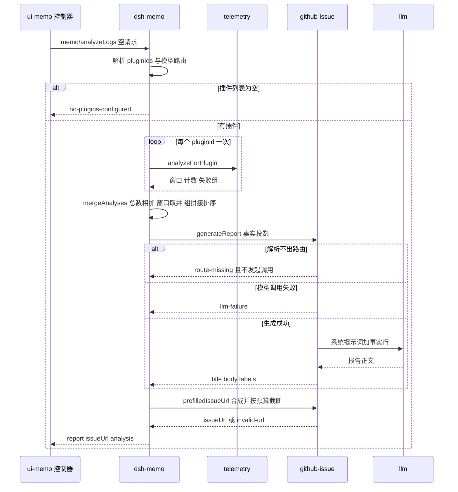
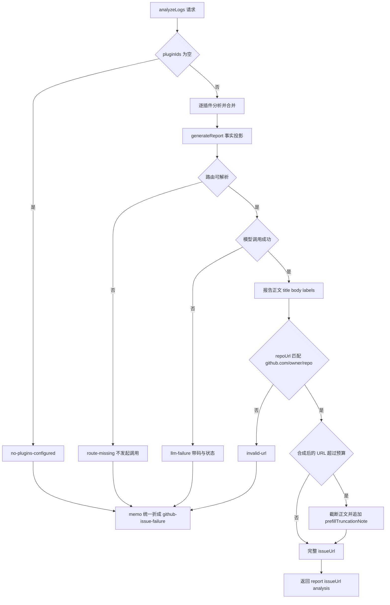

# 从遥测日志分析到 GitHub Issue 报告

这条链路只有一个目的：把本机遥测里的失败事件，变成一份**能自己说明时间与路由**的 GitHub issue 报告，再加一个预填好的新建 issue 链接。它不是「让模型解释日志」，而是「让模型复述分析已经确定的事实」——两者的差别决定了整条链路的形状：事实在遥测服务里提炼，`dsh-memo` 只负责搬运与合并，`dsh-github-issue` 只负责排版与拼 URL，模型不接触原始事件。

唯一的编排者是 `memo/analyzeLogs`。看板点「分析日志」时，浏览器发的是一个空请求，插件清单、模型路由、仓库地址全部由宿主侧的配置解析（[controller.ts](../../packages/client/ui-memo/src/client/controller.ts#L1074-L1087)、[index.ts](../../packages/memo/dsh-memo/src/index.ts#L1638-L1675)）。



图：一次日志分析从点击到看板拿到报告的调用顺序，以及两个可能提前结束的失败分支。

## 覆盖范围由配置决定，而不是由遥测发现

遥测没有枚举 API：它不知道部署里有哪些插件，只能回答「这个 `pluginId` 的事件是什么」。所以**分析覆盖哪些包是一个部署决策**，落在 `dsh-memo` 的 `Config.logAnalysisPlugins` 上，默认 `['memo', 'github-issue']`，按配置顺序逐个读取；单次请求可以用 `pluginIds` 覆盖它（[index.ts](../../packages/memo/dsh-memo/src/index.ts#L146-L155)、[index.ts](../../packages/memo/dsh-memo/src/index.ts#L210-L211)、[index.ts](../../packages/memo/dsh-memo/src/index.ts#L1648-L1655)）。

默认值是「这一套包一起装」，不是「当前插件自己」。理由写在请求类型里：一套包通常一起安装、一起坏、一起修，而只覆盖 `memo` 的报告无法提到破坏这个面板 issue 编辑器的 `github-issue` 失败——那正是当时真实漏掉的那条（[types.ts](../../packages/github-issue/dsh-github-issue/src/types.ts#L14-L28)）。

空清单不会被当成「一套什么都没记录的套件」发出去，而是直接失败为 `no-plugins-configured`，并提示去设置 `logAnalysisPlugins` 或传 `pluginIds`（[index.ts](../../packages/memo/dsh-memo/src/index.ts#L1649-L1654)）。这是本链路唯一一个**在模型调用之前**就拒绝的失败面。

## 合并是一步显式决策，不是逐插件报告的拼接

`mergeAnalyses` 把「每个插件一份分析」压成「整个套件一份分析」，四条规则各有理由（[index.ts](../../packages/memo/dsh-memo/src/index.ts#L413-L447)）：

| 维度 | 合并方式 | 为什么 |
|---|---|---|
| `totalEvents` / `totalFailures` | 逐个相加 | 报告写的是整套包的总量；读者拿到的失败率必须与同一份报告里的分子分母一致 |
| `window` | 只取各插件**存在**的窗口，`firstEventAt` 取最小、`lastEventAt` 取最大 | 一次事故报告要覆盖它读过的整段时间，不能只看某一个插件的切片；全部插件都无事件时**整个键缺席**，而不是造一个空区间 |
| `failureGroups` | 直接首尾拼接，再按 `count` 降序 | 每组的 `featureCodeRef` 已带插件前缀，不会撞名；报告必须从失败最多的那组读起，这与单插件分析的既有顺序一致 |
| `pluginId`（合并对象自身） | 变成 `pluginIds.join(', ')` | 只是给这份合并结果一个身份；真正的插件清单随请求以数组形式下行，不依赖这个字符串 |

两个容易被忽略的细节：排序用的是稳定排序，所以 `count` 相同的组保持插件读取顺序，先配置的包排在前面；`window` 缺席与 `window` 为空不是一回事——前者表示「无可奉告」，报告里会写 `not recorded`，不会有空窗口段落。

合并结果同时服务两个消费者：`generateReport` 的请求，以及返回给看板的 `analysis` 摘要。两者不是同一份投影（见下文「返回给看板的不等于喂给模型的不等于」）。

## 报告只允许主张分析里的事实

从 `TelemetryFailureGroup` 到提示词，字段被逐项压平。这张表就是「报告能说什么」的完整清单（[index.ts](../../packages/memo/dsh-memo/src/index.ts#L1657-L1675)、[index.ts](../../packages/github-issue/dsh-github-issue/src/index.ts#L1014-L1036)）：

| 分析里的字段 | 报告请求里的字段 | 提示词行 | 缺失时 |
|---|---|---|---|
| `pluginIds` | `pluginIds` | `Plugins: memo, github-issue` | 空数组写 `not recorded` |
| `window` | `window` | `Analysis window: <ISO> .. <ISO>` | `Analysis window: not recorded` |
| `totalEvents` / `totalFailures` | 同名字段 | `Total events` / `Total failures` | 不会缺失（计数为零也照写） |
| `failureGroups[].featureCodeRef` | `featureCodeRef` | `- featureCodeRef: …` | 必定存在（遥测侧缺失时回落 `unknown`） |
| `failureGroups[].count` | `count` | `count:` | 必定存在 |
| `latest.error.code` | `errorCode?` | `errorCode:` | 整行省略 |
| `latest.error.message` | `errorMessage?` | `errorMessage:` | 整行省略 |
| `latest.timestamp` | `lastFailureAt?` | `lastFailureAt:` | `not recorded` |
| `attemptsAfterLastFailure` | `attemptsAfterLastFailure?` | `attemptsAfterLastFailure:` | `not recorded` |
| `route` | `route?` | `route: provider / model (status N)` | `route: not recorded` |
| `errorCodes`（复数） | **不透传** | — | 只出现在返回给看板的摘要里 |
| `latest.error.stack` | **不透传** | — | 从不进入提示词 |

一个真实的提示词因此长这样（与 `github-issue.spec.ts` 的断言同形）：

```text
Plugins: memo, github-issue
Analysis window: 2026-09-01T07:22:00.000Z .. 2026-09-15T08:19:00.000Z
Total events: 458
Total failures: 5

Failure groups:
- featureCodeRef: memo:analyze
  count: 3
  errorCode: LLM_FAILURE
  errorMessage: model produced no output
  route: deepseek-cu / deepseek-flash (status 429)
  lastFailureAt: 2026-09-11T03:04:00.000Z
  attemptsAfterLastFailure: 14
```

**缺失的事实写成 `not recorded`，而不是省略、更不是「需要补充采集」。** 这两种省略方式对模型的含义完全不同：省略会让模型以为没有这项能力，或者干脆替它编一个；`not recorded` 明确告诉模型「分析里没有」，因此既不能推断，也不能归因。同一条理由让系统提示词禁止写「需要补充采集」——一个缺失的字段既可能是采集缺口，也可能只是旧事件的正常状态，报告无从区分（[index.ts](../../packages/github-issue/dsh-github-issue/src/index.ts#L208-L209)、[index.ts](../../packages/github-issue/dsh-github-issue/src/index.ts#L261-L272)）。

系统提示词是与之配套的另一半，逐条限制「可能原因」的写法（[index.ts](../../packages/github-issue/dsh-github-issue/src/index.ts#L253-L295)）：

- 只引用分析中出现的事实；**禁止**提出分析没有证据的机制——采样参数、token 预算、超时、分块、流式、响应解析被逐一点名，因为它们在这套插件里根本不存在。这条禁令是被一次真实报告逼出来的：那次报告建议调整 `max_tokens`、分块摘要、`stop` 序列，而 `dsh-memo` 的 `Config` 只有 `repoUrl` / `provider` / `model`（[2026-09-15-log-analysis-report-fidelity-design.md](../../docs/plans/2026-09-15-log-analysis-report-fidelity-design.md#L31-L35)）。
- 必须报告分析窗口，以及每组的路由、最近失败时间、之后同一动作又跑了几次，并说明「最近一次失败有多旧、之后是否又跑过」；**没有再次复现的失败不是当前缺陷**。
- 缺失写 `not recorded`，禁止写「需要补采集」。

报告的形状是固定的：标题取模型输出的第一个 `## ` 标题，取不到时回落到 `Telemetry failures in <pluginIds>`；标签固定为 `['bug', 'telemetry']`；正文就是模型输出本身，宿主不做二次校验，也不套模板。模板约束靠系统提示词里那段 pinned Markdown（含 `### 路由与时间 / Route and Timing` 一节），测试只断言提示词里有这条约束，不会去验证模型是否照做（[index.ts](../../packages/github-issue/dsh-github-issue/src/index.ts#L497-L510)、[index.ts](../../packages/github-issue/dsh-github-issue/src/index.ts#L277-L294)、[github-issue.spec.ts](../../packages/github-issue/dsh-github-issue/tests/github-issue.spec.ts#L323-L344)）。

## 时间与「之后又跑了几次」为什么是载荷的一部分

只给累计总数时，报告无法区分两种完全不同的处境。设计文档记录了一次实测：458 条事件、5 次失败，看上去是「失败率约 1.09%」；但按日拆开，5 次失败全部发生在 09-01 与 09-11，最后一次是 09-11 11:04，此后 403 条事件（其中 `analyze` 12 次、`exportReport` 2 次）**零失败**。累计分母越大，这个比率越好看，也越说明不了任何事（[2026-09-15-log-analysis-report-fidelity-design.md](../../docs/plans/2026-09-15-log-analysis-report-fidelity-design.md#L9-L20)）。

所以载荷里带三件事：分析窗口、每组的 `lastFailureAt`、以及 `attemptsAfterLastFailure`。三者合起来才能写出读者真正需要的那句话：「最后失败 09-11 11:04；此后 14 次调用零失败」。判读规则保持中立：只陈述事实与差值，不替读者下「已修复」的结论——遥测只能说明没有再发生。

`attemptsAfterLastFailure` 的口径比名字严格，读错会直接把「当前缺陷」看成「旧账」（[index.ts](../../packages/telemetry/dsh-telemetry/src/index.ts#L264-L321)、[index.ts](../../packages/telemetry/dsh-telemetry/src/index.ts#L462-L486)）：

- **按 action 计，不按全部事件计。** 只有组内记录过的那些 `action` 的后续事件才计数；无关的读（`listWeeks` 之类）不参与，否则一条旧失败会被繁忙期吹成「之后跑了很多次」。
- **「之后」是写序，不是时间戳序。** `Date.now()` 只有毫秒精度，一次与失败同一毫秒发出的重试按时间戳会算成「不晚于」，于是报告说「0 次尝试」——这正是把一个正在发生的缺陷读成旧账的机制。`seq` 定序、时间戳只在没有序列号的旧行上兜底，三个调用点（选 `latest`、算尝试数、`listEvents` 排序）共用同一个 `compareOrder`。
- **不跨插件。** 只统计同一 `pluginId` 的事件；别的包的 `analyze` 不会计入 `memo:analyze` 的尝试数。
- **`latest` 也是写序最晚的那条**，因此它的错误码、消息与路由就是报告会引用的那一条；同一毫秒内的两条失败，取后写的那条是刻意行为。

## 脱敏边界：只有白名单路由与被脱敏的自由文本离开存储

报告会变成 GitHub issue，离开本机。所以「分析结果里有什么」不只是信息量问题，而是导出边界问题。跨出遥测服务的东西只有四类：

1. **插件自己选定的分组键**：`featureCodeRef` 与错误 `code`。它们**不做脱敏**——脱敏会毁掉分组，而它们本来就是插件选择公开的标识（[index.ts](../../packages/telemetry/dsh-telemetry/src/index.ts#L380-L398)）。
2. **已脱敏的自由文本**：错误 `message`（以及存储里的 `stack`）。写入时跑一遍规则，读出时对每组 `latest` 再跑一遍同一套规则，因为旧行是按当时的规则集存下的，而分析是这段文本变成提示词与 issue 之前的最后一站（[index.ts](../../packages/telemetry/dsh-telemetry/src/index.ts#L400-L427)）。
3. **白名单路线**：`routeFromMetadata` 只抄 `provider`、`model`、`status` 三个键，要求前两者都是非空字符串、`status` 是有限数，缺一半就当作「这条事件没记录路由」，`route` 键直接不出现。`metadata` 是插件自由填充的开放映射，整体透传等于把调用方随手放进去的一切一起导出；增加一个键必须是有意的动作（[index.ts](../../packages/telemetry/dsh-telemetry/src/index.ts#L516-L538)）。
4. **计数与时间戳**：`totalEvents`、`count`、`firstEventAt`、`lastEventAt`、`lastFailureAt`。

反过来说，**`metadata` 整体、`stack`、`listEvents` 的原始视图都到不了提示词**。看板摘要能多看到一点（`errorCodes` 复数），但也没有消息与栈。

白名单字段还必须能在脱敏后存活：`deepseek-cu`、`glm-5-2-260617` 这类值不匹配 email、凭据、路径、IP、十六进制块、base64 中任何一条规则。这不是巧合，而是被两条测试同时钉住的事实——一条断言 `route` 恰好只有三个键、注入的 `apiKey` 不出现，另一条把「provider 与 model 的写法」作为控制样本放进默认规则集的逐样本表（[telemetry.spec.ts](../../packages/telemetry/dsh-telemetry/tests/telemetry.spec.ts#L257-L273)、[redaction.spec.ts](../../packages/telemetry/dsh-telemetry/tests/redaction.spec.ts#L106-L112)）。将来某次规则收紧若把它们清空，报告里的路由会静默消失，而这两条测试就是那条防线。

`redact: false` 时写入与读出两遍都不跑，事件逐字存储；这是调试自己规则集的部署需要的行为，也正因此那些记录不适合贴进 issue（[index.ts](../../packages/telemetry/dsh-telemetry/src/index.ts#L55-L109)）。

## 三个失败面，不能混成一个

这条链路上有三种「没拿到报告」的处境，它们的成因、责任方与业务码都不一样。混读会把配置问题当成模型问题，或者把 URL 问题当成数据问题。

| 失败面 | 发生在哪 | `github-issue` 的码 | `memo` 返回的码 | 是否记遥测 |
|---|---|---|---|---|
| 遥测无数据 | 分析阶段 | —（不是失败） | 无（照常 `ok: true`） | 会记 `generateReport` 成功 |
| 插件清单为空 | 分析之前 | — | `no-plugins-configured` | 不记 |
| 遥测服务缺失 | 分析之前 | — | `github-issue-failure`（message 说明是 telemetry） | 不记 |
| 模型路由解析不出 | 报告阶段 | `route-missing`，**不发起调用** | `github-issue-failure` | 记 `github-issue:generateReport` 错误事件，`NO_MODEL_ROUTE` |
| 模型调用失败 | 报告阶段 | `llm-failure`（消息里带 DSH 码与状态） | `github-issue-failure` | 记 `github-issue:generateReport` 错误事件，带 `provider` / `model` / `status` |
| URL / 报告构建失败 | 预填阶段 | `invalid-url` | `github-issue-failure` | **不记** |



图：三个失败面在代码里的位置。注意「零事件」不在这张图的失败分支里——它会走完整条成功路径。

三点必须分开记住：

- **「没有数据」不是失败。** 某个插件在遥测表里没有任何事件时，分析给出 `totalEvents: 0`、`totalFailures: 0`、无 `window`、无失败组；`generateReport` 照常被调用，提示词写 `Analysis window: not recorded` 与 `(none)`，报告照常生成并被记成一次成功。把「读不到失败」当成「没有失败」是判读错误，但把「零事件」当成一次错误同样是错的（[telemetry.spec.ts](../../packages/telemetry/dsh-telemetry/tests/telemetry.spec.ts#L205-L214)、[index.ts](../../packages/github-issue/dsh-github-issue/src/index.ts#L1024-L1034)）。
- **`memo` 把下游所有失败折成一个码。** `github-issue-failure` 同时覆盖「遥测服务缺失」「github-issue 服务缺失」「`route-missing`」「`llm-failure`」「`invalid-url`」，只保留底层 `message`。所以**看板只看得到消息，看不到哪一步坏了**；`route-missing`、`llm-failure`、`invalid-url` 的区分只存在于 `github-issue` 服务的返回类型与它的自行遥测里（[index.ts](../../packages/memo/dsh-memo/src/index.ts#L1640-L1685)、[types.ts](../../packages/memo/dsh-memo/src/types.ts#L269-L303)、[types.ts](../../packages/github-issue/dsh-github-issue/src/types.ts#L89-L105)）。
- **记录的粒度不对称。** `generateReport` 成功与失败都写 `github-issue` 事件（成功也带路由，否则分析无法判断路由是否换过）；`prefilledIssueUrl` 是同步纯函数，什么都不记；`memo` 只在成功时写一条 `analyzeLogs` 事件，失败路径一条都不写。于是「分析本身失败了」在这套日志里留下的是**下游**的那条错误，而 URL 构建失败留下的是一片空白（[index.ts](../../packages/github-issue/dsh-github-issue/src/index.ts#L497-L510)、[index.ts](../../packages/github-issue/dsh-github-issue/src/index.ts#L523-L533)、[index.ts](../../packages/memo/dsh-memo/src/index.ts#L1704)）。

还有一个自指的性质：**分析会写入它正在读的那张表。** 每次 `analyzeLogs` 成功都会在 `memo` 下追加一条 `analyzeLogs` 事件，并在 `github-issue` 下追加一条 `generateReport` 事件；`generateReport` 失败时还会追加一条错误事件。所以反复点「分析日志」会增长事件总数、可能移动窗口的上界，并让「之后又跑了几次」的统计里多出这条链路自己的足迹。这不是缺陷，但它解释了为什么遥测事件量级会随使用增长，以及为什么 `attemptsAfterLastFailure` 必须按 action 而不是按全部事件计数（[index.ts](../../packages/telemetry/dsh-telemetry/src/index.ts#L264-L311)）。

## 预填 URL：预算按合成后的 URL 计算

报告生成之后，`analyzeLogs` 立刻调 `prefilledIssueUrl`，仓库地址取请求里的 `repoUrl` 覆盖，否则取 `Config.repoUrl`。这一步是同步的，失败只有一个码：`repoUrl` 必须匹配 `^https://github\.com/[^/]+/[^/]+$`，否则 `invalid-url`——企业部署能用 `apiBaseUrl` 建单，却拿不到预填链接，因为预填链接是给浏览器打开的 github.com 表单（[index.ts](../../packages/github-issue/dsh-github-issue/src/index.ts#L523-L533)）。

长度预算由 `dsh-github-issue` 的 `maxPrefillUrlLength`（默认 7000）持有，检查的是**合成后的 URL**而不是正文长度：标题、标签与百分号编码花的是同一笔预算，按正文长度定的规则依然会产出 GitHub 拒收的链接。超限时每轮按当前溢出量从正文尾部多切一点并重新合成，直到装得下，末尾追加 `prefillTruncationNote` 说明正文已被截短；标记本身都超限时，正文退化成只剩标记。完整规则与测试见 [GitHub issue 服务](../systems/github-issue-service.md)。

这条链路对截断的处理是配套的：看板展示的是内存里的完整 `report.body`，不展示 URL 里的副本；「复制完整正文」按钮拷的是同一个完整 body（不含标题行），所以用户在表单里可以补上被 URL 截掉的部分。默认的截断文案点名了「备忘面板的『复制完整正文』」，而按承诺放置这颗按钮的地方正是日志分析这张卡片（[MemoBoard.tsx](../../packages/client/ui-memo/src/client/MemoBoard.tsx#L230-L252)、[MemoBoard.tsx](../../packages/client/ui-memo/src/client/MemoBoard.tsx#L482-L502)、[index.ts](../../packages/github-issue/dsh-github-issue/src/index.ts#L150-L170)）。

## 返回给看板的不等于喂给模型的

成功的返回是一个冻结对象 `{ report, issueUrl, analysis }`，其中 `analysis` 是**合并后分析的再次投影**：有 `pluginIds`、`totalEvents`、`totalFailures`、可选的 `window`、以及每组的 `featureCodeRef` / `count` / `errorCodes` / `lastFailureAt` / `attemptsAfterLastFailure` / `route`。与喂给模型的那份相比，它少了 `errorMessage`，多了 `errorCodes`（[types.ts](../../packages/memo/dsh-memo/src/types.ts#L229-L267)、[index.ts](../../packages/memo/dsh-memo/src/index.ts#L1686-L1703)）。

于是同一批事实有三个可见度不同的副本：遥测持有全部（含原始 `metadata`），报告请求持有脱敏后的单条消息与白名单路由，看板摘要持有计数、码、时间与路由但没有消息。改动任何一个字段都要同时想清楚这三处。

浏览器侧的行为很薄：`controller.analyzeLogs()` 发空请求、置 `busy`、成功时把 `{ report, issueUrl }` 存进视图状态，失败时只把 `error.message` 写进错误条；卡片据此渲染正文、一个「打开预填 issue」链接和一个「复制完整正文」按钮。

**看板上没有「把这份日志分析报告直接建成 issue」的按钮。** 直接建单的 `createIssue` 是存在的（`github-issue` 的 Remote 方法，在宿主侧解析凭据并调 GitHub REST），但 `ui-memo` 的 `createIssue()` 读的是 `issueReport`——issue 编辑器里那份优化过的报告，不是 `logAnalysis`。所以日志分析报告在当前装配下只有两条出路：打开预填表单由用户提交，或者由别的调用方把 `report` 传给 `createIssue`。把这两份报告混为一谈会让「复制正文」和「直接建单」指向不同的对象（[controller.ts](../../packages/client/ui-memo/src/client/controller.ts#L1042-L1072)、[controller.ts](../../packages/client/ui-memo/src/client/controller.ts#L1074-L1087)、[MemoBoard.tsx](../../packages/client/ui-memo/src/client/MemoBoard.tsx#L200-L228)）。

## 测试锚点

这条链路的测试分三层，各自钉不同的契约：

- **遥测口径**：未知插件返回零且 `window` 缺席；窗口只由本插件事件定界；`attemptsAfterLastFailure` 按 action 且不跨插件；路由白名单只有三个键且 `apiKey` 不出现；`route` 缺失时是「未记录」而非空路由；同一毫秒的重试仍被计数、`latest` 取后写的那条（[telemetry.spec.ts](../../packages/telemetry/dsh-telemetry/tests/telemetry.spec.ts#L205-L292)、[telemetry.spec.ts](../../packages/telemetry/dsh-telemetry/tests/telemetry.spec.ts#L302-L354)）。
- **透传与合并**：`analyzeLogs` 把窗口、路由、`lastFailureAt`、`attemptsAfterLastFailure` 原样写进 `generateReport` 请求体；同一批事实也出现在返回的 `analysis` 里；缺失字段是**键不存在**而不是 `undefined`（否则跨过报告边界就成了「记录过的事实」）；两个插件的总数相加、窗口取并、组按 `count` 排列；只读配置列出的插件，调用方可以覆盖，空清单被拒绝（[memo.spec.ts](../../packages/memo/dsh-memo/tests/memo.spec.ts#L291-L438)）。
- **报告提示词**：窗口、路由、最近失败时间、之后尝试数原样进用户提示词；全缺时四处都是 `not recorded`；系统提示词里「禁止编造机制」「未复现的失败不是当前缺陷」「禁止写需要补采集」与 `### 路由与时间 / Route and Timing` 模板节同时存在；解析不出路由时不发起模型调用（[github-issue.spec.ts](../../packages/github-issue/dsh-github-issue/tests/github-issue.spec.ts#L234-L246)、[github-issue.spec.ts](../../packages/github-issue/dsh-github-issue/tests/github-issue.spec.ts#L273-L344)）。

## 改动这块时要守住的不变量

1. **事实只能来自分析。** 新增一个提示词字段，必须先在遥测的 `TelemetryFailureGroup` 里提炼出稳定字段、在 `analyzeLogs` 的投影里显式搬运、在 `GithubIssueFailureGroupInput` 里声明、在 `buildReportUserPrompt` 里渲染——四步缺一，字段就到不了报告。反过来，任何「让模型猜一猜」的字段都不应该加。
2. **缺失写成 `not recorded`，永不写成行动建议。** 这条同时约束提示词文案与文档口径。
3. **不做 `metadata` 整体透传。** 要加一个键，就把它逐个加入 `routeFromMetadata` 的白名单，并为「脱敏后仍存活」补一条测试。
4. **尝试数按 action、按写序。** 改成按全部事件或按时间戳，都会把「刚刚又失败了」读成「早就没再发生」。
5. **窗口可以缺席，不能造假。** 所有插件都无事件时省略 `window`，而不是给出 `0 .. 0`；空的失败组写 `(none)`，而不是编一段「无失败」的分析。
6. **失败面保持可区分。** 如果将来要拆开 `github-issue-failure`，改的是 `MemoMemoFailure` 联合与 `analyzeLogs` 的返回分支；不要只改消息文案，因为消息是当前唯一的区分手段。

## 相关页面

- [遥测服务（宿主）](../systems/telemetry-service.md) —— `analyzeForPlugin` 的分组口径、两遍脱敏与写序定序
- [GitHub issue 服务](../systems/github-issue-service.md) —— 报告提示词、预填 URL 预算、直接建单与认领派发
- [模型路由与失败事实保全](../concepts/llm-route-and-failure-facts.md) —— `provider` / `model` / `status` 为什么必须逐字保全
- [备忘服务](../systems/memo-service.md) —— `analyzeLogs` 在服务方法面中的位置与依赖
- [备忘看板 UI](../systems/memo-board-ui.md) —— 日志分析卡片、复制正文与视图状态
- [宿主与浏览器的 Remote 契约](../architecture/host-client-remote-contract.md) —— 空请求与 `{ ok, value }` 信封如何过线
