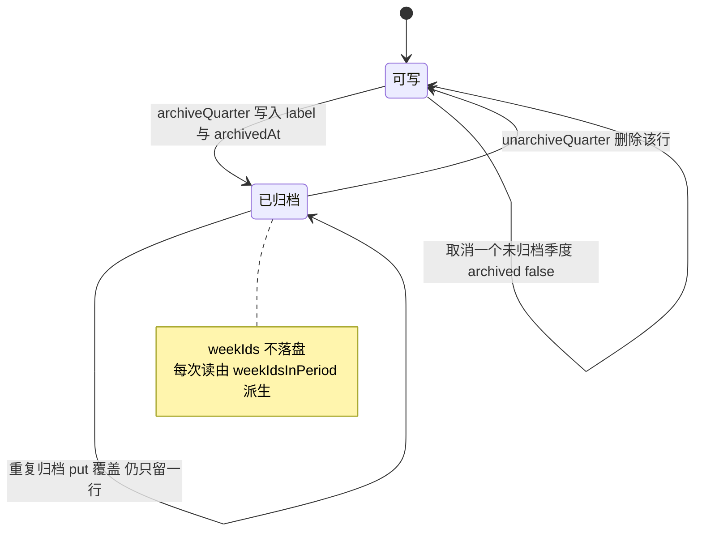
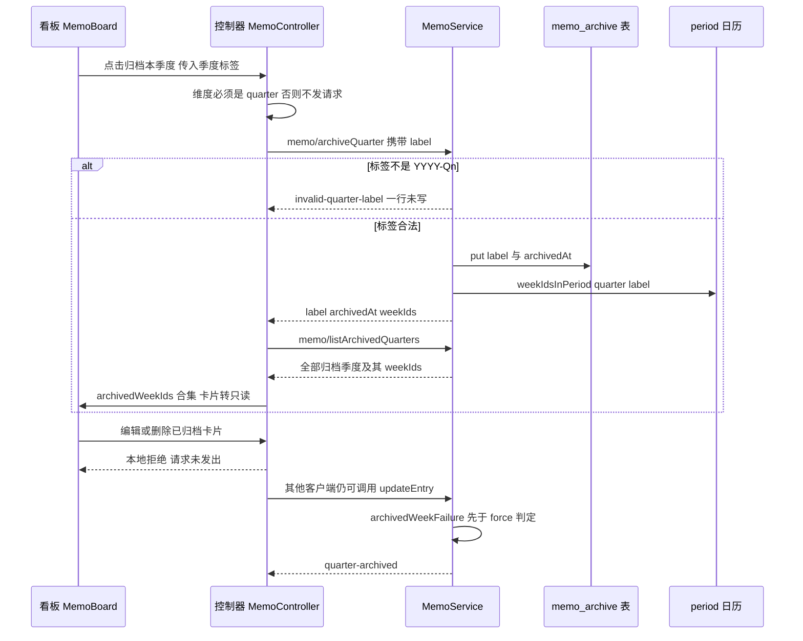
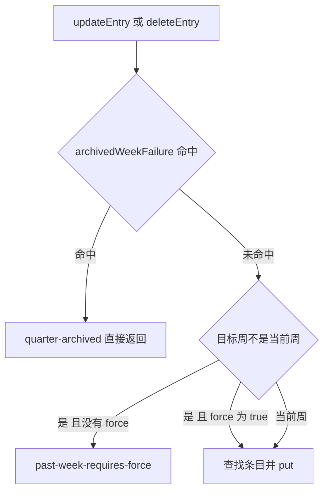

# 季度归档与只读：按标签归档、宿主派生周 id 与写守卫

归档是**标记，不是搬运**。点下「归档本季度」不会移动、复制、重写任何一条备忘周行；它只在另一个存储域里写下**一行** `{ label, archivedAt }`，之后所有「这个季度已关闭」的判定都从这一行和一张日历推导出来。取消归档就是删掉这一行——所以取消归档不可能丢内容，归档状态也不可能与备忘表本身不一致。

这条路线上有三个决定值得按顺序读一遍：**请求只带季度标签**（因为只有标签能唯一命名一个季度）、**周 id 每次读时由宿主派生**（不落盘，避免存一份日历副本）、**只读守卫在宿主方法体里**（浏览器只是第一道提示）。宿主侧的方法全集与失败码见[备忘服务（宿主）](../systems/memo-service.md)，日历规则本身见[四维周期日历](../concepts/period-calendar.md)，存储域的行 schema 与打开语义见[存储与持久化](../architecture/storage-and-persistence.md)，看板侧的控件布局见[备忘看板 UI](../systems/memo-board-ui.md)。

本页还负责另一件容易被同名混淆的事：**看板里「归档会话」选择器（`listArchivedSessions`）与「归档季度」是两套不相关的归档集合**。前者列的是会话仓库里的官方归档集合，用来生成周记；后者是本服务自己的 `memo_archive` 季度表。选择器的行为见[按会话归档列表与分组](#按会话归档列表与分组)，把会话写成周记的流程见[会话总结到周](session-summary-to-week.md)。

## 一次归档写下的到底是什么

| 项 | 值 |
|---|---|
| 域 / 表 | `memo_archive` / `quarters`（`memoArchiveDomainSpec`，`version: 0`） |
| 键 | 季度标签，`YYYY-Qn` |
| 行 | `{ label, archivedAt }`，`archivedAt` 是 `Date.now()` 毫秒数 |
| 备忘周行 | 一条都不动，也没有新增字段 |

`MemoService` 在自己的 `[Service.init]` 里依次打开两个域，各自用 `ctx.effect` 注册关闭动作（标签 `memo.domainClose` / `memo.archiveDomainClose`），然后把 `quarters` 表存进 `archiveTable` 字段（[index.ts](../../packages/memo/dsh-memo/src/index.ts#L844-L857)）。归档域是**独立域而不是 `weeks` 旁边多一张表**，理由写在域声明处：两个特性写不同的数据，分开之后归档特性再坏也不可能让备忘表打不开（[spec.ts](../../packages/memo/dsh-memo/src/spec.ts#L79-L99)）。域名叫 `memo_archive` 而不是 `memo-archive`，因为存储域的名字只接受 `/^[a-z][a-z0-9_]*$/u`。设计记录里这条取舍同样写在「零迁移风险」名下（[设计文档](../../docs/plans/2026-09-14-ui-memo-shell-and-archive-design.md#L15)）。

## 为什么是标签，而不是「你正在看的那个周期」

`archiveQuarter` 的入参是 `MemoQuarterLabelRequest`，只有 `label` 一个字段（[types.ts](../../packages/memo/dsh-memo/src/types.ts#L408-L413)）。这不是接口洁癖，而是因为「包含当前周期的那个季度」**没有唯一答案**：

- **年**跨四个季度，从年标签推不出唯一的季度。
- **月**在季度里只占三分之一，标签前缀与季度标签同为 `YYYY-`，靠字符串前缀判断正是旧缺陷的来源。
- **周**更糟：一周的周一是 2025-12-29，它的星期四却是 2026-01-01，于是这一周属于 `2026-Q1` 而不是 `2025-Q4`。

三种情况下「从周期起点的时间戳反推季度」都会归档错的季度，所以宿主干脆不接受周期，只接受季度标签；理由直接写在 `archiveQuarter` 的文档注释里（[index.ts](../../packages/memo/dsh-memo/src/index.ts#L859-L875)），回归用例 `archives exactly the quarter named, never a neighbour` 钉住相邻季度不受影响、重复归档也只留一行（[memo.spec.ts](../../packages/memo/dsh-memo/tests/memo.spec.ts#L662-L693)）。浏览器这一端对应的约束是：归档动作只出现在季度维度，其他维度没有这个按钮，`archiveCurrentQuarter()` 在非季度维度直接 `return false`，连请求都不发（[controller.ts](../../packages/client/ui-memo/src/client/controller.ts#L537-L562)、[MemoBoard.tsx](../../packages/client/ui-memo/src/client/MemoBoard.tsx#L488-L505)）。

## 归档状态机

一个季度只有两态，两态之间没有中间态；周 id 的归属是每次读时现算的，所以状态里不存在「这份归档覆盖哪些周」这种会过期的字段。



图：一个季度的两态生命周期；周行在任何转换中都不被移动或重写，两次转换都返回同一份派生后的 `weekIds`。

## 标签形状校验：写入之前的第一道门

两个写方法开头是同一段前置判断：`typeof label !== 'string' || !QUARTER_LABEL_PATTERN.test(label)` 就返回业务失败 `invalid-quarter-label`，其中 `QUARTER_LABEL_PATTERN = /^\d{4}-Q[1-4]$/u`（[index.ts](../../packages/memo/dsh-memo/src/index.ts#L337-L338)、[index.ts](../../packages/memo/dsh-memo/src/index.ts#L873-L881)、[index.ts](../../packages/memo/dsh-memo/src/index.ts#L894-L902)）。它发生在 `Date.now()`、`writeWithRetry`、任何 `put`/`delete` 之前，因此被拒的调用**一行都不写**——用例对 `2026-W37`、`2026-09`、`2026`、`not-a-quarter`、空串逐个断言失败码，最后再读一次归档列表确认长度仍是 0（[memo.spec.ts](../../packages/memo/dsh-memo/tests/memo.spec.ts#L695-L708)）。

第二道门在持久化边界：`archivedQuarterSchema` 用同一个正则约束 `label`（[spec.ts](../../packages/memo/dsh-memo/src/spec.ts#L71-L75)）。存储域在打开时校验每一行，所以哪怕有人绕过 Remote 直接写坏一行，坏行会**打开即失败**，而不是被当成一条「不认识的归档季度」静默忽略——这与本仓库「一条非法记录让整个插件起不来」的既有事故结论是同一条取舍。

失败信封是 `{ ok: false, error: { code: 'invalid-quarter-label', message, label: String(label ?? '') } }`，`label` 字段把调用方传进来的原值回显出来。这条拒绝路径**不写遥测**：它直接 `this.failure(...)` 返回，既没有 `track` 也没有 `trackError`（对比成功分支的 `track('archiveQuarter', 'success', { label })` 与 `track('unarchiveQuarter', 'success', { label, archived })`）。

## 请求序列

1. 用户在季度维度按下「归档本季度」→ `controller.archiveCurrentQuarter()`。控制器先自检 `selection.period === 'quarter' && selection.label !== ''`，否则返回 `false`、不发请求；通过后置 `busy: true`。
2. `callMemo(rpc, 'archiveQuarter', { label })` 经 `callRemote` 包成 `{ args: { request } }`，走 `rpc.call('/api', 'memo/archiveQuarter', …)`。
3. 宿主校验标签形状（上一节）。被拒则**到此为止**。
4. `archivedAt = Date.now()`，`writeWithRetry(() => archiveTable.put(label, { label, archivedAt }))`——与备忘写入共用同一个 `EPERM`/`EBUSY` 重试助手。
5. 成功时 `track('archiveQuarter', 'success', { label })`，并返回 `{ ok: true, value: archivedQuarter(label, archivedAt) }`：`label`、`archivedAt`、以及**宿主现算的** `weekIds`。
6. 控制器**丢掉**这个返回值里的 `weekIds`，改为重新调用一次 `memo/listArchivedQuarters`，因为卡片只读与否取决于「所有已归档季度的周 id 合集」，而不只是刚归档的那一个（[controller.ts](../../packages/client/ui-memo/src/client/controller.ts#L552-L558)）。
7. 客户端把返回的季度逐个冻结、把每个 `weekIds` 合进一个 `Set`，然后 `set({ archivedWeekIds, archivedQuarters })`。**周列表、时间线、卡片列表都不重新拉取**——卡片没变，变的是它们现在落在归档集合里（[controller.ts](../../packages/client/ui-memo/src/client/controller.ts#L415-L433)）。
8. 下一帧渲染时，每张卡片的 `archived` 由 `view.archivedWeekIds.has(card.weekId)` 决定，于是同一个季度在**四个维度**下同时变成只读（[MemoBoard.tsx](../../packages/client/ui-memo/src/client/MemoBoard.tsx#L439-L456)）。



图：归档一次季度的写入与回读序列，以及只读在客户端与宿主两道门上的落点。

## 宿主派生周 id，客户端只做成员测试

`archiveQuarter` 与 `listArchivedQuarters` 的返回元素都是同一个构造器产出的：`Object.freeze({ label, archivedAt, weekIds: Object.freeze(weekIdsInPeriod('quarter', label)) })`（[index.ts](../../packages/memo/dsh-memo/src/index.ts#L930-L936)）。`weekIds` 是该季度拥有的周 id 升序列表，来自与 `listPeriods` 完全相同的枚举函数（[period.ts](../../packages/memo/dsh-memo/src/period.ts#L153-L192)）。

这带来一条对客户端很关键的简化：**浏览器不需要知道「周 → 季度」怎么换算**。它只做 `Set.has(card.weekId)`，所以跨年边界的周（周四在次年、周一在上一年）不会在浏览器里被算错（[types.ts](../../packages/memo/dsh-memo/src/types.ts#L395-L407)）。控制器里五个查询全部建立在这个集合上：

| 问题 | 方法 | 依据 |
|---|---|---|
| 这张卡只读吗 | `isArchived(card)` | `archivedWeekIds.has(card.weekId)` |
| 这张卡的季度是谁（取消归档要点哪个标签） | `archivedQuarterOf(card)` | 在 `archivedQuarters` 里找 `weekIds.includes(card.weekId)` 的那一条 |
| 当前标签页的季度归档了吗 | `archivedQuarterLabel()` | 只有季度维度才回答，比对 `label` |
| 新增会写进归档吗 | `targetArchived` | 对 `targetWeek` 做同一集合的成员测试 |
| 要解哪个季度（任一维度） | `targetArchivedQuarter()` | 对 `targetWeek` 找拥有它的归档季度 |

（[controller.ts](../../packages/client/ui-memo/src/client/controller.ts#L684-L738)）。`archivedQuarterLabel()` 与 `targetArchivedQuarter()` 的分工不是重复：前者只回答「工具栏按钮该显示哪个动作」，因此只在季度维度有意义；后者回答「这个我的写入会落进哪个归档季度」，需要在任何一个维度下都能给出，composer 的说明文案与内联出口就靠它（[MemoBoard.tsx](../../packages/client/ui-memo/src/client/MemoBoard.tsx#L414-L428)）。

`archivedQuarterOf` 用 `find` 取第一个命中即止，这在语义上是安全的：日历的「铺满且不重叠」性质保证每个周恰属于一个季度，因此一张卡片最多只有一个所有者（[period-calendar.md](../concepts/period-calendar.md)）。列表本身按标签 `localeCompare` 升序返回，即**最旧在前**，与写入顺序无关；用例用两次归档后比对排序结果来钉住这一点（[index.ts](../../packages/memo/dsh-memo/src/index.ts#L909-L928)、[memo.spec.ts](../../packages/memo/dsh-memo/tests/memo.spec.ts#L631-L653)）。

## 为什么只存标签与时间戳，周 id 每次重算

`listArchivedQuarters` 返回的 `weekIds` 是**读时派生**的，从不落盘。域声明处给出的理由很直接：周 id 由标签经过同一套周期日历确定地推出，存一份副本等于存一份「日历被修正的那天就会错」的副本——那一刻起，存储里的副本会静默地多归档或少归档一批卡片（[spec.ts](../../packages/memo/dsh-memo/src/spec.ts#L79-L92)）。

同一段理由还有第二个收益：**列表与守卫共用同一族函数**。`listArchivedQuarters` 用 `weekIdsInPeriod('quarter', label)` 说明「这个季度拥有哪些周」，写守卫用 `weekIdBelongsToPeriod(weekId, 'quarter', label)` 判断「这个周是否落在已归档季度里」，前者是后者的枚举（[period.ts](../../packages/memo/dsh-memo/src/period.ts#L194-L209)）。只要日历被修正，两处同时改变，不会出现「卡片显示为已归档但写入被允许」或反过来的漂移。

## 只读守卫：一个函数，多个落点

真正的拒绝发生在宿主，判据是私有方法 `archivedWeekFailure(weekId)`：遍历 `archiveTable.entries()`，只要有一条归档标签满足 `weekIdBelongsToPeriod(weekId, 'quarter', label)` 就返回失败对象

```
{ code: 'quarter-archived', weekId, message: `week "${weekId}" is inside an archived quarter; unarchive the quarter before changing its memos` }
```

（[index.ts](../../packages/memo/dsh-memo/src/index.ts#L1096-L1118)、[types.ts](../../packages/memo/dsh-memo/src/types.ts#L277)）。调用点都在任何 `put` 或模型调用之前：

| 入口 | 守卫位置 | 拒绝时机 |
|---|---|---|
| `addEntry` | 委托给私有 `appendEntry`，`requireTable()` 之后第一件事就是守卫 | 读已有周行、构造 entry、`put` 之前（[index.ts](../../packages/memo/dsh-memo/src/index.ts#L1203-L1215)） |
| `updateEntry` | 方法体开头，`requireTable()` 之后 | 找行、`force` 判定、`put` 之前（[index.ts](../../packages/memo/dsh-memo/src/index.ts#L1250-L1260)） |
| `deleteEntry` | 同上 | 同上（[index.ts](../../packages/memo/dsh-memo/src/index.ts#L1296-L1306)） |
| `summarizeSession` | 解析并校验目标 `weekId` 之后、读会话与调模型之前 | 一次拒绝整次调用，不进 per-session outcome（[index.ts](../../packages/memo/dsh-memo/src/index.ts#L1552-L1562)） |

`summarizeSession` 还有第二次拦截：它最终通过 `updateEntry` / `appendEntry` 写卡片，而这两条路各自又过一遍守卫，所以即使一次总结在「顶层检查通过」之后才落地归档，写入仍会被拒，并被搬进该会话的 outcome（[index.ts](../../packages/memo/dsh-memo/src/index.ts#L1628-L1641)）：`updateEntry` 的失败被转成 `summaryFailure`，`appendEntry` 的失败被原样塞进 `outcomes`，整次调用仍是 `ok: true` 加一条失败 outcome。

**守卫的边界是「条目写入」，不是「整张表」。** `getWeek`、`listWeeks`、`listPeriods`、`listMemory`、`listArchivedSessions` 照常可读；`analyze` 与 `exportReport` 也不受拦截——两者都只读取周行（`analyze` 另外把结果追加到 `$DSH_HOME/memo/ledger.json` 账本，`exportReport` 只把 Markdown 交回调用方），都不写周表（[index.ts](../../packages/memo/dsh-memo/src/index.ts#L1438-L1493)）。归档一个季度之后，你仍然可以对它做 AI 分析与导出报告，只是不能改它的卡片。

### 为什么这条规则必须在宿主，而不是看板

代码注释给了两条具体的理由，两条都不是理论担忧（[index.ts](../../packages/memo/dsh-memo/src/index.ts#L1096-L1107)）：

1. **同一个 Remote 方法任何客户端都能调。** 看板只是其中一个调用方；把只读写进 `MemoBoard`，换一个客户端、或直接发一次 RPC 就绕过了。
2. **归档可能在对话框已经打开之后落地。** 用户打开编辑框时该周还是可写的，点保存时已经不是了——所以控制器在 `updateCard`/`deleteCard` 里也重新判一次，而宿主再不依赖任何客户端状态地判一次。

浏览器侧的拒绝是为了**把原因摆在用户面前**（错误横幅而不是一个原始失败码），以及**少发一次必然失败的请求**；它不是安全边界。用例直接断言归档后 `memo/addEntry`、`memo/updateEntry`、`memo/deleteEntry` 一次都没有发出（[controller.spec.ts](../../packages/client/ui-memo/tests/controller.spec.ts#L721-L746)），同时宿主用例断言即使带着 `force: true` 打过去也一定被拒、且周内容一字未改（[memo.spec.ts](../../packages/memo/dsh-memo/tests/memo.spec.ts#L711-L761)）。

## 归档压过 `force`

`updateEntry` / `deleteEntry` 内部有两个写闸门：**归档只读**与**非当前周需 `force`**。顺序是固定的：



图：两个闸门的先后顺序——归档判定先于 force 判定。

由此得到一条必须明说的性质：**已归档季度里的写入永远报 `quarter-archived`，永远不会是 `past-week-requires-force`，而 `force: true` 也解不开它。** 归档是用户的「这个季度关掉了」这个声明，`force` 只是「我知道历史周的分析结果可能变」这个确认，前者比后者更强。代码里能直接看到这个顺序：守卫返回在 `const { weekId: currentWeekId } = computeWeekBounds()` 与 `request.force` 判断之前（[index.ts](../../packages/memo/dsh-memo/src/index.ts#L1250-L1277)、[index.ts](../../packages/memo/dsh-memo/src/index.ts#L1296-L1315)）。

这一点在看板上尤其要紧：控制器**总是**带 `force: true` 发编辑与删除（[controller.ts](../../packages/client/ui-memo/src/client/controller.ts#L853-L860)、[controller.ts](../../packages/client/ui-memo/src/client/controller.ts#L891-L897)），因为它已经在编辑对话框里摆过确认文案。也就是说，对看板这条路径而言，`past-week-requires-force` 实际上不会成为回退，第二道门只剩归档守卫——这正是它必须由宿主独立把关的原因。

## 拒绝写入的守卫清单

把以上各条合成一张表，就是「谁能拒绝一次写入、报什么码」。**决定性的一点：被拒的调用只返回失败，不写任何行、不发模型请求、也不写遥测。**

| 被拒的场景 | 失败码 | 归属 | 证据 |
|---|---|---|---|
| 归档/取消归档的标签不是 `YYYY-Qn` | `invalid-quarter-label`（回显 `label`） | `archiveQuarter` / `unarchiveQuarter` 方法体开头 | [index.ts](../../packages/memo/dsh-memo/src/index.ts#L873-L881) |
| 写入落在已归档季度的任一所属周 | `quarter-archived`（附 `weekId`） | `addEntry`(→`appendEntry`) / `updateEntry` / `deleteEntry` / `summarizeSession` | [index.ts](../../packages/memo/dsh-memo/src/index.ts#L1096-L1118) |
| 同上，且调用方带了 `force: true` | 仍是 `quarter-archived` | 归档判定先于 force 判定 | [memo.spec.ts](../../packages/memo/dsh-memo/tests/memo.spec.ts#L711-L761) |
| 归档列表读不到 | 无（客户端折叠成空集合 + 警告；宿主侧为传输层错误） | 不在宿主守卫范围内 | [controller.ts](../../packages/client/ui-memo/src/client/controller.ts#L404-L433) |
| 归档域未初始化 | 抛错而非业务失败 | `requireArchiveTable()` | [index.ts](../../packages/memo/dsh-memo/src/index.ts#L1119-L1125) |

存储域在打开时的行 schema 校验是**契约之外的第三道防线**：它不是在拒绝写入，而是在拒绝「打开一个坏掉的域」，因此不产生上表任何失败码，而是让插件起不来（[spec.ts](../../packages/memo/dsh-memo/src/spec.ts#L71-L99)）。

## 归档当前季度会连今天一起关掉

`archiveQuarter` 不区分当前季度与历史季度，「归档本季度」对进行中的季度是合法动作。后果是**本周也立刻变成只读**，包括刚打开的空编辑器：控制器会把 composer 的 textarea 与提交按钮一并禁用、把占位文案换成「该季度已归档，取消归档后才能继续添加或编辑」，并在下方内联给出「取消归档」按钮（[MemoBoard.tsx](../../packages/client/ui-memo/src/client/MemoBoard.tsx#L395-L428)、[locales.ts](../../packages/client/ui-memo/src/client/locales.ts#L59-L62)）。宿主用例把这条写成了显式后果而不是意外：归档当前季度后往今天写会被拒，取消归档后同一个写入立刻成功（[memo.spec.ts](../../packages/memo/dsh-memo/tests/memo.spec.ts#L797-L823)）。

## 取消归档：删一行，返回「是否真的删掉了」

`unarchiveQuarter` 走同一段标签形状校验，然后 `writeWithRetry(() => archiveTable.delete(label))`，把删除的布尔结果原样放进返回值（[index.ts](../../packages/memo/dsh-memo/src/index.ts#L894-L906)）：

```ts
{ ok: true, value: { label: string; archived: boolean } }
```

这里的 `archived` 很容易读错：它表示**这次调用是否真的删掉了一行**，而不是「该季度当前是否已归档」。同一个季度归档两次只有一行（`put` 覆盖，`archivedAt` 被后一次刷新）；对一个本来就不在归档里的季度调用取消归档，返回 `ok: true` 且 `archived: false`——这是幂等的 no-op，不是失败（[memo.spec.ts](../../packages/memo/dsh-memo/tests/memo.spec.ts#L646-L660)、[types.ts](../../packages/memo/dsh-memo/src/types.ts#L435-L438)）。

客户端**不看**这个字段：它只判 `result.ok`，然后重读 `memo/listArchivedQuarters` 并把新的合集写回状态（[controller.ts](../../packages/client/ui-memo/src/client/controller.ts#L571-L584)）。重读而不是本地删一条，是为了让「只有宿主知道的事实」保持单一来源——多客户端、或一个刚好在别处归档的季度，都不会被本地乐观更新覆盖。删除与写入一样经过 `writeWithRetry`，所以 `EPERM` 重试同样覆盖归档的 `put` 与 `delete`：用例分别给两次操作各安排一次失败，最终 4 次尝试成功（[memo.spec.ts](../../packages/memo/dsh-memo/tests/memo.spec.ts#L1079-L1094)）。

## 客户端那半边：只读是一层叠加视图

浏览器从不持有「归档」这个事实本身，只持有宿主刚告诉它的两份数据：`archivedWeekIds`（所有已归档季度周 id 的合集，用于成员测试）与 `archivedQuarters`（季度本身，用于回答「该取消哪一个」）。视图层据此做四件事：

| 位置 | 归档时的表现 |
|---|---|
| 卡片动作行 | 「查看」保留，编辑槽位换成「取消归档」；「复制 / 删除」一并撤掉。用例断言动作行只剩恰好两个按钮。卡片加 `data-archived`、降透明度到 0.72、换成虚线边框与「已归档」标签（[MemoBoard.tsx](../../packages/client/ui-memo/src/client/MemoBoard.tsx#L856-L890)、[styles.ts](../../packages/client/ui-memo/src/client/styles.ts#L223-L237)、[MemoBoard.spec.tsx](../../packages/client/ui-memo/tests/MemoBoard.spec.tsx#L474-L491)） |
| 详情对话框 | 同一条规则：不出现「编辑」，出现「取消归档」；把编辑放回一次点击之外，等于把刚藏起来的按钮还回去，而阅读仍然照常（[MemoBoard.tsx](../../packages/client/ui-memo/src/client/MemoBoard.tsx#L913-L953)） |
| composer | 目标周在归档季度里时禁用输入与提交，说明原因并内联给出取消归档出口（按 `targetArchivedQuarter()` 找要解哪个季度） |
| 工具栏 | 只在季度维度出现，按钮文案在「归档本季度 / 取消归档」之间按 `archivedQuarterLabel()` 切换 |

卡片知道自己属于哪个**周**、不知道属于哪个**季度**，所以取消归档的标签由 `archivedQuarterOf(card)` 从宿主派生的 `weekIds` 反查，而不是在浏览器里重算（[MemoBoard.tsx](../../packages/client/ui-memo/src/client/MemoBoard.tsx#L448-L455)）。

其中「显示为已归档」与「真的写不进去」是两件事：控制器在 `addCard`、`updateCard`、`deleteCard`、`summarizeSessions` 里各判一次并就地给出原因，宿主再独立判一次。任一侧失效都不会把写入放过去。

### 读不到归档时的失败语义

`readArchivedQuarters` 把任何失败折叠成「空集合 + `ok: false`」，`refresh` 随后**保持 `status: 'ready'`、把卡片显示为可编辑**，但在 `error` 槽里明写「the archived quarters could not be read; cards are shown as editable」（[controller.ts](../../packages/client/ui-memo/src/client/controller.ts#L390-L397)、[controller.ts](../../packages/client/ui-memo/src/client/controller.ts#L402-L433)）。这是一个刻意的取舍：

- **不能静默。** 「读不到」与「没归档」在屏幕上长得一模一样，这个歧义曾经掩盖了整个特性——宿主归档成功 13 次，客户端的读永远为空，界面上没有任何东西解释为什么（[controller.spec.ts](../../packages/client/ui-memo/tests/controller.spec.ts#L771-L787)）。
- **可以放宽到可编辑。** 归档只是卡片上的一层只读叠加，读失败不该把用户本来能看的备忘藏起来；真正的安全性由宿主守卫承担，所以这里「显示为可编辑」不会变成「真的写得进去」。

值得注意的是 `listArchivedQuarters` 的类型虽然允许业务失败，实现里却从不返回 `ok: false`：它同步读表、没有 I/O 失败分支，唯一的坏情况是归档域没初始化时 `requireArchiveTable()` 抛错，那会以传输层错误的形式出现（[index.ts](../../packages/memo/dsh-memo/src/index.ts#L909-L928)、[index.ts](../../packages/memo/dsh-memo/src/index.ts#L1119-L1125)）。因此客户端看到的 `!result.ok` 基本等价于「端点不可达/请求形状不对」——历史事故正是后者：这个方法曾经完全没有形参，而 Remote 协议按名绑定参数，调用在进入方法体之前就被拒。同一条规则现在由 `remote-signatures.spec.ts` 对**所有** `@Remote` 方法静态检查（[remote-signatures.spec.ts](../../packages/memo/dsh-memo/tests/remote-signatures.spec.ts#L1-L57)）。

## 按会话归档列表与分组

看板另一个带「归档」字样的特性是**会话总结选择器**，它读取的是官方会话归档集合，与季度归档互不相干，但共享两条值得记住的设计：

- **哪些会话可选，由归档集合决定；标题与元数据由会话查询服务补。** `listArchivedSessions` 先读 `workspaceRegistry.archivedSessionIds`，再按需读标题；子代理子会话在读取任何日志之前就被过滤掉，因为它们是模型自己的委派、不是用户的工作（[index.ts](../../packages/memo/dsh-memo/src/index.ts#L941-L1033)）。
- **按工作区分组。** 归档会话保留它的工作区槽位，所以它们留在自己的项目里而不是掉进「未分组」；`workspaces` 只列出**至少持有一条归档会话**的工作区，空筛选器是噪音（[index.ts](../../packages/memo/dsh-memo/src/index.ts#L1030-L1073)、[session-summary.spec.ts](../../packages/memo/dsh-memo/tests/session-summary.spec.ts#L253-L274)）。

### 缓存里的空标题也算「已答复」

标题是这条路径上唯一昂贵的东西：折一条标题要读并回放整个日志，几十条大会话的归档曾慢到像坏掉。宿主因此先用 `sessionProjectionCache` 的零 I/O 投影取标题，只对缓存答不出来的会话做日志折叠（[index.ts](../../packages/memo/dsh-memo/src/index.ts#L1075-L1095)）。

`cachedProjectionTitle` 因此有三种结果，调用方必须区别对待（[index.ts](../../packages/memo/dsh-memo/src/index.ts#L2283-L2311)）：

| 结果 | 含义 | 宿主行为 |
|---|---|---|
| 标题字符串 | 缓存给出了标题 | 直接用，不折日志 |
| `null` | 缓存里有这一行，但这一行还没有标题 | **记为已答复**，写入空串，直接走短 id 兜底，不折日志 |
| `undefined` | 缓存答不出来（无该行、无该服务、读抛错） | 留给 `readSessionTitles` 批量折叠 |

关键在中间那一行：把 `null` 当成 miss 会让宿主回放整条会话，只为学到它确实没有标题——正是这条路径存在的目的（省掉这次折叠）被抵消。用例 `treats a cached row without a title as answered and folds nothing` 断言 `titleReads` 为 0，且显示的是短 id 兜底形式（[session-summary.spec.ts](../../packages/memo/dsh-memo/tests/session-summary.spec.ts#L296-L312)）。

浏览器侧对应的分组逻辑是纯函数、时钟可注入：`filterArchivedSessions` 应用「搜索 / 项目 / 时间窗」三个筛选，`groupArchivedSessions` 按宿主给的工作区顺序分桶，未分组的桶永远排在最后，用保留哨兵 `::ungrouped::` 表示（[logic.ts](../../packages/client/ui-memo/src/client/logic.ts#L368-L490)）。筛选只是已加载列表的一个视图，敲键盘或切项目都不会重读归档；只有弹窗里的刷新按钮才会再调一次 `listArchivedSessions`（[MemoBoard.spec.tsx](../../packages/client/ui-memo/tests/MemoBoard.spec.tsx#L1083-L1094)）。看板用例逐项钉住了分组顺序、筛选计数，以及「筛空了」与「归档本来就是空的」是两条不同文案（[MemoBoard.spec.tsx](../../packages/client/ui-memo/tests/MemoBoard.spec.tsx#L1040-L1080)）。

## 失败与边界一览

| 场景 | 结果 |
|---|---|
| 标签不是 `YYYY-Qn`（归档或取消归档） | `invalid-quarter-label`，**一行都不写**，无遥测 |
| 重复归档同一季度 | `ok: true`，归档列表仍只有一行 |
| 取消归档一个没归档过的季度 | `ok: true`，`{ label, archived: false }` |
| 写入落在已归档季度的任一所属周 | `quarter-archived`，附 `weekId`，周内容不变 |
| 写入落在任何归档季度之外 | 与未引入归档时完全一致（含 `past-week-requires-force`） |
| 归档当前季度 | 今天也变只读，取消归档是唯一出口 |
| AI 分析或导出报告已归档季度 | 照常可用：两条路径不调用归档守卫，也不写周表 |
| 归档列表读失败 | 卡片显示为可编辑 + 看板警告；宿主仍拒写 |
| 归档域未初始化 | `requireArchiveTable()` 抛错，作为传输层错误冒出来，不折成业务失败 |
| 归档写入遇到 `EPERM`/`EBUSY` | 与备忘写入同一套 `writeWithRetry`，耗尽后把最后一次错误抛给调用方 |
| 会话选择器读不到归档集合 | 弹窗内显示原因（`session-service-unavailable` 等），看板本身不受影响 |

## 覆盖这些行为的测试

| 文件 | 钉住的事实 |
|---|---|
| [memo.spec.ts](../../packages/memo/dsh-memo/tests/memo.spec.ts#L611-L709) | 归档返回的 `weekIds` 等于时间线给出的那一组；列表最旧在前；取消归档真的删除、重复取消是 `archived: false` 的 no-op；只归档被点名的那一个季度且重复归档只留一行；五种非法标签全部被拒且零写入 |
| [memo.spec.ts](../../packages/memo/dsh-memo/tests/memo.spec.ts#L711-L824) | 三个写方法全被拒且内容未变、解归档后恢复可写；被归档季度拥有的**每一个**周都被拒；归档之外的周照旧可写；归档当前季度连今天一起关 |
| [memo.spec.ts](../../packages/memo/dsh-memo/tests/memo.spec.ts#L1079-L1094) | 归档的 `put` 与 `delete` 各自重试一次后成功（共 4 次尝试） |
| [session-summary.spec.ts](../../packages/memo/dsh-memo/tests/session-summary.spec.ts#L253-L312) | 只列持有归档会话的工作区、无归属的会话留在未分组；标题先读缓存、只折未命中的那一条；缓存给出空标题也算答复、折叠次数为 0 |
| [remote-signatures.spec.ts](../../packages/memo/dsh-memo/tests/remote-signatures.spec.ts#L1-L57) | 每个 `@Remote` 方法都声明且只声明一个名为 `request` 的参数——`listArchivedQuarters` 曾经缺失它，宿主归档成功而客户端读回空 |
| [controller.spec.ts](../../packages/client/ui-memo/tests/controller.spec.ts#L703-L787) | 归档后新增/编辑/删除/复制一次请求都不发；解归档后写入恢复；归档之外的周期保持可写；归档读失败时 `status` 仍是 `ready` 且带警告 |
| [MemoBoard.spec.tsx](../../packages/client/ui-memo/tests/MemoBoard.spec.tsx#L454-L587) | 归档按钮只在季度维度出现；四个维度下同一张卡都带 `data-archived`、动作行只剩「查看 + 取消归档」；详情对话框与 composer 同规则；邻季度（跨年）保持可编辑 |

## 延伸阅读

- [备忘服务（宿主）](../systems/memo-service.md)——全部 Remote 方法的完整方法面、失败码与降级语义。
- [备忘看板 UI](../systems/memo-board-ui.md)——控制器状态、四维标签与卡片动作的浏览器侧布局。
- [四维周期日历](../concepts/period-calendar.md)——星期四规则与「铺满不重叠」性质，本页所有派生都建立在它上面。
- [存储与持久化](../architecture/storage-and-persistence.md)——`memo_archive.quarters` 的键形状、行 schema 与打开失败语义。
- [会话总结到周](session-summary-to-week.md)——选择器选出的会话如何写成周记，以及目标周落在归档季度时的出口。
