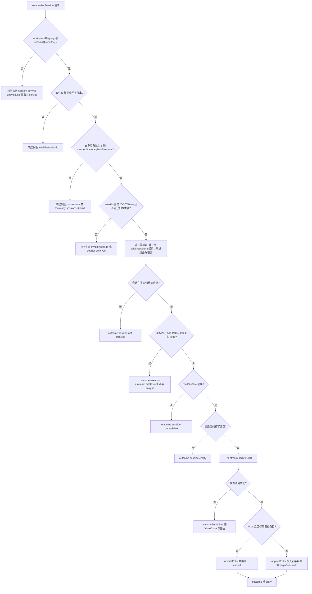
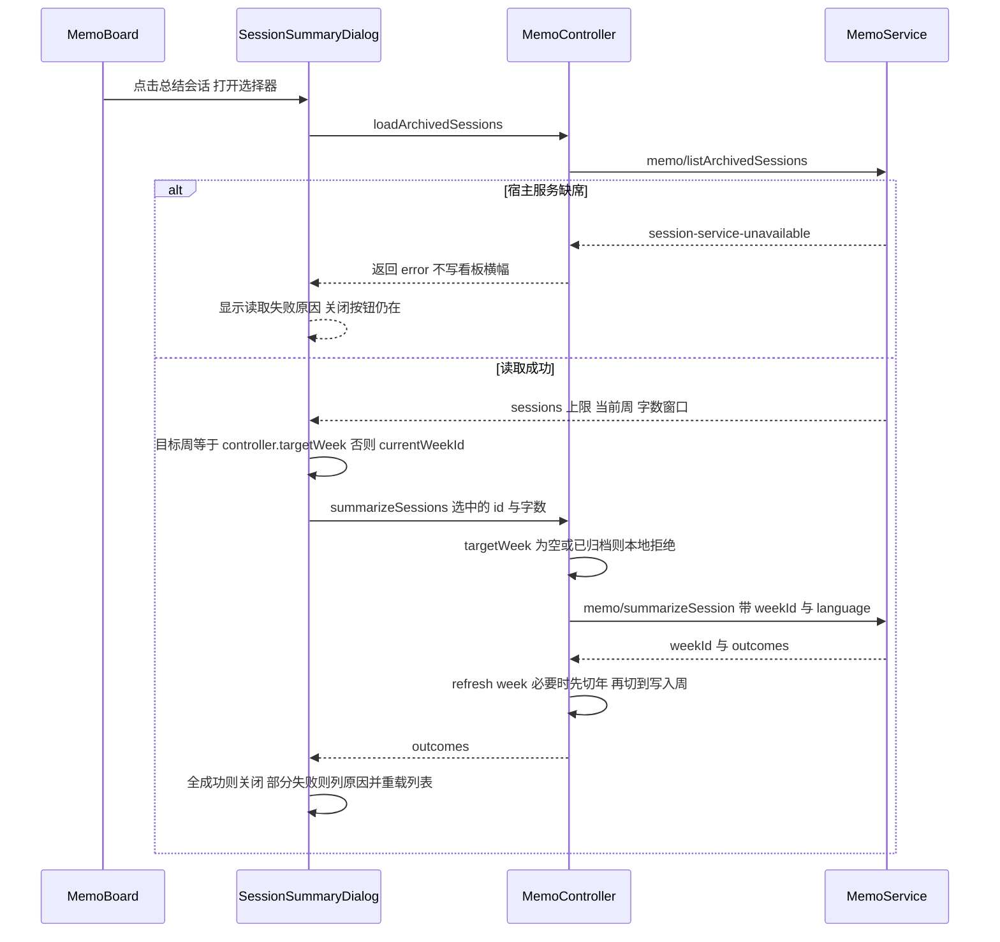

# 已归档会话 → 备忘周条目

「总结会话」把**官方归档**的会话变成**当前查看的那一周**里的备忘条目。它是一条**用户手动触发、手动勾选**的路线：打开选择器、勾几个会话、按「开始总结」，宿主对每个被选中的会话各调一次模型、各写一条 `text` 条目，条目末尾带来源会话标注。

这条路线的形状由四个决定撑起来：

- **资格只看官方归档集合**（`ctx.workspaceRegistry.archivedSessionIds`），会话内容由 `ctx.sessionQuery` 提供；两者都是**可选读**，缺席时返回指名服务的失败而不是一个空列表。
- **一个会话一次模型调用、一条条目**，而不是把几个会话拼成一个大提示词——周视图因此读起来是「每段对话各自产出了什么」，一个超长会话也挤不掉别的会话。
- **转写有硬预算**：只留人可见的用户/助手文本，单条上限 + 总量上限，总量超限时保留首尾、砍掉中间（工作会话的目标通常在开头、结论通常在结尾）。
- **来源由宿主记录而不是推断**：`originSessionId` 与末尾的来源注记都在模型返回之后由宿主写入，模型与浏览器都碰不到。

宿主侧方法全集与失败码总表见[备忘服务（宿主）](../systems/memo-service.md)，`workspaceRegistry`/`sessionQuery` 的三层容错与 `llm` 路由解析见[DSH 宿主服务](../integrations/dsh-host-services.md)，模型调用失败如何保全事实见[模型路由与失败事实保全](../concepts/llm-route-and-failure-facts.md)，选择器在看板上的位置与文案见[备忘看板 UI](../systems/memo-board-ui.md)，目标周落在已归档季度时的只读守卫见[季度归档与只读](quarter-archive-and-read-only.md)。

**这一期明确不做的事**：归档时自动总结（要额外的模型成本授权与去抖策略）、把多个会话合并成一条周总结、从会话内容生成 GitHub Issue、改动官方归档 UI 或归档数据本身（[设计文档](../../docs/plans/2026-10-28-memo-session-summary-design.md)）。

## 两个 Remote 方法

| 方法 | 入参 | 出参 |
|---|---|---|
| `listArchivedSessions` | `{}`（只为协议按名绑定参数而存在） | `{ sessions, maxSessions, currentWeekId, summaryMaxChars, summaryMaxCharsLimit }`；每个会话是 `{ sessionId, title, createdAt, cwd?, summarizedWeekIds }` |
| `summarizeSession` | `{ sessionIds, weekId?, provider?, model?, force?, language?, maxChars? }` | `{ weekId, outcomes[] }`；每个 outcome 是 `{ sessionId, title, entry?, error? }` |

`summarizeSession` 的**顶层失败只回答「这次请求能不能跑」**（服务缺席、id 形状、空选择、超上限、周 id 非法、目标周已归档）；**每个会话自己的问题全部落进 `outcomes`**。这条分层是整页的主线：顶层失败一次都不写库，单会话失败则与同一请求里已经成功的那些条目并存（[types.ts](../../packages/memo/dsh-memo/src/types.ts#L518-L631)、[index.ts](../../packages/memo/dsh-memo/src/index.ts#L1320-L1460)）。



图：一次 `summarizeSession` 的顶层闸门、每会话判定顺序与两条写入分支。

## 阶段一：谁能被总结

`listArchivedSessions` 不自己判断「什么算已归档」：它读 `ctx.get('workspaceRegistry').archivedSessionIds`，这个数组是**唯一**的资格依据（[index.ts](../../packages/memo/dsh-memo/src/index.ts#L852-L901)）。备忘自己的按季度归档是另一件事——那是「哪几周只读」，与「哪些会话可以被总结」无关，两者不要混。

拿到 id 集合之后是一次**批量补全**，补的全是表现层：

| 字段 | 来源 | 读不到时 |
|---|---|---|
| `title` | `sessionQuery.readTitleSnapshots(ids)` 里 `status: 'fulfilled'` 的 `value.title.title` | 回退成短 id 形式 `Session <id 前 8 字符>`，会话仍然出现 |
| `createdAt` | `sessionQuery.listSessions()` 的 `header.createdAt` | `0`，排序时沉到最后 |
| `cwd` | 同一个 header | 字段整个省略 |
| `summarizedWeekIds` | 遍历 `weeks` 表里所有带 `originSessionId` 的条目 | 空数组 |

两个批量读都是**尽力而为**：`listSessions()` 抛错就得到一张空 header 表，`readTitleSnapshots` 抛错或该方法根本不存在（它是结构上的可选成员）就得到一张空标题表（[index.ts](../../packages/memo/dsh-memo/src/index.ts#L1518-L1568)）。理由写在 JSDoc 里：归档集合已经点名了会话，读不到元数据只是少几个字段，不该让整个选择器变成失败。用例钉住了这个回退：没有标题的 `session-b` 显示为 `Session session-`，而 `session-a` 拿到 `Fix CI`、`createdAt: 2000`、`cwd: '/work'`（[session-summary.spec.ts](../../packages/memo/dsh-memo/tests/session-summary.spec.ts#L175-L199)、[session-transcript.spec.ts](../../packages/memo/dsh-memo/tests/session-transcript.spec.ts#L122-L128)）。

**子会话在这里被剔掉**，而不是在浏览器里：`isSubagentSession(header)` 只认 `header.origin === 'subagent'`（[session-transcript.ts](../../packages/memo/dsh-memo/src/session-transcript.ts#L272-L282)）。理由是它们是模型自己的委派、不是用户的工作，而且每个子会话总结出来都只是父会话的近似副本；放进选择器既会淹没列表，也会让一次点击花掉好几个近乎重复的模型调用。

最后列表按 `createdAt` 倒序（最新在前），并附带三个客户端要用的值：`maxSessions`、`currentWeekId`、以及字数窗口 `summaryMaxChars` / `summaryMaxCharsLimit`（下一节）。

## 阶段二：把会话压成一段有界的转写

对话提取与预算全是纯函数，放在 `src/session-transcript.ts`，宿主方法只负责编排。这不是洁癖：这些规则一旦错，错法是「模型看到了工具输出」或「预算被一条消息吃光」，必须能直接单测。

### 只留人可见的问答

`extractSessionMessages` 只认两种事件类型：`user/message` 与 `assistant/message`。`system/message`、`developer/message`、`tool/result` 全部跳过；消息体优先取 `data.message`，若老一点的产线把字段直接放在 `data` 上则退而取 `data`；内容只拼 `type === 'text'` 的块（`tool-call` 之类忽略），空白消息整条丢弃；用户消息还多一道 `source.kind` 检查——只要它是个字符串且不等于 `'user'`，就判定为工具或系统合成的提示而非用户自己的话（[session-transcript.ts](../../packages/memo/dsh-memo/src/session-transcript.ts#L118-L151)）。

用例把这条规则钉成三段断言：系统提示词、工具结果、`source.kind: 'tool'` 的合成用户轮次**都不出现**在送给模型的文本里，而 `Please fix the CI` 与 `I fixed the CI` 出现（[session-summary.spec.ts](../../packages/memo/dsh-memo/tests/session-summary.spec.ts#L219-L230)、[session-transcript.spec.ts](../../packages/memo/dsh-memo/tests/session-transcript.spec.ts#L17-L47)）。

### 两道预算：单条 4000 + 总量保留首尾

渲染时每条消息写成 `User: …` / `Assistant: …`，消息之间空一行。两道预算互不替代：

| 预算 | 值 | 归属 | 超限时 |
|---|---|---|---|
| 单条消息 | `DEFAULT_MAX_MESSAGE_CHARS = 4000` | **协议常量**，不是 `Config` | 截断到 4000 并追加 ` …(truncated)` |
| 整段转写 | `sessionSummaryTranscriptMaxChars`（默认 `24000`） | 部署可调 | 保留开头与结尾，中间换成一条省略标记 |

单条上限故意不做成旋钮：它的存在意义是「一次失控的工具倾倒不能吃掉整个上下文预算」，而这属于协议约束，不是部署口味；可调的是总量（[session-transcript.ts](../../packages/memo/dsh-memo/src/session-transcript.ts#L59-L74)）。

总量超限时的算法在 `renderSessionTranscript` 里，值得按顺序记住：

1. 先算省略标记 `… (omitted N messages, M characters) …` 的长度，再把它和标记两侧的连接开销一起从预算里扣掉，得到 `keptBudget`（下界 2），**所以即使每条都被省略，最终文本仍在预算内**。
2. `keptBudget` 对半分：头部约 50%、尾部约 50%。
3. 头部从第 1 条开始贪心装整条，装不下就停；如果一条都装不下，就把第一条按预算切片硬保留一小段。
4. 尾部从最后一条往回贪心，且**不越过头部已经吃掉的条数**；同样地，一条都装不下就切片保留最后一小段。
5. 返回值同时报告 `messageCount`、`elidedMessages`、`truncated`，所以「被砍了多少」是可观测的，而不是一个黑箱。

切字符时用 `sliceWholeCharacters` 在 UTF-16 代理对上退一格，避免截出半个 emoji 或半个 CJK 扩展字（[session-transcript.ts](../../packages/memo/dsh-memo/src/session-transcript.ts#L76-L95)、[session-transcript.ts](../../packages/memo/dsh-memo/src/session-transcript.ts#L153-L237)）。用例分别覆盖「预算够就一字不删」「10 条消息压进 500 字后仍含首条与末条、且总长 ≤ 500」「单条超长被标记」「切点不落半个代理对」（[session-transcript.spec.ts](../../packages/memo/dsh-memo/tests/session-transcript.spec.ts#L49-L100)）。

**空转写就是空会话。** 宿主拿到 `transcript.text.length === 0` 就直接产出一条 `session-empty` 的 outcome，不去花模型调用——一个只有工具事件的会话没有可总结的人话。

## 阶段三：一次会话一个模型调用

宿主在循环外一次性算好三件事：路由（`resolveRoute(request)`，请求 → 服务 `Config` → 部署的 `agentDefaultModel`，复用既有那套，不另造）、输出语言、目标字数；然后把 `{language}` 与 `{maxChars}` 代入 `sessionSummaryPrompt` 得到系统提示词（[index.ts](../../packages/memo/dsh-memo/src/index.ts#L1143-L1150)、[index.ts](../../packages/memo/dsh-memo/src/index.ts#L1372-L1375)、[index.ts](../../packages/memo/dsh-memo/src/index.ts#L259-L267)）。

循环里每个会话一次 `streamLlmText(llm, route, systemPrompt, transcript.text)`，成功后条目内容是**两段拼接**：

```
${result.text.trim()}${renderSourceAnnotation(sessionSummarySourceTemplate, { sessionId, sessionTitle: title })}
```

后半段是宿主编译的，默认模板 `\n\n来源会话：{sessionId}`；`renderSourceAnnotation` 只替换 `{sessionId}` 与 `{sessionTitle}` 两个占位符，**其它花括号原样留着**，因为模板是部署拥有的文案而不是通用表达式语言（[session-transcript.ts](../../packages/memo/dsh-memo/src/session-transcript.ts#L239-L257)）。用例同时钉住默认模板的产出 `…\n\n来源会话：session-a` 与自定义模板 `[{sessionTitle}]({sessionId})` → `[Fix CI](session-a)`（[session-summary.spec.ts](../../packages/memo/dsh-memo/tests/session-summary.spec.ts#L202-L217)、[session-summary.spec.ts](../../packages/memo/dsh-memo/tests/session-summary.spec.ts#L281-L289)）。

### 语言：`auto` 跟随浏览器，`zh`/`en` 压过浏览器

`sessionSummaryLanguage` 有三档，解析在 `resolveSummaryLanguage`：

| Config | 实际语言 |
|---|---|
| `zh` | 简体中文，无视请求 |
| `en` | 英文，无视请求 |
| `auto`（默认） | 请求的 `language === 'en'` → 英文；其余（`zh`、缺省、未知）→ 中文 |

`auto` 的「其余都是中文」是有意的：默认来源注记本身就是中文，一个中文界面收到英文总结是这条特性当初要修的问题；而部署若要求周报统一一种语言，用 `zh`/`en` 直接覆盖浏览器（[index.ts](../../packages/memo/dsh-memo/src/index.ts#L1462-L1476)、[index.ts](../../packages/memo/dsh-memo/src/index.ts#L185-L193)）。

浏览器那半边只做一件映射：`locale().toLowerCase().startsWith('zh') ? 'zh' : 'en'`，前缀判断让 `zh-CN`/`zh-TW`/`en-GB` 都跟随基语言；拿不到 locale 时控制器的默认提供者是 `() => 'zh'`，于是缺省落到中文（[controller.ts](../../packages/client/ui-memo/src/client/controller.ts#L668-L680)、[controller.ts](../../packages/client/ui-memo/src/client/controller.ts#L280-L290)）。

模板里的语言名不是 id 而是自然语言名（`Simplified Chinese` / `English`）：提示词是散文，"Write in zh" 比 "Write in Simplified Chinese" 更容易被模型忽略（[index.ts](../../packages/memo/dsh-memo/src/index.ts#L233-L243)）。自定义提示词省略占位符就等于放弃该维度——用例断言一个不含占位符的自定义提示词**原样**发给模型（[session-summary.spec.ts](../../packages/memo/dsh-memo/tests/session-summary.spec.ts#L275-L279)）。

### 字数：默认值、请求值与一个硬窗口

`{maxChars}` 来自 `resolveSummaryMaxChars`，窗口是 `[100, max(100, sessionSummaryMaxCharsLimit)]`：

- 请求没带 `maxChars` → 用 `sessionSummaryMaxChars`（默认 `300`），并先被夹进同一个窗口，所以默认值不会落在窗口外。
- 请求带了 → 四舍五入后夹进窗口；低于 `100` 抬到 `100`，高于上限压到上限。
- 上限本身先被抬到至少 `100`（`SESSION_SUMMARY_MIN_CHARS`），因此一个被配小的 limit 也不会把窗口变成空的。

`listArchivedSessions` 回给选择器的 `summaryMaxChars` / `summaryMaxCharsLimit` 用**同一段算式**，所以选择器里显示并预先填好的数字，与「请求不带 maxChars 时宿主会用的值」必然一致（[index.ts](../../packages/memo/dsh-memo/src/index.ts#L889-L899)、[index.ts](../../packages/memo/dsh-memo/src/index.ts#L1478-L1494)、[types.ts](../../packages/memo/dsh-memo/src/types.ts#L599-L605)）。用例覆盖两端：`maxChars: 5000` 在 `limit: 500` 下变成 500，`maxChars: 10` 变成 100（[session-summary.spec.ts](../../packages/memo/dsh-memo/tests/session-summary.spec.ts#L265-L273)）。

### 四个预算相关的旋钮

| 字段 | 范围 / 默认 | 作用 |
|---|---|---|
| `sessionSummaryMaxSessions` | `1–20`，默认 `5` | 单次请求接受的会话数；超了是顶层 `too-many-sessions`，带 `limit` |
| `sessionSummaryTranscriptMaxChars` | `1000–200000`，默认 `24000` | 单个会话送入模型的字符预算，唯一在「摘要深度 ↔ 上下文安全」之间取舍的旋钮 |
| `sessionSummaryLanguage` | `auto`/`zh`/`en`，默认 `auto` | 输出语言策略 |
| `sessionSummaryMaxChars` / `sessionSummaryMaxCharsLimit` | `100–4000` 默认 `300` / `100–20000` 默认 `2000` | 选择器默认字数 / 客户端可请求上限 |

外加 `sessionSummaryPrompt` 与 `sessionSummarySourceTemplate` 两个纯文案旋钮（[index.ts](../../packages/memo/dsh-memo/src/index.ts#L284-L298)、[README](../../packages/memo/dsh-memo/README.zh.md#L19-L25)）。全部字段都是 `.volatile()`，所以设置面板改完**下一次调用**就生效，不需要重挂插件——见[配置与实时设置](../concepts/configuration-and-live-settings.md)。

## 失败分类：顶层拒绝 vs 每会话失败

上面的流程图里，两个失败集合必须分清，因为它们对「已经写进去的东西」的影响完全不同。

**顶层失败：一次都不写库。** `session-service-unavailable`（带 `service: 'workspaceRegistry' | 'sessionQuery'`）、`invalid-session-id`（带原始 `sessionId`）、`no-sessions`、`too-many-sessions`（带 `limit`）、`invalid-week-id`（带 `weekId`）、`quarter-archived`（带 `weekId`）。这些判定全部在循环之前完成，包括 id 去重（`new Set`）与周 id 形状校验（[index.ts](../../packages/memo/dsh-memo/src/index.ts#L1321-L1367)、[types.ts](../../packages/memo/dsh-memo/src/types.ts#L269-L319)）。

**每会话失败：进 `outcomes`，成功的那些照样写。** 检查顺序是固定的，先命中先返回：

| 顺序 | 失败码 | 判据 | 是否花了模型调用 |
|---|---|---|---|
| 1 | `session-not-archived` | id 不在 `archivedSessionIds` 集合里 | 否 |
| 2 | `already-summarized` | 目标周已有同 `originSessionId` 的条目且未 `force` | 否 |
| 3 | `session-unreadable` | `readSurface()` 抛错 | 否 |
| 4 | `session-empty` | 渲染后的转写长度为 0 | 否 |
| 5 | `llm-failure` | `streamLlmText` 返回失败，保留 `failureCode`/`provider`/`model`/`status` | 是 |
| 6 | （透传） | 写入被拒，例如写入之前目标周刚好被归档成 `quarter-archived` | 是 |

**「一个会话坏掉不丢其他会话」是硬约束**，不是顺带的行为：每个 `continue` 只结束当前这一轮，`outcomes` 逐条累积，方法最后返回 `{ ok: true, value: { weekId, outcomes } }`。用例正面钉住这一点——一个可读的 `session-a` 与一个读不到的 `session-missing` 同批提交，第一个拿到 `entry`、第二个拿到 `session-unreadable`，整体仍是成功（[session-summary.spec.ts](../../packages/memo/dsh-memo/tests/session-summary.spec.ts#L315-L326)、[session-summary.spec.ts](../../packages/memo/dsh-memo/tests/session-summary.spec.ts#L341-L351)）。

遥测也按这条分界记账：整次调用记一条 `summarizeSession`，只要有一条成功就是 `success`，元数据里带 `requested` / `succeeded` / `failed`；单会话失败另外走 `trackError`，但 `summaryFailure` **遇到 `llm-failure` 就跳过**，因为 `llmFailure` 已经带着路由记过一次，重复记录会让日志分析看到的失败计数虚高（[index.ts](../../packages/memo/dsh-memo/src/index.ts#L1448-L1459)、[index.ts](../../packages/memo/dsh-memo/src/index.ts#L1496-L1516)）。

## 重复与 `force`

去重的依据是一张索引而不是一次遍历：`summarizedSessionWeeks()` 单遍扫过 `weeks` 表，把每条带 `originSessionId` 的条目按会话归到 `{ weekId, entryId }` 上（[index.ts](../../packages/memo/dsh-memo/src/index.ts#L1570-L1589)）。这张索引同时服务选择器（哪几周已经有总结）和总结路径（重复守卫），所以两处读到的永远是同一份事实。

- **目标周已有**该会话的总结、且请求没有 `force: true` → `already-summarized`，失败对象里带 `weekId` 与 `entryId`，客户端可以直接说「本周已总结」并禁用勾选。
- **`force: true`** → 不新增条目，而是替换同一条：`updateEntry({ weekId, entryId, content, force: true })`。强制标志在这里是必需的，因为目标周往往不是当前周，而 `updateEntry` 对非当前周要求 `force`；`updateEntry` 会保留 `id`、`createdAt` 与 `originSessionId`，只换 `content`（[index.ts](../../packages/memo/dsh-memo/src/index.ts#L1388-L1445)、[index.ts](../../packages/memo/dsh-memo/src/index.ts#L1086-L1096)）。
- **其他周已有**这个会话的总结不影响写入：重复是按「会话 + 周」判的，不是按会话判的。

用例把三次调用串起来断言：首次写入 → 第二次得到 `already-summarized` → `force: true` 后拿到**同一个 `entryId`**、条目数仍是 1、`originSessionId` 仍在（[session-summary.spec.ts](../../packages/memo/dsh-memo/tests/session-summary.spec.ts#L291-L313)）。

## 来源（provenance）只有一个入口

`MemoEntry.originSessionId` 只有这条路径能写，机制上是**私有方法 + 单一调用点**：

- 公开的 `addEntry` 请求类型 `MemoAddEntryRequest` 里**根本没有**这个字段，所以一个客户端无论如何构造请求都塞不进去；`addEntry` 只是 `appendEntry(request)` 的一层壳，不传第二个参数。
- 真正写字段的是 `appendEntry(request, originSessionId?)`，而全仓库唯一传这个参数的调用点就是 `summarizeSession`——它刚刚读过那个会话（[index.ts](../../packages/memo/dsh-memo/src/index.ts#L999-L1053)、[index.ts](../../packages/memo/dsh-memo/src/index.ts#L1440-L1445)）。
- `updateEntry` 显式从旧条目复制 `originSessionId`，所以编辑一次摘要正文不会把来源洗掉（[index.ts](../../packages/memo/dsh-memo/src/index.ts#L1086-L1095)）。
- 存储边界上它只是可选字段（`originSessionId: z.string().min(1).optional()`），因此新增它不会让既有周行失效（[spec.ts](../../packages/memo/dsh-memo/src/spec.ts#L20-L30)）。

为什么不复用 `source`：`source` 的既有语义是「用户链接的本地文件路径」。混用会让去重与未来查询把「一条链到文件的备忘」和「一段会话的摘要」当成同一类来源，而一个文件路径看起来就会像 session id（[types.ts](../../packages/memo/dsh-memo/src/types.ts#L27-L35)）。

来源注记同理：它在宿主拼接、在模型返回之后，所以模型既看不到也伪造不了；如果放在浏览器里拼，其他客户端（CLI、别的面板）看到的条目就没有这段来源。

## 客户端：从看板到周视图

看板头部多一个「总结会话」按钮，打开 `SessionSummaryDialog`（[MemoBoard.tsx](../../packages/client/ui-memo/src/client/MemoBoard.tsx#L266-L283)、[MemoBoard.tsx](../../packages/client/ui-memo/src/client/MemoBoard.tsx#L573-L585)）。**列表是打开对话框时才读的**，不跟看板一起加载：多数人从不打开它，而归档集合在两次访问之间会变。



图：选择器的加载、提交与失败面，以及控制器把看板带到写入周的那一步。

控制器这一侧有三条值得记住的规则：

- **目标周与输入框同一个判据**：`targetWeek` 走的是 `targetWeekId(selection, weekIds, weeks[0]?.weekId)`——优先选当前周期里的当前周，否则选该周期最后一周，再回退到宿主最新周。所以「我在看哪一周」在新增卡片和总结会话两处只意味着一个答案（[controller.ts](../../packages/client/ui-memo/src/client/controller.ts#L310-L314)、[logic.ts](../../packages/client/ui-memo/src/client/logic.ts#L100-L122)）。
- **本地先拦，宿主再拦**：`targetWeek` 为空直接返回原因；`targetArchived` 为真就地提示「目标周所在季度已归档，先取消归档」，连请求都不发。宿主侧仍会在 `summarizeSession` 开头、以及最终写条目时各判一次，任一侧失效都不会把写入放过去（[controller.ts](../../packages/client/ui-memo/src/client/controller.ts#L626-L668)、[controller.ts](../../packages/client/ui-memo/src/client/controller.ts#L722-L736)）。
- **成功后看板跟到写入周**：先 `refresh('week')`，再在必要时切年（写入周可能属于一个刷新后时间线已不再列出的年份），最后 `selectLabel(result.value.weekId)`。哪怕用户原本在看月或年视图，条目也必须出现在屏幕上，否则一次完成的请求看起来像什么都没发生。

对话框内的勾选语义同样是「在请求发出前就讲清」：`summarizedHere(session)` 用 `summarizedWeekIds.includes(targetWeekId)` 判定，命中的行标「本周已总结」并**禁用**；在其他周总结过的行标「其他周已总结」但仍可选；「全选」只取前 `maxSessions` 个未完成的行；一旦已选数达到上限，其余行也被禁用。提交后的行为分两种：全部成功就直接关闭（看板已经在写入周）；有失败就留在屏幕上，显示「已写入 N」加上每个失败会话的 `title: message`，并**重新拉一次列表**，否则重开的挑选器会邀请一次注定被 `already-summarized` 拒绝的重复请求（[MemoBoard.tsx](../../packages/client/ui-memo/src/client/MemoBoard.tsx#L1010-L1058)、[MemoBoard.tsx](../../packages/client/ui-memo/src/client/MemoBoard.tsx#L1159-L1186)）。

文案全部走 `locales.ts` 的 zh/en 词条（`sessionSummaryTitle`、`sessionSummaryAlready`、`sessionSummaryWritten` 等），对话框复用既有的 `dsh-memo-dialog` 样式（[locales.ts](../../packages/client/ui-memo/src/client/locales.ts#L93-L108)）。

## 可选宿主服务缺席时

两个宿主服务都**不进 `static inject`**（那里只有 `storageDomain`、`telemetry`、`githubIssue`），而是每次用 `ctx.get()` 读、判空、给出指名服务的失败。理由很直接：没有工作区或会话查询的 headless 部署仍应能启动备忘服务，只是在真的点「总结会话」时得到一个解释而不是一个空列表（[index.ts](../../packages/memo/dsh-memo/src/index.ts#L649-L651)、[index.ts](../../packages/memo/dsh-memo/src/index.ts#L835-L870)）。

缺席时的表现分三处：

| 场景 | 宿主返回 | 选择器显示 |
|---|---|---|
| `workspaceRegistry` 未挂载 | `session-service-unavailable`, `service: 'workspaceRegistry'` | 「会话归档读取失败：…」并保留关闭按钮 |
| `sessionQuery` 未挂载 | `session-service-unavailable`, `service: 'sessionQuery'` | 同上 |
| 两个都在但归档为空 | `ok: true`，`sessions: []` | 「官方归档中还没有可总结的会话」 |
| `readTitleSnapshots` 这个方法不存在 | `ok: true`，标题回退短 id | 行内显示 `Session <8 字符>` |

「服务读不到」与「归档是空的」被刻意分成两种结果：前者是部署问题，后者只是还没有人归档会话；把它们混成同一个空列表，用户会以为自己的归档丢了。

`loadArchivedSessions` 把失败**作为返回值**交给对话框，而不是写进看板状态：选择器是一个有自己生命周期的模态，把「列表为什么是空的」放进看板横幅，只会在对话框关掉之后才显示（[controller.ts](../../packages/client/ui-memo/src/client/controller.ts#L586-L608)）。用例对这个降级面断言两件事：对话框里出现失败原因，且关闭按钮仍然可点——一个加载失败的列表不能把用户困在一个只能点遮罩退出的弹窗里（[MemoBoard.spec.tsx](../../packages/client/ui-memo/tests/MemoBoard.spec.tsx#L1006-L1014)、[controller.spec.ts](../../packages/client/ui-memo/tests/controller.spec.ts#L648-L656)）。

## 测试锚点

- **纯函数**：提取规则、两道预算、代理对切点、占位符替换、标题回退、子会话判定（[session-transcript.spec.ts](../../packages/memo/dsh-memo/tests/session-transcript.spec.ts#L17-L136)）。
- **宿主编排**：默认/自定义来源模板与 `originSessionId`、只发人话给模型、语言与字数的默认与覆盖、重复与 `force` 复用同一 `entryId`、读失败与空会话隔离、`session-not-archived`、超上限、周 id 非法、`summarizedWeekIds` 回读（[session-summary.spec.ts](../../packages/memo/dsh-memo/tests/session-summary.spec.ts#L175-L386)）。这些用例用 `MockWorkspaceRegistry`/`MockSessionQuery` 两个 `Service` 在 memo 之前挂载，等价于真实部署里 `beforeMemo` 的顺序。
- **客户端**：控制器的新 RPC 与语言映射、目标周跟随、归档周拒绝、宿主失败透传；看板的选择器加载、字数输入、已总结标记与禁用、成功后关闭、失败后仍可退出、达到上限后不再可选（[controller.spec.ts](../../packages/client/ui-memo/tests/controller.spec.ts#L603-L700)、[MemoBoard.spec.tsx](../../packages/client/ui-memo/tests/MemoBoard.spec.tsx#L938-L1027)）。
- **契约**：`remote-signatures.spec.ts` 自动覆盖新 Remote 方法的单 `request` 参数形状；客户端假 RPC 里的 `summarizeSession` 会真的往周里写带 `originSessionId` 的条目，并让 `listArchivedSessions` 反映这次写入——「点一下 → 重拉一遍」这条循环里的错误因此会暴露出来（[fake-rpc.ts](../../packages/client/ui-memo/tests/fake-rpc.ts#L287-L353)）。
